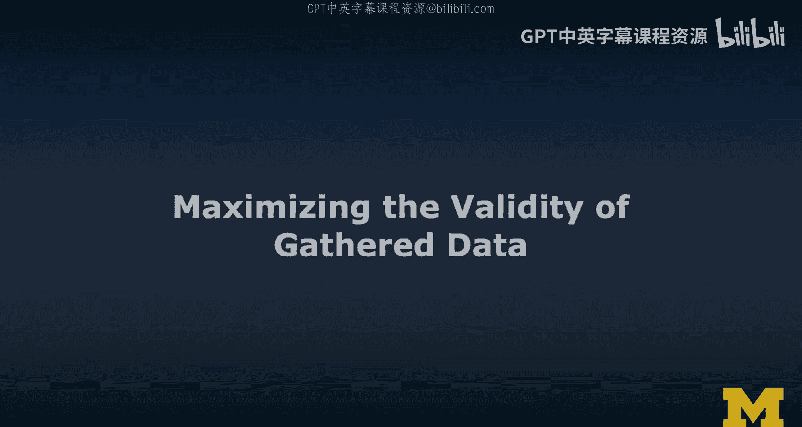
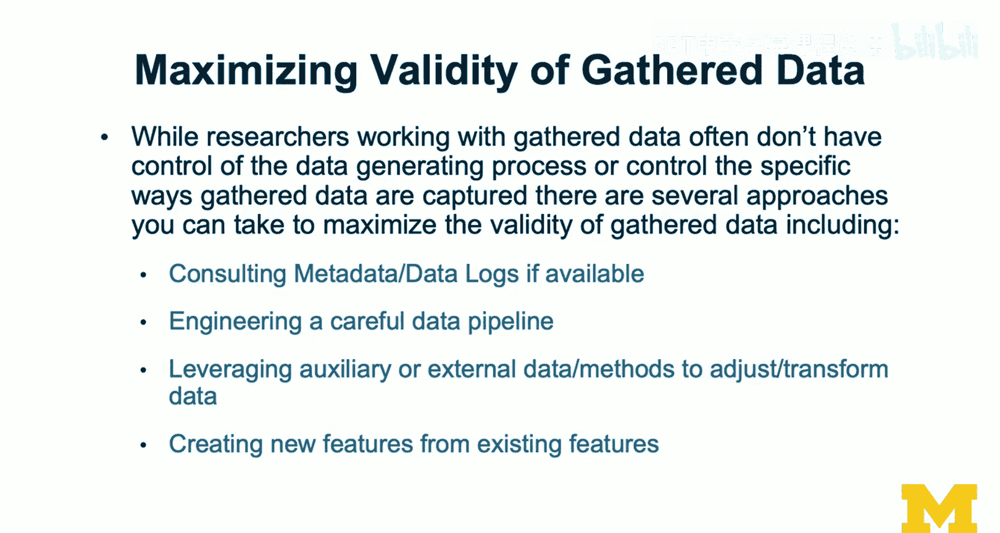
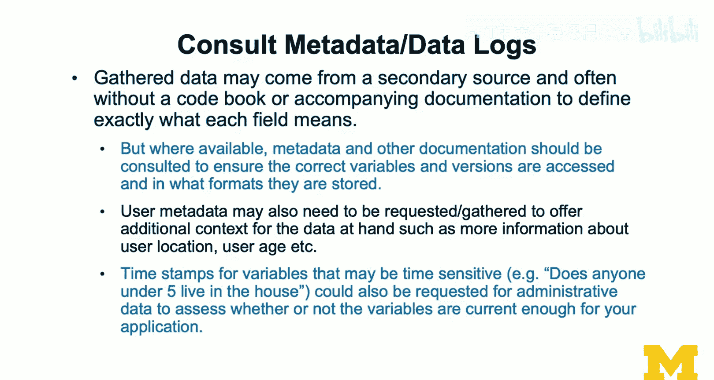
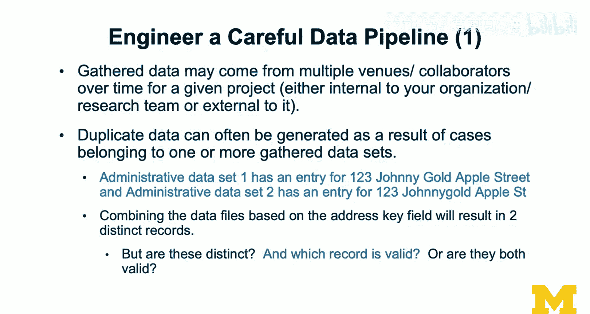
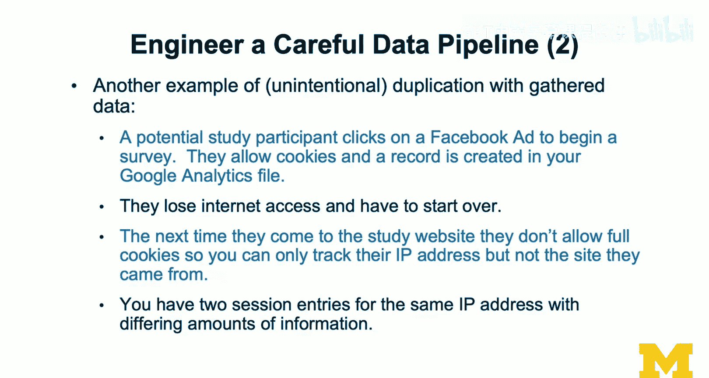
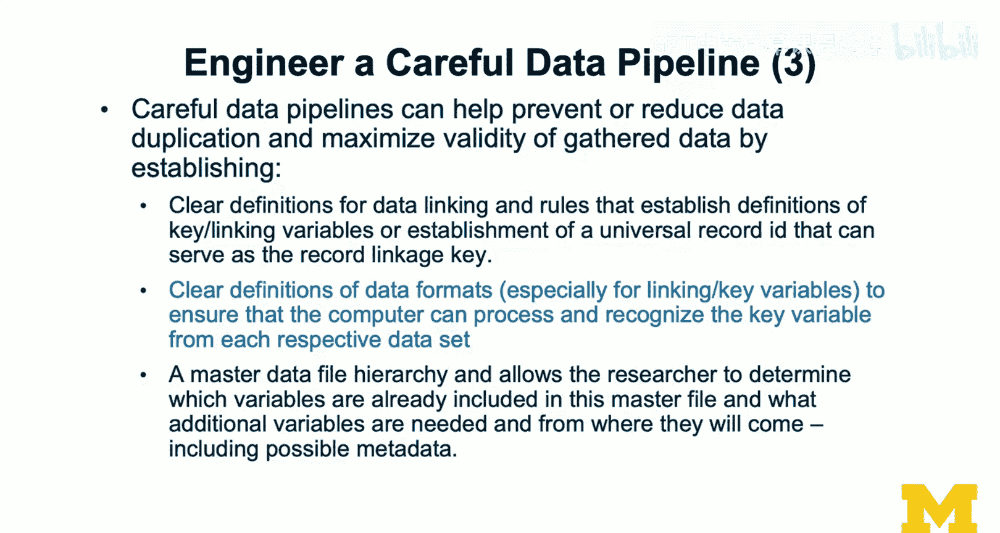
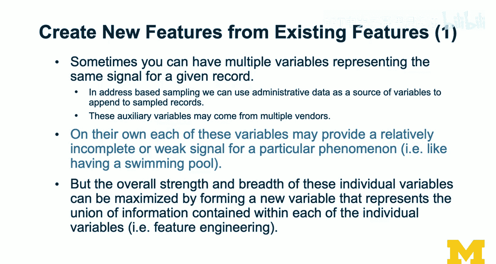
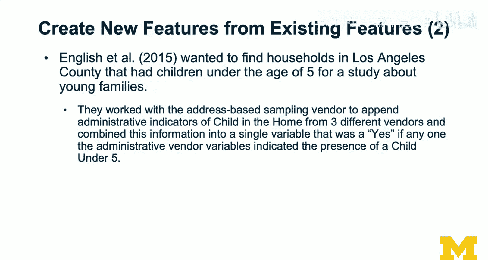
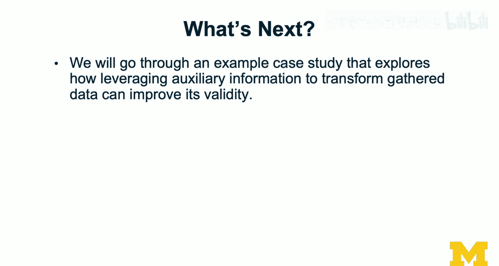

# 密歇根大学《总体数据质量（框架、度量、设计策略）total data quality》 p76 3_最大化采集型数据的效度.zh_en -BV1Jn4y1X7uS_p76-

Hello， welcome to our lecture on maximizing the validityity of Ga data， I'm Trenm Uskirk。

 it's great to have you here。

Just as we do in every one of these lectures， want to give you a picture of where we are in the overall framework and what we're going to be discussing today。

 we're on the measurement side of the framework and we are going to be talking about ways to maximize validity of gathered data in particular。

 researchers working with gathered data often do not have control of the data generating process or control of the specific ways the gather data are captured。

But there are several approaches that you can take to maximize the validity of gathered data。

 including consulting the metadata or data logs if they're available。

 engineering a careful data pipeline。Leveraging auxiliary or external data methods to adjust or transform data in particular。

And creating new features from existing features， we're going to take each of these in turn in this lecture。

 and hopefully this will give you a few other options for maximizing the validity of gathered data。😊。

Gathered data may come from a secondary source and often without a codebook or any accompanying documentation。

Keep in mind that print one of the key aspects of gathered data is that it's gathered。

 you may not have had complete control over the full process by which that data came to be。

 you may also not have clean labels or a beautiful data set that you might be used to working with with clear definitions of what each variable represents and how they were measured。

But in some cases， metadata may be available for gathered data and other documentation could be available that should be consulted。

To ensure that the correct variables and versions are accessed in and in what formats they are stored。

 this metadata will be very valuable if and when it's available。

 and you should definitely think about consulting it in order to make clearer and understanding of what those variables represent how they were measured and perhaps when they were updated。

 Use metadata may also be requested or gathered to offer additional context for the date at hand。

For example， if you are to gather tweets using an API for example， on Twitter。

 you would gather the text of the tweet itself as a normal part of that process。

 but there is additional user metadata that are available in the payloads if they are requested that could include information about the user's bio。

 their location and other aspects of their Twitter presence like the number of followers or the number of people they're following。

 but this metada data doesn't come automatically， and you have to be mindful to request it in your API call。

Timetamps for variables that may be time sensitive， like， for example。

 does anyone under the age of five live in your household could also be requested from administrative data to access whether or not the variables are current enough for your application。

We talked in an earlier lecture about the currency or timeliness metrics that could be used for measuring the quality of data of gathered data。

This is one of these examples where gathering this information could be very useful for you to make a decision as to whether or not this particular variable can meet your needs。

 I'm going to talk a little bit now about engineering a careful data pipeline。

 And there are a few slides here。 And so after we get through these slides。

 you should be able to have a better understanding about what a data pipeline is。

We're going to describe some of the issues that might occur and then sort of talk more specifically about what a data pipeline can provide you。

Gathered data may come from multiple venues or collaborators over time for a given project。

 it may require multiple sources of information to be gathered and put together in order to meet your study's needs。

Duplicate data， though， can often be generated as a result of cases belonging to one or more of these gathered dataset sets。

 For example， administrative data set number one has an entry for 1，2，3。 Johnny Gold， Apple Street。

 an administrative data set number 2， has an entry for 1，2，3， Johnny Gold， Apple Street。

 but these two entries appear to be the same location。 But in general。

 if you were trying to match these with an exact match on the address field， for example。

It is very likely that these would be considered two different records because of the way that the street is spelled and also because of the way that we've abbreviated the street symbols。

 depending on your matching algorithm or the way that you link these records together。

 You may or may not think these are the same record？

 The idea is the question really that you have to ask， is， are these distinct。

 which record is valid or are they both valid。 In other words。

 does the street spelled with two words， Johnny and gold。

 Is that the same as the street with a compound word。One would think it probably is the same。

 but these are questions that might occur that you might not have thought about beforehand when you go to merge these data。

 Now it's very easy to look at this one example and make a decision but imagine having administrative dataset sets of thousands upon thousands of records that you can't possibly scan every pair or triple of records that appear to be somewhat consistent or somewhat overlapping or duplicating。

 So the ability to create a data pipeline to automate some of these things with clear decision rules to decide whether or not records are distinct or whether they match is a really critical part of combining multiple data sources with the potential of having different formatting for information in a key matching field like a address。

Another example of unintentional duplication with gathered data could come from people trying to make multiple attempts to complete a survey exercise online。

 For example， a potential study participant clicks on a Facebook ad to begin a survey。

 they allow cookies， and so by the allowance of cookies。

 a record can be created in your Google Analytics file。Then while taking the survey。

 they lose internet access and have to start over。The next time they come to the study website。

 they don't allow full cookies。So you can only track their I address。

 but not the site from which they come。 So in this case。

 you have actually two session entries for the same IP address with differing amounts of information。

 And depending on the amount of information that is there。

 you may not be able to link those records in the end。

 So this creates a potential duplication that is unintentional for sure。

 but is technical in nature because one time the respondent allowed cookies the other time the respondent didn't allow cookies。

 This happened to us on a study recently， and we really had some issues being able to track which respondents actually matched which responses。

 in part， because of this cookie problem。😊。

Careful data pipelines can help prevent or reduce data duplication。

 and they can help maximize validity of gathered data by establishing clear definitions for data linking and rules that establish the definitions of key linking variables or the establishment of a universal record ID that can serve as the basis for record linkage。

Similar to what we talked about before， do I use the address to link these records together or do I use some sort of universal ID1。

2，3，4 matches 1234， those records link careful data pipelines can also establish clear definitions of data formats to ensure that the computer can process and recognize the key variable from each respective data if you've ever tried to merged small datas on your own where one dataset set had an ID that was an alphanumeric code and it was stored as text and another variable had that similar code which was all stored as numbers and you tried to link them。

 it is very possible that the software could not recognize those two variables or similarities in those two variables simply because the formats were different。

 not because the contents were different so being able to make sure that the formats match on the key variables when you go to do this is part of the establishment of a data pipeline and the rules that come along。

With that。The data pipeline can also help establish a master data file hierarchy and allows researchers to determine which variables are already included in the master file and which variables are which additional variables are needed and from where those variables are to come。

 including possible metadata， so you have say a core corpus of data and you're going to append information to this corpus in a certain hierarchy or rules or steps。

 so this data pipeline helps establish what these rules are and what the basis of these matches are。

I now want to talk a little bit about how you can leverage auxiliary or external data methods to help adjust or transform data in order to maximize the validity of gathered data。

Often， data are accurate， properly recorded and represented in a gathered data set。

 but are not maximizeimd for use for a given study objective。 In other words。

 somebody else was gathering this data as part of a totally different purpose。

 And you see this data as an opportunity to learn something new。

 but those variables may not have been optimized for that particular purpose。 however。

You could apply a transformation to these data to maximize their utility and validity for a given task for your own research。

 For example， when personal accelerometers are worn by study participants to track physical activity。

 what is recorded is not the likely activity。 but rather， a series of time dependent movement data。😊。

That has been has to be translated into usable and valid measures of physical activity。

 as described by Figo and colleagues in 2010。 So， for example。

 if I'm trying to figure out if you are sitting or if you're standing。

I don't get a variable called sitting or standing in a gathered data set with physical activity。

 What I get is a series of blips or signals to indicate how much movement is happening。

 That information has to be translated into some type of variable that matches your study objective。

 In this case， you might need to convert all of that movement data into a variable that is indicating whether or not the person is standing or sitting。

 Another thing that you can do to maximize the validity of gathered data is to create new features from existing features。

 Sometimes you can have multiple variables representing the same signal for a given record。

 In addressbased sampling， for example， we can use administrative data as a source of variables to append to sample records。

 So A B S file or the address file is the main file and we can append additional information about each of those addresses to the file。

 these so called auxiliary variables may come from multiple then。😊。

And may represent the exact same phenomenon。On their own。

 each of these variables may provide a relatively incomplete or weak signal for a particular phenomenon。

 for example， like whether or not a house has a swimming pool。For example。

 vendor1 may only cover a third of the records， vendor2 may cover two- thirdhirs of the records。

 and vendor3 may cover 80% of the records， so on their own。

 none of these vendors provides a complete picture of the swimming pool status of the households in my addressbased sample frame or in my addressbased database。

 but by adding information from multiple sources， I can cover a wider array of the cases in my dataset to maximize the validity of this particular variable do you have a swimming pool。

The overall strength and breadth of these individual variables can be maximizeimd by forming perhaps a new variable that represents the union of information contained within each of the individual variables。

 This is an example of engineering a feature or creating a variable from existing variables。

English and colleagues in 2015 wanted to find households in Los Angeles County that had children under the age of five for a study about young families。

As you can imagine， finding families that have a kid under the age of five may be difficult without additional information about that kind of household composition。

They worked with address based sampling vendors to append administrative indicators of child in the home from three different vendors。

 They combine this information into a single variable that was equal to yes。

 if any one of the administrative vendor variables indicated the presence of a child under the age of five。

The taking of this union increased the sensitivity or the true positive rate or the reach of this information of this particular variable that could then be used to figure out eligibility for households in their sampling frame for being able to hone in on the particular audience or target population that they were really interested in that was families with children under the age of five。

As you can see， information from the first vendor was only about 43% sensitive or had a true positive rate of 43% that is that that information could correctly identify households with a child under the age of five。

 approximately 43% of the time。Vendor 2 had a lower rate of 26%。

 and vendor 3 had a moderate rate of 30% cent。 But when this information was combined。

 the overall combined single variable had a true positive rate of 67% cent。

The underlying prevalence of children under 5 in L A County was 19 per cent。

 So without any of this additional information， you had about a one in five chance of finding a house with a child under the age of  five。

 But with the information on this flag， the true positive rate increased to about 67 per cent。

 This one variable that was created from these additional variables that were appended from these three vendors actually improved the ability to use this information in the field to identify households with a child under the age of five before going to those households。

😊，In the next lecture， we're going to talk about an example case study that explores how leveraging auxiliary information to transform gather data can improve its validity。

 very much like what was done in the English at all study in 2015。

 I can't wait to share that information with you。 I look forward to seeing you next time。

 Thanks for being here。😊。

