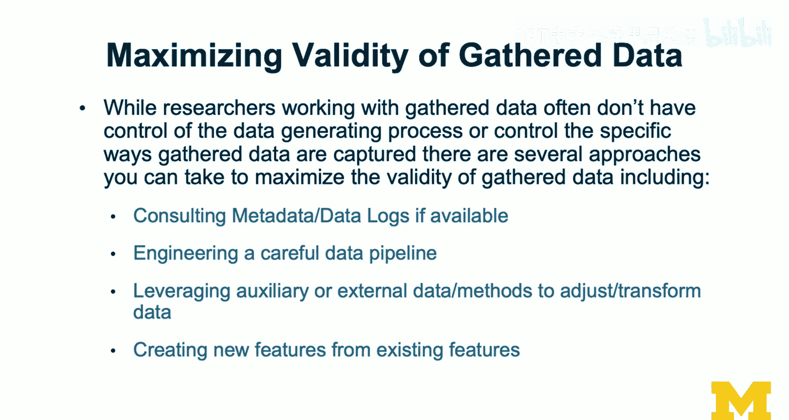
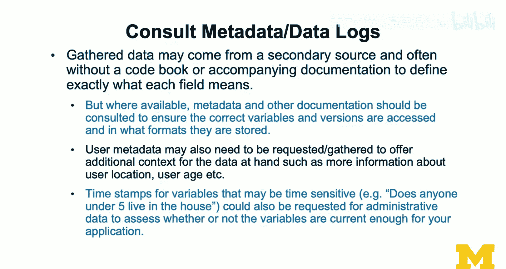
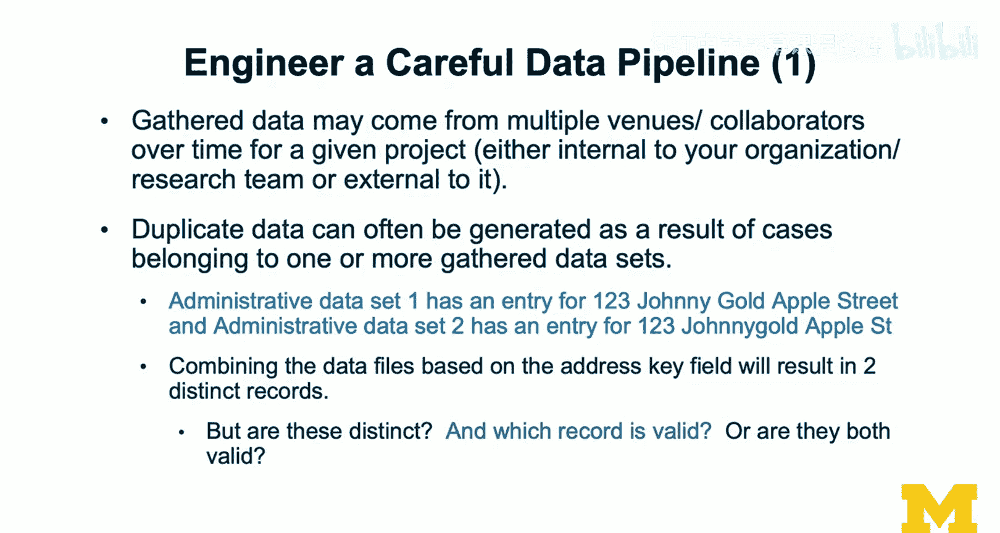
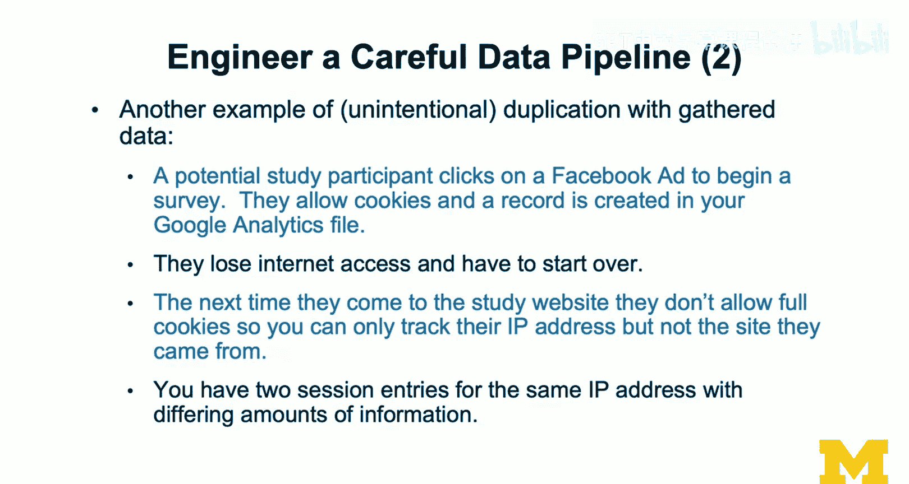
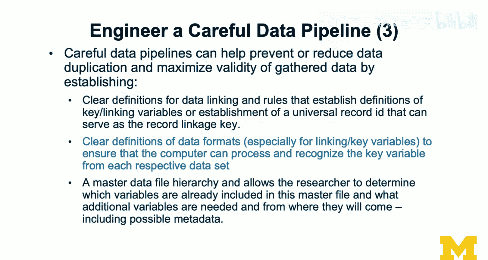
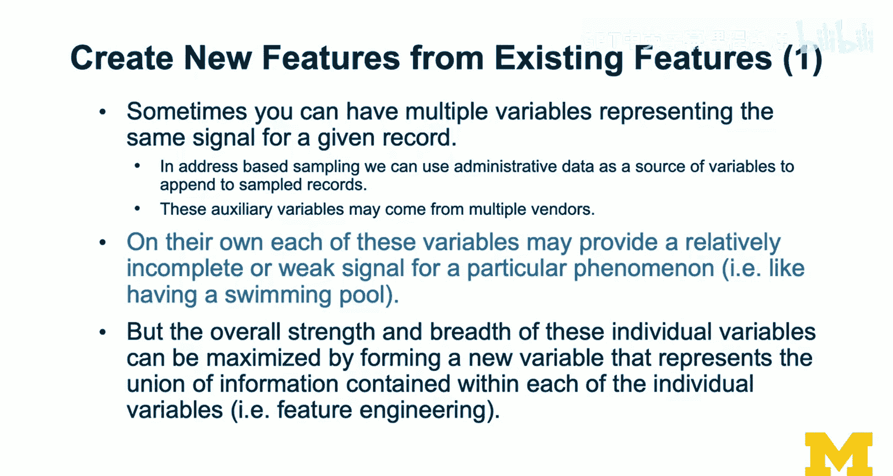
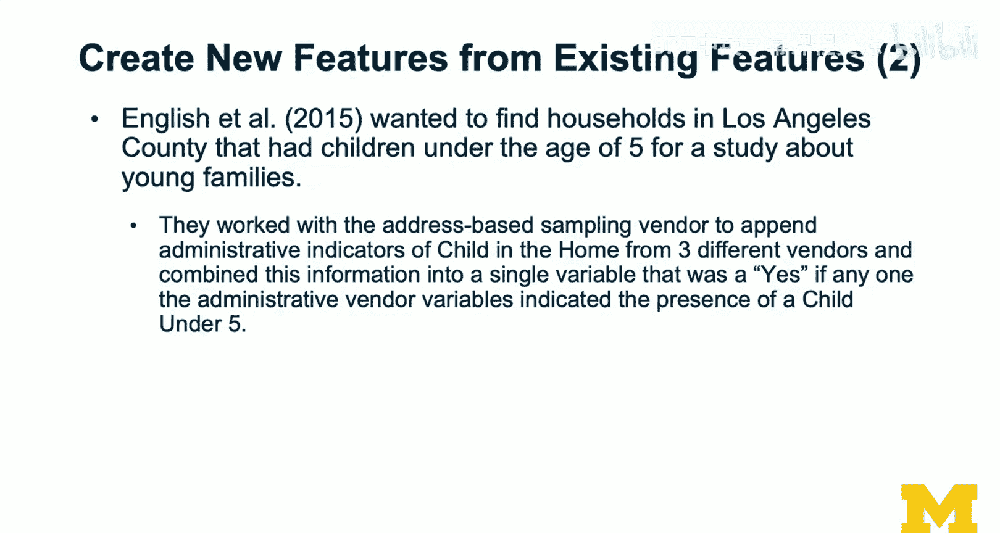
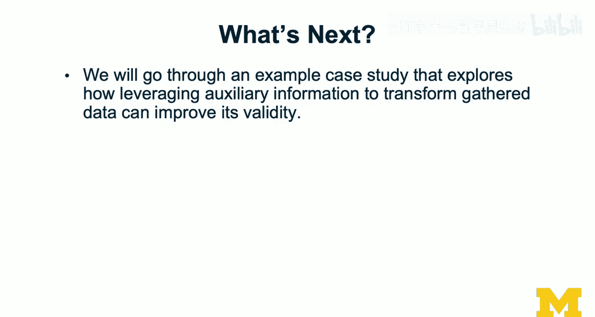

# 总体数据质量：3：最大化采集型数据的效度 📊

在本节课中，我们将学习如何最大化采集型数据的效度。采集型数据通常指研究者从外部来源获取的、而非自己直接生成的数据。由于研究者无法完全控制其生成过程，确保其效度（即数据准确测量其预期概念的程度）面临独特挑战。我们将探讨几种策略来应对这些挑战。

## 咨询元数据与数据日志 📄

上一节我们介绍了课程的整体框架，本节中我们来看看第一种策略：利用元数据。

采集型数据可能来自二手来源，且通常没有代码簿或任何随附文档。请记住，采集型数据的关键特征在于它是被“采集”的，你可能无法完全控制其生成的全过程。你可能也没有清晰的标签或定义明确的变量。

但在某些情况下，采集型数据可能提供元数据或其他文档，应当予以查阅。这可以确保访问正确的变量和版本，并了解其存储格式。如果可用，这些元数据将非常有价值。你应当考虑查阅它们，以更清晰地理解这些变量代表什么、如何测量以及可能何时更新。也可以请求或收集额外的元数据，为手头的数据提供更多背景信息。

以下是元数据应用的例子：

*   **社交媒体数据**：例如，通过API采集推文时，除了推文文本，你还可以请求包含用户简介、位置、关注者数量等信息的用户元数据。但这些元数据不会自动提供，你必须在API调用中明确请求。
*   **时间戳信息**：对于可能随时间变化的变量（例如，“您家中是否有5岁以下儿童”），可以从管理数据中请求时间戳，以评估变量对于你的应用是否足够“新鲜”。

我们在之前的课程中讨论过用于衡量数据质量的“时效性”指标。收集此类信息对于你判断特定变量是否能满足需求非常有用。

## 设计严谨的数据管道 🔄

接下来，我们将探讨如何通过设计严谨的数据管道来提升数据效度。

采集型数据可能来自多个渠道或合作方，可能需要整合多个信息源以满足研究需求。然而，重复数据常常因此产生，因为个案可能同时出现在多个采集的数据集中。

例如，两个管理数据集可能包含看似相同但格式略有差异的记录（如“Johnny Gold”街道与“JohnnyGold”街道）。如果仅基于地址字段进行精确匹配，它们很可能被视为两条不同的记录。当处理成千上万条记录时，手动检查所有可能的重复或重叠记录是不现实的。

另一个非故意重复的例子可能来自在线调查：参与者可能因网络中断而多次尝试完成调查，由于cookie设置不同（一次允许，一次不允许），系统可能基于IP地址生成多个会话条目，但信息量不同，导致难以链接，从而产生潜在的技术性重复。

严谨的数据管道可以帮助防止或减少数据重复，并通过以下方式最大化采集型数据的效度：

以下是数据管道可以建立的关键规则：

*   **明确数据链接定义**：建立关键链接变量（如地址、ID）的清晰定义和匹配规则，或建立一个通用的记录ID作为链接基础。
*   **统一数据格式**：确保关键变量在各数据集中的格式一致，以便计算机能够处理和识别。例如，确保ID字段同为文本格式或同为数字格式。
*   **建立主数据文件层次结构**：允许研究者确定主文件中已包含哪些变量，还需要从何处添加哪些额外变量（包括可能的元数据），并按照一定的规则或步骤进行追加。

## 利用辅助或外部数据方法进行调整 🔧

现在，我们来看看如何利用辅助或外部数据方法来调整或转换数据，以最大化其效度。

通常，采集型数据中的数据是准确且被正确记录的，但可能并未针对特定的研究目标进行优化。换句话说，这些数据最初是为其他目的收集的。你可以对这些数据应用转换，以最大化其对你研究任务的效用和效度。

例如，当研究参与者佩戴个人加速度计来追踪身体活动时，记录下的不是具体的活动类型，而是一系列随时间变化的运动数据。这些数据必须被翻译成可用且有效的身体活动测量指标，正如Figo及其同事在2010年所描述的那样。因此，你可能需要将所有运动数据转换为一个指示人是坐着还是站着的变量。

## 从现有特征创建新特征 🆕

最后，我们探讨通过从现有特征创建新特征来提升效度。

有时，对于给定记录，你可能拥有多个代表相同信号的变量。例如，在基于地址的抽样中，我们可以使用管理数据作为变量来源，将其附加到样本记录上。这些所谓的辅助变量可能来自多个供应商，并且可能代表完全相同的现象。

单独来看，每个变量对于特定现象（例如，房屋是否有游泳池）可能提供相对不完整或微弱的信号。供应商1可能只覆盖三分之一的记录，供应商2覆盖三分之二，供应商3覆盖80%。单独使用，没有一个供应商能提供完整的画面。

但是，通过整合多个来源的信息，我可以覆盖数据集中更广泛的个案，从而最大化这个特定变量的效度。通过形成一个代表各个单独变量所含信息**并集**的新变量，可以最大化这些个体变量的整体强度和广度。

这是一个特征工程或从现有变量创建新变量的例子。English及其同事在2015年的一项研究中，希望找到洛杉矶县有5岁以下儿童的家庭。他们与基于地址的抽样供应商合作，从三个不同供应商那里附加了关于家中是否有儿童的管理指标。他们将此信息合并成一个单一变量：如果**任何一个**管理供应商的变量表明存在5岁以下儿童，则该变量等于“是”。

取这个并集提高了该变量的**灵敏度**（或真阳性率），从而能更有效地用于确定抽样框中家庭的资格，以便精准定位他们真正感兴趣的目标人群——有5岁以下儿童的家庭。

如图所示，第一个供应商的信息灵敏度仅为43%，第二个为26%，第三个为30%。但当这些信息合并后，新的单一变量的真阳性率达到了67%。洛杉矶县5岁以下儿童的基础比例是19%。在没有这些额外信息的情况下，你只有大约五分之一的机会找到有5岁以下儿童的家庭。但有了这个合并后的标志，真阳性率提高到了约67%。这个从三个供应商附加的变量中创建的新变量，显著提高了在实际操作中识别目标家庭的能力。

## 总结 📝

本节课中，我们一起学习了最大化采集型数据效度的四种核心策略：
1.  **咨询元数据与数据日志**：充分利用可用文档理解数据背景和定义。
2.  **设计严谨的数据管道**：建立清晰的规则来处理数据链接、格式和层次结构，防止重复并确保一致性。
3.  **利用辅助数据进行调整**：通过转换或调整数据，使其更贴合特定的研究目标。
4.  **从现有特征创建新特征**：整合多个弱信号变量，形成一个更强、覆盖更广的新变量，如通过取**并集**来提升信息的完整性和灵敏度。

在下一讲中，我们将通过一个案例研究，深入探讨如何利用辅助信息来转换采集数据，从而显著提高其效度，类似于English等人2015年的研究。