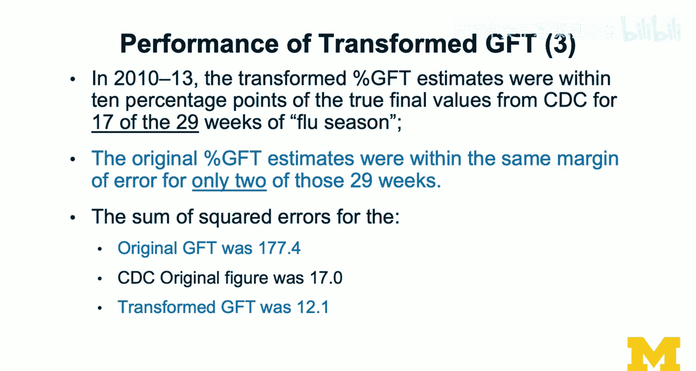
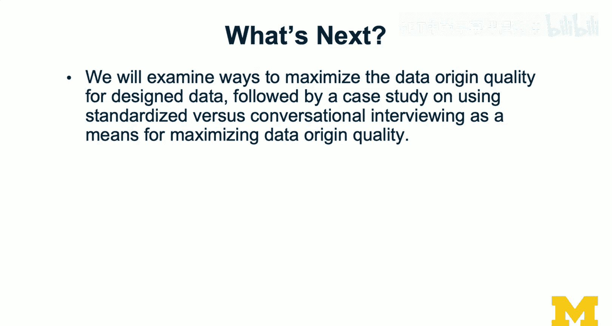

# 密歇根大学《总体数据质量（框架、度量、设计策略）total data quality》 p77 4_案例研究：利用辅助数据提升采集数据效度.zh_en -BV1Jn4y1X7uS_p77-

Hello， welcome to our case study where we're going to talk about improving the validity of gathered data。

 using auxiliary data。 I'm Trent Buskirk。 It's great to have you here。 In course 1。

 we looked at a few articles related to the Google F trendsrens example for how big data worked until it didn't。

😊。

Lzar and colleagues in 2014 discuss reasons why the Google flu Trans methods stop working over time。

So called big data hubris， where more data is better is not always the case。

They also found that exclusion of potentially helpful keywords and lack of transparency around the final set of keywords used in the model。

 Lazar and colleagues in 2014 discussed reasons why the Google flu trends methods stopped working over time。

 They noted that so called big data hubris， where more data is better is not always the case。

 Exlusions of potentially helpful keywords and lack of transparency around the final set of keywords used in the model。

 There actually were 45 of them。😊，Algorithmic dynamics and changes to how search engines work over time was also a noted issue for why the Google F trendsrends might have stopped working。

More recently， Martin and colleagues in 2015 published an open source article examining how Google F Trans data could be improved for the US using a transformation based on CDC historical data。

 Here's the reference for you。 In this case study we're going to be talking about this article。

 Martin and colleagues used the Google Trans data for  a hundred47 weeks between 2009 and 2013。

 representing estimates that were obtained after Google recalibrated their algorithm in 2009。

 But before they applied a subsequent recalibration in 2013。

 So they tried to keep the period of Google F Trans data collection to be relatively consistent with how the algorithm was working at that time。

 They also used two variables from influenza like illnesses or I L I for short。

 from Sentinel surveillance data from the IL I met that is published by CDC over the same time。😊。

Including these variables， the first variable one is PLI net。

 which represented the preliminary values for a given week available from fluview influenza surveillance reports。

 The second variable was F ILI net。 which represented the final flu values for a given week certified and released by CDC as official statistics。

 specifically， they leveraged these preliminary estimates and final statistics from CDC along with the weekly Google flu trend data and created a transformation that assumed relative changes in the CDC values from a prior week would be proportional to those from the Google flu trends data In formula form。

 We see this is the kind of relationship that they were trying to model。So on the left side。

 we see a formula that represents the relative changes in the CDC values from a prior week。

 On the right side， we see the relative changes in GFT values from a prior week。

 The C constant is what they were estimating using a regression equation with regression through the origin。

With no intercept assumed。In their work， they estimated this constant to be 0。65。

 using a simple linear regression model with no intercept， As I mentioned。

 by using the estimated value of the proportionality constant， the 0。65。

 Martin and colleagues transformed the GFT data using the reranged equation。

 We are simply solving for F I L I net hat， if you will。

 in the prior equation to get an updated estimate。 So we're going to call this updated estimate the transformed Google flu trans value。

 and that is essentially going to be an estimated final influenza like value。

 it is a function of the prior week from CDC， and the Google flutrans data from the current week and the prior week。

 using these transformed GFT values， Martin and colleagues recasted the time series estimates for influenza like illnesses over the time period that we talked about between 2009 and。

2013。And here's what the recasting looks like。 So in the dark blue line。

 you see the actual final I L I net from CDC。 That's the thing that we're trying to estimate The red line is the the original Google Ftrans line。

 You can very clearly see that the period to the left of 2013。 The Google Ftrans worked。

 until it didn't， which is where you see the peak from 2013 onward。

But you notice that the Google flu trends in red is not as close to the dark blue line as the very。

 very light colored blue line。 The light colored blue line here represents the transformed Google flu trends estimates。

 This transform uses a combination of CDC data from the week prior and Google F trends data from the week prior and the current week to make these new estimates that we see in the light blue line。

Essential， we've created a transformed Google flu trends value where we've incorporated auxiliary data from CDC in a very simple linear equation。

😊，In 2010 to 2013， the transformed Google flu trend estimates were within 10 percentage points of the true final values from CDC for 17 of the 29 weeks of the flu season。

 The original GFT estimates were within the same margin of error for only two of those 29 weeks。

The sum of squared errors for this was the original GFT。 the sum squared errors was 177。

4 over the time period。 The CDC original figure was 17， and the transformed Google flu trends was 12。

 You can see here the power of adding a transformation and auxiliary variables into the gathered data space for improving estimation or to maximize the utility of these gathered data for making estimates。

 This is a very interesting example for how combining administrative data or official data with gathered data can actually improve the utility and quality of the gathered data。

 We hope this was as interesting to you as it was for us when we read it。😊。

Next， we're going to examine ways to maximize the data origin quality for design data。

 followed by a case study on using standardized versus conversational interviewing as a means for maximizing data origin quality。

 We hope to see you there。 Thanks for joining us。

