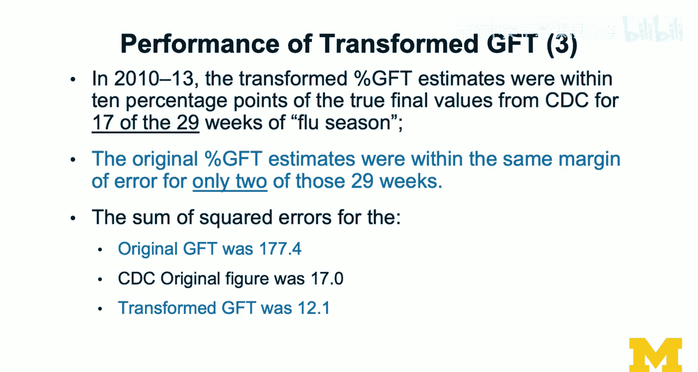
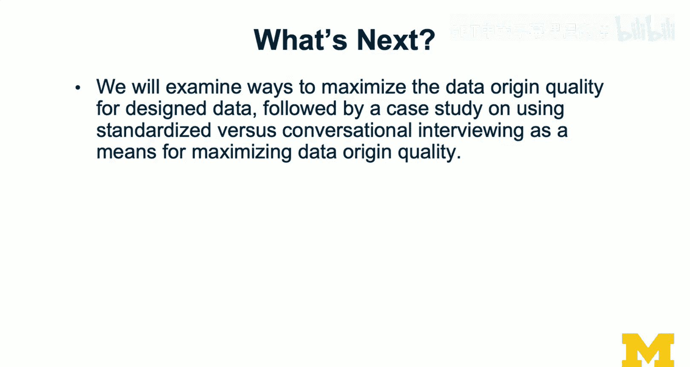

总体数据质量：4：案例研究：利用辅助数据提升采集数据效度 📊


在本节课中，我们将学习一个具体案例，探讨如何通过结合辅助数据来提升采集数据的效度，从而改善预测模型的准确性。

---

在上一节课程中，我们讨论了数据质量的不同维度。本节中，我们将通过一个关于谷歌流感趋势（Google Flu Trends, GFT）的案例，来具体看看如何利用辅助数据解决采集数据效度不足的问题。

拉扎尔及其同事在2014年分析了谷歌流感趋势预测方法随时间推移失效的原因。他们指出了几个关键问题：所谓的“大数据傲慢”（即认为数据越多越好）并非总是成立；模型可能排除了潜在有用的关键词；并且模型最终使用的关键词集缺乏透明度。此外，搜索引擎算法的动态变化也是导致GFT预测失效的一个因素。

最近，马丁及其同事在2015年发表了一篇开源文章，研究如何利用基于美国疾病控制与预防中心（CDC）历史数据的转换方法来改进谷歌流感趋势数据。接下来，我们将详细探讨这项研究。

马丁团队使用了2009年至2013年间共147周的谷歌流感趋势数据。这些数据是在谷歌于2009年重新校准其算法之后、但在2013年进行下一次校准之前收集的，目的是保持数据收集期间算法运作的相对一致性。

他们还使用了来自CDC在同一时期发布的流感样疾病（Influenza-Like Illness, ILI）哨点监测数据的两个变量：
*   **`PILI.net`**：代表从流感监测报告中获得的给定周的初步估计值。
*   **`FILI.net`**：代表CDC认证并发布的给定周的最终官方统计值。

具体而言，他们利用CDC的这些初步估计值和最终统计数据，以及每周的谷歌流感趋势数据，创建了一个转换模型。该模型假设CDC数值相对于前一周的变化，与谷歌流感趋势数据的变化成比例。

用公式表示，他们试图建模的关系如下：

```
[ (FILI.net_t - PILI.net_{t-1}) / PILI.net_{t-1} ] = C * [ (GFT_t - GFT_{t-1}) / GFT_{t-1} ]
```

公式左边代表CDC最终值相对于其前一周初步值的相对变化。右边代表GFT值相对于前一周的相对变化。常数 **`C`** 是他们通过一个**无截距的过原点回归方程**估计得出的。

在他们的工作中，通过一个简单的无截距线性回归模型，估计出这个比例常数 **`C`** 的值为 **0.65**。

利用这个估计出的比例常数0.65，马丁团队对原始GFT数据进行了转换。他们实质上是在求解上述方程，以得到更新后的估计值 **`FILI.net_hat`**。

我们称这个更新后的估计值为“转换后的谷歌流感趋势值”。它本质上是基于前一周的CDC数据、当前周和前一周的GFT数据，所估计出的最终流感样疾病值。

使用这些转换后的GFT值，马丁团队重新绘制了2009年至2013年期间的流感样疾病时间序列估计图。

以下是重绘结果的图示：
*   **深蓝色线**代表CDC发布的实际最终`FILI.net`值，这是我们要估计的目标。
*   **红色线**代表原始的谷歌流感趋势估计值。可以清楚地看到，在2013年之前，GFT预测是有效的，但在2013年之后出现了显著的预测峰值，偏离了真实情况。
*   **浅蓝色线**则代表转换后的谷歌流感趋势估计值。这条线非常贴近深蓝色的真实值线。

本质上，我们通过一个简单的线性方程，将来自CDC的辅助数据整合进来，创建了一个转换后的GFT值。

在2010至2013年的流感季期间，转换后的GFT估计值在29周中有17周，其误差在CDC最终真实值的10个百分点以内。而原始的GFT估计值在相同误差范围内只有2周。

在整个研究时间段内，原始GFT估计的误差平方和为177.4，CDC初步值的误差平方和为17，而转换后的GFT估计的误差平方和仅为12。

这个案例清晰地展示了，通过在采集数据中引入转换模型和辅助变量，可以显著提升估计的准确性，从而最大化采集数据用于估计的效用。这是一个结合行政/官方数据与采集数据，以提升后者效用和质量的非常有趣的范例。



---


本节课中，我们一起学习了一个具体案例，了解到谷歌流感趋势预测如何因数据效度问题而失效，以及研究人员如何通过整合CDC的辅助数据，建立一个简单的比例转换模型，显著改善了预测的准确性。这说明了利用高质量辅助数据来校准和提升采集数据价值的重要性。




接下来，我们将探讨如何最大化数据来源质量的设计方法，并有一个关于使用标准化访谈与对话式访谈的案例研究。我们下节课再见。