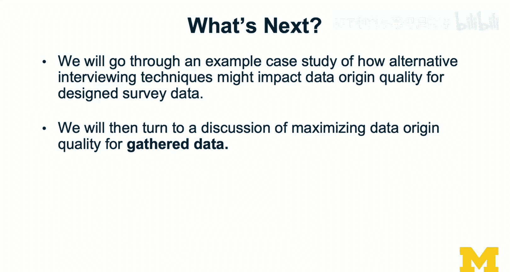

# 密歇根大学《总体数据质量（框架、度量、设计策略）total data quality》 p78 5_最大化设计型数据溯源质量.zh_en -BV1Jn4y1X7uS_p78-

Okay， hello， now we're going turn our attention to maximizing data origin quality for design data。

 So now we're shifting our attention from a study of validity to the study of data origin and how to maximize data origin quality。

 specifically when we're talking about design data。

 So thinking back to our big picture of the total data quality framework。

 Now we're turning our attention to data origin as one of the measurement dimensions， again。

 going from a variable or field that you have in a questionnaire to the actual data values that are generated。

 And how do we maximize data origin quality at this stage of the total data quality framework。 Okay。

 so building out what we've talked about in previous courses。

 now we're going to talk about different adjustment strategies that can be used if there are problems with data origin quality in an effort to maximize that data origin quality。

 So we talked a lot about interview effects is being an important issue with design data in prior courses。

And we talked about how to measure interviewer effects if they're suspected in an interviewer administered data collection where the interviewers are the ones asking the questions and recording the responses。

 So when we're thinking about maximizing and not just measuring data origin quality。

 but maximizing data origin quality， there are techniques that we can use to adjust our survey estimates and our corresponding inferences for those interviewer effects that we measured as a part of the data origin process。

 Now， if we're given estimates of these interviewer variance components from our data。

 we can use these estimates to actually adjust our survey estimates。

 and there's examples of this in paper that I worked on with Mike Elliott in 2015 and then another paper by one of our graduate students。

 Miha Fisher in 2019。 First of all， if we're doing descriptive analysis So our interest is in computing means of variables or computing estimates of proportions for binary variables。

 things like that， we want to make sure that in analysis。

 the standard errors of our estimates reflect。Clustering of the data by the interviewer so first and foremost。

 if we have an interviewer ID code in the dataset and it's apparent that interviewer effects exist for some of our variables of interest。

 when we do the analysis。 and we actually report our estimates。 our means or proportions。

 We want to make sure that we're using procedures that will ensure that our standard errors of those survey estimates are computed correctly to reflect the fact that data collected by the same interviewer tend to be correlated with each other。

 If interviewer effects are an issue。 So one approach to doing this as a socalled designbased approach we could treat the interviewer I like a sampling cluster using functions like the survey mean function in the survey package of the our software。

 this allows us to account for cluster I variables and make sure that our standard errors reflect similarity of observations within the same cluster。

 an alternative approach， which would be a so-called modelbased approach is to fit a multilevel model that includes random interviewer effects。

 So again。We have that interviewer ID variable in our dataset。

 We can fit a multilevel model that includes random effects associated with this interviewer ID variable and then estimate an intercept only model to get an estimate of the mean on our variable of interest。

 where that standard error again will be adjusted correctly for any clustering within those interviewer ID code。

 So both of these would be equally valid approaches to make sure that we're adjusting our inferences for the presence of clustering by interviewer and of course。

 both of these approaches also require having that interviewer ID present in your data。

 So that's always something important to look for， especially when you're downloading data and doing a secondary analysis data that have already been collected if you're collecting your own original data it's best to help data users by including that interviewer ID so that they can adjust for this type of clustering in their analyses When we're thinking about regression analyses now。

 not just descriptive estimates， but estimating regression coefficients in a model based on。

DaIf we find that there are interviewer effects on a given predictor variable in that regression model。

 we'll just call that predictor variable X in this particular case after we fit that linear regression model。

 what we can do is divide that estimated regression coefficient for that predictor by one minus the intraclass correlation on that predictor variable X where that ICC is the intrainer correlation in the measures on that predictor variable we talked about how to measure that ICC in the prior course course2 of this specialization So for example。

 if an estimated linear regression coefficient for a predictor was 2。

0 and the estimated intrainer correlation or ICC on that predictor variable was computed as you see here So the between interviewer variance divided by the sum of the between interviewer variance plus the within interviewer variance。

 suppose that between interviewer variance was 5 and the within interviewer variance was 95 in this particular model being fitted we would simply take5。

Divided by the sum of those two variance components and the result there would be 0。05。

 Then we would adjust our estimated regression coefficient of 2。0 by dividing it by 1 minus0。

05 and the result of that adjustment is 2。11。 So that would be the estimated regression coefficient that we would report when summarizing our results。

 And you can see the point here， the interviewer variance in that predictive variable or the interviewer effects on that predictive variable。

 they're introducing bias in the estimate of that regression coefficient。

 they're shrinking that estimate in the direction of 0。 And of course。

 we want to avoid that due to interviewer effects in the predictive variable。

 So this is a handy adjustment that can be applied。

 if there's evidence of interviewer variance on key predictive variables。

 and you can see more details in that paper by Miha Fscher and colleagues。

 So additional adjustment strategies that we can think about in terms of maximizing data origin quality。

 we need to think about mode effects。 So remember we talked about measuring mode effects in the second course of this specialization if。

s are expected or present。 There's a literature on how to calibrate or adjust survey estimates if mode effects are present。

 and I've included a couple of the articles here， which are going to be in our reference list that talk about different strategies and analytic approaches that one can use to adjust estimates for the presence of mode effects。

 These approaches generally require the analyst to identify a benchmark mode， or in other words。

 the mode that's considered to produce the highest quality measures on a given variable of interest and then use statistical models to predict what people would respond with in that particular mode。

 So based on a model fitted to data from the highest quality mode。

 we can use that estimated model to develop predictions of what responses would have been on that mode for all the people who did not respond。

 in that particular mode and then use those predictions ultimately to make our inferences and compute our estimates and so forth。

 And again， there are more details about that。Of approach in these papers here。

Now there are not just adjustment strategies that are designed to maximize data origin quality and compensate for some of these issues that we've talked about previously with data origin。

 there are also design strategies， so if we think about the design of the overall data collection。

 these are strategies that we can use to maximize data origin quality before the data are even collected so one is to use audio computer assisted self interviewviewing or just computer assististed self- interviewviewing Cassie for especially sensitive questions and surveys so if you're asking about things like drug use and sexual activity and other kinds of sensitive behaviors。

 it's best to let the survey respond in self-administer these questions rather than have an interviewer try to ask these questions in a strictly face-toface setting we've included one article here that talks about this in detail but the main point here is that the use of self-administ for these especially sensitive questions prevent social desirability bias so in a lot of studies although an interviewer may ask several questions face to face。

The interviewer then allows the respondent to self administer。

 especially sensitive sections of the questionnaire so that the interviewer doesn't have the chance of affecting the responses to those particular questions。

 and this technique is designed to prevent social desirability bias。

 especially when these kinds of sensitive questions are being asked。Furthermore。

 better than trying to perform posttoc adjustments for interview effects using the strategies that we just discussed。

 it's better to spend a lot of resources on careful training of the interviewers that are going to be working on that survey。

 making sure they're very comfortable with the questionnaire。

 making sure they're very comfortable with how to handle respondent questions and confusion and also performing real-time monitoring of the data that the interviewers are collecting in addition to if possible collecting audio recordings of the interviewers that are actually being conducted to make sure that questions are being asked as intended and the interviewers aren't introducing any kind of effects that were unexpected on the responses。

 so these are design strategies in design data collections that can be very useful for removing some of these problems that arise at the data origin stage。

Okay， some other strategies that we can think about in terms of maximizing data origin quality for design data in the adjustment realm。

 regression calibration is possible and that can be used to correct estimates in the presence of known measurement error。

 Now this does require validation data for a subsample of the cases。

 So the idea is similar to what we are talking about with mode effects。

 if you have true values on a variable of interest we can actually regress the true values on available covariates and then make predictions of what those true values should be and compare them to the reported values which are suspected to be measured with error and then adjust the reported values based on those predictions。

 That's one approach。 Another approach is known as simulation extrapolation or Ss。

 This can be used to simulate what your survey estimates would look like if in fact。

 no measurement error was present and Kens Steonssky of a nice paper about this kind of Sax approach that they wrote back in 1994 this is a valuable technique that can be used to adjust overall estimates rather than the。

datata or the raw data that you've collected from a given survey。

 so also valuable for adjusting estimates for any kind of measurement error introduced at this data origin stage。

Additional design strategies， one idea especially to improve recall when survey questions are asking about past events that may have been long ago in the past is to use landmark events to orient respondents to a certain time in their lives where they're being asked about something that may have happened during that time period and there's a nice paper by Gake and colleagues about this kind of approach which proves to be very valuable when you're asking about retrospective information。

 Another design strategy is to encourage respondents to look up records for financial or factual questions。

 Joe Murphy and colleagues have a nice paper about this in 2016。

 this can help get more accurate responses for complex questions about these kinds of topics where a respondent might have records available that can provide them with information to give you more accurate response。

 And again， this is a design strategy that could be used。During the data collection。

 or you could plan for this as part of the data collection rather than trying to adjust the estimates and adjust the data after the fact to fix up some of these issues。

Okay， so in summary， some of these optimization strategies at the data origin stage involve posttac adjustment of estimates to account for data origin problems。

 These are things like adjusting for interviewer effects and Sax and regression calibration Other strategies involve careful design to prevent problems with the origin of the design data。

 So for example， careful interviewer training use of a cassie for especially sensitive questions。

 encouraging record use， these are all possible design strategies。 General。

 we want to use some combination of both of these kinds of approaches to correct for problems with data origin quality in design data。

 So what we'd be talking about next， we're going to go through an example case study of how alternative interviewing techniques might impact data origin quality for design survey data We're then going to turn to a discussion of maximizing data origin quality for gather data。

 Thank you。

