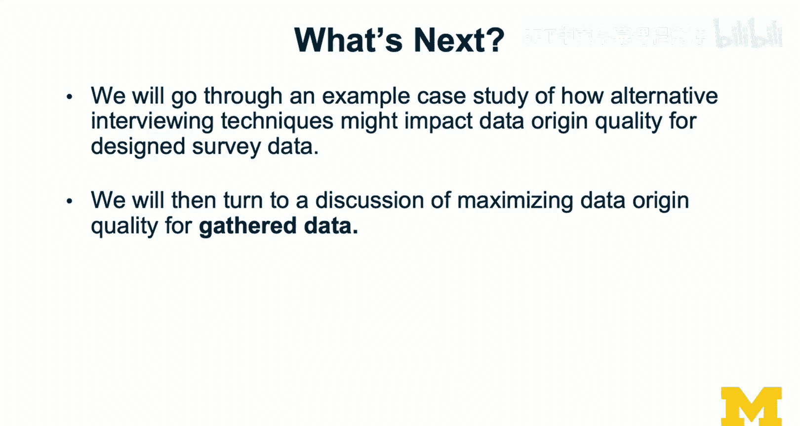

# 总体数据质量（框架、度量、设计策略）：5：最大化设计型数据溯源质量 📊

在本节课中，我们将学习如何最大化设计型数据（如问卷调查数据）的**数据溯源质量**。数据溯源关注从问卷中的变量或字段到最终生成的实际数据值这一过程。我们将探讨当数据溯源质量出现问题时，如何运用调整策略和设计策略来提升数据质量。

上一节我们讨论了数据有效性的研究，本节我们将注意力转向数据溯源，并探讨如何最大化其质量，特别是在处理设计型数据时。

## 调整策略：应对访问员效应

在之前的课程中，我们讨论了访问员效应是设计型数据的一个重要问题，并介绍了如何测量它。当我们不仅想测量，还想**最大化**数据溯源质量时，可以使用技术来调整我们的调查估计值及其推论，以应对已测量的访问员效应。

以下是两种主要的调整方法：

*   **基于设计的调整**：将访问员视为一个抽样聚类。例如，在R语言的`survey`包中使用`svymean`函数，可以指定访问员ID作为聚类变量，从而确保计算出的标准误能正确反映同一访问员收集数据之间的相关性。
*   **基于模型的调整**：拟合一个包含随机访问员效应的**多水平模型**。通过包含访问员ID作为随机效应，可以估计我们感兴趣的变量的均值，其标准误同样会针对访问员内部的聚类进行正确调整。

这两种方法都要求数据集中包含访问员ID变量，这对于进行二次分析的数据使用者至关重要。

## 调整策略：回归分析中的校正

当我们进行回归分析，而不仅仅是描述性估计时，如果发现某个预测变量X存在访问员效应，我们可以对回归系数进行校正。

**校正公式**如下：
`调整后的回归系数 = 原始回归系数 / (1 - ICC_X)`
其中，`ICC_X`是该预测变量X的**组内相关系数**（即访问员间方差占总方差的比例）。

**示例**：
假设一个预测变量的原始回归系数估计值为2.0，其ICC计算为0.05（例如，访问员间方差为5，访问员内方差为95）。则调整后的系数为：
`2.0 / (1 - 0.05) = 2.11`
这个调整可以纠正因预测变量存在访问员效应而导致的回归系数向0收缩的偏差。

## 调整策略：应对调查模式效应

如果数据收集存在多种模式（如面对面、电话、网络），并且出现了模式效应，我们可以通过统计模型进行调整。

基本思路是：
1.  确定一个**基准模式**，即被认为能产生最高质量测量的模式。
2.  基于基准模式的数据拟合模型。
3.  使用该模型预测所有未在基准模式下回答的受访者在该模式下的可能回答。
4.  利用这些预测值进行最终的推断和估计。

## 设计策略：预防数据溯源问题

除了事后调整，更好的方法是在数据收集**设计阶段**就采取措施，预防问题的发生。

以下是几种有效的设计策略：

*   **对敏感问题使用自填模式**：对于药物使用、性行为等敏感问题，采用**音频计算机辅助自访**或**计算机辅助自访**让受访者自行回答，可以有效避免因访问员在场导致的**社会期望偏差**。
*   **加强访问员培训与监控**：投入资源对访问员进行严格培训，确保他们熟悉问卷并能妥善处理受访者疑问。同时，实时监控收集的数据，并在可能时录制访问音频，以确保问题按预期提出。
*   **利用“地标事件”辅助回忆**：当询问过去很久的事件时，使用一些众所周知的“地标事件”来帮助受访者定位时间，从而提高回溯信息的准确性。
*   **鼓励查阅记录**：对于财务或事实类复杂问题，鼓励受访者在回答前查阅相关记录（如账单、文件），以提供更准确的信息。

## 其他调整技术

除了上述方法，还有两种重要的统计调整技术可用于纠正测量误差：

*   **回归校准**：当存在已知的测量误差时，如果有一个子样本具有该变量的真实值（验证数据），可以通过建立真实值与协变量之间的回归模型，来预测和校正其他样本的报告值。
*   **模拟外推法**：这种方法通过模拟来估计如果不存在测量误差，调查估计值会是什么样子。它是一种用于调整总体估计值而非原始数据的有效技术。

## 总结

本节课中，我们一起学习了最大化设计型数据溯源质量的多种策略。

*   **事后调整策略**主要用于纠正已出现的问题，例如针对访问员效应、模式效应进行校正，或使用回归校准、SIMEX等方法处理测量误差。
*   **事前设计策略**则侧重于预防问题的发生，例如精心培训访问员、对敏感问题采用自填模式、利用地标事件和鼓励查阅记录等。

通常，我们需要结合使用这两类方法，以最佳方式提升设计型数据的溯源质量。

接下来，我们将通过一个案例研究，探讨不同的访谈技术如何影响设计调查数据的数据溯源质量。之后，我们将转向讨论如何最大化**采集型数据**的溯源质量。