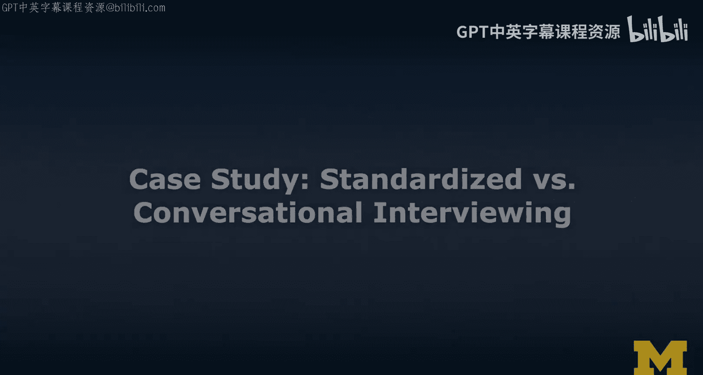
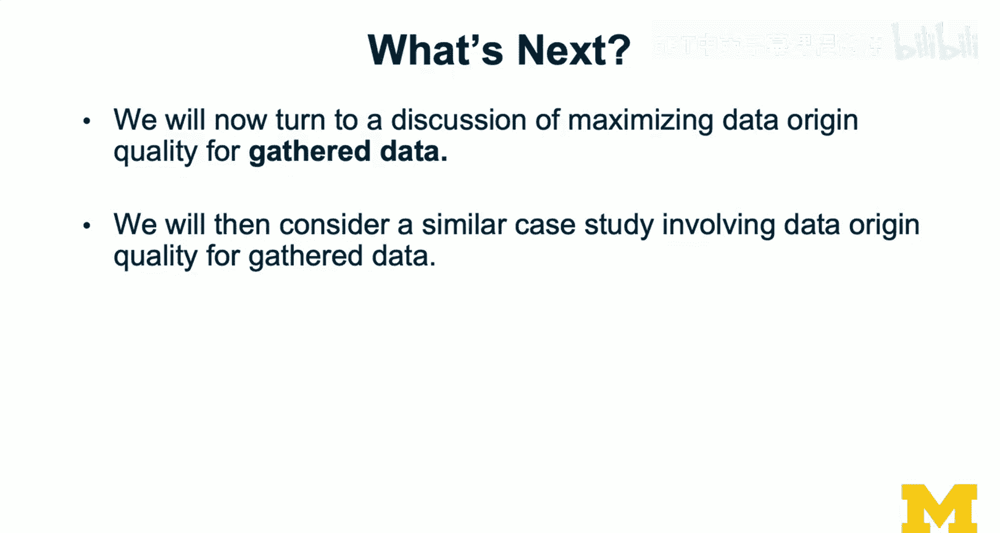
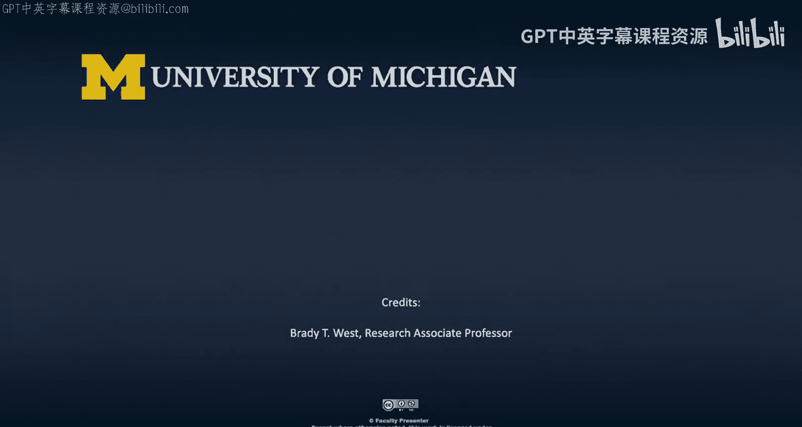

# 密歇根大学《总体数据质量（框架、度量、设计策略）total data quality》 p79 6_案例研究：标准化访谈与对话式访谈对比.zh_en -BV1Jn4y1X7uS_p79-

Alright， hello and welcome back。 Now we're going to turn to a case study that considers how to maximize data origin quality with a particular eye on interviewer effects。

 And we're going to talk about two different types of interviewing techniques。

 namely standardized interviewing and conversational interviewing as different approaches that could be used from a design perspective in design data collection。

 again， to maximize data origin quality。 Okay， so again， revisiting our big picture。

 we're focusing on the data origin dimension going from a variable or field of interest to the data value that's actually collected。

 And our focus in this case study is on the role that interviewers might play in effecting data origin quality。

 So， first of all， let's start with a definition of standardized interviewing。

 The basic procedure here is that survey interviewers are instructed to read questions exactly as they're worded。

 almost robotically。 If the survey respondent provides an unacceptable answer。

 The interviewer then must use neutral probes。 examples might be。😊，Well。

 the interviewer would just reread the question。 The interviewer might say let me reread the question or the interviewer might say something like well。

 whatever that term means to you or whatever that question means to you。

 So nonleading probes to help the respondent try to come up with an answer。

 but those probes have to be neutral。 we want to avoid any possible effects of the interviewer on the response provided The rationale here is that if all the interviewers present the same stimulus to all the respondents。

 different answers from different respondents can't be attributed to any kind of wording differences introduced by the interviewers and any differences are likely to reflect actual differences between these respondents in terms of their reports。

 The idea here is that this approach should reduce interviewer related variants by reducing the range of possible behaviors that the interviewer eye can engage in So you can think about how this approach might work in practice and other researchers have expressed concerns about this kind of standardized interviewing approach in the survey interviewing practice。

man Jordan wrotete a very critical article back in 1990 about this approach。

 arguing that it doesn't allow for any kind of side sequences in a conversation for identifying and repairing any kind of routine uncertainties of meaning or troubles and understanding。

 that's really the primary criticism here。 put differently。

 standardized interviewing doesn't permit conversational grounding。

 so if we were having an everyday conversation， you know， going back and forth。

 talking about a topic。 it prevents the idea of allowing both individuals to be sure that they understand each other well enough for the purposes of the current discussion。

 So in the case of a survey interview， that's an interviewer asking a question a respondent providing an answer and making sure that everybody is on the same page and grounded with respect to what's being discussed and basically。

 conversational grounding is a collaborative approach between one person and another to establishing meaning。

 this is especially important for terms in survey questions that might be confusing。

 and standardized。Interviewing really doesn't allow for this kind of establishment of a common meaning and understanding。

 So grounding addresses particular interactional troubles and could involve different wording for different respondents without this kind of grounding respondents are more likely to misinterpret questions。

 which increases the likelihood that an answer might be inaccurate。

 so arguments against standardized interviewing say that this absence of conversational grounding leads to more misinterpretation of questions and as a result more inaccurate responses。

 So an alternative that survey methodologists have proposed and developed over the years is referred to as conversational interviewing In this kind of approach。

 interviewers and respondents work together to assure that respondents understand questions as intended。

 like and standardized interviewing， the interviewer reads the question is worded。

 but then the interviewer says whatever is necessary to assure that the respondent interprets the question as intended。

 In other words， to ground the meaning of the question。 The goal of。

Conversational interviewing is to standardize the meaning。 even if wording varies。

 which should ultimately improve response accuracy。 And again。

 our big picture idea here is that we want to maximize data origin quality with this kind of approach。

 Now， different interviewing techniques may apply in different scenarios。

 So the best interviewing techniques， standardized or more conversational may vary depending on the survey question。

 Standardized approaches may be perfectly fine for some types of survey questions。

 no problem with taking that kind of robotic neutral approach。

 but some questions especially those with more complicated terms that may not map easily onto the situations of different survey respondents。

 some questions may require more conversational approach。

 and it's perfectly fine to use a mix of the two techniques when trying to maximize data origin quality。

 So here's an example questions that was looked at in some prior research on this topic。

 So has Kelly purchased or had expenses for household furniture example type of survey question。

 Have you had any。For household furniture recently。

 And take a look at this example receipt to the right on this slide。 it says Katz's furniture mark。

 And you can see that there was an expense for a lumen floor lamp of 14999 before taxes。

 So the question here is， does a floor lamp count as an example of household furniture。

 So if a person had just come from the furniture store and said， oh yeah。

 I just bought a floor lamp here， but wait a minute。

 Does a floor lamp mean household furniture or does a floor lamp not count as that type of household furniture。

 And here's a definition that those designing the survey actually intended tables， chairs， footstool。

 sofas， China， cabinets etc etc。 does not include TV， radio or other sound equipment。

 lamps and light fixtures， outdoor furniture， Ins furniture or appliances So the idea here is that there's an underlying definition of household furniture。

 And should the respondent be。With all that additional text， which would make the question longer。

 or should the interviewer be able to provide that kind of help and assistance to clarify the meaning of household furniture as a part of the normal interviewing process。

 So Scher and Conrad in a 1997 article examined whether conversational interviewing can help to improve response accuracy in these types of cases where they actually made up these kinds of examples and then tested them out with different types of survey respondents。

 So here's a picture of the results that they found in that particular study on the Y axis。

 you see the response accuracy。 how they provided the correct information in terms of expenses and then you see that there's a black bar for straightforward survey questions。

 and then there's a gray bar for complicated survey questions and you can see results are broken down by the type of survey interviewing that was used。

 So you can see that for straightforward types of questions。

 it didn't really matter between standardized and conversational interviewing。

 which technique to use， they both tended to produce very accurate responses。

 But when it comes to more complicated types。Survey questions。

 which might require looking at records or involving complicated terms， whatever the case may be。

 only for more complicated questions， does conversational interviewing produce a significantly larger increase in the percentage of responses that turn out to be accurate。

 you can see the conversational interviewing got close to 90% accuracy whereas standardized interviewing only hit about 30% accuracy for those kinds of complicated questions。

 data origin quality。 And this is where the type of interviewing technique used by design can be helpful for improving that data origin quality and even maximizing it when talking about different types of survey questions Now there is a drawback of conversational interviewing。

 you can see here these are interview interview durations and minutes from that study and you can see that in terms of the median the minimum and the maximum for interview duration conversational interviewing does tend to take longer。

 the median time was about 11。5 minutes as as opposed to only 3。

4 minutes for standardized interviewing because there's a lot。

Clarification going on when complicated terms are asked about by respondents and you can see one interview in particular took 35 minutes when using the conversational interviewing technique。

 So time is money and that can be a tradeoff between increased response accuracy and the time spent on the actual interviewing process。

 So that's certainly something else to keep in mind Now what about interviewer effects So in the conversational techniques if the interviewers have more leeway and clarifying a questions meaning and grounding and grounding understanding do different interviewers handle the ability to do this differently So put differently in conversational interviewing is interviewer variance and responses more likely than it is in standardized interviewing again because the interviewers have more leeway in how they're handling respondent confusion So I performed a study in Germany with some colleagues in 2018 involving face to face interviewing and using these these two techniques and what we found was the answer really no conversational interviewing can effectively increase response accuracy without consistently increase interviewer。

In the responses collected for many different types of question。

 So this was an open question in the survey methodology literature。

 and we were very interested in this response where we found minimal evidence of additional interviewer variant introduced by this technique。

 So this is pretty strong rationale for using conversational interviewing to maximize data origin quality。

 despite that possible time increase， which we didn't see that strong evidence of in that 2018 study。

 And again， this is especially true for more complex questions that may introduce confusing terms for some respondents。

 Again， standardized interviewing may be perfectly fine for large majority of the questions in a given survey。

 but the interviewers should be prepared to be conversational when necessary。 Okay so what's next。

 we're now going to turn to a discussion of maximizing data origin quality for gathered data。

 and then we'll consider a similar case study involving data origin quality for gathered data as well。

 Thank you。

