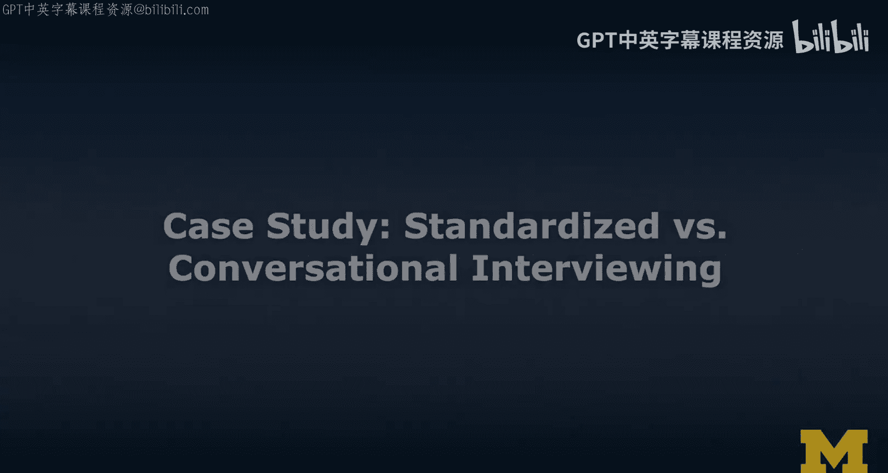
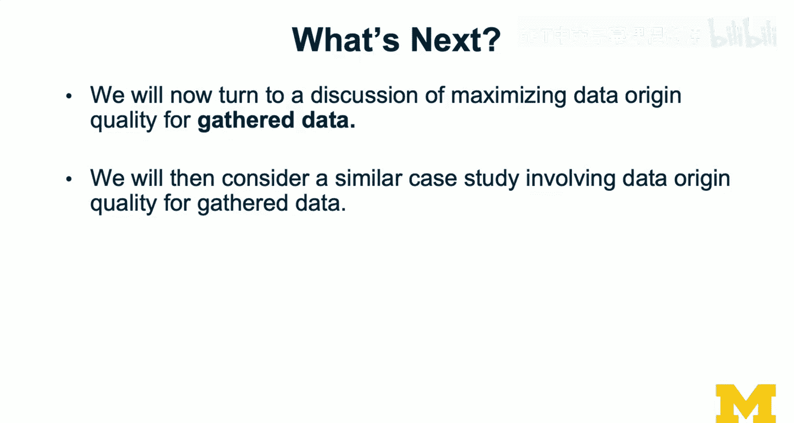

# 总体数据质量（框架、度量、设计策略）：6：案例研究：标准化访谈与对话式访谈对比 📊

在本节课中，我们将通过一个案例研究，探讨如何最大化数据来源质量，并特别关注访谈员效应。我们将比较两种不同的访谈技术：标准化访谈和对话式访谈，分析它们作为数据收集设计策略的优劣。

---

## 概述

上一节我们介绍了数据来源维度的基本概念。本节中，我们将聚焦于访谈员在影响数据来源质量方面所扮演的角色。具体来说，我们将深入探讨两种访谈技术：标准化访谈和对话式访谈，分析它们的设计理念、操作方式以及对数据准确性的影响。

---

## 标准化访谈 🤖

标准化访谈的基本操作流程是，调查访谈员被要求严格按照问卷的措辞来朗读问题，过程近乎机械化。

如果受访者提供了不可接受的答案，访谈员必须使用中性的追问方式。

以下是几种中性追问的例子：
*   访谈员可以重新朗读问题。
*   访谈员可以说“让我再读一遍问题”。
*   访谈员可以说“这个词/问题对您来说意味着什么”。

这种做法的核心理念是，避免访谈员对受访者的回答产生任何可能的影响。其原理在于，如果所有访谈员向所有受访者呈现完全相同的刺激（问题），那么不同受访者之间的答案差异就不能归因于访谈员引入的措辞差异，而更可能反映了受访者报告内容之间的真实差异。

这种方法旨在通过限制访谈员可能采取的行为范围，来减少与访谈员相关的变异。

---

## 对标准化访谈的批评

然而，其他研究者对这种标准化访谈方法表达了担忧。例如，Jordan在1990年发表了一篇非常批判性的文章，认为这种方法不允许在对话中进行任何“旁支序列”来识别和修复常规的意义不确定性或理解障碍。

其主要批评在于，标准化访谈不允许进行“对话性基础确认”。在日常对话中，双方会来回交流以确保彼此充分理解当前讨论的内容。在调查访谈中，这意味着访谈员提问、受访者回答，并确保双方对所讨论的内容有共同的理解基础。

对话性基础确认是人与人之间建立意义的协作过程。这对于调查问题中可能令人困惑的术语尤为重要。而标准化访谈确实不允许这种共同意义和理解的确立。

反对标准化访谈的观点认为，缺乏对话性基础确认会导致更多的问题误解，从而增加答案不准确的可能性。

---

## 对话式访谈 💬

作为替代方案，调查方法学家提出并发展了一种称为“对话式访谈”的方法。

在这种方法中，访谈员和受访者共同努力，以确保受访者按设计意图理解问题。与标准化访谈类似，访谈员会朗读问题的原话。但随后，访谈员会说任何必要的话来确保受访者按意图解释问题，即为基础确认问题的意义。

对话式访谈的目标是**标准化意义，即使措辞可能变化**，这最终应能提高回答的准确性。我们的大目标是通过这种方法最大化数据来源质量。

---

## 不同技术的适用场景

不同的访谈技术可能适用于不同的场景。最佳的访谈技术——标准化或更偏向对话式——可能因调查问题的类型而异。

标准化方法对于某些类型的调查问题可能完全适用，采用那种机械化的中性方法没有问题。

但有些问题，特别是那些包含更复杂术语、可能不易映射到不同受访者具体情况的问题，可能需要更偏向对话式的方法。

在尝试最大化数据来源质量时，混合使用这两种技术是完全可行的。

以下是一个在先前相关研究中被探讨过的示例问题：

**“凯利是否购买或产生了家庭家具的费用？”**

考虑幻灯片右侧的示例收据，上面写着“Katz‘s家具店”，并显示了一项149.99美元（税前）的“Lumen落地灯”费用。那么问题来了：落地灯算作“家庭家具”的例子吗？

调查设计者实际意图的定义是：桌子、椅子、脚凳、沙发、瓷器柜等。**不包括**电视、收音机或其他音响设备、灯具和照明装置、户外家具、办公家具或电器。

这里的关键在于，“家庭家具”有一个潜在的定义。受访者是否应该被提供所有这些额外的文本（这会使问题变长）？或者访谈员是否应该能够在正常的访谈过程中提供这种帮助和澄清，以明确“家庭家具”的含义？

Scher和Conrad在1997年的一篇文章中研究了对话式访谈是否有助于在这类情况下提高回答准确性。他们实际构建了这类例子，并用不同类型的调查受访者进行了测试。

---

## 研究结果：准确性与时间

以下是该特定研究的结果图示。在Y轴上，您可以看到回答准确性（即他们提供正确费用信息的程度）。黑色条形代表直白型调查问题，灰色条形代表复杂型调查问题。结果按所使用的调查访谈类型细分。

对于直白型问题，使用标准化访谈还是对话式访谈区别不大，两者都倾向于产生非常准确的回答。

但对于更复杂类型的调查问题（可能需要查阅记录或涉及复杂术语），**只有**对于更复杂的问题，对话式访谈才会显著提高准确回答的百分比。可以看到，对话式访谈的准确率接近90%，而标准化访谈对于这类复杂问题的准确率只有约30%。

这正是在设计层面，所使用的访谈技术类型有助于改善甚至最大化数据来源质量的地方。

然而，对话式访谈也有一个缺点。从该研究的访谈持续时间（分钟）数据可以看出，对话式访谈确实倾向于花费更长时间。中位时间约为11.5分钟，而标准化访谈仅为3.4分钟，因为当受访者询问复杂术语时，会有大量的澄清过程。可以看到，有一次使用对话式访谈技术的访谈甚至花费了35分钟。

时间就是金钱，这是在提高的回答准确性和实际访谈过程所花费的时间之间的一种权衡。这当然是需要牢记的另一件事。

---

## 访谈员效应

那么访谈员效应呢？在对话式技术中，如果访谈员在澄清问题含义和基础确认理解方面有更多的自由裁量权，不同的访谈员处理这种能力的方式会不同吗？换句话说，在对话式访谈中，回答中的访谈员变异是否比标准化访谈中更可能发生？因为访谈员在处理受访者困惑时有更多的自由空间。

我与一些同事于2018年在德国进行了一项涉及面对面访谈并使用这两种技术的研究。我们发现，答案是否定的：对话式访谈可以有效提高回答准确性，而**不会**持续增加在所收集的许多不同类型问题的回答中的访谈员变异。

这在调查方法论文献中曾是一个开放性问题，我们对这个结果非常感兴趣，因为我们发现这种技术引入的额外访谈员变异的证据极少。

因此，尽管存在可能的时间增加（我们在2018年的研究中没有看到这方面的强有力证据），但这为使用对话式访谈来最大化数据来源质量提供了相当有力的理由。对于那些可能为某些受访者引入混淆术语的更复杂问题来说，尤其如此。

再次强调，标准化访谈对于给定调查中的绝大多数问题可能完全适用，但访谈员应做好准备，在必要时进行对话式访谈。

---

## 总结

本节课中，我们一起学习了两种关键的访谈技术：标准化访谈和对话式访谈。我们了解到，标准化访谈通过统一措辞来减少访谈员效应，但可能因缺乏意义澄清而导致复杂问题回答不准确。对话式访谈则通过协作确认意义来提高复杂问题的数据准确性，且研究显示它并未显著增加访谈员变异，尽管可能耗时更长。关键在于根据问题的复杂程度灵活选择或结合使用这两种技术，以最大化数据来源质量。

接下来，我们将转向讨论如何最大化“采集数据”的数据来源质量，并考虑一个涉及采集数据数据来源质量的类似案例研究。