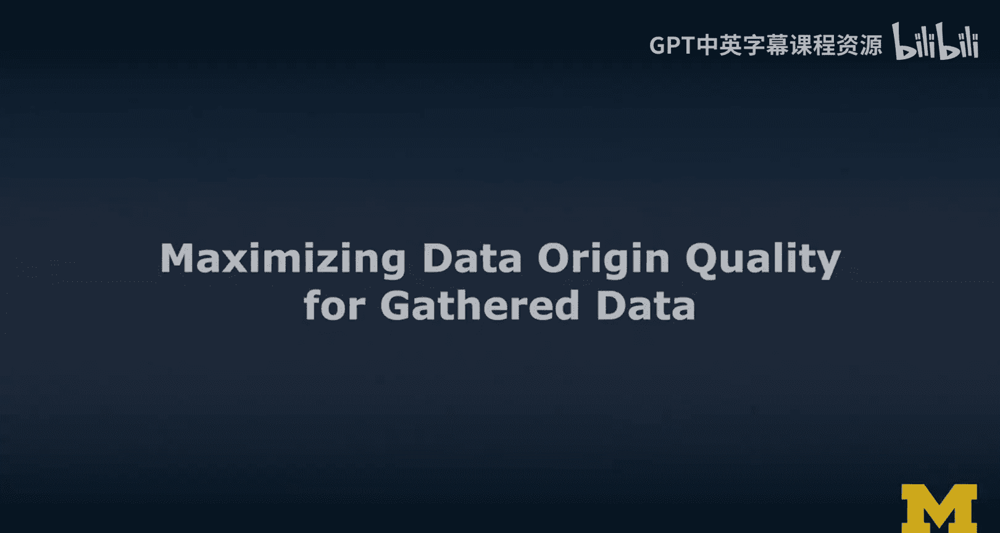
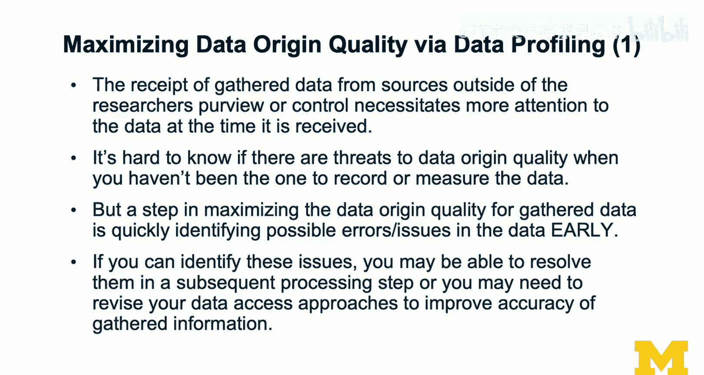
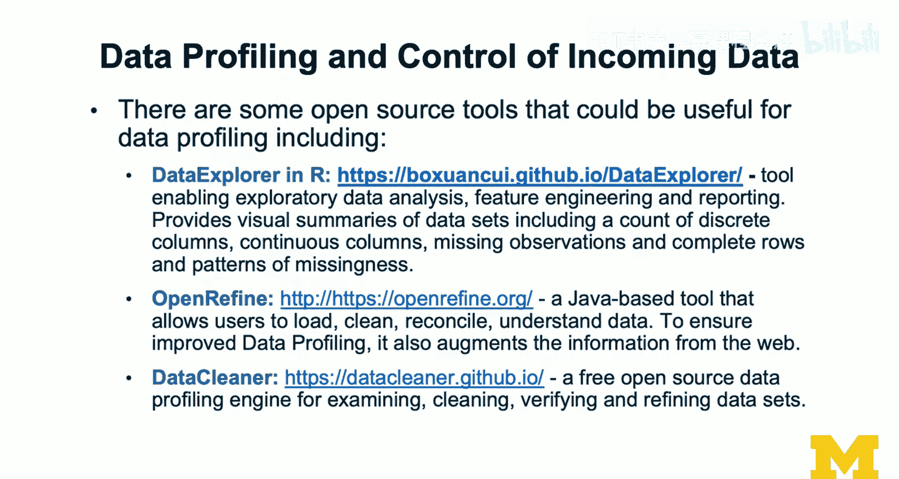
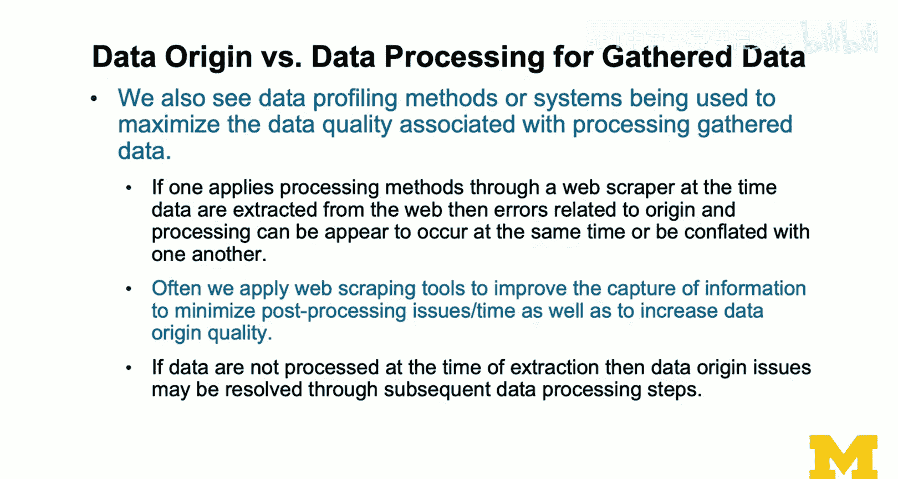
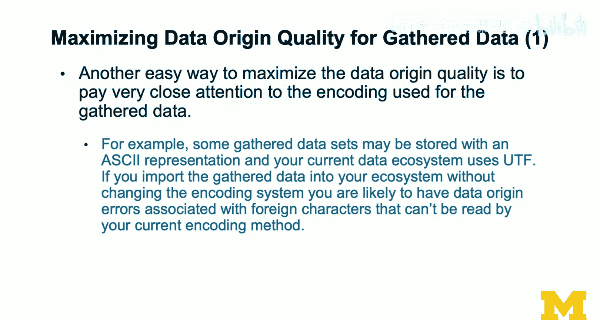
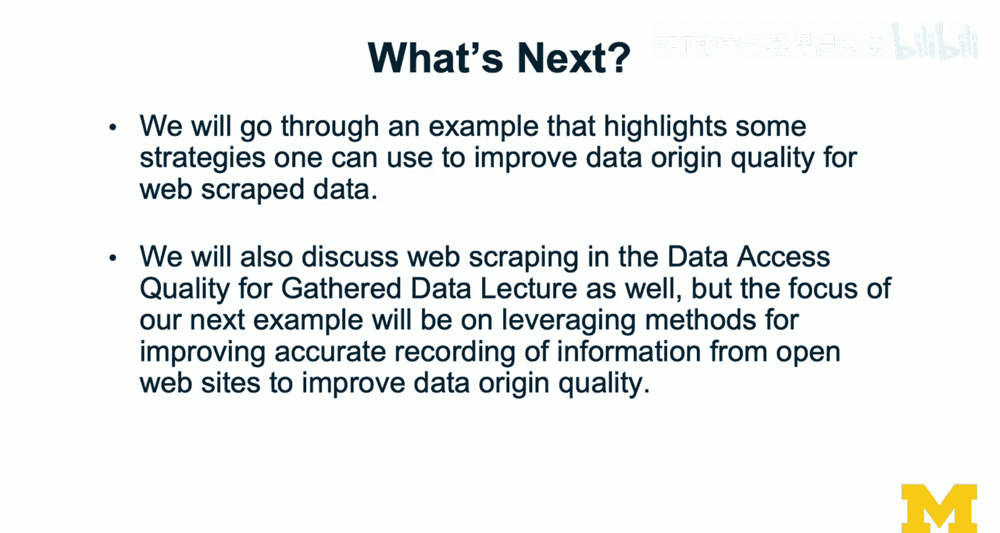
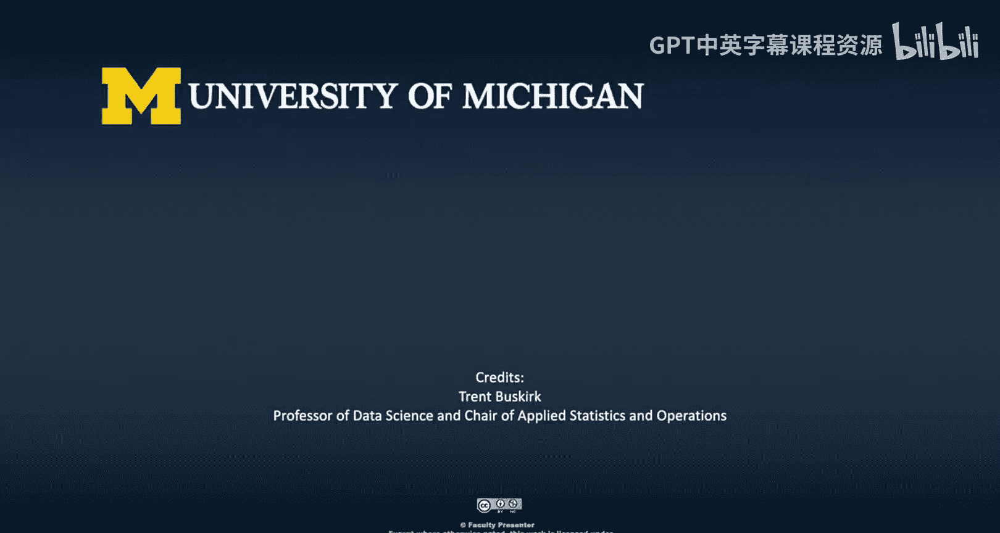

# 密歇根大学《总体数据质量（框架、度量、设计策略）total data quality》 p80 7_最大化采集型数据源生质量.zh_en -BV1Jn4y1X7uS_p80-

Hello， welcome to maximizing data origin quality for Ga data。 I'm Trenm Buskerrk。

 It's great to have you here。 As we've done in all the other lectures。

 just want to give you a framing of where we are within our framework。

 We're going to be talking today about maximizing the quality of data origin for gathered data。

 which falls on the measurement side of our framework。 just to recall。

 data origin is how we the individual values or data points for a given variable or field recorded。

 captured， gathered， computed or represented。 And by represented here。

 we don't mean the represented side of our framework。

 we really mean the formatting of a particular variable。😊。

For gather data specifically， the quality for data origin can be linked to issues for creating。

 retrieving or recording the values for the various fields of interest in the gather data set itself。

 we're going to talk about maximizing data origin quality using what we call data profiling。

The receipt of gathered data from sources outside of the research's purviewer control necessitates more attention to the data at the time it is received。

 Keep in mind， gathered data are typically secondary data sources for your research study。

And you don't necessarily have control over how those data were recorded， how they were imagined。

 even how they were measured。It's really hard to know in those cases if there are threats to data origin quality when you haven't been the one to record or measure that data。

But if you are able to gather data yourself， one of the ways to maximize data origin quality for the gather data that you're working with is to quickly identify possible sources or issues or errors early in the process。

If you can identify these issues at the point where you are gathering the data。

 you may be able to resolve them either at the time that you capture the data or in a subsequent processing step or you may need to revise your data access approaches to improve the accuracy of the gathered information。

 So， for example， if you are scraping a web page and you realize that your webcraer is completely missing a portion of the web page that you thought you were going to capture and needed that information for your study you would need to revise the data scraper at the point where you were gathering that information。

 otherwise you'll end up with a data set without variables that you really need or errors that were created in that gathering process。

 I。e  errorss of omission。

So to maximize the quality of gathered data， you could establish or use what we call a data profiling tool as described by Shennon in 2019 This tool checks for data formats in basic patterns。

 things that you're expecting if you are scraping a particular variable or a part of a page and you expect that you're scraping a number。

 but you're actually capturing text， data， you might think there's something akeew here。

 there's something missing in the way that I am gathering this information。

These data profiling tools also check for data consistency on each record。

 and they also look at data value distributions， possible outliers， or anomalies。

 and they also look for the completeness of the data。

A couple of example data profiling tools that you might want to explore on your own are data Explorer in R。

 this tool enables exploratory data analysis， some feature engineering which is creation of new variables from existing ones and also being able to do some reporting。

The cool thing about data Explorer in R is it provides some visual summaries of data。

 including the count of discrete columns， the number of continuous columns。

 whether or not you have missing observations， and what kind of patterns those missing observations create in terms of and it provides a visual assessment of those。

The important part about this is that you might expect that you have a certain number of categorical or discrete variables that you are sort of sourcing from a particular gathered data source。

 and then you have a certain number of continuous variables that you were expecting。

 being able to use a data profiling tool like data Explorer allows you to very quickly assess whether or not you are getting what you might be expecting。

 Now， this just seems a little bit trivial if you have a very small data set。

 but imagine if you have a data set with hundreds of columns。

 it might not be easy to scan that on your own by eye。

 So being able to use an automation tool data profiling tool like these can actually really help catch some of these potential error sources at the data origin stage and be able to allow you to correct for those if in fact。

 you find some errors。

OpenRefine is another such tool， it's a Java based tool that allows users to load， clean， reconcile。

 and understand data。And last one is data cleaner this is also a free and open source data profiling engine for examining。

 cleaning and verifying and refining data sets， so these three examples actually provide you a way to peek into your data to assess whether or not the quality of origin related issues exist and also be able to make some refinement in the data set to be able to correct for some of these issues if in fact you find them we also see that data profiling methods or systems are being used to maximize the data quality associated with the processing with processing gather data。

If one applies processing method methods through a web scraper at the time that data are extracted from the website itself。

 then errors related to origin and processing can appear to occur at the same time or be conflated with one another as we've already discussed in a prior lecture。

But often we apply web scraping tools to improve the capture of information to minimize the post processing issues or the time it takes。

 as well as to increase the data origin quality。So if you are trying to capture information at the web。

 you can decide that you are going to format that information at the time that you capture it。

 That would be a data origin particular use of these tools。

 but if you were going to later on say I'm not going to change anything。

 I'm just going to gather the raw information。 and later in a post processing step。

 I'm going to format it。 This is where the data origin techniques for maximizing quality and the processing techniques somehow are separated。

 but it is possible for me to process and gather information at the same time with the web scraping tool。

 for example， And in this case， I'm really linking together the data origin and the data processing steps。

 although I'm not trying to link them together， they're just occurring almost simultaneously with the way that I'm capturing the information from the websites。

 if data are not processed at the time of extraction， as I mentioned earlier， then。

DataOrigin issues may need to be resolved through a series of subsequent data processing steps that would allow us to focus on the formatting and the correction of those data origin issues if you ask me。

If making corrections at the point of origin where I'm actually extracting the data or whether or not using subsequent data processing steps would be the better approach to maximizing the data origin or data processing quality of gathered data。

 I might have to decide on the， I might have to come down on the side of trying to maximize the data origin quality at the time that you're actually gathering the information。

 And the reason why is because if you somehow find that there are systematic errors in the way that you are gathering information as it relates to the data origin piece add a processing step。

You may， in order to fix those things or to figure out how to correct them with processing。

 still have to go back to the data to the website and figure out what it actually is saying or what the data should actually be like。

 So you have to go back into that sort of data collection step in order to do that。

 So if you are able to correct these issues and maximize the data origin quality at the time that you are gathering the information from the website。

 I think you you're way better off。And the processing steps can still happen and we can still maximize the quality using with respect to data processing。

 but in this situation when we're talking about web scraping。

 it's usually advisable to try to use techniques to maximize the quality of the data that you are gathering at the time that you're gathering it where you are gathering it。

 hence trying to maximize data origin and putting in a bit of processing at the point where you're extracting data。

 this can make improvements。

Another easy way to maximize the data origin quality is to pay very close attention to the encoding use for the gathered data。

 For example， some gathered data sets may be stored with an ASII representation。

 and your current data ecosystem uses UTF or。If you import the gather data into your ecosystem without changing the encoding system。

 you are likely to have data origin errors associated with foreign characters that show up that can't be read by your current encoding method。

 This is a very simple way to maximize data origin quality。

 but you must pay attention to this before you incorporate or import those data into your ecosystem。

 So simply asking what is the format， what is the native format of this data。

 and what is the native formatting expected in my ecosystem and making sure those things match。

 This is a very easy thing to try to do Data origin quality can also be improved by making sure that the field to be appended or merged into an existing data set from another gathered data set have the correct formats a priori。

 If I'm going to merge in information into my data file and every field。

 My whole data set is all text。 And I'm going to add in numeric values as additional columns。

 and and I'm expecting to。

Or those as text， just because I haven't formatted new fields to be numeric。

 I could actually get problems with the recording of those new informations or those new variables that I'm appending simply because I don't have the right data formats。

 This seems obvious and trivial。 but when you're working at scale and doing this with multiple variables coming into an environment It may not be easy for the naked eye to see this。

 But thinking about this beforehand is really important for maximizing data quality when youre merging information in to an existing data set。

😊，Sometimes data origin， quality issues don't show up at the point of origin。

Sometimes you don't learn about this until way down the line after you have an analysis or after you've completed several steps in your research process。

For example， when we use data to make decisions like classifying an image as a person。

 a cat or an animal using some model that we've developed with gathered data， or asking the question。

 does a tweet convey positive or negative sentiment after we've modeled this using Twitter data？

We will often realize that our models don't have as much accuracy as they could have had because we have issues with the overall underlying dataset set itself around the labels or the accuracy of the labels that we used in the data originally。

Labelling issues with respect to say， image data or text data， for example， when we。

 when we evaluated， we said a human person， a human said this is an image of a cat or a human read the tweet and said this is negative sentiment。

 If those labels are wrong。And we build those we use those data for our models。

We actually could create inaccurate models for predicting sentiment or classifying images as cats。

 animals or other。So one way to maximize data origin quality for gathered data is to focus on the methods for ensuring the accuracy of the labels of such data。

If we don't get this right in the beginning， we will see it in the end with our models。

 One way to improve the accuracy or improve the quality of data origin with respect to labeling is to train and use human coders to provide labels for images or tweets。

 We compute intercoder reliability and ensure that there's a certain level of reliability before we release those data or call them good or final in our data sets。

 This allows us to ensure that the labels are accurate and the origin issues with respect to those particular variables are maximized so that when we feed them into a model。

 we can actually improve the accuracy。 and we won't have to redo this whole process。Coming up。

 we're going to go through an example that highlights some strategies one can use to improve data origin quality for web scrappe data in particular。

 We will also discuss web scraping in the data access quality for Ga data lecture。

 But the focus of our next example will be on leveraging methods for improving accurate recording of information from open websites to improve data origin quality At the point that data are extracted。

 I can't wait to see you then。 Thanks for joining us today。😊。

