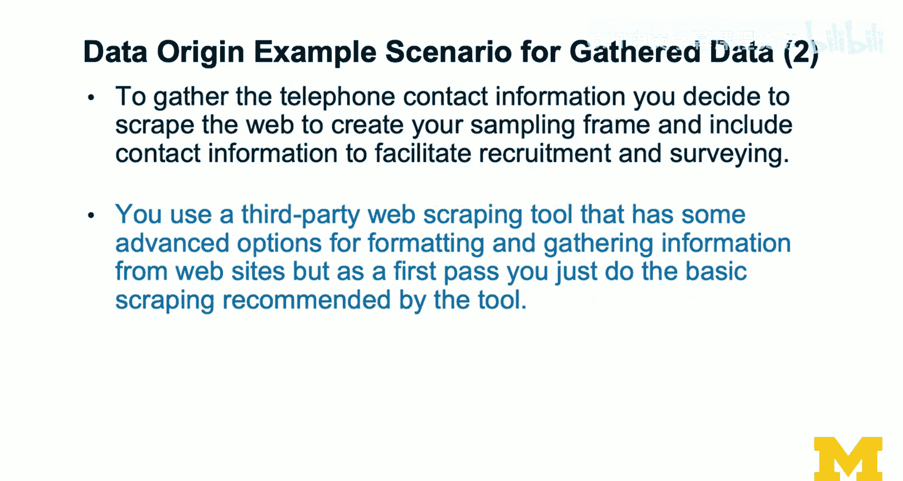
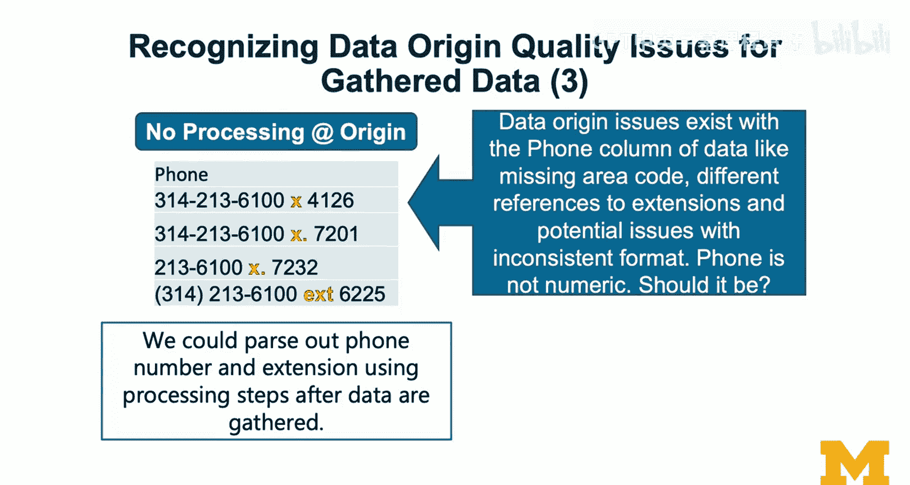
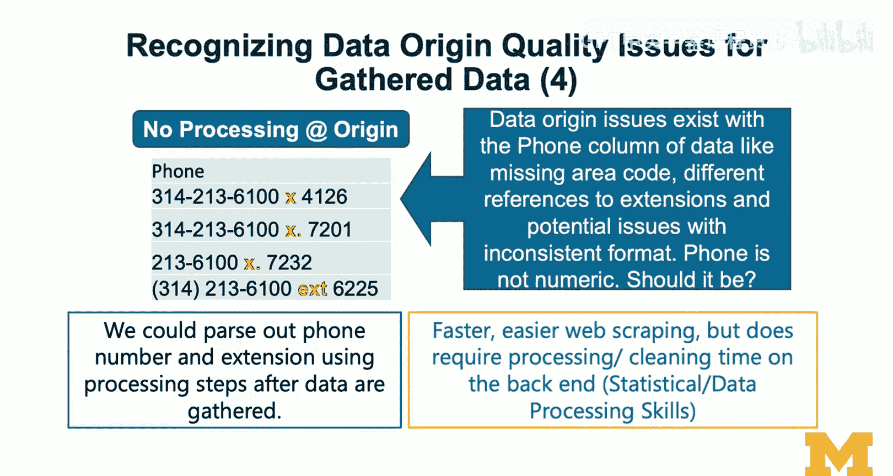
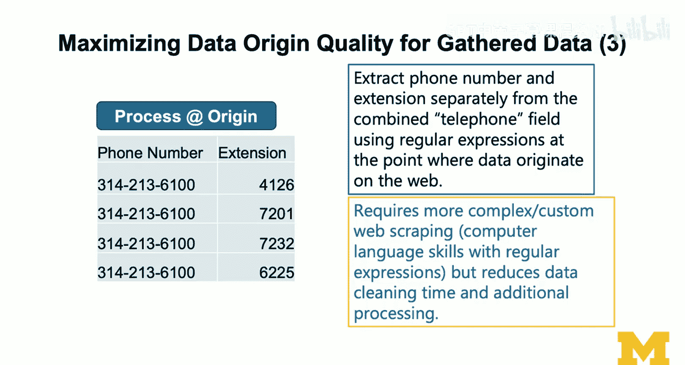
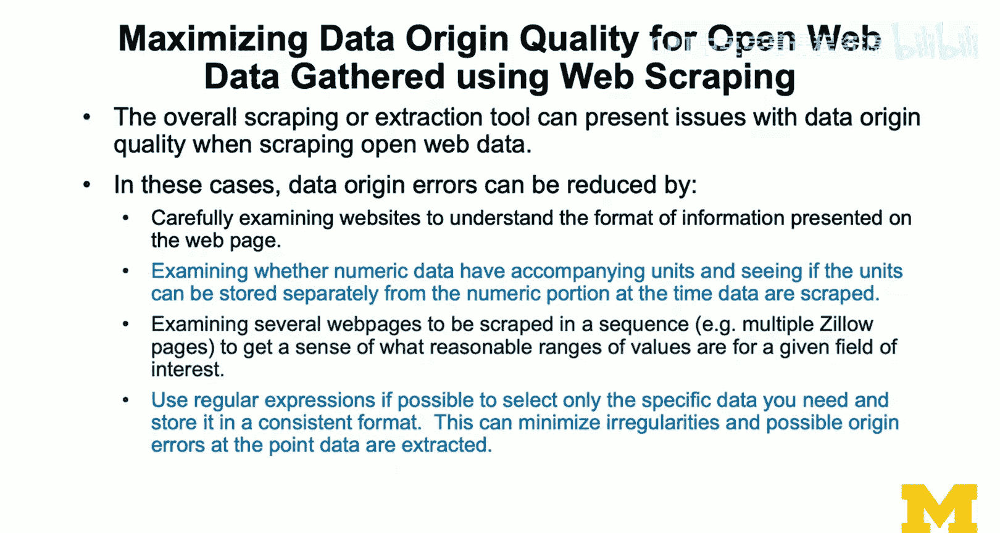
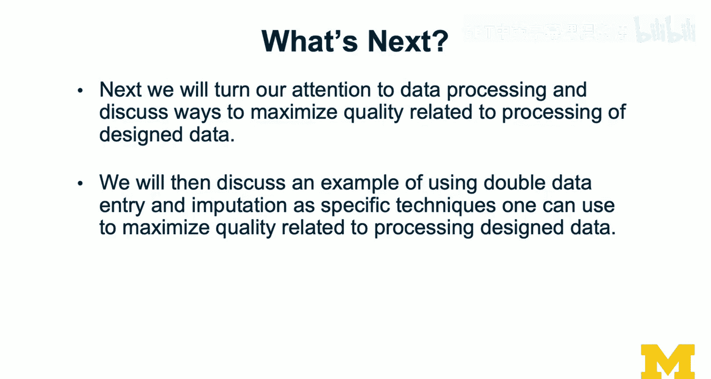

# 密歇根大学《总体数据质量（框架、度量、设计策略）total data quality》 p81 8_案例研究：网络调查中提升数据溯源质量的简易经验.zh_en -BV1Jn4y1X7uS_p81-

Hello， welcome to our example where we're going to talk about simple lessons learned for improving data origin quality Well web scraping I'm Trenm Busker。

 I'm happy to have you imagine that you're tasked with creating a sampling frame of telephone contacts for various public schools in your state that are eligible for an upcoming survey on physical activity curricula for children under 12 There is no directory of telephone numbers for teachers but you do have district web pages that in turn provide links to teacher webp pages that contain the telephone numbers to gather the telephone contact information you decide to scrape the web to create your sampling frame and include the contact information to facilitate your recruitment and your surveying you use a third-party webs scraping tool that has some advanced options for formatting and gathering information from websites。

😊。

But as a first pass， you do just the basic scraping recommended by the tool。 Here's what you get。

 In this case， you can see there are data origin issues that exist with a phone column of data like the missing area code。

  different references to extensions and potential issues with an inconsistent format。

 Ph is not numeric。 Should it be So this is the column of data that I get and you can see that I have very different values of a phone number couple of choices I have at this point I could parse out phone number and the extension using processing steps after the data are gathered。

 So in other words， my decision here is to ignore this formatting issue。 take the data as they are。

 pull it into a data set， move it to a processing stage。

 So in this case I've decided that I'm not going to maximize the data origin quality at the time that I'm extracting the data but I'm going to have to maximize that using a processing step later on after I've already gathered this information Certainly this decision to do it later It faster It's easier for webs scraping。

 I just used the default functions in the tool。

And it gave me this information partially correct， partially informative， partially useful。

 but this does require an extra step it requires cleaning time and stuff that happens on the back end after we've already been at these websites Here's another example of what we could have gotten at the point of origin here we extract phone number and extension separately from the combined telephone field on the web pages using regular expressions at the point where the data originated on the web at the website where we got the data in the first place In this case this required more complex custom web scraping I had to use some of the tools in the webs scrapper that were beyond the recommended defaults using regular expressions for example this reduces the data cleaning time and the additional processing that is required at a further step and it allows me to maximize the data origin quality at the point where I've gotten these data This is just a simple example of how you might be able to use regular expressions or other tools。

To maximize the data origin quality at the point where you've extracted web data for example。

 another way to think about it is as we saw in this example。

 using a web scraping tool or an extraction tool with the default settings presented some issues with data origin quality when we scraped the open web data phone numbers In these cases data origin errors can be reduced or data origin quality can be maximized by carefully examine the webs to understand the format of information presented on the webpage before you scrape the information examining whether numeric data have accompanying units and seeing if the units can be stored separately from the numeric portion and expect or plan to create an additional field to store the units and the numbers separately。

 also by examining several web pages to be scraped in a sequence are there multiple pages in the our case we had multiple schools and we had multiple teacher pages。

 we examine a series of those to get an understanding of what the pattern might be in order to fix or to maximize the quality。

Of the yield of the data that we were going to scrape。

 we saw in our example the use of regular expressions to maximize data origin quality by putting data in a consistent format at the time that we actually extracted it。

 This minimize irregularities and also reduce the number of processing steps ever required later in our next lecture。

 we're going to turn our attention to data processing and discuss ways to maximize quality related to processing of design data in particular。

 Well then discuss an example of using double data entry and imputation as specific techniques one can use to maximize the quality related to processing of design data。

 Thanks for joining us for this example。 We look forward to seeing you in the next lecture。😊。

