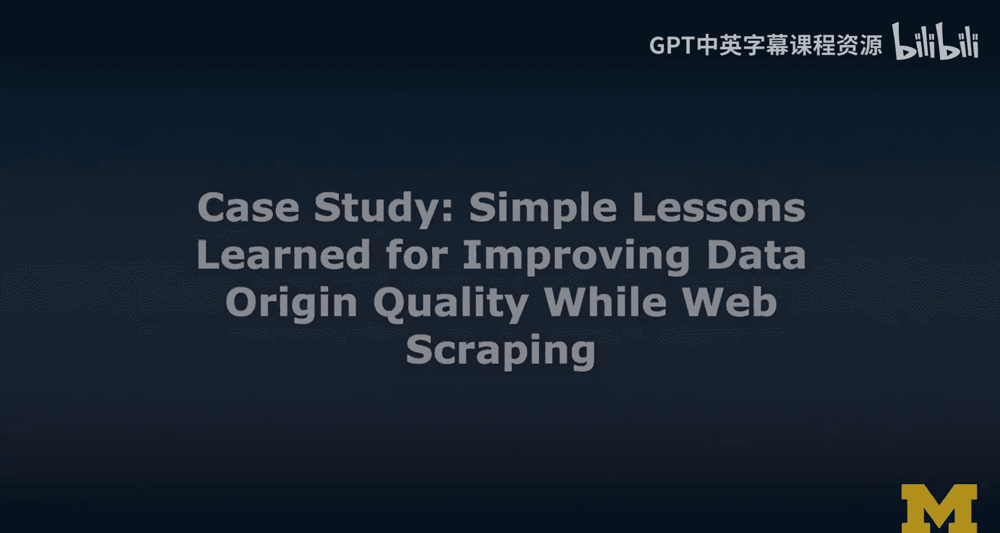
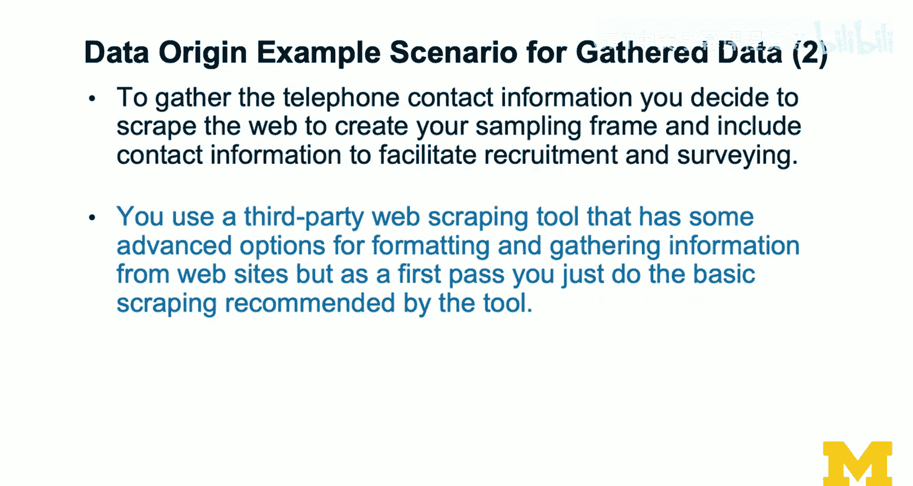
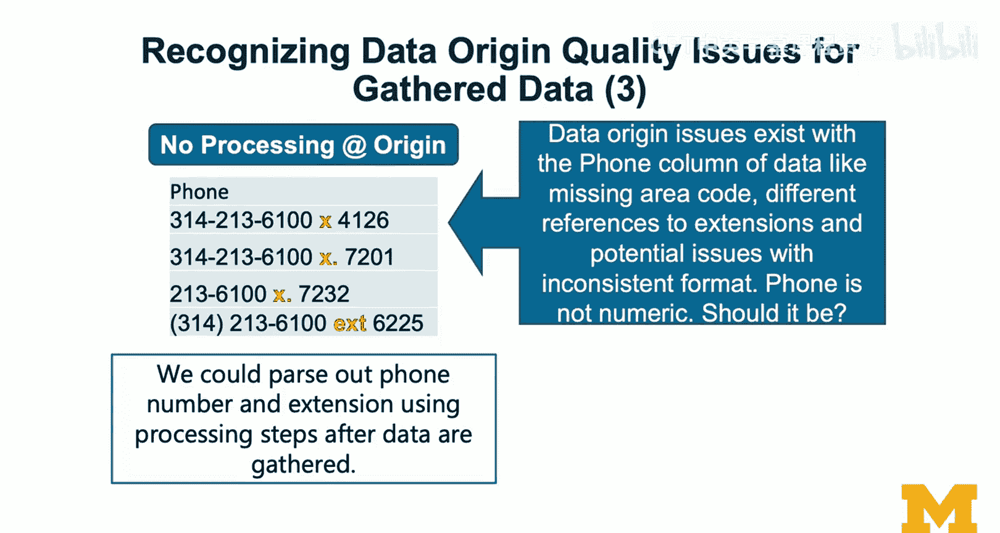
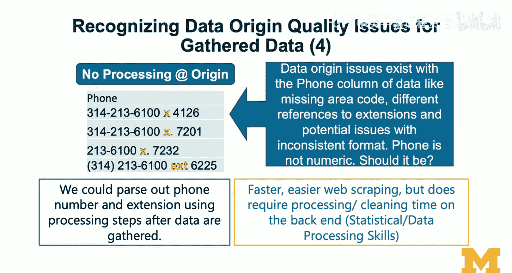
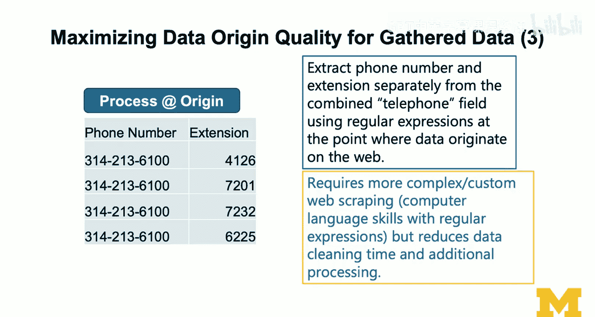
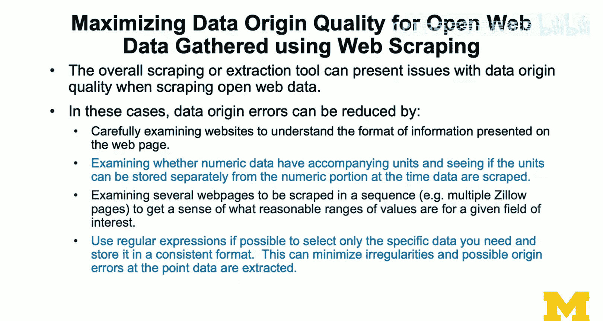
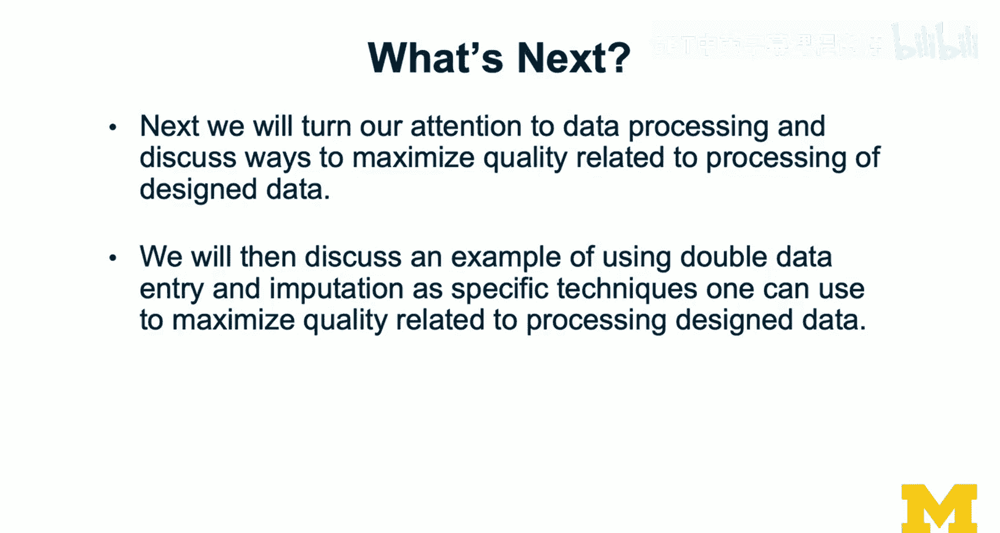
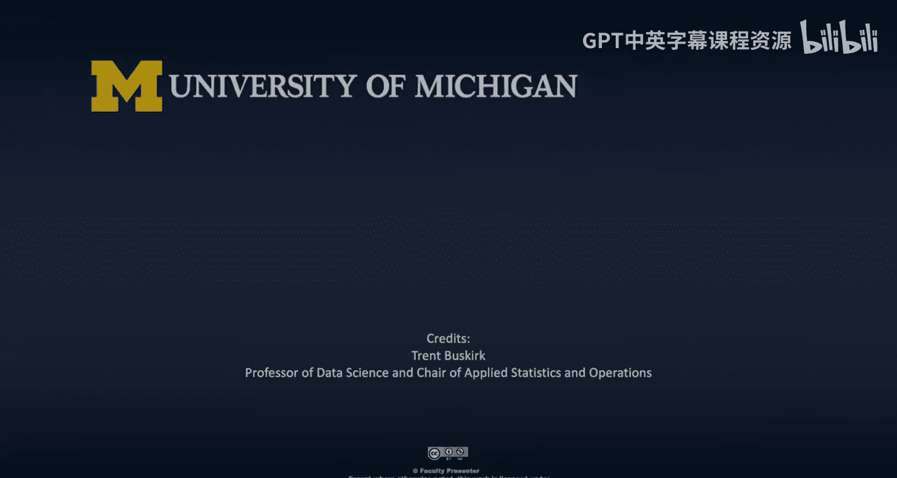

总体数据质量（框架、度量、设计策略）：8：案例研究：网络调查中提升数据溯源质量的简易经验 📊




在本节课中，我们将通过一个具体的网络爬虫案例，学习如何在数据采集的源头（即数据溯源阶段）提升数据质量。我们将对比两种不同的数据抓取策略，并总结出一些实用的经验教训。

---

假设你的任务是为你所在州的各公立学校创建一个电话联系人抽样框，用于一项针对12岁以下儿童体育活动课程的调查。没有现成的教师电话号码目录，但你有学区网页，这些网页链接到包含电话号码的教师个人页面。为了收集这些联系信息，你决定使用网络爬虫来创建抽样框，以便于后续的招募和调查工作。你选择了一款具有高级格式化和信息收集功能的第三方网络爬虫工具。




### 初始尝试：使用默认设置

作为初步尝试，你直接使用了该工具推荐的基本爬取设置。以下是得到的结果：

```
电话列数据示例：
555-1234
(555) 123-4567 ext. 890
Ph: 555-987-6543
123-4567
```

在这个案例中，你可以看到“电话”这一列数据存在数据溯源问题，例如：
*   缺少区号。
*   对分机号的引用方式不一致。
*   格式不统一（例如，“Ph:”是非数字内容）。

此时你有几个选择。一种选择是忽略这些格式问题，先按原样抓取数据，将其导入数据集，然后在后续的数据处理阶段再通过处理步骤来解析电话号码和分机号。





**决策分析**：选择事后处理意味着在数据提取时没有最大化数据溯源质量，而是打算在收集完信息后，通过额外的处理步骤来弥补。这个决定通常更快、更容易，因为你只使用了工具的默认功能。它给了你部分正确、部分有用的信息，但这需要在后端进行额外的数据清洗步骤。

### 优化方案：在源头提升质量

另一种方案是在数据源头（即从网页上获取数据的那一刻）就提升质量。以下是我们可能得到的结果：

```
电话列数据示例：
555-1234
555-123-4567
555-987-6543
123-4567

分机列数据示例：
(空)
890
(空)
(空)
```






在这个方案中，我们使用**正则表达式**等工具，在抓取时就从网页上组合的电话字段中分别提取电话号码和分机号。

**实现方式**：这需要更复杂的自定义网络爬虫设置，例如使用正则表达式，这超出了工具推荐的默认功能范围。

**优势**：这种做法减少了后续所需的数据清洗时间和额外处理步骤，并允许我们在获取数据的源头就最大化数据溯源质量。这只是如何使用正则表达式或其他工具在提取网络数据时最大化数据溯源质量的一个简单例子。

### 经验总结与最佳实践

通过这个例子，我们可以总结出一些提升网络数据溯源质量的通用经验：


*   **预先检查网页格式**：在抓取信息之前，仔细检查网页，了解页面上信息的呈现格式。
*   **分离数值与单位**：检查数值数据是否带有单位，并考虑是否可以将单位与数值部分分开存储。计划创建额外的字段来分别存储单位和数字。
*   **分析序列模式**：检查要抓取的一系列网页（在我们的案例中是多个学校和教师页面），以了解可能存在的模式，从而在抓取时进行修正或优化数据产出质量。
*   **利用工具在源头格式化**：如我们的例子所示，使用**正则表达式**在数据实际被提取时将其放入一致的格式，可以最大限度地减少不规则性，并减少后期所需的处理步骤。

---

### 课程总结




本节课我们一起学习了如何通过优化数据采集策略在源头提升数据质量。我们对比了“先抓取后处理”和“在抓取时即格式化”两种方式，认识到在数据溯源阶段投入更多精力（如使用正则表达式进行精确提取）可以显著减少后续的数据清洗工作，从而整体上更高效地保证数据质量。







在下一讲中，我们将把注意力转向数据处理阶段，讨论如何最大化与数据处理设计相关的质量。我们将具体探讨使用双数据录入和插补等技术作为提升数据处理质量的方法。