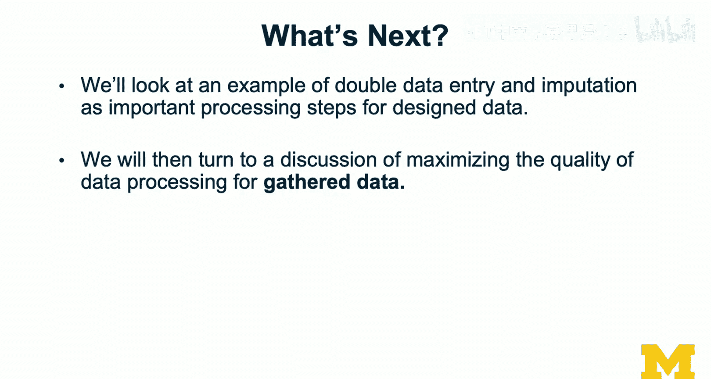

# 密歇根大学《总体数据质量（框架、度量、设计策略）total data quality》 p82 9_最大化设计型数据处理质量.zh_en -BV1Jn4y1X7uS_p82-

Okay， welcome back。 We're now going to turn our attention to the processing of the dimension of the total data quality framework and think about how to maximize processing quality。

 specifically with design data in mind So now if we look at the big picture for the total data quality framework we're now shifting our attention from data origin to data processing going from the data value that we actually collected to the edited data that we might ultimately prepare for data analysis and our focus is going to be on how to maximize the quality of the processing at this particular step in the overall total data quality framework Okay。

 so maximizing the quality of data processing for design data。

 One technique that we can use to maximize quality is known as double data entry and this is especially useful if human entry of survey data and survey responses is required and can resolve any discrepancies in this particular case with a knowledgeable third party So the idea here with double data。

En is that two different individuals would enter the data from， say a mail survey， for example。

 into an electronic data file。 And then if a comparison of those two electronic data files produces any discrepancies。

 those would be resolved with a knowledgeable thirdpart。

 an independent individual from the two who did the coding。 So， for example。

 two different individuals again， could enter responses from the same mail questionnaires obtained from a mail survey into a spreadsheet or some online form。

 and this would ultimately produce two data files that we would use for further comparison。

 these two data files would then be compared data point by data point。

 every single data point that was entered in those two data files。

 every survey response that was entered by the two individuals would be compared one by one。

 and there are software procedures that are available to do this。 for example。

 compare in the SaS software is especially useful performing these kinds of point by point comparisons in double data entry。

 and then once the software is used to。Pform these point by point comparisons。

 the software produces a report of any data values that were inconsistent between the two data files that were entered and rates of discrepancies would be computed。

 these discrepancies would then be resolved again with the assistance of a knowledgeable third party that's the basic idea of double data entry Now this is where human entry of survey data is required。

 Many surveys that creation of electronic data files will be automatic if there's no human intervention necessary to enter。

 say mail survey forms or something like that。 another very popular approach for maximizing the quality of data processing is to apply the fileggy and Holt criteria for editing of the data and the basic idea behind this approach is to change the smallest number of fields or variables that are necessary for a record in the data set to pass edit checks。

 So the basic idea is to attack the worst variable。

that's producing the most problems in terms of out of range values or whatever the case may be。

 attack the worst variable first in terms of total data quality and then reevaluate the edit checks for different variables in the data and move forward so you don't have to necessarily look at every variable but just start with the worst ones and do the minimum amount of changing necessary to make sure that edit checks are eventually passed and Fele and Holt have a 1976 paper older。

 but again， a practice that's still employed outlining this overall process nowadays we can definitely use computer assististed editing routines to save time so web survey platforms like Surmonkey。

 which we introduced in the first class of the specialization usually allow you to program these kinds of editing routines in advance to make sure that the data collected are within range。

 there's no unusual values there's logical consistency between different values that are that are entered。

 you can have those kinds of logical checks programmed in advance。

When you're coding open-end responses at the processing stage。

 very important to much like double data entry use a knowledgeable and independent thirdparty individual to resolve any discrepancies between the openend responsesents responses that may have been coded by two different individuals So again。

 make use of an independent individual to resolve any discrepancies that come up during that overall coding process additional thoughts on maximizing the quality of data processing again。

 with design data and mine， imputation is often applied at the data processing stage to predict what missing values should have been when you're preparing a data set for ultimate analysis。

 Another very important part of processing with design data。

 but we don't want to treat imputation models that are used to make these predictions of missing values like black boxes we carefully want to perform model diagnostics for all of the models that are being used to predict those missing。

So were all of the statistical models that were used to impute these item missing data of sufficient quality。

 Did they fit the data well were there any noticeable problems in terms of estimated coefficients in that models or problems with those models converging when they're being fit to the complete data in the data we have to carefully evaluate the quality of the imputation models that are being used before we sign off on the imputed values that are included in a data to replace missing values。

 So definitely important to check model fit for each of those models being used for imputation Furthermore。

 if we're imputing missing values in a survey data file。

 we want to provide imputation flags to indicate to data users which values were actually imputed on which variables So these are additional variables at the end of a data file which。

 for example， could contain a one for a particular record in the data file if a particular variable is imputed so you might have something like race imp as the name of the variable and then that。

impute variable would have a one if a person's race ethnicity was imputed and a0 otherwise these flags are important。

 but because they tell data users what variables have had what values imputed and if a data user would like to do their own imputation。

 their own prediction of those missing values。 the imputation flags in the data set would allow them to redo those imputations so very important again at the processing stage。

 create these indicator variables and allow data users to redo these imputations if they so desire very important practice。

 so those are some techniques that can be used to maximize quality in terms of data processing for design data。

 what's next， we're going to look at an example of double data entry and imputation as important processing steps for design data so we'll look at a little case study and then we'll turn to a discussion of maximizing the quality of data processing specifically for gathered data Thank you。

