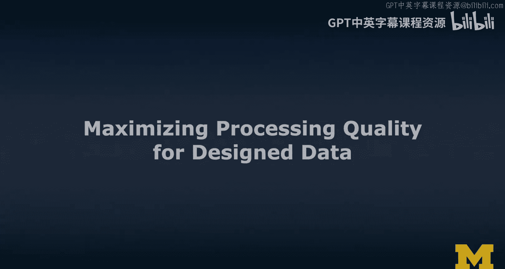
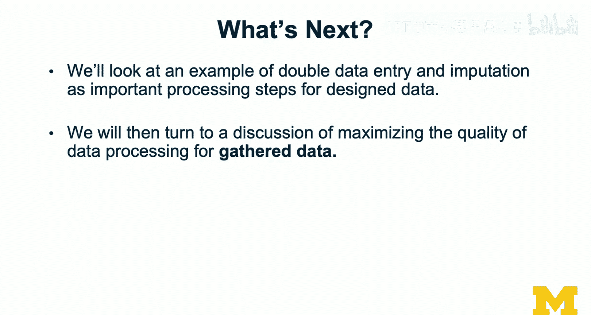

# 总体数据质量（框架、度量、设计策略）：9：最大化设计型数据处理质量 📈

在本节课中，我们将学习总体数据质量框架中的“数据处理”维度，并重点探讨如何针对**设计型数据**最大化其处理过程的质量。

上一节我们介绍了数据来源的质量，本节中我们将注意力转向数据处理环节。在总体数据质量框架中，数据处理是将我们实际收集的原始数据值，转化为最终可用于数据分析的“已编辑数据”的关键步骤。我们的核心目标是，在框架的这一特定环节，最大化数据处理的质量。

## 最大化设计型数据处理质量的技术

以下是几种可用于最大化设计型数据处理质量的核心技术。

### 双录入法

当需要人工录入调查问卷数据时，双录入法是一种非常有效的质量控制技术。其核心思想是通过两名独立人员分别录入同一份数据，并借助第三方解决差异。

具体流程如下：
1.  **独立录入**：两名不同的录入员分别将同一批（例如，邮寄调查的）问卷数据录入电子数据文件。
2.  **逐点比对**：使用软件（例如，SAS中的 `COMPARE` 过程）对生成的两个数据文件进行逐点比对。
3.  **生成报告**：软件会生成一份报告，列出两个文件中不一致的数据值，并计算差异率。
4.  **第三方裁决**：由一位熟悉调查内容的、独立于两名录入员的第三方人员，根据原始问卷裁决并解决所有差异。

### 费利格-霍尔特编辑准则

另一种流行的数据处理质量控制方法是应用费利格和霍尔特提出的数据编辑准则。其基本思想是：以最少的改动，使数据记录通过所有编辑检查。

操作步骤如下：
1.  **识别问题变量**：找出导致最多问题（如超出范围值）的变量。
2.  **优先处理**：首先处理这个“最差”的变量，对其进行必要的修正。
3.  **重新评估**：修正后，重新评估其他变量的编辑检查状态。
4.  **迭代进行**：重复此过程，无需一次性检查所有变量，而是从问题最严重的开始，进行最小必要改动，直至所有记录通过编辑检查。

如今，我们可以利用计算机辅助编辑程序来节省时间。例如，像SurveyMonkey这样的网络调查平台，允许你在设计阶段就预先编程逻辑检查规则，确保收集的数据在合理范围内且逻辑一致。

### 开放式回答的编码与缺失值插补

在数据处理阶段，对于开放式问题的回答进行编码时，质量控制同样重要。

以下是关键实践：
*   **编码一致性**：类似于双录入法，如果由两名编码员对开放式回答进行编码，应使用一位知识渊博且独立的第三方来解决编码过程中的任何分歧。
*   **缺失值插补**：在准备最终分析数据集时，常会应用插补法来预测缺失值。但插补模型不应被视为“黑箱”。
*   **模型诊断**：必须对所有用于预测缺失值的统计模型进行仔细的模型诊断，评估其拟合优度、系数估计是否存在问题等，确保模型质量可靠。
*   **插补标识**：在调查数据文件中，应为被插补的值提供**插补标识**。这是在数据文件末尾添加的额外变量，用于指示哪些记录、哪些变量的值是被插补的。例如，可以创建一个名为 `race_imp` 的变量，如果某条记录的种族信息是插补的，则该变量值为1，否则为0。

> **插补标识的重要性**：这些标识至关重要，因为它们告知数据使用者哪些值被修改过。如果使用者希望使用自己的方法重新进行插补，这些标识能让他们轻松识别并替换原有的插补值。

## 总结

本节课中，我们一起学习了最大化设计型数据处理质量的几种关键技术：**双录入法**用于确保人工录入的准确性；**费利格-霍尔特编辑准则**指导我们以最小改动通过数据检查；在处理**开放式回答编码**和**缺失值插补**时，我们强调了第三方裁决、模型诊断以及创建**插补标识**的重要性。这些实践共同保障了数据处理环节的输出质量，为后续的可靠分析奠定了基础。

接下来，我们将通过一个案例研究，具体看看双录入和插补作为设计型数据处理关键步骤的实际应用，然后转向讨论如何最大化**收集型数据**的处理质量。