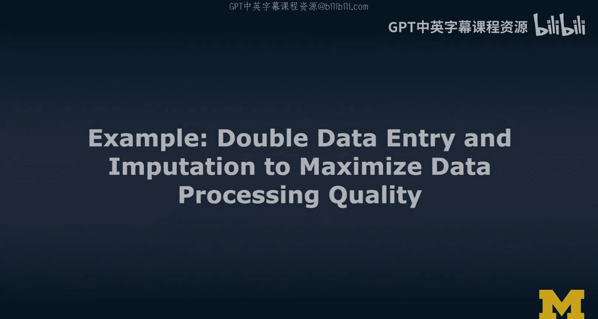
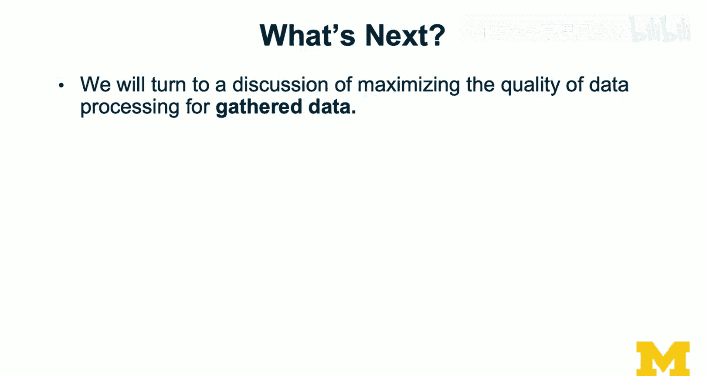

# 密歇根大学《总体数据质量（框架、度量、设计策略）total data quality》 p83 10_示例：双录入与插补法提升数据处理质量.zh_en -BV1Jn4y1X7uS_p83-

Okay， welcome back。 Now we're going to look at an example of using double data entry and imputation to maximize data processing quality。

 So a little case study to illustrate both of these different ideas about how to maximize processing quality specifically with design data in mind so again revisiting the overall TDQ framework were at the processing dimension on the measurement side thinking about how to maximize quality at the processing phase of the overall framework So double data entry in imputation in this example。

 we're going to consider a practical example， illustrating the ideas of double data entry and imputation and we're going to start the example with two hypothetical entered data files so going in we're assuming that two different human beings have entered these two data files say based on a mail survey or something like that All right so here the two entered data files if you were to just eyeball these two data files a couple things youd notice first of all there's three variable。

In each data file， one is an indicator for whether or not you're a male。

 one is a recording of a person's body mass index or Bmi and one is a measure of a person's satisfaction with life。

 let's say so those are the three survey variables that were physically entered by two human beings into these electronic data files say something like Excel so you might notice right away that for the fifth survey respondent they have a missing value for Bmi and just eyeballing these two data files。

 you don't really see any discrepancies right off the bat but if you look a little bit closer that's where you start to see that there were some discrepancies between the two entered data files so where are the discrepancies Well now they're highlighted in red on this particular slide So you can see that for the first survey respondent。

 the first data coder entered in 18 for Bmi but for the first survey respondent the second data coder entered in 81 So it looks like they might have just flipped around the one in the8 but that introduces a discrepancy because it's not realistic for Bmi to have a value of 81 So now know。

That might not pass an edit check at the data processing stage。

 And we have to go back and look at the original questionnaires and so forth。

Additional discrepancies。 If you look at the fifth survey respondent。

 the first coder said that they were male。 The second coder said that they were a female。

 So who's correct in this case。 The sixth survey respondent for satisfaction。

 The first code are entered to three。 The second coder entered to4。

 so there are actually these three discrepancies that we would need to resolve。

 And that's where double data entry as a technique can be very。

 very valuable for resolving these kinds of discrepancies at the processing stage。

 So let's summarize and correct these discrepancies out of the 18 possible values entered。

 they were disagreements on three of them。 So the two data coders or data processors had 83。

3% agreement。 So that's a measure of this particular aspect of quality like we talked about in course。

 But how do we go about fixing this now。 how do we go about maximizing quality at this processing step。

 Usually software programs。Prot compare in the Saas software are used to identify these kinds of discrepancies。

 So there's existing software that we can use to line up two data files。

 essentially stack them on top of each other electronically and then go through point by point to see where these discrepancies emerge。

 We could do that by hand just looking at the simple example。

 but more generally will need software like Proc compare。

 and there are other tools like PRc compare out there After we identified the discrepancies with a tool like PR compare an independent third coder reviews the mail surveys that were received for these three cases in question。

 So not pictured here would probably be an I code of some form that would be linked up to the actual mail forms that were received by a survey organization that we could use to go back and see what was actually printed or what was actually entered by the survey respondents on those mail forms So an independent evaluator would go back to the mail surveys received for these three cases and correct。

The final values for each of these different cases。 so this idea of double data entry。

 entering the files twice， doing an electronic comparison。

 identifying the discrepancies and then resolving those discrepancies is a very efficient process that can save a lot of time and maximize quality at the processing stage Here's what the final clean data set would look like after that double data entry process。

 you see that Bmi was actually 18 for the first respondent the fifth respondent was actually a mail and the correct satisfaction was actually for for the final respondent。

 And you can see that different data processors were correct for these different variables。

 So it wasn't like one data processor was the only one providing correct responses。

 If that was the case， then the second data processor might need some additional training or might need to slow down in the data entry there can be additional training steps taken in that case。

 But here's our final clean data set after that after application of that double data entry technique。

 So now we think about imputation as another tool for。Again。

 maximizing processing quality at this particular phase when we think about predicting missing values in a dataset。

 it's always best to use models to do this to impute these missing values that incorporate relationships between the variables in question and the other observed variables in the data so we always want to build models that can draw on the relationships between different variables and the term that represents this idea is using conditional modeling to impute these missing values we're conditioning our predictions on other observed variables in the data rather than just imputing missing values based on the overall mean or the overall median of a particular variable a much simpler unconditional procedure we also want to make sure that the models that we're using for imputation at a minimum include all the variables that are eventually going be part of our analysis So again make sure at a minimum that the models used for imputation of missing values actually include。

All the variables that you're eventually going to analyze。

 whether you're fitting a regression model or computing descriptive estimates。

 make sure that that imputation model at a minimum。 includes all those different variables。

 but generally， yes， we do not want to use simple unconditional methods like imputing the meanme of a given variable unless there's a very。

 very， very small amount of missing data In that case。

 just plugging in the mean for a couple of cases may work just fine generally we want to use a conditional prediction approach for imputing missing values So in this particular case that we're looking at right now we might know。

 for example， that males and females tend to have different values on body mass index so we might fit a regression model to the observed data where we predict body mass index with sex rather than simply using the meanme of body mass index to impute that missing value。

 So let's take a look at what that means in the final data set after double data entry。

 The overall mean of Bmi based on the five available values of 18201924 and 20。

That overall mean was 20。2 and we have that in red here。

 So one option would be to predict that missing value with the overall mean of 20。

2 and plug that value of 20。2 into the data set a better option would be to make a prediction of what the Bmi is for that fifth individual based on a model that regresses the Bmi variable like a dependent variable on mail as a predictive variable。

 So we're using mail to predict the value of Bmi and in that case。

 the prediction of Bmi for males based on the observed data would be 22 and you can notice in this little data set that's just the mean of 24 and 20 for mail specifically so that's better because it conditions on other observed data to give you a more realistic prediction of what that missing value would be。

 and you can see if we get those better predictions for all these imputed values in a much bigger data we're going to end up with a better data set after the processing stages complete for the ultimate analysis because we have more realistic or plausible。

Values in place of those missing values in the original survey dataset set。

 now we've imputed that missing value。 let's say we go with that conditional approach。

 that imputed value is 22 for Bmi for that fifth case。

 then again it's good practice to add imputation flags to the final data set that you're preparing for analysis after the processing stage so you can see there's been a fourth column now added to the data file。

 that fourth column is called impfl underscore Bmi。

 So there was no imputation performed for the first four cases and no imputation performed for the sixth case。

 but for that fifth case， the value of Bmi was imputed。

 So that fifth case gets a one on this flag that's specific to the Bmi variable。

 and that tells the data user that that value of 22 is an imputed value。 And if they wanted to。

 they could delete that value of 22 and then conduct their own imputation。

 possibly using another regression model before they ultimately analyze the data。

 but that's helpful for data producers， it's also a record for data analyst to see which of the values were actually。

But this enables reimputation of BM if data users so desire。 So again。

 very good practice to be open and transparent about what values were actually imputed in the data set and to allow data users to do their own thing。

 if they have better imputation models in mind。 Okay。

 so after that little example where we saw the application of those different processing techniques and practice。

 We're now going to turn to a discussion of maximizing the quality of data processing specifically for gathered data。

 Okay， thank you。😊。

