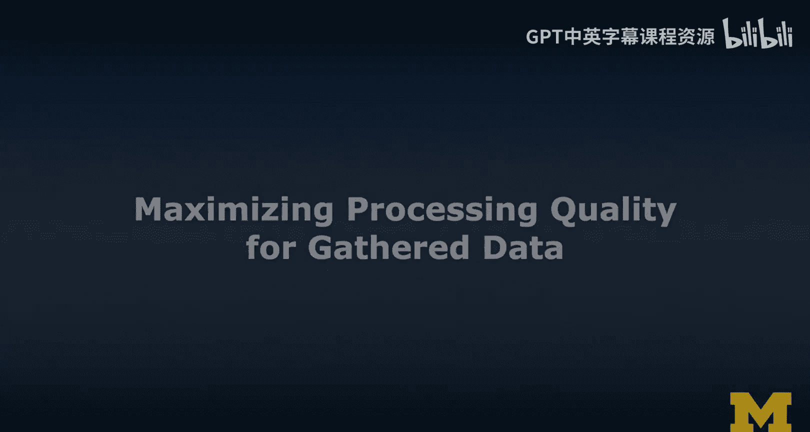
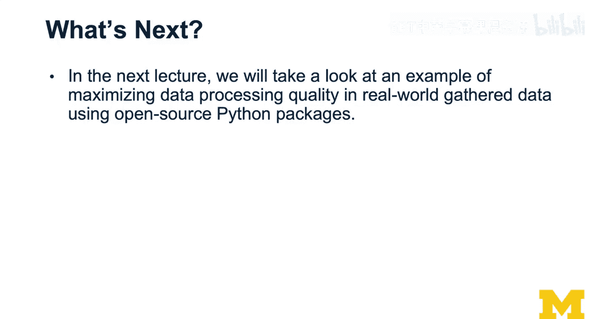

# 总体数据质量：11：最大化采集型数据处理质量 📊

在本节课中，我们将学习如何最大化采集型数据的数据处理质量。我们将探讨数据处理问题的特征描述、错误纠正措施，并介绍一些实用的开源工具。

---

在之前的课程中，我们学习了如何最大化设计型数据的数据处理质量。现在，我们将注意力转向采集型数据。为了最大化数据处理质量，我们首先需要描述数据处理问题的特征。

一项由Dr. Saik进行的研究表明，数据剖析是最大化数据处理质量的关键措施。数据剖析指的是使用一个一致的框架来识别、检测和描述数据处理错误。

一个有用的框架是使用两个维度来剖析数据：单源或多源，以及实例级或模式级。例如，数据错误可能发生在单个数据源的实例级别。这可能是数据录入错误或冗余信息。有些错误可能是系统性的，这适用于多源模式级错误的情况。

数据处理错误的发生是因为数据源使用了不同的数据模式。例如，当你合并来自美国和欧盟两个数据提供商的用户数据时，数据字段可能以不同的格式记录。美国数据以月、日、两位或四位年份的顺序记录日期，而欧盟数据可能以四位年份、月、日的顺序记录。这说明在整合两个数据集时，由于跨多个源的模式不同，可能会发生处理错误。

---

完成数据剖析后，你现在可以应用措施来纠正处理错误。在数据科学中，这一步有多种称谓，但最常被称为数据清洗。

数据清洗包括通过控制词汇表、数据类型和值格式来标准化数据。如果条目因不一致的标识符而被合并或拆分，我们可能需要去重或合并条目。为了解决数据处理中的系统性问题，数据提供商可能需要实施一致的数据模式。

---

以下是几种可以帮助你最大化数据处理质量的开源交互式工具。

**正则表达式**被广泛用于检测不符合正确格式的值。你可以使用幻灯片中列出的开源正则表达式工具来测试你创建的正则表达式，以筛选匹配特定模式的信息。如果测试通过，这些正则表达式可以在我们采集的数据上实施，以查找并纠正那些包含由正则表达式预定义错误的实例。

另一个值得一提的工具是**OpenRefine**。你可以将数据以电子表格格式上传，并在OpenRefine平台上解析和清洗它们。

**SQLite**用于检查完整性约束。更多细节，请参考幻灯片中介绍的网站。

---

尽管开源工具在最大化数据处理质量方面非常有帮助，但对于大规模、多样化的数据处理，你可能需要考虑使用脚本语言，如Python和R。这些语言为用户提供了包含数据清洗功能的各种包。

这意味着你不需要重新发明轮子来最大化数据处理质量。例如，一个Python包可以用来修复许多因编码问题导致的乱码字符，正如幻灯片中展示的包含奇怪字符的句子所示。此外，流行的Python包，如**pandas**和**NumPy**，可以加速包含数百万实例的大规模数据中耗时的数据处理。

---

接下来，我们将看一个在真实世界采集数据中最大化数据处理质量的例子。我们将使用开源Python包进行演示。

---

在本节课中，我们一起学习了如何最大化采集型数据的数据处理质量。我们从描述数据处理问题的特征开始，介绍了数据剖析的框架。然后，我们探讨了数据清洗的步骤，包括标准化、去重和解决系统性问题。最后，我们介绍了几种实用的开源工具和脚本语言，它们可以帮助我们高效地完成这些任务。