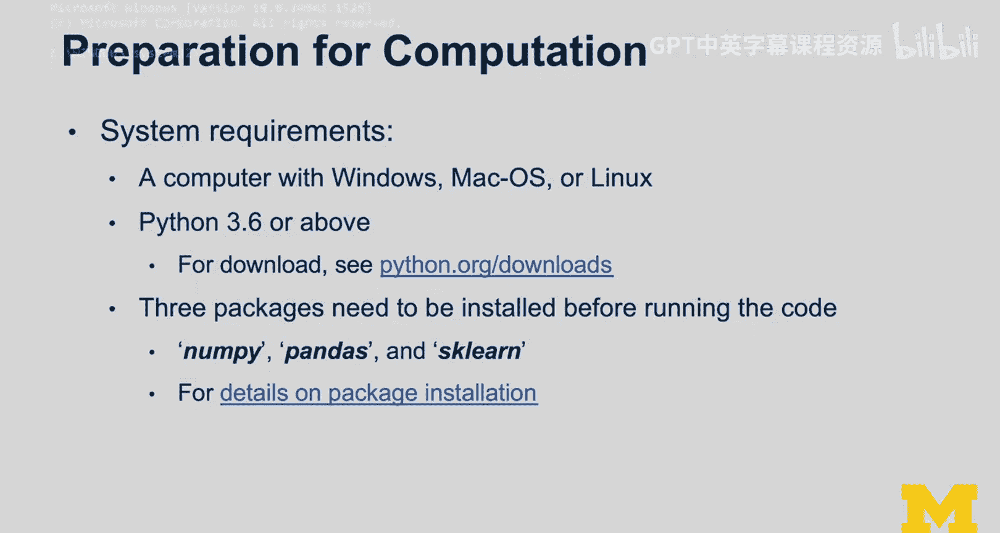
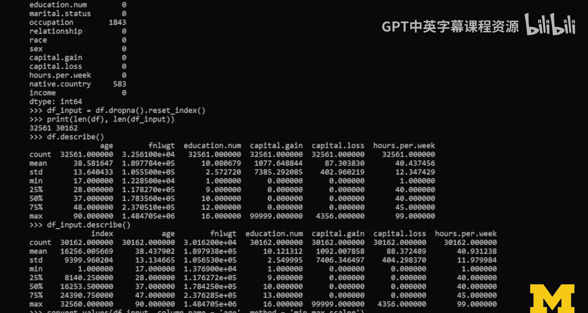
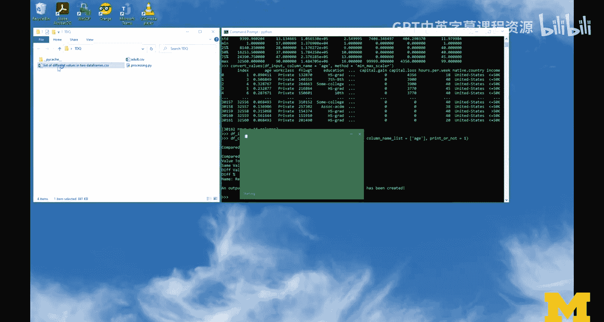
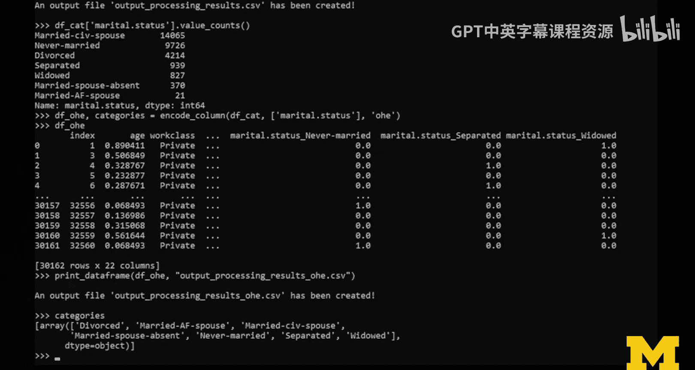
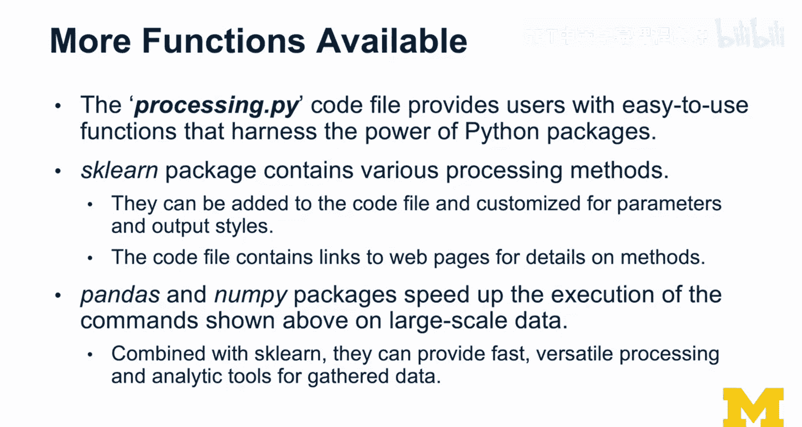

# 密歇根大学《总体数据质量（框架、度量、设计策略）total data quality》 p85 12_示例：提升采集型数据处理质量的最佳实践.zh_en -BV1Jn4y1X7uS_p85-

Data processing is the preparation of quality data for analysis。This includes parsing， cleaning。

 standardization， filtering， and transformation of data instances and fields。

These techniques are very similar to those used for design data。But for large scale gather data。

 with sometimes millions of instances， data processing needs to be computationally efficient。

In this example， you will implement data processing techniques for gather data using Python packages。

Data source for this example comes from Census Pro database。

 The data set we are going to use is adult Census income that contains 32，600 records of US adults。

 socialci economic and income information。We will use a copy of the data set available on the University of California ofvine machine learning repossitory。

The data set has been quite frequently used for education in data science in general。

 as well as in machine learning before you move forward。

 please check your computer system for requirements。A computer with Windows。

 Mac OS or Linux is required to have Python installed to run the example code。

 you need to install three Python packages， numpy， pandas and ecallon。

Let's get ready for running comments。Download the data file。

 adult do CSsv and a Python code file processing thatt Pi from the TTQ course page and save them in any folder you want to use on your computer。

I created the processing that P file for you， so you can implement an example processing techniques without writing all the detailed Python code lines。

Now， open a command prompt and change your current walking directory to the location of the folder where the data file and the code file are saved。

Open a Python console by typing Python on the command prompt and press enter。

Then let's load Python packages。Type each command as shown below and press enter import panddas S PD。

 importy S and P。From S K La input pre processing。These load data processing functions from a machine learning package named as Klon。

 most importantly typed from processing input asterisk risk and press En。

This will import all available functions included in the code file named processing created for this example。

As packages are loaded， it's time to load sample data。Type a command as shown below， and press enter。

By adding an A under values equal question mark to the command。

 you clarify that missing values are denoted by a question mark in the data。Now。

 let's see how the data look like。For this， type D F dot head parentheses and press enter。

The first five rows are displayed。 The first row has a missing value for the work class column。

The screen shows that there are 15 columns， but many of them are not shown。For data overview。

 type D F dot info parenthesesis and press enter。This reports that there are 32561 entries。

 and 15 columns。Each column name is listed with its non missing count and data type， As you can see。

 some columns like work class and occupation are shown to have missing values。

How can you get a summary of missing values， if any， in all columns in the data？

You type the F thatt is an a parentheses that sum parentheses and press enter。

You will see the counts of missing values in each column。 For example。

 the walk class column has 1836 missing values。You will learn how to replace any missing values later in the course3 week3 session。

For now， let's delete any missing values from the load data。Type commands as shown below。

 and press enter。Here， two things happen。 First， you drop any rows with any missing values in any column and create another data frame named D F underbar input that contains only the remaining rows。

Second， you assign new index numbers to each row by adding reset underbar index as you change the number of rows by dropping some of them。

You can check how many rows are deleted by printing lengths of rows before and after the change。

Here you can see that the number of rows in the originally loaded data got reduced by about 25400 and after dropping rows with missinging values。

You know how to get distributions of numerical values， right。

 Do you remember you typed D F thatt describe parentheses for this。Please type that again。

 and press enter。This reports distributions of numerical values in the columns whose data types are integralger 64 in the originally loaded data。

Now type the command again， but with the reduced data frame name， the F on the input and press enter。

Can you see the differences between two results。First。

 index column has been added as you change the index evolve。Second。

 row counts of the columns have been changed。But both results show that the columns have different ranges of numerical values and distributions。

This can be problematic for many analytics and especially for machine learning。

So there are scientists often rescale values to make their ranges consistent across columns。

You can rescale values so they they are changed into values between 0 and 1。

This is done by Min Max scalealr。Which is one of the processing functions in Scallon。

Do you remember a Python code file named processing that Pi has been loaded。

 You can use customized commands in the file to implement any scalr from Scallon。

Type the command below on the console First， convert on the bar values is a customized command for value conversion。

Second， you choose the F under bar input as a target data frame to be converted。Third。

 by typing column name and age， you input the name of a column to be converted。Last。

 you decide which conversion method is used here， mean Max Gar is selected。Press， enter。

This converts numerical values in the column H into values between 0 and 1， using min max Gaar。

The changed failures are recorded in D F input data frame。If you work with small size data。

 you can just look into the data frame for any changes。

But what if you are dealing with a huge data set。A customized function is available for this situation。

First， type a command as shown below and press enter。

This repeats what you've done of to drop all rows with any missing values to create another data frame for comparison。

Then type a command line， exactly as shown。Let me explain what each part does。 First。

 a data frame named D F Underbar compared is created to contain results of command execution。Second。

 compare under about data frame is a customized function for comparing changes between two data frames。

Third， you give two data frame names to be compared for any changes here。

 type DF input before and DF input。Next， choose what columns are compared for changes。

 You can give one or more column names。Here， type H with single quotation marks and wrapped by square brackets。

Last decide whether you want the comparison result will be printed in a text file or not。1 means yes。

 otherwise， no。Once you complete typing the command line， press enter。

Then you will see a report that summarizes changes。

It reports the number of data points that are converted and its ratio over the total。

Note that an alpha file has been created。To open the output file。

 go to the folder you use to put the data file and processing code file。

You can see a C SV file created。Open it。Now， you can see how each value in the column is converted here。

 age under bar pre represents the column before change。

 and age under bar pause represents the column after change。

If you want to check the changes but don't want to open the out profile。

 just type the F under the bar compared and press enter。

This reports the first five and last five rows and their changed values after conversion。

Let's take a look at another method to convert numerical values。Type the command as shown below。

First， convert under our values is a customized command for value conversion。Second。

 you choose Df underbar input as a target data frame to be converted。Third。

 by typing column name and hours do per dot week， you input the name of a column to be converted。

Last， you decide which conversionver method is used。Here， standard scalar is selected。Press enter。

This standardizes numerical values in the column， hours per week。

Other than mini Maxax scalar and standard scalar， more methods like normalizer。

 power transformer and label binizer are available。So far， we have converted numerical values。

A common data processing techniques for categorical values is decocaromization。

Type D F on the bar input income in square brackets and single quotation marks that value on the bar counts parentheses and press enter。

This reports there are two unique values in the income column。

This column has been used as a dependent variable in many statistical and machine learning tasks after its values are decocartomized。

Let's convert the values into decocaromized ones。 In other words，0 and1 by typing the command below。

The command line is almost the same as one you typed above for Min Maxax Scalar and standard scalar。

 except that its method is labeled by an ariser。You can see that values in the income column has been changed into 0。

01。Some categorical values can have two or more unique values。

One of such cases is that categor values can be ordered by their weight。

 importance or timing of events。Let's take a look at the education column to see how many unique values exist。

Type a command line as follows， and press enter。This shows a list of unique values in the column。

 and their accounts。Do you notice that there can be ordered by education level， For example。

10th grade comes before 11th grade。How can I create a list of ordered unique values。Unfortunately。

 no easy way here。Instead， type command lines as shown below and press enter for each line。

The ellipses will appear automatically when you press enter after you type each line。

While you are typing， pay special attention to the square brackets， quotation marks。

 wrapping each categoral value， and a commas that separate each value。

After you successfully type the lines， type a comment line below。First， D， F under bar， O， L。

 D and categories。Means two outputs created by a functioning code column。Second。

 encode under column is a customized function to change values。Third。

 Tf underbar input is the name of a target data frame to change values in it。Fourth。

 education is the name of the column to be converted。Next， while D means the values are ordered。

L ordered under about categories is the list of categorical values ordered manually by U in the above step。

If you press enter， the categorical values in the education column are ordered according to the given list and saved in the alpha data frame named DF Odoba OLD。

To check the results， type DF onba OLD and press En。Now。

 you can see that the last column named education is filled with ordered numbers that represent categor values。

Sometimes data scientists just simply assign random numbers to categories before they fit the data into analytical tools or machine learning algorithms。

But if you want to do this， you can use the customized function with a simple tweakig。

Let me show you how to do it。Type the command below， and press enter。

This is basically the same command line as you typed above to convert categor values into order numbers。

Here are a few different things to note。First， the outputs are named in a different way to distinguish them from previous ones。

Second， the input data frame is Df on bar or while D。

 not D F onbar input because you override the results into previous one。Third。

 you can see that two column names， race and sex are put together within the same square brackets。

This means you can convert two or more columns at the same time， using the same method。Last。

 none is set as a value for the last input variable instead of ordered under bar categories。

 as we don't care about the ordering of values here。Let's check what happened to the two columns。

Type the app on the bar cat， and press enter。The al data frame is displayed。

You can see that two columns， races and sex have numbers instead of text strings。

Please note that the converted columns are moved to the end。

I told you that these convergence do not care about ordering。

 then how can you find which categor value has been converted into what numerical value。

Do you remember you created two outputs in the previous command。

The output named categoriesries is a list of categorical values and the orders of appearance correspond to the numerical values in the converted column。

Let me show you how this works。Type categories。 and press enter。

Here you can see that AM EL D Indian D Ekimo was converted into0 as it appears first。Meanwhile。

 white was converted into4 as it appears last among five categor values in the list。

Female was converted into 0， while male into one。If you want to see the results of value conversion in a file。

 you can use a customized function to print the results。

Type the comment as shown below and press enter。This command produces an output file that prints the results of all processing steps demonstrated above。

You can find it in the folder where you put the data and processing code file。

Please note that you can decide the name of the alpha file For this example。

 I named it as output on thebar processing onbarresult。 CS3。

Another nuance way of converting categor values is using one h encoding。

Let me dive into the example and then explain how one hat encoding works。

Let's select the Mo status column for this task。Type a command line shown below and press En to see the count of unique values in the selected column。

If they are converted into integers using categorical value converts demonstrated of。

 some machine learning algorithms consider a integers to be related closer than others， For example。

 one is assumed to be closer to two than to3 or others。

This is not what you want categorical values to be converted。To address this problem。

 data scientists use a technique called one h including。Type a command line below。First。

 two outputs are named D F Under， O， H， E and categories。Second， a customized function is called。

Third， the eundbar cat is used as an input data frame。Fourth。

 the name of the column to be included is provided。

Lest an encoding method is selected here you pick up OA G， which is the acronym of one h encoding。

To see the encoding results， type D F on the bar Wait E and press enter。

Can you see how one art encoding works。Instead of assigning numerical values to categories。

 one hat including creates extra columns for each categorical values and then recordscourse the membership of a value in each of the extra columns。

For example， the marathon status was widowed for the first row。

So the first row has a value of one for the extra column name marathital status we do。

 while G rows for all other extra columns。In the screen display， some columns are not shown。

So if you want to see the results in a file， type the command line below and press enter。

If you want to know how many categorical values are used to create extra columns in what orders type categories and press enter。

This will display the list of categor values sorted in the order of appearance in the extra columns added to the data frame。

You have learned several techniques to maximize data processing quality in this example。

The processing that pi could file provides is to use functions that harness the power of Python packages。

Especially as Kalan， which is the core of this code file。

 contains various processing methods that are not included in this code file。

You can add other functions to the code file and customize them for parameter settings and output styles。

The code file contains links to the web pages， for details on methods。Again。

 pandas and Ny packages speed up the execution of the comments shown above on large scale data。

Combined with SKL， they can provide fast versatile data processing tools for gather data。

