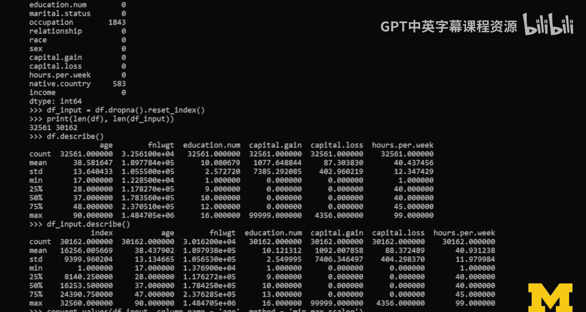
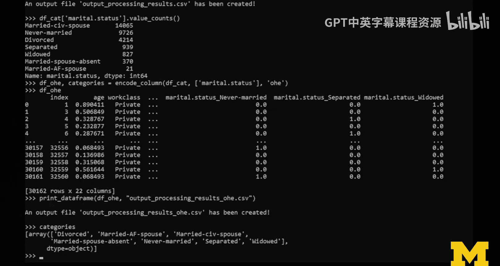
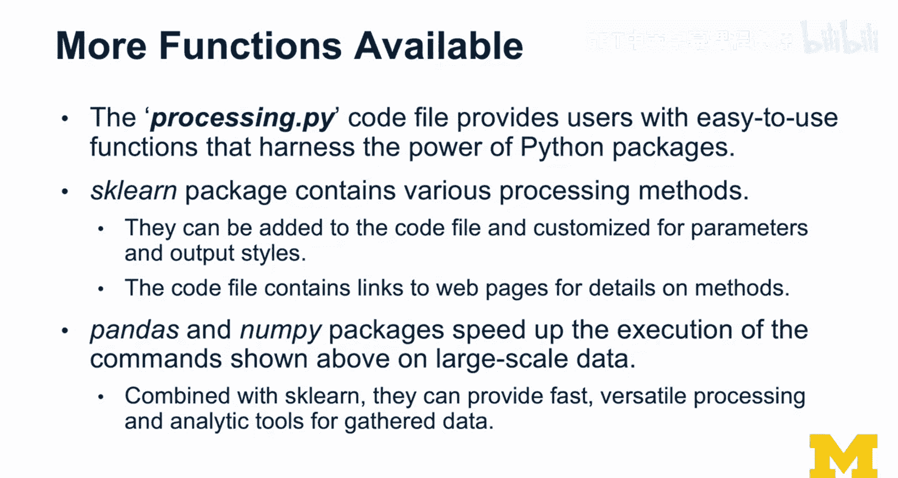

# 总体数据质量：12：示例：提升采集型数据处理质量的最佳实践 🚀


在本节课中，我们将学习如何通过Python实践数据处理技术，以提升大规模采集数据的质量。我们将使用一个包含32,600条记录的美国人口普查收入数据集，通过解析、清洗、标准化、过滤和转换等步骤，为后续分析准备高质量的数据。

---

## 概述

数据处理是为分析准备高质量数据的过程。这包括对数据实例和字段进行解析、清洗、标准化、过滤和转换。对于大规模采集数据（有时包含数百万条实例），数据处理需要具备计算效率。本节将通过一个具体示例，展示如何使用Python包（如`numpy`、`pandas`和`scikit-learn`）来实现这些技术。

---

## 环境准备与数据加载

在开始之前，请确保您的计算机（Windows、Mac OS或Linux）已安装Python。您需要安装三个Python包：`numpy`、`pandas`和`scikit-learn`。


以下是运行示例的准备步骤：

1.  从课程页面下载数据文件 `adult.csv` 和Python代码文件 `processing.py`，并将它们保存到您计算机上的任意文件夹中。
2.  打开命令提示符，将当前工作目录切换到保存数据文件和代码文件的文件夹位置。
3.  在命令提示符中输入 `python` 并按回车键，打开Python控制台。
4.  加载所需的Python包。依次输入并执行以下命令：

```python
import pandas as pd
import numpy as np
from sklearn import preprocessing
from processing import *
```

`processing.py` 文件包含了为本示例预定义的自定义函数，可以简化代码编写。

现在，加载示例数据。输入以下命令并按回车：

```python
df = pd.read_csv('adult.csv', na_values='?')
```

通过设置 `na_values='?'`，我们指定数据集中用问号 `?` 表示缺失值。

---

## 数据概览与缺失值处理

让我们先查看一下数据。输入 `df.head()` 并按回车，可以显示前五行数据。第一行在“工作类别”列存在缺失值。

为了获得数据集的整体概览，输入 `df.info()` 并按回车。报告显示共有32561个条目和15列。每列都列出了其非缺失值的数量和数据类型。可以看到，“工作类别”和“职业”等列存在缺失值。

要获取所有列中缺失值的摘要，可以输入 `df.isna().sum()` 并按回车。例如，“工作类别”列有1836个缺失值。

目前，我们先从加载的数据中删除所有包含缺失值的行。输入以下命令：

```python
df_input = df.dropna().reset_index(drop=True)
```

这里发生了两件事：首先，`dropna()` 删除了任何列中包含缺失值的所有行，创建了一个仅包含剩余行的新数据框 `df_input`。其次，`reset_index(drop=True)` 在删除行后为每一行分配了新的索引号。

您可以通过打印更改前后的行数来检查删除了多少行。原始数据行数减少了约2500行。

---

## 数值数据的分布与缩放

您知道如何获取数值的分布，对吗？输入 `df.describe()` 可以报告原始数据中数据类型为 `int64` 的列的数值分布。

现在对处理后的数据框 `df_input` 再次输入 `df_input.describe()`。可以看到两个结果之间的差异：首先，索引列因重置索引而改变；其次，各列的行数发生了变化。但两个结果都显示，各列具有不同的数值范围和分布。

这对于许多分析，尤其是机器学习来说，可能会造成问题。因此，数据科学家经常对数值进行重新缩放，以使各列的范围保持一致。

一种常见的方法是将数值缩放到0和1之间，这可以通过 `MinMaxScaler` 实现，它是 `scikit-learn` 中的一个处理函数。您可以使用 `processing.py` 文件中的自定义命令来实现。

输入以下命令：

```python
df_input = convert_values(df_input, 'age', 'minmax')
```

这将使用最小-最大缩放法，将 `age` 列中的数值转换为0到1之间的值，并将更改记录在 `df_input` 数据框中。

---



## 对比处理前后的变化

如果您处理的是小型数据集，可以直接查看数据框的变化。但如果您处理的是大型数据集呢？为此，我们提供了一个自定义函数。

首先，输入以下命令创建一个用于比较的新数据框：

```python
df_input_before = df.dropna().reset_index(drop=True)
```

然后，输入以下命令行：

```python
df_compared = compare_dataframes(df_input_before, df_input, ['age'], 1)
```

让我解释每个部分的作用：
*   `df_compared` 是一个用于存放命令执行结果的数据框。
*   `compare_dataframes` 是一个用于比较两个数据框之间变化的定制函数。
*   您需要提供两个要比较的数据框名称，这里输入的是处理前的 `df_input_before` 和处理后的 `df_input`。
*   选择要比较哪些列的变化，可以提供一个或多个列名。这里输入的是 `['age']`。
*   最后决定是否将比较结果打印到文本文件中，`1` 表示是，否则为否。

执行命令后，您将看到一个总结变化的报告，其中报告了转换的数据点数量及其占总数的比例。同时，一个输出文件（CSV格式）会在您的文件夹中创建。打开它，您可以看到 `age` 列中每个值是如何转换的（`age_pre` 表示转换前，`age_post` 表示转换后）。

如果您不想打开输出文件，只需输入 `df_compared` 并按回车，即可查看转换后前五行和后五行的值及其变化。

---

## 其他数值转换方法


让我们看看另一种转换数值的方法：标准化。输入以下命令：

```python
df_input = convert_values(df_input, 'hours-per-week', 'standard')
```

这将标准化 `hours-per-week` 列中的数值。

除了 `MinMaxScaler` 和 `StandardScaler`，还有更多方法可用，如 `Normalizer`、`PowerTransformer` 和 `LabelBinarizer`。

---

## 分类数据的处理：标签编码

到目前为止，我们处理了数值数据。分类数据的一种常见处理技术是数字化（标签编码）。

输入 `df_input['income'].value_counts()` 并按回车，报告显示 `income` 列有两个唯一值。在许多统计和机器学习任务中，该列在其值被数字化后常被用作因变量。

让我们将这些值转换为数字（即0和1）。输入以下命令：

```python
df_input = convert_values(df_input, 'income', 'label')
```

命令行与上面用于 `MinMaxScaler` 和 `StandardScaler` 的几乎相同，只是方法换成了 `label`。您可以看到 `income` 列的值已变为0和1。

---

## 有序分类数据的编码

有些分类值可能有两个以上的唯一值。其中一种情况是分类值可以根据其权重、重要性或事件发生时间进行排序。

让我们看看 `education` 列有多少个唯一值。输入 `df_input['education'].value_counts()` 并按回车。这会显示该列中唯一值的列表及其计数。您是否注意到这些值可以按教育水平排序？例如，“10th grade”在“11th grade”之前。

如何创建一个有序的唯一值列表？这里没有简单的方法。相反，请按如下所示输入命令行，每行按一次回车（省略号会在您输入每行后按回车时自动出现）。输入时，请特别注意方括号、引号以及分隔每个值的逗号。

```python
ordered_categories = [
    'Preschool', '1st-4th', '5th-6th', '7th-8th', '9th', '10th', '11th', '12th',
    'HS-grad', 'Some-college', 'Assoc-voc', 'Assoc-acdm', 'Bachelors', 'Masters',
    'Prof-school', 'Doctorate'
]
```

成功输入这些行后，输入以下命令行：

```python
df_ord, categories = encode_column(df_input, 'education', 'ordinal', ordered_categories)
```

解释如下：
*   `df_ord, categories` 表示由函数 `encode_column` 创建的两个输出。
*   `encode_column` 是用于更改值的自定义函数。
*   `df_input` 是要更改值的目标数据框的名称。
*   `education` 是要转换的列的名称。
*   `ordinal` 表示这些值是有序的。
*   `ordered_categories` 是您在上一步中手动排序的分类值列表。

按回车后，`education` 列中的分类值将根据给定的列表进行排序，并保存在名为 `df_ord` 的新数据框中。

要检查结果，请输入 `df_ord` 并按回车。现在，您可以看到名为 `education` 的最后一列填充了代表分类值的有序数字。

---

## 无序分类数据的编码

有时，数据科学家在将数据拟合到分析工具或机器学习算法之前，只是简单地为类别分配随机数字。如果您想这样做，可以使用自定义函数并进行简单调整。

输入以下命令：

```python
df_cat, categories = encode_column(df_ord, ['race', 'sex'], 'label', None)
```

这基本上与您上面将分类值转换为有序数字的命令行相同。这里有一些不同之处需要注意：
*   输出命名方式不同，以区别于之前的结果。
*   输入数据框是 `df_ord`，而不是 `df_input`，因为您要将结果覆盖到之前的数据框上。
*   您可以看到两个列名 `race` 和 `sex` 被放在同一个方括号内。这意味着您可以使用相同的方法同时转换两个或多个列。
*   最后一个输入变量的值设置为 `None`，而不是 `ordered_categories`，因为我们不关心这里的值排序。

让我们检查一下这两列发生了什么变化。输入 `df_cat` 并按回车。新数据框被显示出来。您可以看到 `race` 和 `sex` 两列现在是数字而不是文本字符串。请注意，转换后的列被移到了末尾。

既然这些转换不关心顺序，那么如何知道哪个分类值被转换成了哪个数字呢？还记得您在之前的命令中创建了两个输出吗？名为 `categories` 的输出是一个分类值列表，其出现顺序对应于转换列中的数字值。

让我展示一下这是如何工作的。输入 `categories` 并按回车。在这里您可以看到，“Amer-Indian-Eskimo”被转换为0，因为它首先出现。同时，“White”被转换为4，因为它在列表的五个分类值中最后出现。“Female”被转换为0，而“Male”被转换为1。

如果您想将值转换的结果保存在文件中，可以使用自定义函数来打印结果。输入如下命令并按回车：

```python
print_processing_results(df_input, 'output_processing_result.csv')
```

此命令会生成一个输出文件，打印上面演示的所有处理步骤的结果。您可以在放置数据和代码文件的文件夹中找到它。请注意，您可以决定输出文件的名称，本示例中我将其命名为 `output_processing_result.csv`。

---

## 分类数据的处理：独热编码

另一种更细致的分类值转换方法是使用独热编码。让我先演示示例，然后解释独热编码的工作原理。

让我们选择 `marital-status` 列来完成此任务。输入如下命令行并按回车，查看所选列中唯一值的计数。

如果使用上面演示的分类值转换方法将它们转换为整数，一些机器学习算法会认为某些整数之间的关系比其他更近，例如，1被认为比3更接近2。这通常不是您希望分类值被转换的方式。

为了解决这个问题，数据科学家使用一种称为独热编码的技术。输入以下命令行：

```python
df_ohe, categories = encode_column(df_cat, 'marital-status', 'onehot')
```

解释如下：
*   两个输出被命名为 `df_ohe` 和 `categories`。
*   调用自定义函数 `encode_column`。
*   使用 `df_cat` 作为输入数据框。
*   提供要编码的列名 `marital-status`。
*   选择编码方法，这里选择 `onehot`，它是“独热编码”的缩写。

要查看编码结果，请输入 `df_ohe` 并按回车。您能看到独热编码是如何工作的吗？它不是为类别分配数值，而是为每个分类值创建额外的列，然后在每个额外的列中记录该值是否属于该类别。

例如，第一行的婚姻状况是“Widowed”。因此，第一行在名为 `marital-status_Widowed` 的额外列中的值为1，而在所有其他额外列中的值为0。在屏幕显示中，有些列没有显示。

所以，如果您想查看文件中的结果，请输入以下命令行并按回车：

```python
print_processing_results(df_ohe, 'output_onehot.csv')
```



如果您想知道使用了多少个分类值来创建额外的列以及它们的顺序，请输入 `categories` 并按回车。这将显示分类值列表，按其添加到数据框的额外列中的出现顺序排序。

---

## 总结

在本示例中，我们学习了几种最大化数据处理质量的技术。`processing.py` 代码文件提供了利用Python包（特别是 `scikit-learn`）强大功能的函数。该代码文件包含了指向方法详细信息的网页链接。

再次强调，`pandas` 和 `numpy` 包可以加速上述命令在大规模数据上的执行。结合 `scikit-learn`，它们可以为采集数据提供快速、多功能的数据处理工具。




通过本课程，我们一起实践了数据加载、缺失值处理、数值缩放、标签编码、有序编码以及独热编码等关键数据处理步骤，为进行高质量的数据分析奠定了坚实基础。