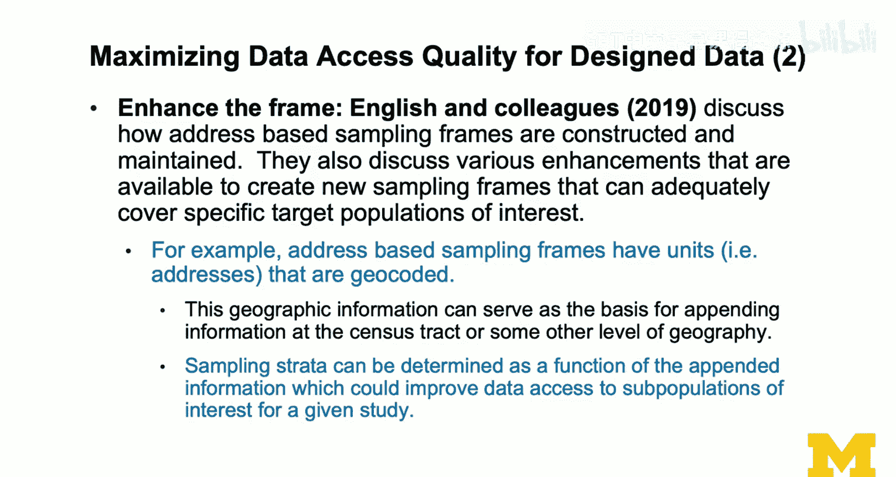
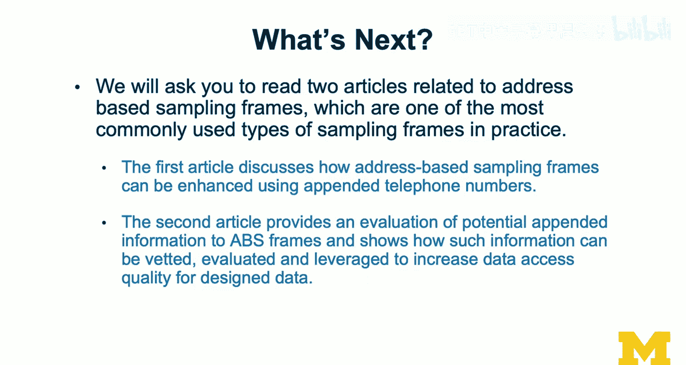

# 密歇根大学《总体数据质量（框架、度量、设计策略）total data quality》 p86 13_最大化设计型数据访问质量.zh_en -BV1Jn4y1X7uS_p86-

Hello， welcome to our lecture on maximizing data access quality for design data。 I'm Tram Busgar。

 We're happy to have you just as we do in all the lectures。

 want to make sure that we're all on the same page about where we are in our framework。😊。

We're going to be talking about ways to maximize data access quality for design data。

 The data access portion of our framework falls on the representation side and we are going to be focusing again on design data here。

 just to recall， data access refers to the platforms， repositories， methods。

 approaches or tools that are available or can be used to retrieve information about a population of interest for design data in particular。

 access to a target population is typically provided through a sampling frame which is constructed from lists of people or areas。

 maps etc In particular， a sampling frame is a set of information。

 materials or procedures that is used to select a sample。

 we prefer sampling frames that give us every eligible unit a non-zero probability of being selected。

 those are probability samples。A non probability sampling frame is also a frame。

 but not one under which the sampling is controlled by the sampler。

 The sampling frame gives you access to the target population。 In some cases。

 we can improve the coverage of or access to the target population by using more than one frame。

In this particular lecture， we're going to discuss three broad approaches that can be used to maximize data access quality for design data。

 including using multiple frames to improve coverage of the target population。

 enhancing frames by adding additional information that can be used in the sampling design。

 And then finally，lib calibration of the sample to known population targets。

 Let's first talk about multiple frames。 There's a lot of literature on multiple frames that dates back to the early 60s。

 And we've seen examples of multiple frames being used in such cases as a phishing efforts survey where you have a list of persons with ar licenses or ph licenses and a sample of addresses of the general population。

😊，Not everybody who fishes requires a fishing license。

 especially if you're just going to throw them back in or you're catching really small fish in a pond near your house。

 So in those cases， the first list wouldn't cover those people。 but the list of addresses could。

 And so we maximize the coverage of the population of all people who fish by using multiple frames。

 We've also seen lots of work with multiple frames in the scenario of random digit dialing designs for cellular and landline phones。

 Not everyone has a landline telephone。 So if you used a landline telephone frame。

 you would miss the people that do not have a landline and our cell phone only， for example。

 Let's illustrate this multiple frames with the context of an R DD design for both cellular and landline telephones。

 Here's our target population that we're trying to cover。

Here's the landline telephone frame that covers all of the people with a landline telephone number。

Here's the cell phone frame that covers all the people with a cellular telephone number。Clearly。

 there are people or households without telephones that aren't covered by using these two frames。

 but we certainly improve or maximize the coverage by using these two frames as opposed to using only one of them。

And clearly， one of the issues with using multiple frames is that there could be people that fall into both frames。

 So while on the one hand， we maximize coverage of the population more so than we would have gotten with using only one frame We do run the risk of having overlap in the two frames that has to be dealt with analytically and potentially in the field when we're trying to take samples from both of these frames to maximize access to the target population。

Another thing that we can do to maximize data access quality for design data is to enhance the frame itself。

 English and colleagues in 2019 discuss how addressbased sampling frames are constructed and maintained。

 They also specifically discuss various enhancements that are available to create new sampling frames that can adequately cover specific target populations of interest。

 So， for example， using the entire country's address based sampling frame itself。

 we can add additional variables to that frame and the information in those variables， like。

 for example， Do you have a swimming pool。 That variable alone can be used to create a subframe only covering the households with a swimming pool if you are trying to do a study of swimming pool owners prior to the summer of 2022。

😊，Another example is address dressby sampling frames have units that are geocoded；

 all of the addresses have a geocode， this geocoded geographic information can serve as the basis for appending additional information at the census tract level or some other level of geography。

Sampling strata can be determined as a function of the appended information。

 which could improve data access to subpopulations of interest for a given study。 For example。

 I might be able to focus on census tracts that are five miles away from water if I'm doing a recreation based study。

 for example， or I can find information about areas that have a high concentration of minority persons if I'm interested in a study about diversity and inclusion and want to care about opinions for minority residents。

 sampling strata can be determined as a function of the append information。

 which could improve data access to subpopulations of interest for a given study。 For example。

 if I want to look at an area where there are younger residents。

 I could append census age group information at the track level and focus on tracks that have a higher proportion of younger Americans for a study about age related issues。

The other way that I can maximize data access quality for design data is to apply machine learning models to create sampling strata based on auxiliary information and gather data。

Eckkin colleagues in 2018 developed a neural network model to identify the location of windmills for aerial images to create a sampling frame with the geo coordinateds of the windmills。

 Currentlyly， there is no directory of where the windmills are located across the country by using these aerial images。

 The team was able to identify the locations of where those windmills were。

 Translating those locations into geo coordinateds that can then be used for sampling was a real advantage of this research。

 We discussed this particular paper in more detail in the second example of our fourth week of this course。

😊，Some other examples of using machine learning or applying machine learning models to create sampling strata are also in the literature Burgen it all in 2019。

 for example， use machine learning methods to create strata based on multiy expenditure trajectories for a survey interested in learning about the range of care。

 delivery structures and processes。That are used to influence total costs for providing health care to patients。

Busker and Kicher in 2020 provided a comprehensive overview of how they and others are leveraging auxiliary and gather data sources with machine learning to create or enhance sampling frames for probability based designs。

 Lastly， we're going to talk about calibration adjustments。

 These use specialized weighting techniques to ensure that a sample accurately reflects a population based on what is known about that population。

 These techniques correct for deficiencies in the sampling frame using post stratification or raking techniques in particular。

 Com up， We'll ask you to read two articles related to addressbased sampling frames。

 which are one of the most commonly used types of sampling frames in practice。😊。

The first article discusses how address based sampling frames can be enhanced using appended telephone numbers。

 And the second article provides an evaluation of potential append information to such frames and shows how this information can be vetted。

 evaluated and leveraged to increase data access quality for design data。

 Thanks so much for joining us in this lecture。 Happy reading。😊。

