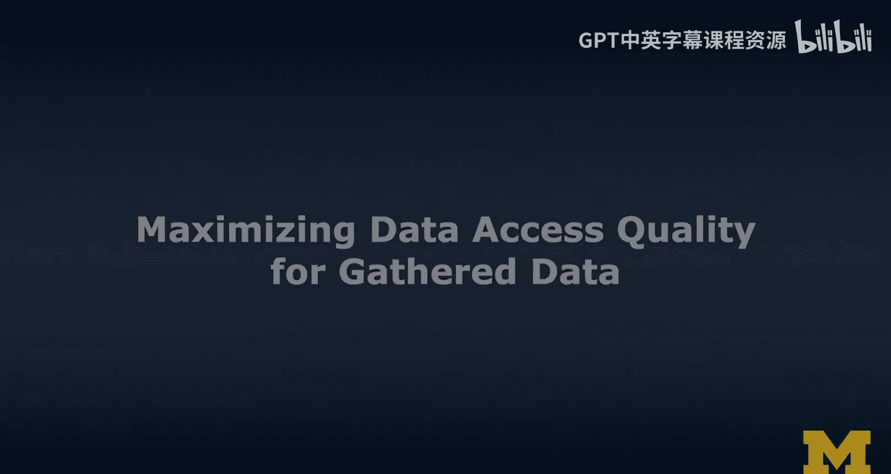
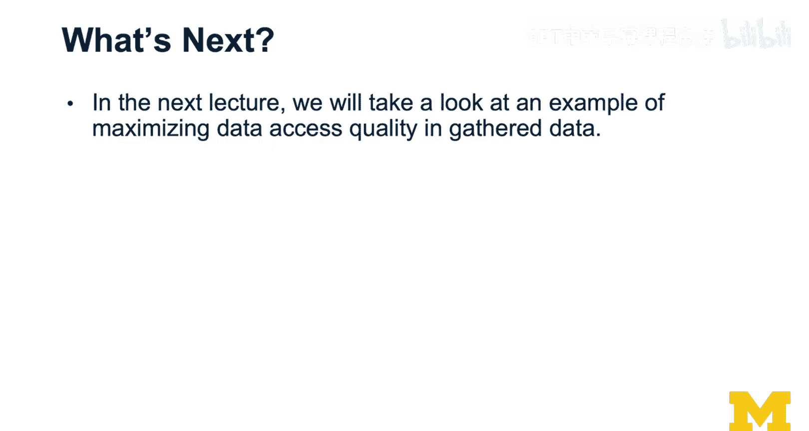
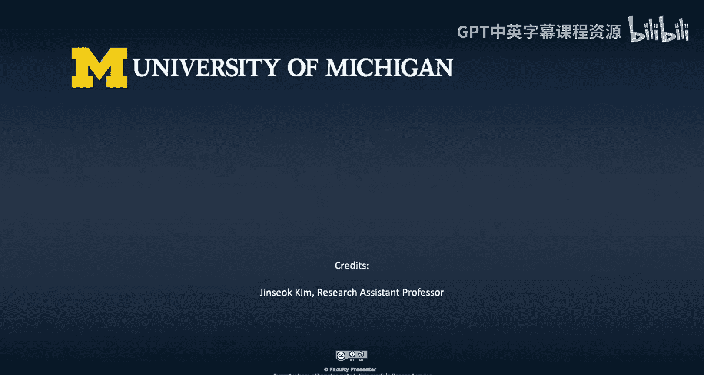

# 密歇根大学《总体数据质量（框架、度量、设计策略）total data quality》 p87 14_最大化采集型数据访问质量.zh_en -BV1Jn4y1X7uS_p87-

Hello， everyone。In this lecture， you will learn how to maximize data access quality for gather data。

We always start learning by checking where we are in the big picture。Now。

 our topic is about data access quality for gather data。

Web scraping is widely used to access data online， but it can cause a data access problem when it fails to properly retrieve all available information on a web page。

 such a problem occurs when users use web scrappers without good knowledge of the web page they intend to mine。

For example， value instances may be ill formatted or misplaced on the wrong data fields。

 so web scrappers may fail to retrieve them。Oftentimes data cleaning and processing need to be implemented with proper skills and decisions while scraping good news is that various user friendly web scraping tools are available for free or commercial uses for example。

 Google Chrome extension web scrapper and ParHb are free。Commercial web scrappers like F Minr。

octop parts and Outwit provides free trials and customer services。These tools provide tested。

 reliable and easy to use methods for web scraping。

 so users who are unfamiliar with script languages can obtain good quality web scraping results。

Sometimes we may need to access and scrap web pages using Scri languages because free or commercial tools are not suitable for the scraping task we want war too expensive。

Programming or script languages provide versatile methods。For example。

 Xpath is a query language specialized in instructing information in XML documents。

Another example is beautiful soup， a Python library for web scraping during the web scraping we can use regular expressions to extract matched patterns from mess data。

 maximizing data excess quality。Another method to maximize data access quality is to use online data platforms providing APIs for data access。

Social media companies like Twitter， commercial services like Jillow。

 and many federal and state government agencies allow users to access data through APIs。

So we can maximize the quality of data access by choosing the correct API and calls for a given source。

For example， commas can represent or while space means and in some APIs。

This asks for special attention from users who want to use the APIs。

Another way to maximize data access quality using APIs is to integrate the API within a broader data quality control framework to minimize handoffs in data curation。

A common example of this approach is to combine an API pipeline with a data processing method like regular expression and data cleaning。

One consideration in using social media APIs is that social media platforms tend to allow public access to their data for a restricted amount of information or time range。

To overcome this challenge， there are scientists use sampling。

First the example is the study by Hino and Fahei in 2019。

 where the authors built a Twitter data archive based on a random sample of Twitter user IDs and gathered tweets associated with these user IDs。

Another example is a two stage sampling proposed by Bovski and colleagues in 2018。

Their first step is to conduct probability based systematic sampling on Twitter user IDs and gather tweets from the users。

Then the sample of the users are further stratified and a random sample of users from each stratum is selected。

Next， we will learn how to maximize data access quality in gather data using a real world example。

