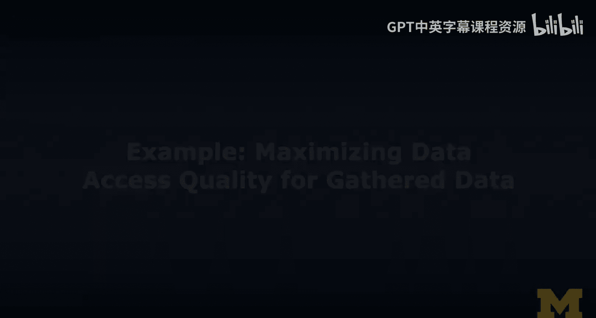
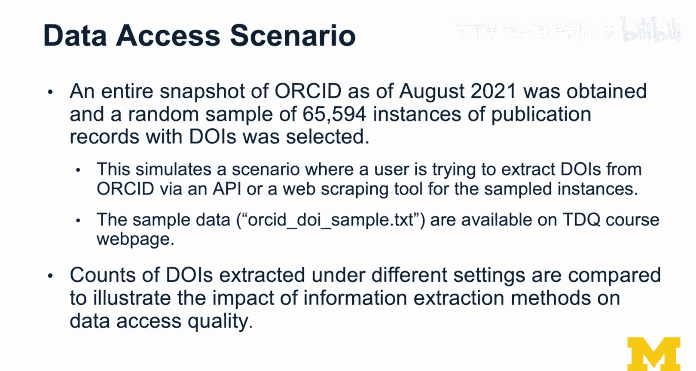
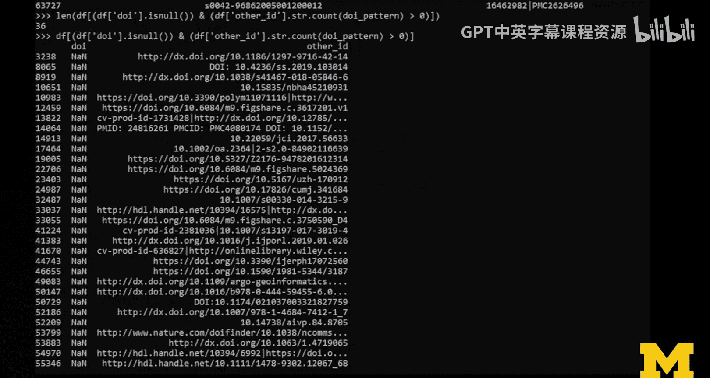
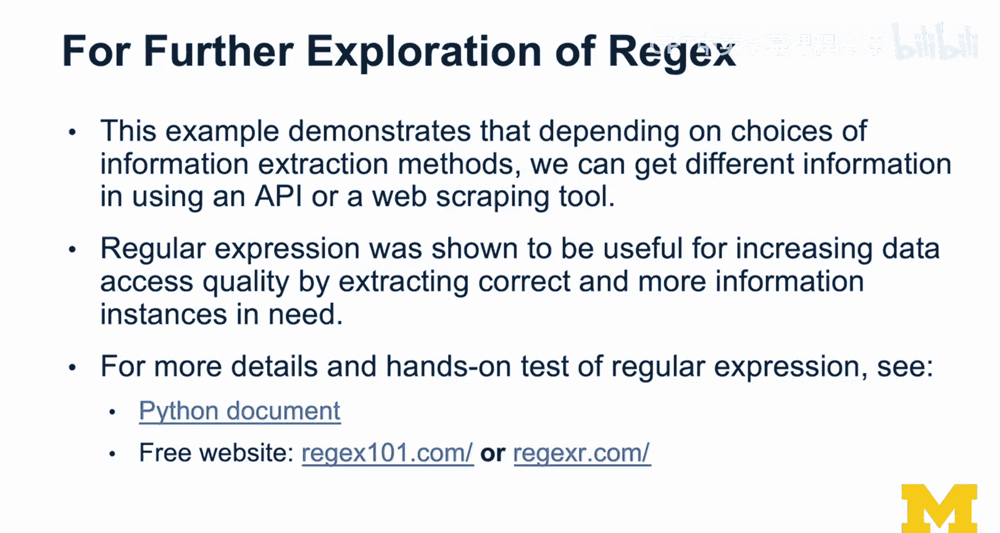
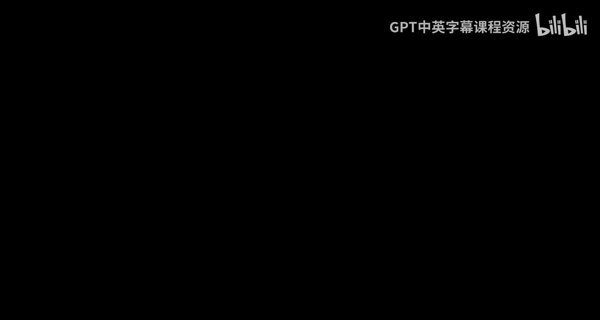
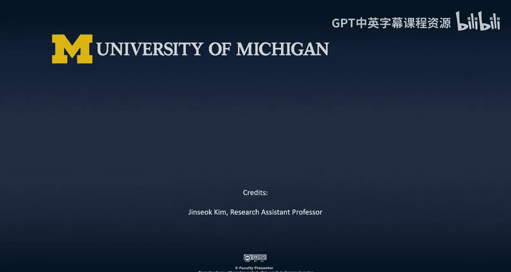

# 密歇根大学《总体数据质量（框架、度量、设计策略）total data quality》 p88 15_示例：优化采集型数据访问质量的实现路径.zh_en -BV1Jn4y1X7uS_p88-

Hello， everyone。 In this example， we'll take a look at maximizing their excess quality for gather data。

Researchers and digital libraries often link Ochi data to publication records to find out who has published what papers。

The main reason is that consistent researcher identifiers do not exist across publication data sets。

OchiID， an acronym of Open researcher and contributor ID。

 is a nonprofit open data platform of researcher profiles curated by more than 10 million people across the world。

As ORCID offers a public API with almost no restriction。

 it is widely used by researchers and commercial digital libraries。

How does OI link to publication data。Technically， D O I is the key to linkage。

DOI refers to digital object identifier， which is a kind of international format for identifying a unique publication item。

Here's an example of DI being used as a connector to link OchiID and publication data。First。

 we find matched Diis in OchiID and publication data。

Then we find matched the names in the OID record and the publication record that shares the same DOI。

While using DI information in OchiID， we often encounter a data access problem。

Why does that happen In all， Dis are supposed to appear under the DoI tag。

 but many Dis are recorded under different tag or mixed with other paper Ids。 For example。

 in the left image， the DOI of the paper is recorded under other I tag。In the right image。

 OI is recorded with PMID and PMC IDD。Why does the problem matters。

If DOIis are extracted by looking into information only under the DI tag through an API。

 many DOIis recorded under other tags will be missed。

Another problem is that information under the DOI field may not be a DI instance。For example。

 the string with a DI tag in the example image does not look like a DI in any way。

This mislabelled DI can cause a linkage error。So we need to extract as many correct DI instances as possible from OchiID to maximize data access quality。

We explore using regular expression to extract U eyes from orchid in this example。Regular expression。

 which is short as rex or rex， refers to patterns of strings expressed in a way that computation languages can detect them。

For example， the format of a phone number 1，2，34，5，67，8，9。

0 is expressed as backlashlash D 3 in brackets， backlashlash dash backlash D3 in brackets。

 backlash dash backlash D4 in for brackets， back slash。In res。

 backlash signals that a following character needs to be interpreted literally。

Low cased D means any integers rising from 0 to 9。Numbers in collie brackets designate counts of numeric characters to be followed。

Any phone number that does not conform that the pattern will be decided as non match on the racks。

Then what is the ra for detecting the Y。Here's an example of a DI。

Please have some time to take a look at it and think of a pattern of yours。

Do you find a pattern to characterize the Di。Here's a widely used re for theis。

Let's break down the pattern。First， all with single quotation marks in number one and number 12 signals that the following string is a row string。

 ignoring any escape codes。Second， two backlash bes in number  two and 12 are word boundaries that match only world characters at the start and end of a string。

Third， a set of parentheses， number 3 and number 11 groups characters then match on the pattern in the parentheses。

The group of matched characters can be accessed in a separated form later。Fourth， number 4，5，6，7。

 and 8 define that a D Y string must have two digits of 10 followed by a dot。

 at least4 and less than 10 integers and a forward slash。

Fifth number9 provides a range of characters that may be found alone or together in a DY string。

 for example， a DY may have any dash that under semicolon or any alphabetical characters or any combination of them。

Lest the following plus signal in the number 10 indicates that one or more of the characters listed in the square bracket need to appear in a DY。

This lagx was tested on a massive set of Ds and reported to detect 99% of 75 million DY instances。

For more information， follow the link into the Dis and matching regular expressions。

As you have learned about the lagx to detect a DI， it's time to test it on real world data access scenario。

A sample data is prepared for you。To create the sample。

 we obtained an entire snapshot of OID as of August 2021 and selected a random sample of 65594 instances of publication records with Dis from it。

This example simulates a scenario where a user is trying to extract the Ois from OID via an API or web scraping tool for the sample instances。

You can download the sample data from TDQ course's webage。

The goal of this example is to count theis extracted under different settings and compare them to illustrate the impact of information extraction methods on data access quality。

Download the data sample file named Ochid Onba D Y onba S dot TXT from T TQ course webpage and save it in any folder you want to use on your computer。

Next， open a command prompt and change your current working directory to the location of the folder where the data file and the code file are saved。

Type Python on the command prompt and press enter to open a Python console。Loow two packages。

 import pandas S P D， import lumpy S N p。Let's load the sample data by typing a command line。

 as shown below。Here are a few comments for the comment。Unlike previous examples。

 you need to specify the separator used in the sample file by typing S P equal back slash T in double quotation marks。

Here， T means tap。In addition， you need to specify which encoding scheme is used while reading the file here。

 UTF 8 is used。Without this includingcod setting， some special characters in the file will appear in strange symbols。

Once you type the command line， press enter。Now， a data frame named the D F is created。

To see how the data frame looks like， type DF thatt had parentheses and press enter。

Let's count how many DIis are recorded in the DI column。Type a comment， as shown below。

This calculates the sum of non missing values in the D Y column。

The total of non missing values is 53431。This assumes that all non missing instances in they columns are li limit Dis。

How can you check if all these instances are listening device eyes or not。Here comes the res。

Do you remember the ras for detecting a Dy in previous slides。

Let's type the pattern on the console and assignsign it to the U I on the pattern。Next。

 type a command line shown below， paying special attention to parentheses and skill breaks。

What this command line does is to count instances in the Dy column that are not missing values and have at least one string that matches on the Dy pattern。

Type the command， and press enter。You will get 53396。

 which is 35 less than the total of non missing values in the D Y column。

This means that some strings in U I column are not listening with U eyes。

Let's check which instances are not your wise。Please type a comment line below。

This command line asks pandas to filter instances in the Dy column that are not missing values and have no string that matches on the Di pattern。

 If you press enter a list of instances with strings that do not match on the DI pattern is displayed。

 For example， the first instance with index ID191019 contains a strange string in the Dy column。Next。

 let's find if any duys are recorded in another column。

Type a command line as follows and press enter。This command line is basically the same as you typed above to count less the eyes。

This time， however， you count instances that have no strings in the Di column but have Ds in the other I column。

 What is the result。You found 36 dus recorded in the other I D column。

Let's check what strings are found to match on the D Y pattern。For this。

 type a command line as shown below and press enter。

Or least is displayed to show the instances that have missing values in the DI column。

 but have legitimate Dis in the other I column。Note that less limit device eyes can be recorded with a URL format。

 starting with H T T P。The D I pattern we used the matches on the string coming after thatt O。

 L G forward slash。Also， note that some Ds are mixed with other paper I， for example。

The eighth instance with index ID D 1，4，0，6，4 contains PM I D， PMC I D and D Y in the same column。

This example demonstrated that depending on how you extract information。

 you can get different information in using an API or web scrapping tool。

 regular expression was shown to be useful for increasing data access quality by extracting crack and more information instances from gathered data。

If you want more details and handsone test of regular expression， follow the links in the slide。

