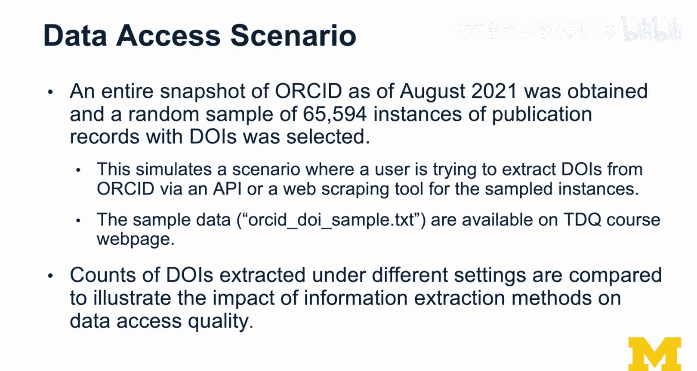
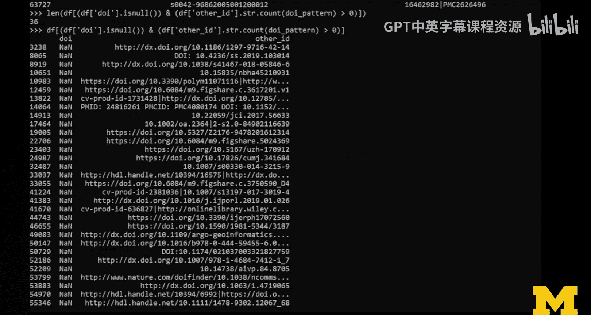
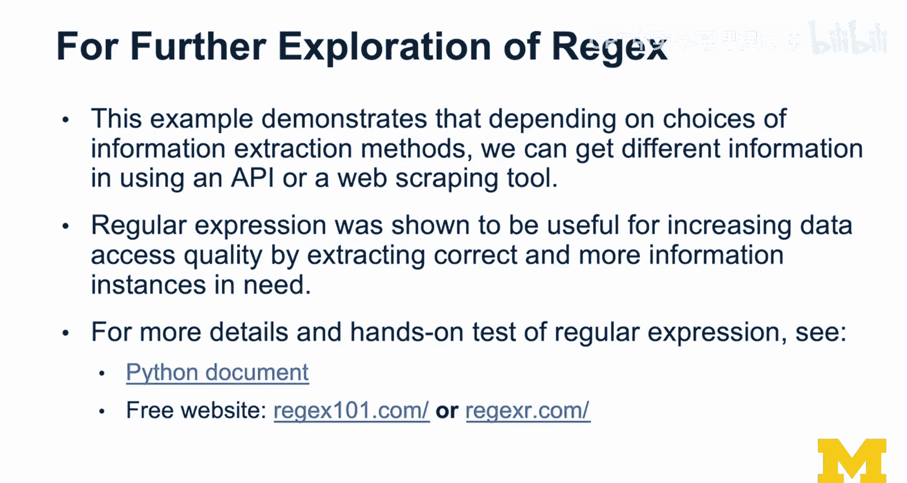

# 总体数据质量（框架、度量、设计策略）：15：示例：优化采集型数据访问质量的实现路径 📊

在本节课中，我们将学习如何通过优化信息提取方法来最大化采集型数据的访问质量。我们将以ORCID（开放研究者与贡献者身份识别码）平台为例，探讨如何从非结构化的数据字段中准确提取DOI（数字对象标识符），从而提高数据链接的完整性和准确性。

## 背景介绍

研究者和数字图书馆经常需要将ORCID数据与出版物记录进行链接，以确定研究者发表了哪些论文。这主要是因为不同的出版物数据集之间缺乏统一的研究者标识符。

ORCID是一个非营利性的开放数据平台，收录了全球超过一千万研究者的个人资料。由于ORCID提供了几乎无限制的公共API，它被研究者和商业数字图书馆广泛使用。

那么，ORCID如何与出版物数据链接呢？从技术上讲，DOI是关键。DOI是一种用于唯一标识出版物的国际标准格式。

## 数据链接方法与问题

以下是使用DOI作为连接器来链接ORCID和出版物数据的示例流程：
1.  在ORCID数据和出版物数据中找到匹配的DOI。
2.  在共享同一DOI的ORCID记录和出版物记录中，找到匹配的姓名。

然而，在使用ORCID中的DOI信息时，我们常常会遇到数据访问问题。

为什么会出现这个问题？理论上，DOI应该出现在`DOI`标签下，但许多DOI被记录在其他标签下，或与其他论文ID（如PMID、PMCID）混合在一起。例如，在左侧图片中，论文的DOI被记录在`other-id`标签下。在右侧图片中，DOI与PMID和PMCID记录在一起。

这个问题为何重要？如果通过API仅从`DOI`标签下提取信息，那么记录在其他标签下的许多DOI将被遗漏。另一个问题是，`DOI`字段下的信息可能并非真正的DOI实例。例如，示例图片中带有`DOI`标签的字符串看起来完全不像一个DOI。这种错误标记的DOI会导致链接错误。

因此，我们需要从ORCID中提取尽可能多的正确DOI实例，以最大化数据访问质量。

## 解决方案：使用正则表达式

在本示例中，我们探索使用正则表达式从ORCID中提取DOI。正则表达式（简称regex或re）是一种用计算语言可以识别的模式来表达字符串的方法。

例如，电话号码格式 `(123) 456-7890` 可以用正则表达式表示为：`\(\d{3}\) \d{3}-\d{4}`。
*   在正则表达式中，反斜杠 `\` 表示其后的字符需要按字面意义解释。
*   小写 `\d` 表示0到9之间的任何整数。
*   花括号 `{}` 中的数字指定了要跟随的数字字符的数量。
*   任何不符合该模式的电话号码都将被判定为不匹配。

那么，用于检测DOI的正则表达式是什么？以下是一个DOI示例：`10.1000/123456`。你能找出其特征模式吗？

以下是一个广泛使用的DOI正则表达式模式：
`r‘\b(10\.\d{4,9}/[-._;()/:A-Z0-9]+)\b’`

让我们分解这个模式：
1.  开头的 `r‘` 和结尾的 `’` 表示这是一个原始字符串，忽略任何转义代码。
2.  两个 `\b` 是单词边界，仅匹配字符串开头和结尾的单词字符。
3.  一组括号 `()` 将匹配括号内模式的字符分组。匹配的字符组稍后可以单独形式访问。
4.  `10\.\d{4,9}/` 定义了一个DOI字符串必须以“10.”开头，后跟一个点，然后是4到9位整数，最后是一个正斜杠。
5.  `[-._;()/:A-Z0-9]` 提供了可能在DOI字符串中单独或一起出现的字符范围，例如，DOI可能包含短横线、下划线、分号或任何字母数字字符或其组合。
6.  紧随其后的加号 `+` 表示方括号中列出的一个或多个字符需要出现在DOI中。

这个正则表达式在大量DOI集合上进行了测试，据报道可以检测出7500万个DOI实例中的99%。更多信息，请参考链接“DOIs and Matching Regular Expressions”。

## 实战演练：在真实数据上测试

既然你已经了解了检测DOI的正则表达式，是时候在真实世界的数据访问场景中测试它了。我们为你准备了一份样本数据。

为了创建这个样本，我们获取了截至2021年8月的ORCID完整快照，并从中随机抽取了65594条带有DOI的出版物记录实例。这个示例模拟了一个场景：用户试图通过API或网络爬虫工具为这些样本实例从ORCID中提取DOI。

你可以从TDQ课程网页下载样本数据。本示例的目标是计算在不同设置下提取的DOI数量，并进行比较，以说明信息提取方法对数据访问质量的影响。

### 操作步骤

1.  从TDQ课程网页下载名为 `orcid_onba_doi_onba_s.txt` 的数据样本文件，并将其保存到计算机上的任意文件夹中。
2.  打开命令提示符，将当前工作目录更改为数据文件和代码文件所在的文件夹位置。
3.  在命令提示符中输入 `python` 并按回车键，打开Python控制台。
4.  加载必要的包：`import pandas as pd`， `import numpy as np`。
5.  通过键入如下所示的命令行加载样本数据：
    `df = pd.read_csv(‘orcid_onba_doi_onba_s.txt’， sep=‘\t’， encoding=‘utf-8’)`
    *   **说明**：与之前的示例不同，你需要通过键入 `sep=‘\t’` 来指定样本文件中使用的分隔符，这里的 `\t` 代表制表符。此外，你需要在读取文件时指定使用的编码方案，这里使用的是 `UTF-8`。没有这个编码设置，文件中的一些特殊字符将显示为奇怪的符号。
6.  键入命令后，按回车键。现在，一个名为 `df` 的数据框就创建好了。要查看数据框的样子，请键入 `df.head()` 并按回车键。

### 数据分析

首先，让我们计算`doi`列中记录了多少个DOI。键入如下命令：
`df[‘doi’].count()`
这个命令计算`doi`列中非缺失值的总和。结果是 **53431**。这假设`doi`列中的所有非缺失实例都是合法的DOI。

如何检查这些实例是否都是合法的DOI呢？这就需要用到正则表达式了。

你还记得前面幻灯片中用于检测DOI的正则表达式吗？让我们在控制台中键入该模式并将其赋值给变量 `doi_pattern`：
`doi_pattern = r‘\b(10\.\d{4,9}/[-._;()/:A-Z0-9]+)\b’`

接下来，键入如下所示的命令行，特别注意括号和反斜杠：
`df[‘doi’].str.contains(doi_pattern， na=False).sum()`
这个命令行的作用是：计算`doi`列中那些不是缺失值、并且至少有一个字符串与DOI模式匹配的实例数量。键入命令并按回车键，你将得到 **53396**，这比`doi`列中非缺失值的总数少了35个。这意味着`doi`列中的一些字符串不是合法的DOI。

让我们检查哪些实例不是DOI。请键入如下命令行：
`df.loc[df[‘doi’].notna() & ~df[‘doi’].str.contains(doi_pattern， na=False)， ‘doi’]`
这个命令行要求pandas筛选出`doi`列中不是缺失值、但没有字符串与DOI模式匹配的实例。按回车键后，将显示一系列不匹配DOI模式的字符串实例。例如，索引为 `191019` 的第一个实例在`doi`列中包含一个奇怪的字符串。

接下来，让我们查找是否有任何DOI被记录在另一列中。键入如下命令行并按回车键：
`df.loc[df[‘doi’].isna() & df[‘other-id’].str.contains(doi_pattern， na=False)， ‘other-id’].count()`
这个命令行基本上与你上面输入的用于统计合法DOI的命令行相同。但这次，你统计的是那些在`doi`列中没有字符串、但在`other-id`列中有DOI的实例。结果是多少？你发现了 **36** 个记录在`other-id`列中的DOI。

让我们检查发现了哪些字符串与DOI模式匹配。为此，键入如下所示的命令行并按回车键：
`df.loc[df[‘doi’].isna() & df[‘other-id’].str.contains(doi_pattern， na=False)， ‘other-id’]`
将显示一个列表，展示那些在`doi`列中是缺失值、但在`other-id`列中有合法DOI的实例。
*   **注意**：合法的DOI可能以URL格式记录，以 `http://` 开头。我们使用的DOI模式匹配的是 `doi.org/` 之后的字符串。
*   **同时注意**：一些DOI与其他论文ID混合在一起，例如，索引为 `14064` 的第八个实例在同一列中包含PMID、PMCID和DOI。

## 总结

本节课中，我们一起学习了如何通过优化信息提取过程来提升数据访问质量。这个示例表明，根据你提取信息的方式不同，使用API或网络爬虫工具时可以获得不同的信息量。正则表达式被证明是通过从采集的数据中提取正确且更多的信息实例来提高数据访问质量的有用工具。

如果你想了解更多关于正则表达式的细节并进行动手测试，请参考幻灯片中的链接。