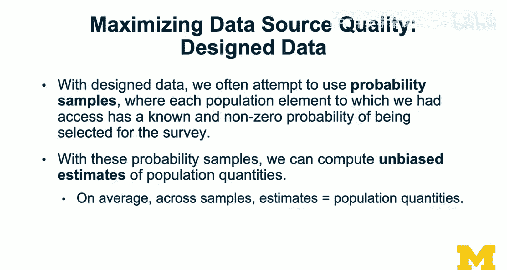
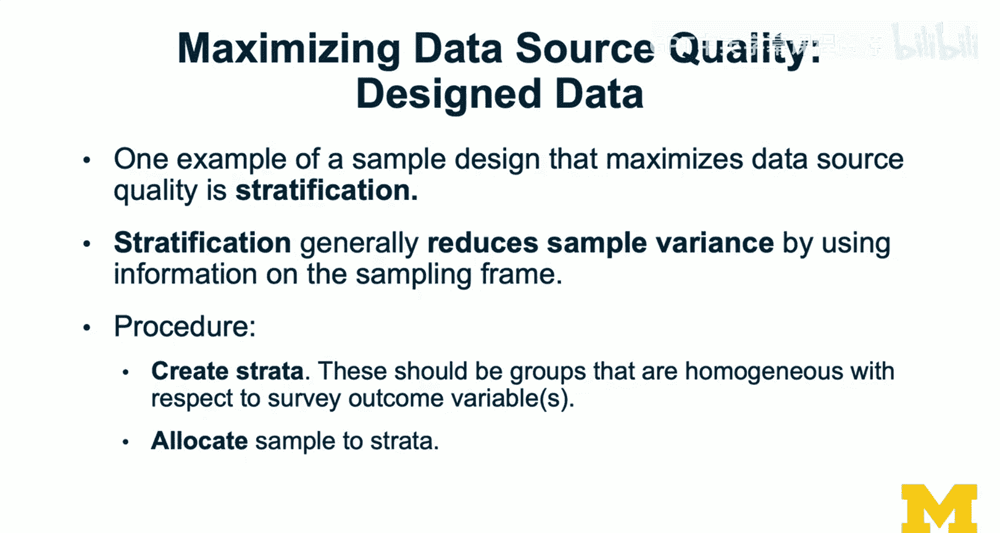
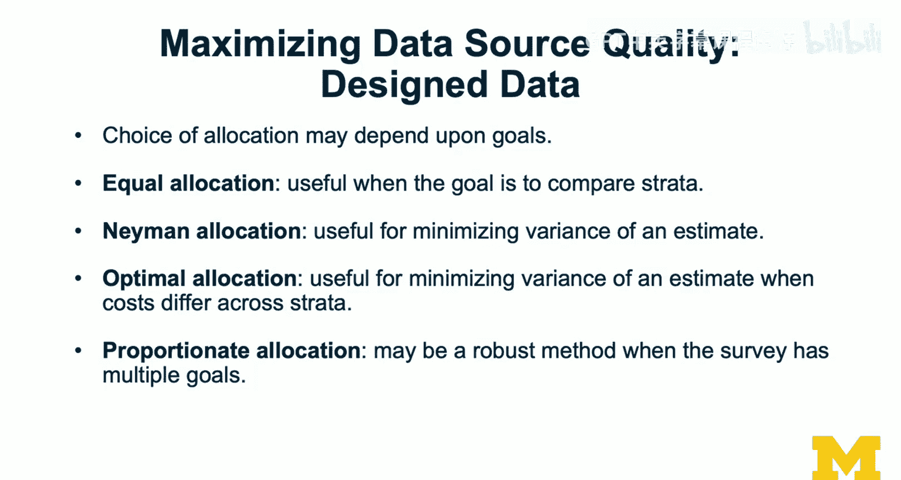
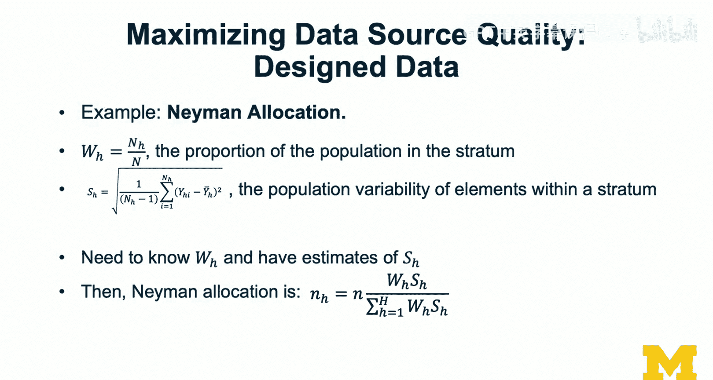
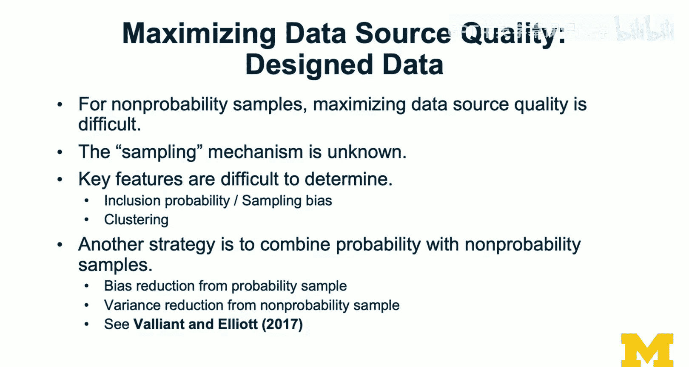
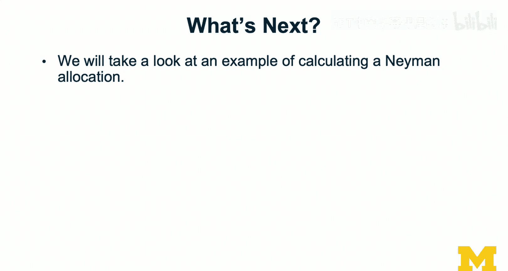

# 密歇根大学《总体数据质量（框架、度量、设计策略）total data quality》 p89 16_最大化设计型数据源质量.zh_en -BV1Jn4y1X7uS_p89-

Hey， welcome back。 Today， we're going to be talking about maximizing data source quality for design data。

 Remember the big picture。 we're talking about data source quality。

 In the case of design data data source quality has to do with sampling and the error associated with that is sampling error。

 So with design data we often attempt to use probability samples where each population element to which we had access has a known and non-zero probability of being selected for the survey with these probability samples。

 we can compute unbiased estimates of population quantities。 So on average， we can。

 across samples produce estimates that are equal to the population quantities。

 That's the definition of an unbiased estimate。 once the data are collected。

 it's important that we reflect to the actual sample design in estimate of data source quality。

 We talked about those when we talked about measuring data source quality。

For example， we looked at the idea of standard errors。

 therefore maximizing data source quality occurs when the sample is designed Op sample designs minimize sampling error for a fixed budget one source for a full description of optimal sample designs is a textbook on sampling by Leslie Kiish cited here it gives a description of optimal sample design techniques we'll give a brief information to some optimal sample designs in a moment。

 one example of a sample design that maximizes data source quality is stratification stratification generally reduces sampling variance by using information on the sampling frame。

 the procedure is to create strata these should be groups that are homogeneous with respect to the survey variables that we're interested in and then we allocate the sample to the strata so we allocate a proportion of the sample to each stratum and those allocations do matter。

They can differ across different designs and depending upon the different purposes that we have so gains from stratification do depend on the allocation it's not just creating strata it's also how we allocate sample to those strata let's look at some examples the first example allocation we consider is called proportionate allocation and in that case we allocate sample to each strata proportionate to its size in the population another kind of allocation is known as name and allocation named after the person who first publicized this sort of allocation it's proportionate the allocation the name and allocation is proportionate to the size of the stratum and the variability within the stratum this type of allocation produces the minimum variance estimate for a fixed sample size Now it does assume that costs are equal across the strata if that's not true then we might want to consider a slightly different allocation known as optimal allocation。

Which considers costs and produces a minimum variance estimate for a fixed budget。 Now。

 the choice of an allocation depends upon the goals。 Another type of allocation。

 equal allocation is useful when our goal is to compare strata。

 Na and allocation is useful for minimizing the variance of an estimate。

 and an optimal allocation is useful for minimizing the variance of an estimate when the cost differ across the strata。

 The proportionate allocation we described earlier is a robust method when the survey has multiple goals。

 So depending upon the goal of our survey， we may choose a different type of allocation。

 Let's look a little more closely at the name and allocation。

 We first define the proportion of the population in the stratum using the notation you see on the slide。

 So that capital W sub H is equal to the proportion of the population that's in that stratum little H。

 The second term that we're going to need is that capital S sub H。

Population variability of elements within a stratum and you can see the formula here and note that it's for the whole population okay so how much do cases within that stratum differ from each other once we have estimates of those things and often we can know W sub H in most cases it's difficult to know the variability of the variable of interest within each stratum so we usually have estimates of S sub h where do we get those possibly from published data surveys that have been done before。

Or from a census from other published sources where we can identify those。

 Or we may have to use our experience to estimate those。

 Once we have estimates of W sub H and S sub H， then the name and allocation uses the formula you see on the bottom bullet of this slide。

 where it's the ratio of the proportion of the population and the variability within the stratum divided by that total is multiplied by the full sample size to allocate the sample to each stratum。

 for nonprob sample。 On the other hand， maximizing data source quality can be difficult for a non probabilitybability sample。

 The sampling mechanism is unknown。 How did elements come into the sample。

 What was the probability of coming into the sample， Those quantities are unknown。

They may be difficult to determine or even predict an inclusion probability， for example。

 What's the probability that any unit entered the sample may be difficult to predict if we incorrectly predict what those probabilitybilities were since we didn't set them we have to predict them if we're incorrect in our predictions then we may result in sampling bias。

 the result might be sampling bias clustering is also difficult to determine in non-probability samples。

 Another strategy is to combine probability with non-probability samples and use the strength of the probability design with known features to help us predict those features for the non-probability sample。

 the bias reduction from the probability sample might help improve estimates combined with the variance reduction from the non-probability sample and here we give a citation that gives examples of strategies for combining probability and non-probability samples Next we'll take a look。

At an example of actually calculating a name and allocation。

 one of the allocations that we looked at today。

