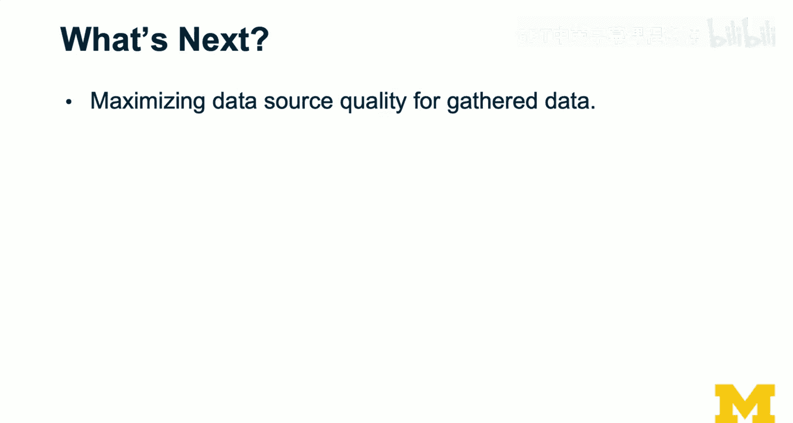

# 密歇根大学《总体数据质量（框架、度量、设计策略）total data quality》 p90 17_示例：提升设计型数据源质量的策略.zh_en -BV1Jn4y1X7uS_p90-

Welcome back。 today， we're going to talk about maximizing data source quality for design data。

 In a previous lecture， we talked about optimal sample design。 And today。

 we're going to look at an example of actually doing optimal sample design。

There are many different ways to do sample design， many different objectives。

 And for a fuller treatment， you can look at textbooks on sampling theory。

 We're going to focus on one particular sample design。 And look at how an optimization might work。

 We're going to start with this idea of a name and allocation。

 And what the name and allocation does is it minimizes sampling variance for a fixed sample size。

 And we'll come back to a key assumption later， because as I said。

 there's many ways to optimize a sample design。 We're going to need a little bit of notation here。

 And so we're going to start with capital W sub H， which is equal to capital N sub H。

 divided it by capital N。 In other words， the proportion of the population in stratum H。

 and we're going to have capital H Strta。 we'll show an example in a minute if this is completely clear。

 the next additional piece of information will need is the sample standard deviation。

 And here you'll see again， we're using population values。 and we're taking the sum of the square。

between each of the values in a stratum， subtracting the stratum mean and squaring that term。

 Then we're going to sum those square differences across all of the elements in stratum H and divide by capital n sub H -1。

 That gives us the population variability of elements within a stratum。

 We'll come back to that quantity as well。 We need to know W sub H and have estimates of S sub H。

 Once we've done that， then we can allocate the sample based on that information。 Now。

 I also need to know little n the sample size。 The total sample size that I have available。

 Then the name and allocation is simply the formula。 You see at the bottom of the slide。

 The sample size allocated to stratum H n sub H is equal to n， the total sample size。 times W sub H。

Times S sub H divided by the sum of W sub H times S sub H across all capital H strata。 So therefore。

 the name and allocation is using the proportion of the population in the stratum and the variability within that stratum as a way to allocate that sample little N efficiently across the all of the capital H strata。

Let's take a look at how that works in practice to help us understand it a little better。

 I'm going to look at an example made up example， a commercial building survey。

 And I'm looking at energy consumption。 The natural choice for stratification in this case is building size because it's highly correlated with energy consumption。

 Now， in this example， I've got 4 strata。 So capital H is equal to 4。

 The strata are defined by the square footage of the buildings。

 The stratum with the smallest buildings are those less than 50000 square feet。

 The stratum with the largest buildings are those with 4 million or more square feet。 All right。

 So we've created these strata， and we categorize all buildings into one of the four strata。

 For example， in that stratum with the smallest buildings sizes。

 there are 1182 buildings in the stratum with the largest buildings。 there are 895 buildings。

 So that's our population， a total of 5318。Commercial buildings Now， in the next column。

 we have their mean energy consumption。 This is an example。

 We've made it up so we can have those numbers， and we can look at the impact of our sample design on our outcome。

72。7 is the average energy consumption in the smaller buildings。

 While the much larger buildings have an average consumption of 11659。

 The last column then is the stratum level estimates of variability。

 So the first stratum with the smallest buildings has that population variability of 11783。

 The largest buildings。 on the other hand， have a variability of a 183 million approximately。

 So those are the characteristics of the strata in our problem。 Now。

 I can use this information to create a name and allocation。

 which is what you see happening in this table。 The first step is to take W H times S H。

And that's what you see in this fourth column。 All right。 So for the first stratum。

 that quantity is 24。1。 I should mention， I've also calculated in this table the W sub H。

 So the proportion of buildings。 The proportion of the population in stratum 1 is about 22。2%。

 The proportion in the largest stratum on the other hand is 16。8%。

 And you can see that the W H is all sum up to 1。 Well， then I've divided W H S H by 2949。4。

 and multiplied by my final sample size of 500 to get sample size in each of the strata。

 Youll see the formula in the last column on the right hand side at the top。

 and that allocation rounded to integer values is 4 units are allocated to stratum 1。

27 of my 500 units are allocated to stratum 2， and 385 units are allocated to stratum 4。

For a total of 500 sample units。 Now， that might seem inefficient because there were few buildings in that fourth stratum。

 the largest buildings。 However， the other thing to note about that stratum。

 is it had by far the largest population variability。

 And so in order to get the most precise estimates。

 We need to allocate a big portion of our sample to that stratum。

 That's one way to interpret this name and allocation， Now。

 I needed an integer allocation to start with， I also needed input estimates of sub S sub H。

 And the first question people often ask me is， how do you get these， Where do I get those estimates。

 And that's actually the hard part。 I either have to have a previous survey with similar estimates that I can use to try and get estimates of S sub H。

 or I may have to figure out to guess accurate values to make some starting values that I can use in order to create this allocation。

 Now， presuming that I can get the。estimatesstimate of S H S sub H。

 Then I can develop the name and allocation， which minimizes sampling variance of the estimated mean for a fixed sample size。

 Therefore， it maximizes data source quality。 Now， there are packages that carry out these allocations。

 For example， the package Pra tools has a function called S R ec。

 which will do this name and allocation。 You just need to give the inputs the W sub H， the S sub H。

 and the fixed sample size that you hope to achieve。 So that's how we do the name and allocation。

 Next， we're going to turn our attention to maximizing data source quality for gathered data。

