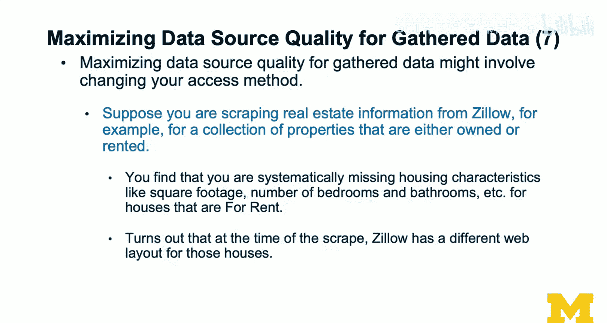
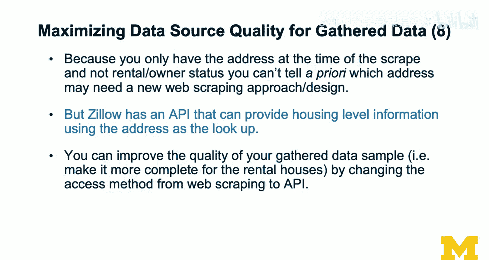
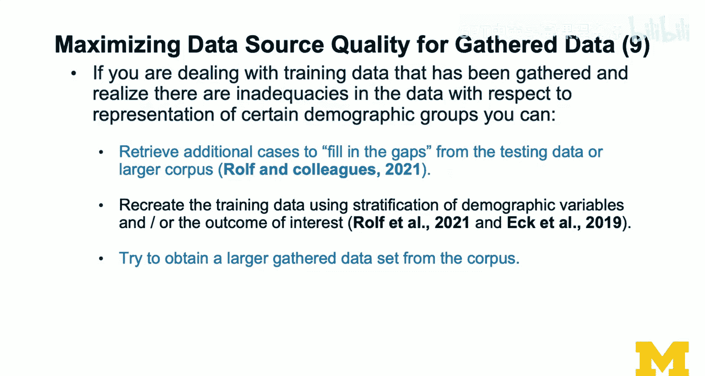
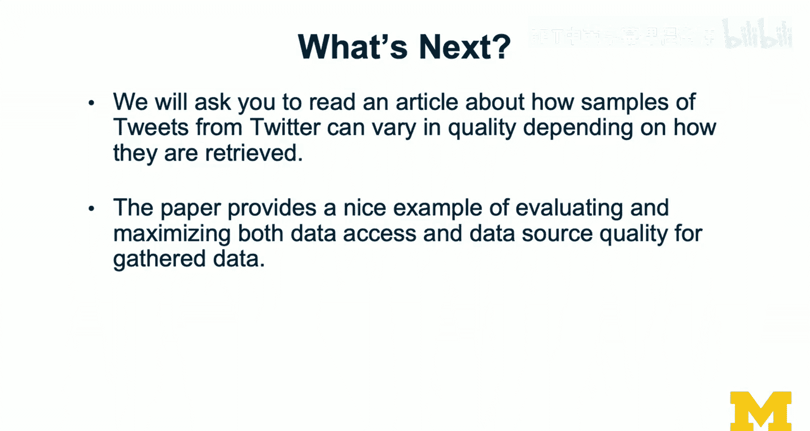

# 密歇根大学《总体数据质量（框架、度量、设计策略）total data quality》 p91 18_最大化采集型数据源质量.zh_en -BV1Jn4y1X7uS_p91-

Hello， welcome to our lecture on maximizing data source quality for Ga data。 I'm Tram Uskirk。

 We're happy to have you just as we do in all the lectures。

 want to make sure that we're all on the same page with where in the framework we are。

 so right now we're talking about maximizing data source quality for gathered data and data source comes on the representation side of our framework。

 keep in mind that the source of the data in design data is a selected sample from a sampling frame。

 but for gather data， the source refers to both the type of information actually extracted as well as the platform or repository from which the data originates so for example you might have a collection of tweets from Twitter users or you might have a data set of administrative records from county taxax assessors's offices for a collection of households。

Implications of coverage， nonres， and possibly other sources of error for design data are often compensated using weighting adjustments or other models that rely on available auxiliary information or other collected information。

However， for gather data， especially digital trace data。

 very little auxiliary information is known other than the actual contents of the data itself。

That is the content of the blog post or the content of the tweet。

A growing body of work continues to explore ways to predict user demographics for digital trace data in particular。

 which could be used to wait or compare digital trace data to target populations of interest。

In some instances， profile or user data may be available for Twitter and Facebook， there are details。

About the user available on public facing profile pages that might include the name or the user name or the handle。

 a photo， a brief biography， selected demographics or other metadata。

 such as the number of followers， likes， friends， et cetera。

 The demographics of users based on profile information can vary， though in its completeness。

 Ciysmo in 2010 studied their study estimated that roughly 69% of Twitter users included a bio in their profile。

 for example， So to this end， Heinz and Joinsson in 2018 provided a very comprehensive overview of 327 published articles aiming to infer or model various aspects of user based on digital trace information。

In particular， they found that gender was reasonably and consistently inferred from digital trace data。

 with acuracies observed to be as high as 80 per cent。

Age was also able to be inferred with slightly less accuracy。

 with some studies still reporting up to 70% cent accuracy。

 Polical orientation was much harder to infer from digital trace data。

 with acuracies reported in the range of about 25% cent。

 Wang and colleagues developed a comprehensive method for inferring demographic characteristics from digital trace data and then used them in a weighting type adjustment for deriving more accurate population based estimates。

😊，Specifically， they used a multilingual multimodal multi attribute deep learning system for inferring the demographics of a user like age。

 gender， and account type based only on the profile picture， the user name or the handle。

 the profile name and the bio。 They developed a de biasing estimation framework based on inclusion probabilities or weights that are estimated as a function of the inferred demographics and known population totals。

 The prior studies that we just discussed are trying to leverage information that is available in the digital trace data itself to infer demographics that could be used in some sort of weighting adjustment。

For maximizing the data source quality for gathered data。

 another way that we can maximize data source quality。

 though might involve changing the access method。Suppose that you're scraping real estate information from Zillow。

 for example， for a collection of properties that are either owned or rented。

You find that you are systematically missing housing characteristics like square footage。

 number of bedrooms and bathrooms for houses that are for rent。

 It turns out that at the time of the scrape， Zillow has a different web layout for these houses。

 So you've programmed your web scraper to pull all of this information from houses that are for sale and it worked fine。

 But the format of such information is different for those houses that are for rent。

 So your web scrapcraer actually ends up with nothing on several of these fields that you care about。

 because you only have the address at the time of the scrape。

 you don't have the rental or owner status。 You can't tell a priori。

 which addresses need a new web scraping approach or design。😊。

But Zillow has an API that can provide housing level information the variables that you need using the address as the lookup。

You can improve the quality of your gathered data sample by changing the access method from web scrapping to API。

This change will allow you to to collect a consistent amount of information from both the houses that are for sale and those that are for rent。

 Another place that data source quality can hamper us in gather data。

 is when we use the gathered data as training data for developing models。

 If you are dealing with training data that has been gathered and realize that they are inadequacies in that data with respect to representation of certain demographic groups。

 For example， you can try to retrieve additional cases to fill in those gaps from the testing data or from the larger corpus of data。

 as was discussed by Rolf and colleagues in 2021。

You can also recreate the training data using stratification of demographic variables and or the outcome of interest to make more complete the training dataset set itself。

 You can also try to obtain a larger gathered dataset set from the corpus in order to round out some of these inadequacies。

😊。

The main goal here is to improve the overall quality of the data source that is then fed into these models to improve the accuracy later on down the line。

A growing collection of research suggests that gathered data can also be improved if collectively researchers use valuable real estate in their publications to address a few things。

 including aspects of the data access or the repository they used and any adjustments that they had to make when using those repositories or data access tools。

 including that information in a data or methods section of papers is very valuable and could be very helpful。

Also， including specific issues related to data quality and collection for the specific sample you gathered。

 including what keywords you use to access that information and why you chose those keywords and why others weren't chosen。

 This can help other researchers reproduce the results that you have and also understand what the implications of using those keywords are in the data that you've sourced。

 Also， including more information about what is being analyzed and how the data you gathered relates to the full corpus of data that was available。

Coming up， we'll ask you to read an article about how samples of tweets from Twitter can vary in quality。

 depending on how they are retrieved， the paper provides a nice example of evaluating maximizing both data access and data source quality for gathered data。

Thanks for being with us happyy reading。

