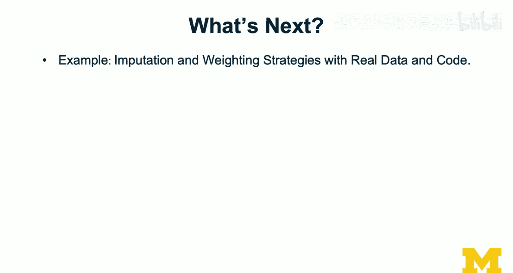

# 密歇根大学《总体数据质量（框架、度量、设计策略）total data quality》 p92 19_最小化设计型数据缺失率.zh_en -BV1Jn4y1X7uS_p92-

Hey， welcome Today， we're going to be talking about minimizing data missingness for design data。

In other lectures， we've talked about maximizing aspects of quality here we're trying to minimize a negative aspect of quality。

Remember the big picture， we're talking about data missingness on the representation side。

 In design data， data missingness was usually survey non response。

And here's a grid with an example of survey data where we have some values are observed and some are not。

 And we have both types of nonre We have in the bottom two rows， unit non respondnders。

 cases that didn't respond to the survey at all。And we also have some item non response where some questions are not answered by persons who answered other questions。

 okay。Now， the best strategy for minimizing the impact of data missingness on design data quality is to minimize survey non response during data collection。

Now， no matter our best efforts， it's likely that there will be non response at the end of the survey。

 So in practice， we have two strategies for making adjustments for those missing values。

 for the missing data。And those two strategies are weeding and imputation。

And we'll take a look at each of these。Waiting is the practice of making the distribution of respondents and the sample or population distributions match each other using weights。

One way to think about it is that groups with low response rates have higher weights。

It's usually performed at the case level。 That is each case is assigned a weight。

 and that weight then forces the distribution of the respondents to look like that of the sample or population。

Let's take a look at a second method， which is imputation。

 Imutation is using model predicted outcomes to fill in missing data。Or impute missing data。

usually includes a stochastic element with repeated draws from a predictive distribution。

 and that repeated procedure then allows us to estimate variances associated with the fact that we're filling in missing data。

We create a value for each missing value。Now， this isn't usually used to adjust for unit nonresse。

 but it's certainly possible to do that。 And in fact。

 it's very flexible the method because it allows us to separate each variable and have a different model for each variable to predict the missing values。

Let's look at an example of a waitinging approach to missing data。

 Both procedures rely upon a missing at random assumption。

 So both waitinging and imputation rely upon a missing at random assumption。

 which says conditional upon the observed data， biases due to missing data will disappear。

Let's look at an example of how aing procedure might meet that assumption。

 I have three age groups in my sample。 I sample 100 units from each of those age groups。

And then I have different response rates across each of those groups。 So the youngest group。

30 persons out of the 100 responded in the oldest group，60 out of 100 responded。

So they are different response rates， which you see in the fourth row of the table。

 The inverse of those response rates can then be used to adjust the respondents back to their full sample size。

So in that 18 to 30 year old group， I have 30 responders。I give each a weight of3 and one third。

And when I multiply 3 and one third times those 30 cases。

 I end up with a weighted count of 100 responders。 So I have rematched the distribution of my sample。

Now， if I had taken a random sample of the population and the sample matched the age distribution of the population。

 I could also reweight。The， the responders to that population distribution by age。

 That's not what I'm doing here， but it's another approach I can take to correct for the differential nonre across these age groups。

A key assumption of these waiting strategies is that respondents and non respondents within each cell。

Age group in the slide we just looked at come from the same distribution of whatever the survey is measuring。

In other words， we assume that the data are missing at random。

What happens if that assumption isn't true？Well， then these waiting and imputation approaches aren't going to correct the nonre biases。

Let's think about an example， what would not missing at random look like？

Go back to the example on the previous slide。 Let's say in the 18 to 30 year old category。

 the responders were more likely to vote in the last election。

Now it's a common finding in surveys that people who are likely to volunteer to vote are the kinds of persons who are more likely to participate in surveys。

So it's a plausible difference that the responders are more likely to vote in the election。Now。

 from the responders， our estimate of the proportion who voted in the last election in this age group would be 42 per cent。

But， in fact， the 70 per who did not respond were much less likely to have voted in the last election。

And so even after our waiting procedures， we have a biased estimate。

 at least for this age group of the proportion that voted in the last election。

What's next when we're going to look at examples of both imputation and weight strategies using real data and code。

I look forward to seeing you there。

