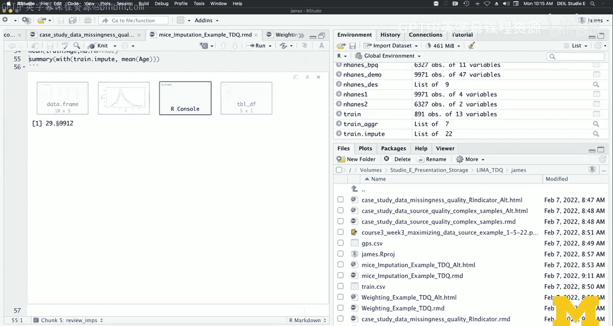
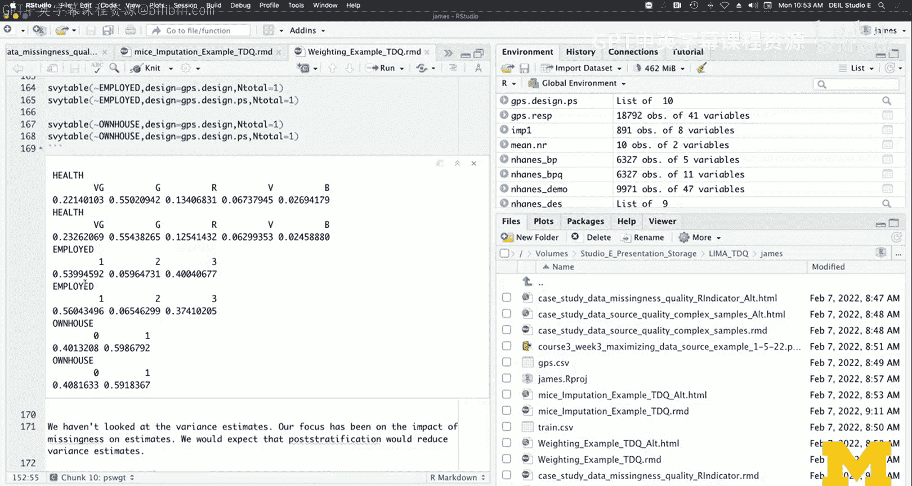

# 密歇根大学《总体数据质量（框架、度量、设计策略）total data quality》 p93 20_示例：插补与加权调整技术.zh_en -BV1Jn4y1X7uS_p93-

Today， we're going to use real data and real code to look at methods for dealing with missing data in design data。

We're going to learn about the mice package， which is used for imputation of missing values。

 something we've talked about in a recent lecture。Now。

 the code and the HTML output are available on the website。

I'm going to run through the code today and show you how that code works in order to use it to impute missing values。

 The first thing I want to do is load the mice package， and I'm going to use the vim package。

 which is nice for looking at missing data， patterns of missing data。

The data that we're going to use come from Kegel dot com。 It's a well known data set。

 the Titanic data set。 And we're going to use the training data set from Kegel com。

So I'm going to go ahead and load the data set， it's available at the URL that you can see in the code here。

Now， the first step in any process or procedure for dealing with missing data in design data is to look at the missing data pattern and for a relatively small data set like the data set in front of us。

 the mice package includes a function that will plot the missing data。

Large data sets might require a different strategy for visualizing missing data。

 As I said a moment ago， the vim package is an alternative that will aid in the visualization of missing data patterns。

So I'm going to take a look at the full data set。 I want to use this mice function to see about looking at missing data patterns。

 And then I'm going to use some of the。V I M package routines to develop outputs about missing data。

All right， so。Here's a quick summary of the missing values。In the data set。 remember。

 this is the Titanic data set。 And so we're looking at what is this data sets often used to look at the probability of surviving the sinking of the Titanic。

 And we have characteristics from the passenger list as predictors in this model。

 The first thing to note is these red bars are indicating where the missing values are。

 And all of the missingness in this case comes from the age variable。On the right hand side。

 I can see all of the variables indicating I have 80 per cent of the values for age。

 and I'm missing 20 per cent。 Now， if other variables had missing values。

 that information would be here as well。 So this first thing I've learned from this is age is the only variable with missing values。

20 per of the age values are missing。😔，Now， the mice package is used to create the imputed values。

 We're going to remove some variables that aren't really relevant for imputation。 For example。

 the passenger's name and other variables like that that are not of use。

 We're going to set the number of imputed values to 5， which is a small number。

 but good for a demonstration， as a rule of thumb， the larger the missing data rate。

 the larger number of imputations you can use。 And with modern computing。

 It's often easy enough to impute 100 values。 which might be a good number to use in many different situations。

 In this example， we're going to set it just to 5 as a demonstration。

 We also ask for the maximum number of iterations to be 50。

 The imputation models are run across all variables with missing values。

 substituting imputed values in iterations after the maximum number of iterations have been run。

 So they're going to repeat that procedure in having a large number of iterations will ensure that the imputed values are stable。

 The method of imputation I going to be used。Us is predictive mean matching。

 And there are alternatives。 You should look at the mice documentation。

 If you want to know which alternative is best for your particular situation。

 We set a seat so that the same imputations will be achieved each time we run this program。

 And finally， we turn off printing of updates to the console。

You can see all of that happening in the code in the next chunk。

The first thing that we need to do is create a flag。To show which cases have missing data。

 And since we know that age is the only variable with missing data。

 we use that variable to set the flag。 Then we're going to call the mice function。

 and we're going to take the training data set where we've dropped some of those predictors that we don't think are useful。

We set the number of imputations to 5， as I just discussed。The maximum iterations to 50。

We did use the specification of predictive mean matching as the method。We set our seed。

And then we set printing to false so that we don't see。Thou put in the console。Let's run this chunk。

Now， pretty rapidly， weve now have our five imputations available。 We can review the imputed values。

 which is a necessary step to make sure that we haven't developed imputations。That don't work well。

 That indicate that there were problems in the modeling approach that we used。

 that need to be addressed。 So this is a good quality control step to carry out The following chunk of code will let us look at the actual imputed values。

 So we're going to look at the first 10 cases to see what values were imputed。

 Then we're going to use some functions that are designed for the imputed data。

 One will produce a density plot of age， the missing values for each of the five imputations that we developed。

Then we'll look at the mean of unimputed data， and then we'll look at the mean age for the five imputed data sets。

 So let's run that chunk and see what happens。First， we get this print out of the first 10。

Imputed values。 And you'll notice that you'll， if you look across。

 we don't get the same imputed value each time。 All right， We're not sure It's a missing element。

 We're not sure what it should be。And our model isn't sure either。

 There's uncertainty in the predictions in our model。

And so imputing different values is a way to encode that uncertainty into our analysis。

 to bring that uncertainty to bear in our analysis。 Now， if you look across these cases。

 you'll notice that some have fairly stable estimates of age。 This first row， for example。

4 of the estimates are around 18 to 21 years of age and one is 28。 The second row， on the other hand。

 one of the predicted values for that person's age is 39 and in two other values are 19。

 So there's a larger range of values， less certainty about the predicted age。

We can also look at a density plot that shows the unimputed mean， this blue line。

And then the distribution of each of the imputed dataset sets means。

And it looks like a fair number of imputed values are being generated around this 20 years of age。

 implying that our predictions are that most of the persons with missing age are about this age。

There's the age from the unimputed group before imputation。

 And now the five means one for each of the different imputed data sets。

Okay， so it hasn't changed a lot。 And it looks like our final imputed means。

 fully imputed means are all very similar， ranging from 28。7。To 29。5。Relatively small range。Okay。

 now we have our imputed data sets。 Now， we might want to do some descriptive statistics。

 We might want to look at some models。 In this case， this data set， as I mentioned earlier。

 is often used to predict who is able to survive。 What are the characteristics of the persons who are able to survive the sinking of the Titanic。

 And we have a fully imputed data set。 We can use the appropriate multiple imputation estimation procedures to get appropriate standard errors。

 In this example， we're using logistic regression to estimate the probability of surviving the sinking of the Titanic。

 The multiple imputation estimates will return several pieces of information related to imputation and underlying uncertainty surrounding those imputed values。

 Let's run this chunk of code and then take a careful look at the output。

The multiple imputation estimates return the average within。Youer。K。

So that's the average variance within each of the imputed data sets。 So I have five variances。

Of the intercept across the five logistic regression models I just ran。

 and I can take the average of that variance to get U bar。

 The program also calculates the between imputation variance。So I have five different intercepts。

 and I can calculate the variability of those intercepts。

 These are combined into a single estimate of the variance， T。

The R I V is a measure of the relative increase in variance due to missing data。

 Lambda is the proportion of variance due to missing data。

 and the F MI is the fraction of missing information。

 All of those give us information about how much inefficiency is created by the missing data in our analysis。

 Now， this estimate gives us all the appropriate estimates and standard errors and allows us to evaluate the impact of the missing data。

For comparison purposes， we could estimate the same model on just the observed data。 In other words。

 ignoring the fact that 20 per cent of the cases are missing a value for age。

 Let's take a look at the output running by running this last chunk of code。嗯。Here are the estimates。

And you have a moment。 Compare them to the estimates here。

Let's focus for a second on the age estimate。Now， after imputation， the impact of age is -0。

03 approximately， indicating the older you were， the more likely you were to say to survive the sinking of the Titanic in this model based on the observed data。

 The estimate is -0。04 a little more than the estimate we see in the model that uses the imputed data。

 And if you compare the standard errors， you'll also notice differences there。 Now， in this case。

 it might be that the imputations didn't change our conclusions very much。

 but we wouldn't have known that if we hadn't carried that procedure out。

 And so I think it's always important to develop procedures using the quality control steps we outlined here。

 that is reviewing the data preparing an imputation model。

 reviewing the imputation and then carrying out our analysis。 If we follow those steps。

 if've done our best to account for missing data in。design data problem。Hi， welcome back。 Today。

 we're going to be looking at real case studies to look at another method for adjusting for missing data in design data。

It's going to be a demonstration of weighting adjustments for missing values。

 So we've also looked at imputation。 Waiting is another approach to the problem。 Today。

 we're going to use a couple of packages。 the survey package。

 which we looked at in a previous demonstration that helps us do correct inference for complex sample surveys。

 And we're also going to look at the PraC tools package， which is going to help us create。

Awaiting adjustments of interest。The code and the H T M output are available on the website。

 and today， I'm going to focus on looking at the code and examining what all of the pieces are doing。

As I said， we're going to need to load those packages。

 including some other packages that are necessary for processing。 On this demonstration。

 we're going to go back to a simulated survey data set that we used earlier。

 It's a household survey that was conduct。 It's based on a household survey that was conducted in the Netherlands。

 and the data set includes respondents and nonrepons。

 Something we need to have in order to correct for patterns of nonresponse。

 We're going to look at two types of adjustments today。

 The first our sample based adjustments called， which are called nonres adjustments。

And the basic idea is that we're going to make the respondents look like the sample。

 We're going to take the characteristics that are available for all cases and use the respondents to represent the full sample by matching them on the characteristics of the full sample。

Once we've done that， we're going to use a technique called post stratification。

 And it's a specific type of calibration adjustment that waits the respondents to look like the population along select dimensions。

In each case， we need specific information available on either the full sample or the full population in order to implement these techniques。

 Now， the first step is to read the dataset set。 And as I said in an earlier demonstration。

 The data set is released as part of a book。 The handbook of nonresponse in household surveys and can be downloaded from the URL that you see here。

 the data set includes a number of variables available from the sampling frame for all cases。

 for both respondents and nonrespons。 something that we need。

Let's take a moment to load the data set now。Before we actually build any nonre adjustment models。

 we should take care to familiarize ourselves with the data set。

 We've already done a little bit of this work last time when we looked at this data set for its use with calculating the R indicator。

 But today day， let's look at some characteristics that we think might be related to response。

Ideally， we're looking for predictors of non response that are related to the survey outcome variables。

That is， we want to identify things that predict both response。And the survey variable。

 It's under those circumstances that non response has the highest chance of producing bias。

And using those characteristics has the highest chance of reducing。That nonres bias us。

Let's take a look at four variables。 The first step is to examine predictors of nonre。 Now。

 I'll just make a general statement to say， we want to identify predictors of nonres that are also related to the survey variables。

 right？ So they need to predict both whether or not someone responded。

 and also predict the survey variable。 Why is that important。

 Because it's those variables that have the。Strongest chance of being related to nonre bias。

 And if I can identify them， I also have the strongest chance of reducing and mitigating the impact of that nonres bias using the weighting adjustments that we'll describe in a minute。

Now， for our purposes， we're going to use four variables as key outcome variables from the survey that we're going to use the weights with。

 We're going to use the weights to in the analysis of these variables。

 The four variables we're interested in our general health。

 the selfre health of each respondent politicss Is the respondent interested in politics employed their current employment situation。

 You can see the labels here as well。 and own house。

 does the respondent own the house in which they live， Yes or no。

 We will only use a few of the variables available from the sample frame and the analysis that we're about to do In practice。

 we'd want to examine all of the available data to see what information is available to us and use as much of the useful information as is available。

 First， we're going to take some time to look at it byvari relationships between variables on the sample frame and the survey variables of interest。

 We can look at this association。For the responders in our dataAs an example。

 we can look at the Association of Self reported Health statusus with urbanicity。

 one of the predictors that's available for all of our sample。

Let's run this chunk of code and see what the results are。All right。

 So we looked at figures like this earlier。 First， we run a high square test of association to see。

 is urban urbanity associated with health， It's pretty clear that there is some association between health and urbanity。

 the small P value indicating that there is some kind of association。

 If we run this kind of figure that we've looked at before。

 we can look at the association between the five categories of health and the five levels of urbanity。

 And notice where there are strong associations。 So these are the largest groups。

 most people saying they have very good or good health。

 But we also see that those with bad health seem to have a strong association between their health and the urbanity。

So that gives us some information that this is a useful predictor。Now。

 we'd want to repeat that kind of analysis for many of the variables that we have in our data set to see what the bivariate relationships are。

Once we've we completed those bivari analyses， we could move on to looking at a model。Of response。

With many the variables of interest in our survey and many of the predictors available on our sampling frame to see if those relationships hold true in a multivariate analysis。

So， for example， in the next chunk of code， we're looking at predicting own house。

 one of the four key outcomes from our survey。 Now， that outcome， as you may recall， is a 0。

1 variable， a yes， no variable。And so we're going to use logistic regression。

 and many of the variables available are on our sampling frame as predictors。

To see if there is a relationship between that survey variable of interest and these variables from our sampling frame。

 So， for example， from our sampling frame， we have gender， urban， age and three categories。

 region has job， married and children。 And we see if all of those variables in a multivariate model have a relationship to our outcome of interest。

 Let's run that chunk of code and see what happens。

It looks like all of those have some relationship to owning your own house。 And for that reason。

 if they're also related to response， they may help us address any nonre bias that's been created through that process through that those missing data in our survey。

It looks like these variables are all useful predictors of own house。 Now。

 I have four key outcomes from the survey of interest。In the creation of these weights。

 I'd want to spend time with each of those variables looking at these multivariate models of this type to see。

 are there relationships between the predictors on my sampling frame and these variables in a multi variableable model。

The next step is to develop a non response model。Once we have these bivariate analysis and multivariate analysis。

 looking at the relationship between variables on our sampling frame and our key survey variables。

 then we can turn our attention to the non response model。

Here we want to focus on those variables that were useful in predicting those key survey variables。

 the four key survey variables we mentioned a moment ago。In this case。

 all of those variables from the previous model。Were significantly related own house。

 So I'm going to include them here in this model， this logistic regression model。

 predicting response。 Let's run that chunk of code and see what the results say。Okay。

It looks like gender is an important predictor of response， as are several categories of urban。

 age seems less important。 Some of the regions have a strongly different response rates。

 has job married and children， all significant predictors。 As I said from these results。

 it appears there are several significant predictors of response。

 regionion and the urbanities have large variation in response。

 Also important as marital status and has job。 The latter is important as employment status is actually one of the survey outcomes。

 Now， has job on our sampling frame is different than employed。 That's one of the survey items。

 but it's also an important predictor of employed。 The latter is important as employment status is one of the survey outcomes。

 We find that persons who do not have a job respond at lower rates。 Finally， although age 3。

 it's not statistically significant。 We keep it in the model as age is often related to response probabilities and removing it is assuming that it。

Is unrelated to response。 That might be only weakly related to response。

 but we'll leave it in because it might have some relationship Once we have our models selected and we've gone quickly through some of the steps that we want to apply more fully in a real analysis。

Then it's time to estimate response propensities。But these might be subject to misspecation error。

 That is， our model might not be correctly specified， and those predicted propensities are also due。

 are also subject to sampling error。 That is， there's some noise around each of these。

In order to smooth out some of these errors， whether misspecation error or sampling error。

 we often elect to create strata based on the estimated propensities。

 and then use the inverse of the response rate in each stratum as a non response adjustment。

Let's take an example and look at how that works。 In order to implement this step。

 we're going to use a function from that Prat tools package。

 That function called the P class will carry out exactly what I just described。

 That is it'll stify based on estimated response propensities。

 and then create a nonres adjustment based on the mean response rate in each of those strata。

Let's take a look at that。Code here I've specified the P class function。

 I have included my model for response。I've said。The data set that I want to use。

 I want to use an unweighted response propensity model for my adjustments。

 I'm using a logit function for the link。 And here importantly， I'm saying。

 give me 10 classes or 10 stta。As an output， I just want the class variable and don't want all of the output that this function will give me。

 And I'm going to attach that P class to my dataset set。 So let's run that chunk of code。

Let's take a look at the data set now to see if that variable is there。All right， there it is。

 You can see the intervals are defined。There should be 10 of those intervals。

Once we have these classes， we can use the inverse response rate in each class or stratum as a non response adjustment。

The sum of these adjustments across the responding units should be equal to the sample size。 Also。

 the weighted composition of the respondents with respect to the predictors included in the non response model should also be closer to the sample。

I'll think about that for a minute。In the lecture， we talked about if I had a 30 per cent response rate。

And I applied a weight of 10 over 3 to each responding case。

 The sum of the respondent weights would equal a sample size。 And that's all I'm saying here。

 If I take this approach， even if I give 10 different weights to cases。

 I'm still going to expect that the sum of those weights should be very close to。

The full sample size。So let's take a look at the next chunk of code。

 which will carry out those calculations。So I'm calculating the mean response rate within each stratum。

Then I'm going to merge that onto my dataset set so that I have that adjustment on each record or the response rate on each record。

 And then I'm going to take the inverse to form a variable called non response。 Wait。

 let's run that chunk of code。IGo to open the data set。So I have merged the mean。Response rate on。

Each case and taken in the inverse of it is a non response adjustment。 And you can see some have a 1。

63，1。66，2。7。 There should be 10 different non response adjustments across the。

18000 respondents in my data set， approximately 18000。As with imputation， any other procedure really。

 we want to do some quality checks。We're going to look at the values of that nonre weight we just generated to be sure that they're correct。

 to be sure that we didn't generate some errors and just to look at the distribution to see if it makes sense。

We'll check the sum that wait for responders to be sure that it's close to our full sample size。

 which is exactly 32019 persons。 So I just ran this chunk of code。And included the weights。

 I expected that I would have 10 different weights across the sample file。 And in fact。

 that's what I see here 10 different weights ranging from 1。38 to a high of 2。7。

 I've also prepared a histogram。Of the weights。 So I can look at their distribution here。

 I know that this weight looks to be a little bit of an outlier。 I might want to investigate。

 Why did this group have such a high weight。 What characteristics does that group have that represent such low response rates that we want to give them a weight of about 2。

7。The last thing that I did was to look to see that the sum of those nonresse weights sum up to the sample size。

 And， in fact， they do。 All of those give me a sense that these weights are operating， as I expected。

 They were calculated， as I expected。 And as I mentioned earlier， in this case。

 I may want to investigate this further on to the next chunk of code。 Now， we're going to use this。

 The weights that we just developed in an analysis to see what impact they have。

We're going to look at the survey variables that we selected as our four key outcomes。And first。

 we'll look at an unweighted table for comparison。 And then the non response adjusted table。

In my chunk of code here， I'm first creating a data set of respondents only。

And then I'm going to look at their health in an unweighted table。

But I'll ask for the proportions so that we can compare the proportions to the weighted analysis。

 And this is the weighted analysis。 The first step， of course， as we saw earlier。

 is to specify the survey design， including the weights。

 And then I'm going to get a weighted survey table。All right。

 so we'll have a weighted and unweighted distribution of self reported health。

 We'll have an unweighted and weighted， employed distribution。

 and we'll have a unweighted and weighted own house distribution。

 to see what impact those non response weights are having across those three variables from our survey。

 Let's take a look。 We'll run the code。Okay， here we have it。 The first one is unweighted。

 and the second one is our non response weighted distribution of self reported health。

They look pretty similar。So our nonrepon weights aren't having much impact on the outcome。 Next。

 we go to the employment status， which has three categories。 Wait a second。 Now。

 something has changed。 right that first category in the third category。 and really。

 the second category proportionally all have changed dramatically。

Can I remember when we looked earlier， the has job variable in our sampling frame was strongly related to response。

And strongly related to this variable。So we shouldn't be surprised that our nonre adjustments are leading to changes in our estimates。

 And so it was important for our analysis that we carried through these nonres adjustments。

 The last variable is own house。 here， the differences are not as dramatic as for the employed variable。

 but still somewhat substantial。 And depending upon the context。

 These differences might be important。 Here we find that the nonrespon adjustments did not make much change to estimates of self reported health status。

 but there are significant changes to the two other variables。 So that's the nonrespon adjustment。

 Remember， we talked about two types of adjustments。Non response adjustment。

 which makes the respondents。Look like the sample from which they were drunk， from which they came。

 right So the characteristics of the respondents and the sample are now made similar through these adjustments。

Now we're going to look at that second kind of adjustment we mentioned at the beginning。

It's called post stratification。Post stratification uses information about the population to produce expected reductions in variance estimates。

 It can also bring the respondents closer to the population。

And if it does so in ways that are related to the survey variables。It can also reduce biases。

So the mechanism that we talked about a minute ago。

 we want variables that predict both response and the survey variable。

 That same approach applies here。 If we're going to reduce nonrespon bias。

 we want to use predictors that have those， both of those characteristics。

We will use population values in post stratification。Not sample values， but population values。

 So I need some source。 I need some way to get estimates of characteristics of the population。

That I can then use to adjust my set of respondents to。

We can use weights in much the way we just looked at to make the respondents look like the population in terms of their distribution。

In this example， we're going to use only the age information。But as you can see from our data file。

 we have a number of characteristics。 If I had population values， I could extend。

The number of adjustments to include more than just age。

 we're going to use just age to keep the problem somewhat simple and focus on the technique。

 We will use the post stratify function from the survey package to calculate the post stratification factors。

 Now， recall that post stratification sets the respondents totals or proportions to match the population totals or proportions for the posttrata。

Therefore， the posttrata can only be created from variables for which population totals or proportions are available。

Let's turn to the R code。Here， I have obtained。The population counts。For the Netherlands。

 in these three age categories。So the first category has about 5 million persons。

 The second category has about 4 million persons， and the third category has about 3 million persons。

Then I'm going to set up my design。 I'm going to set up a post stratification factor using that post stratify function。

 I have to tell it which variable of my respondent file is the post stratification factor。

 and then I have to provide the population totals for that set of groups。 Once I have that function。

 Then I can create a survey table that will show that the weighted data set matches the population characteristics。

 The population distribution。 Let's run that chunk of code。All right。 So I ran my。

Age 3 variable on the survey， using a weighted total。

And the weighted totals match the population distribution。

 verifying that I'm actually carrying out the post stratification in the way that I expected。

 This shows that the post stratification worked。Now。

Let's go back to the three variables we just looked at using those non response adjustments。

 Let's use the same survey estimates， using the post stratified estimator。Health employed own house。

 So the first estimate includes the non response adjustments。

 The second estimate includes the post stratification factors。Here， we see a small change。

In the distribution。Of the characteristics， the self reported health。

The nonre adjusted weight compared to the post stratified。

Here we have the non response adjusted weight。For the employment status。

 and here we have added the post stratification factor。And it looks like there are some。

Adjustment， there is some adjustment， not as dramatic as there was with the non response adjustments。

 but it still makes a difference to include this post stratification on that variable。An own house。

 somewhat similar。After post stratification。So we haven't looked at the variance estimates。

 Our focus has been on the impact of missingness on the point estimates， the proportions。

 the distributions in this case。We would expect that post stratification would reduce variance estimates。

We did observe that for some estimates， non response adjustments and post stratification made a difference。

In particular， the non response adjustment made a strong impact on our estimates of the current employment status developed from the survey response。

Understanding why this occurs is important for two reasons。 First。

 it provides a useful quality control step to make sure that the waitinging approach is reasonable。

 Second， in planning future survey data collections。

 it may be useful to know which dimensions of the sample were underreed due to nonre。

That will give us a way to pre plan to try and reduce the nonre along those dimensions and improve the quality of our survey estimates so that we need to rely on these type of adjustment factors。

 much less。In this case， it looks like the dimensions included in the non response model did make a difference。

 and we saw relatively large changes in estimates of employment status and whether the housing unit is owned。

Post ratification based on age had a less dramatic difference。

 but still resulted in important changes in estimates。

This is a process that needs to be carried out in several steps with a careful review at each step。

We took shortcuts on some of those steps in order to demonstrate the techniques。

We'd want to go back if we were to carry this up process out for real and use all of the available data and carry it through each of these steps to make sure that we've used all of the information to reduce nonrepon bias as much as possible。

But this gives you an overview of how to carry out these steps to address missingness in design data。

