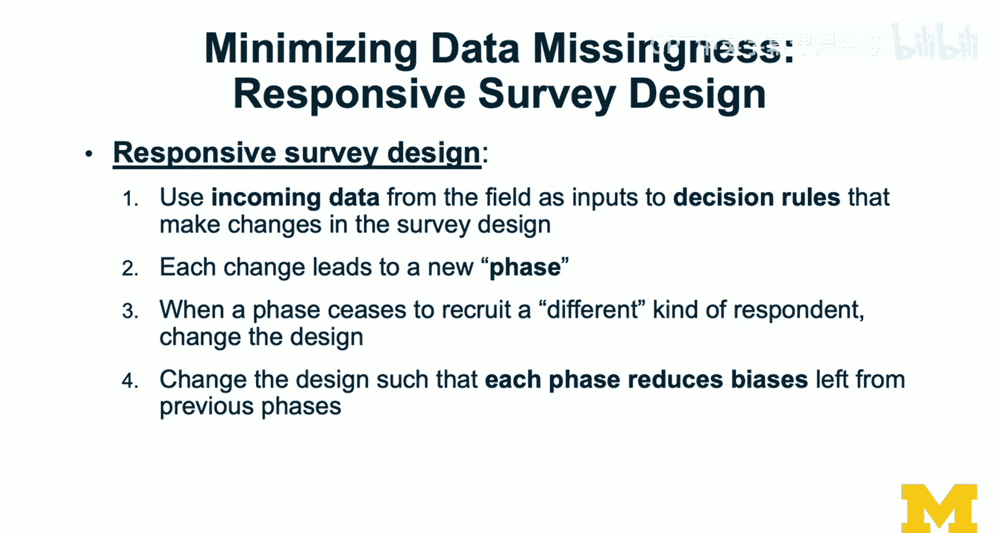
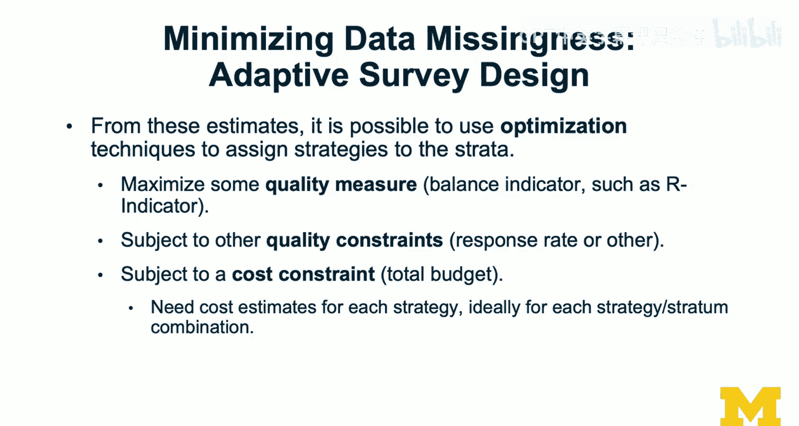
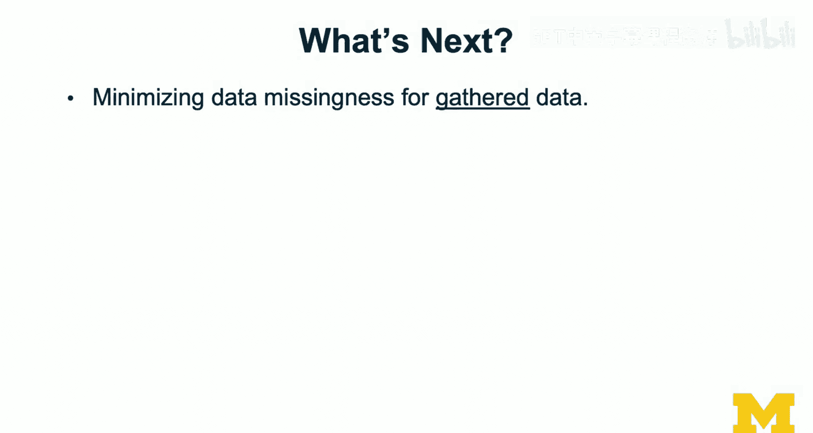

# 密歇根大学《总体数据质量（框架、度量、设计策略）total data quality》 p94 21_最小化设计型数据缺失率：响应式与适应性调查设计.zh_en -BV1Jn4y1X7uS_p94-

Welcome today， we're going to be talking about minimizing data missingness for design data。

 using two techniques， broad categories of approaches to survey design known as responsive and adaptive survey design。

 And we'll take a look at each of those。

Now， just a reminder， looking at the big picture， we're still talking about missing data。

 And in the case of design data， survey non response is the kind of missingness that typically occurs。

So we're going to talk about two strategies， two approaches to survey design that are aimed at minimizing the impact of data missingness。

The best way to minimize the impact of missingness is to minimize missingness。 Okay。

 the reasoning is circular。 I know that。It's usually， however。

 not possible to obtain 100 per cent response rate。

 So we have to find some approach that's going to minimize the potential impact of that missingness on the quality of our estimates。

Now， maximizing the response rate might actually be harmful to estimates。

Or it may not address the biases that underlie some of the nonre。So the question becomes。

 does maximizing response rates simply reinforce biases。

 Are we recruiting a similar kind of person to those we've already recruited。

Thereby not addressing any existing biases。Do different survey designs recruit different kinds of persons。

If that is the case， then we may want to implement different survey designs at different points in time or for different kinds of persons。

So in response to these kinds of concerns， survey methodologists have developed two new kinds of survey designs。

The first is called responsive survey design， and the second is known as adaptive survey design。

And we'll look carefully at each of these。First， we'll look at responsive survey design。

Responsive survey design has four key elements。 You'll see them here on this slide。

 The first is to use incoming data from the field as inputs to decision rules that make changes in the survey design。

Okay so we're going to learn things in the field that allow us to improve the design over time。

Each change leads to a new phase。 That is， I have one survey designed。

 one set of features of the survey that are consistent。

 And when my decision rule indicates that I'm done， I move to another protocol。

 and that's going to be a new phase。When a phase ceases to recruit a different kind of respondent。

 we change the design。The change in the design is such that each phase reduces biases left from the previous phase。

Okay， so over time， I'm introducing a series of designs and the goal of that series is to minimize the potential for bias across the whole data collection procedure。

Now， think of an example where I have a survey design that's very successful at recruiting older persons。

Not so good at recruiting younger persons。That might be my first phase In my second phase。

 I want to identify a design that's going to be successful at recruiting younger persons and may be less successful at recruiting older persons。

😊，By the time I've reached the end of the data collection period。

 I hope to minimize the risk of bias by successfully recruiting across all types of persons that are important for my analysis。

Adaptive survey design， on the other hand， uses data from previous surveys to create stta of persons who differ with respect to estimates and the probability of responding under different designs。

An adaptive survey design assumes that I have some knowledge ahead of time that will allow me to create these strata and apply these at the initial at the initiation of data collection。

The second step then， is to assign different strategies to different strata。

I want to do that on the basis of an optimization that's optimized for cost and quality。For example。

 I might maximize the R indicator or some other balance indicator for a fixed budget by allocating strategies across cases。

Let's look at an example of responsive survey design。

 This example is drawn from a large face to face national survey called the National Survey of Family Growth 2011 to 2019。

And in this case， we're looking for an imbalance between respondents and non respondents。

The characteristic of interest is whether or not there are children in the household and we're comparing respondents and non respondents on this characteristic。

The strategy is to monitor this difference。 That's the incoming data from the field between respondents and nonreents。

 And we have a decision rule。 When that difference becomes significant。

 then we implement an intervention。 An intervention can be any number of things。

 Here We see several examples of mode change an incentive change， a contact strategy change。

 case prioritization or other changes。In this case， we use something called case prioritization。

 That is， we address the imbalance by asking interviewers to focus on the category that is responding at lower rates。

 The category of the sample that has a lower response rate。

Interviewers who have laptops can manage their sample electronically。

 and we can send them information that will allow them to see which cases should be prioritized。

And then we can monitor the results of that intervention。

 The goal is for interviewers to place more effort。

On completing interviews with cases that are prioritized。

 And here you'll see a picture of what their sample management system looks like。

 And you can see that some cases have been prioritized。 We're sending a signal to the interviewer。

 These cases are important。That's one way to try and address that imbalance。

Let's look now at an example of an adaptive survey design。

This survey is the Dutch Labour force survey， and the example comes from our book on adaptive survey design cited here。

Now， in this case， there are nine different strategies。 Okay。

 so the basic strategies are different modes， different survey modes。

 And you'll see there's on the right， there's a legend。

 So W means we're going to implement a web survey。 T means we're going to implement a telephone survey。

And face to face means F is face to face surveys。We can also use standard effort or extended effort。

 So standard effort is a certain number of attempts via telephone or face to face。

And an extended effort means we're going to do more of that。

 So you could think of standard effort as possibly four attempts to complete an interview。

 And an extended effort might mean 9 attempts， for example。

So we have nine strategies that combine these different modes。The first strategy， for example。

 is just a Web survey。 The second strategy is that telephone， standard effort。

The sixth strategy is a mode sequence。 We start with the web， and then we go to telephone。

 standard effort。Okay， so through these different combinations of mode and effort。

 we have9 different strategies that we're going to deploy across our sample for the Dutch Labour force surveyve adapttive design。

9 strata were also formed。 Inent of the9 strategies。 There were 9 strata。

 and these strata were based upon age， household size， employment and ethnicity。

So for the Dutch labor force survey， they have quite a strong sampling frame that actually has these characteristics on the frame。

 and they can create 9 different strata based on these characteristics。

Then they estimate the response probabilities for each stratum under the nine different strategies。

 Now， that takes a lot of experimentation， which is exactly what they did。

 It gives us lots of variation， and it allows us then to consider the implications of assigning the different strategies to the different strata。

Let's look at a large grid。So here we have across the top。

 the columns are the nine strata and those nine stta again。

 are based on characteristics like age and household size。And along the rows。

 then we have the different strategies， the different mode assignments， mode and effort assignments。

 Okay， and what we're looking at are the response rates in each of these strata and mode combinations。

 So there were a lot of experiments that were run to fill in this table。

 But once you have that information， it's quite useful。 Let's focus on a couple of the columns。

 In the first column。 One of the things that we notice。Is that the web？Face to face。

 extended mode sequence has a response rate of about 50 per cent。

Very close to the response rate for just the face to face extended mode。 Okay， so very similar。 Now。

 starting with Web is a lot less expensive than just using face to face methods。

 So that first stratum， we have a less expensive alternative option strategy。

Now let's look at that fourth stratum。In the four stratum， on the other hand。

The face to face extended mode has a 41 per cent response rate。

The highest response rate possible for that group。And the Web mode has only an 11 per cent response rate。

So for that stratum to get a high quality response rate， we need to deploy an expensive strategy。

 Let's look at column 8， Stratum 8。 The Web strategy here has a 36。7 per cent response rate。

 and the face to face extended mode has a 57 per cent response rate。Not close。

 but that group has a relatively high web response rate。

 and it might be that we're willing to accept some cost savings and a lower response rate。

In that stratum， in order to maximize response rate in other stratums。

The strategy then becomes to use these estimates as input to an optimization problem， All right。Now。

 that problem can have different。Forulations。We may want to maximize some quality measure。

 for instance， the R indicator。Subject to other quality constraints。 For example。

 we may say we will have a minimum response rate。Subject to also cost constraints。 That is。

 we have a total budget， which we cannot exceed。Now， in order to implement this optimization problem。

 we need cost estimates for each strategy， ideally， for each strategy by stratum combination。

 So all of the cells in the table I showed you in addition to those response rate estimates， Ily。

 we'd have cost estimates for each of those cells。

Once we have that information， we can perform an optimization that will maximize that quality measure。

Subject to minimum quality and cost constraints。What's next。

 we're going to talk about minimizing data missingness for gathered data。

