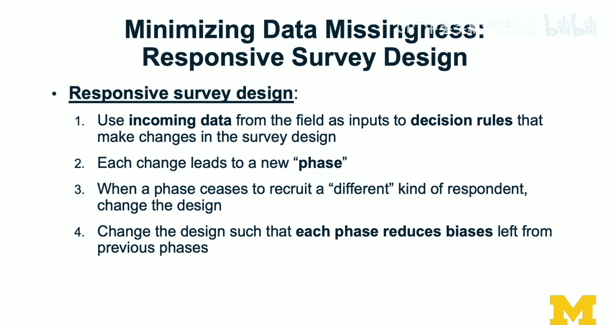
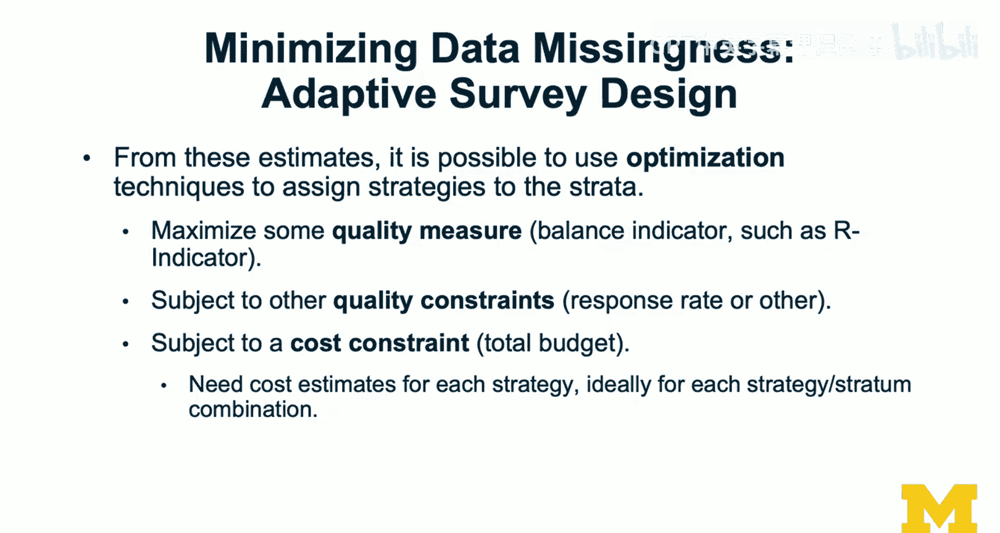
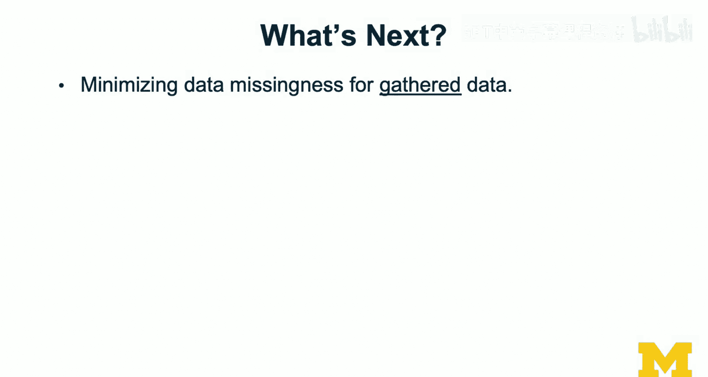

# 总体数据质量（框架、度量、设计策略）：21：最小化设计型数据缺失率：响应式与适应性调查设计 📊

在本节课中，我们将学习如何通过两种先进的调查设计策略——响应式调查设计与适应性调查设计——来最小化设计型数据（尤其是调查无应答）的缺失率。我们将探讨这两种方法的核心概念、关键要素，并通过具体案例来理解其应用。

---

## 概述

设计型数据缺失通常表现为调查无应答。本节课将介绍两种旨在最小化此类数据缺失影响的调查设计方法。虽然完全消除缺失通常不可能，但通过精心设计，我们可以降低缺失数据对最终估计质量的潜在偏差影响。

上一节我们讨论了数据缺失的一般概念，本节中我们来看看两种专门用于优化调查过程、减少无应答的具体设计策略。

---

## 响应式调查设计 🔄

响应式调查设计是一种动态方法，它利用从调查现场收集的实时数据来指导设计调整，以逐步减少偏差。

其包含四个关键要素：

1.  **使用现场数据作为决策依据**：利用从调查现场获得的数据（如不同人群的应答率差异）作为输入，触发对调查设计的修改。
2.  **分阶段实施**：每次设计变更都标志着一个新阶段的开始。每个阶段采用一套固定的调查协议。
3.  **变更触发条件**：当一个阶段无法再招募到新类型的受访者时，就触发设计变更。
4.  **目标在于减少偏差**：每个新阶段的设计都旨在减少前一阶段遗留的偏差，从而在整个数据收集过程中最小化总体偏差风险。

例如，假设第一阶段的设计能有效招募年长者，但对年轻人效果不佳。那么第二阶段的目标就是采用一种对年轻人更有效（即使对年长者效果可能稍差）的设计。通过这种多阶段组合，我们希望在数据收集期结束时，能成功招募到对所有重要分析群体都有代表性的样本，从而最小化偏差风险。

---

### 响应式设计案例：美国家庭成长调查

让我们看一个响应式调查设计的实际案例，它来自2011-2019年进行的全美面对面调查“美国家庭成长调查”。

*   **监测目标**：识别受访者与非受访者之间的不平衡特征。本例中关注的特征是“家庭中是否有孩子”。
*   **策略**：持续监测受访者与非受访者在该特征上的差异（即来自现场的输入数据）。
*   **决策规则**：当该差异变得显著时，启动干预措施。
*   **干预措施**：干预可以是多种形式，例如改变调查模式、调整激励措施、改变联系策略、进行个案优先级排序等。

在本案例中，采用了**个案优先级排序**。具体做法是，当发现某一类别样本（如“无孩子家庭”）的应答率较低时，就通过调查员的电子设备管理系统，指示他们优先联系这些类别的样本户。

调查员的笔记本电脑上会显示其负责的样本列表，其中被优先处理的个案会有特殊标记。这引导调查员将更多精力投入到完成这些优先个案的访谈上，从而有针对性地解决样本结构不平衡的问题。

---

## 适应性调查设计 🎯

与响应式设计不同，适应性调查设计在数据收集开始前就进行规划。它利用以往调查的数据，预先将总体划分为不同的子群（层），并为每个层分配合适的调查策略。

其核心步骤如下：

1.  **预先分层**：利用历史数据，根据影响关键估计值或在不同设计下应答概率的特征（如年龄、家庭规模、就业状况等），将调查总体划分为不同的层。
2.  **策略分配**：为不同的层分配合适的调查策略。这种分配是基于对成本和质量（如应答率、样本平衡性）的优化计算来决定的。

例如，目标可能是在固定预算下，通过在不同个案间分配策略，来最大化R指标（一种衡量样本代表性的平衡指标）或其他质量指标。

---

### 适应性设计案例：荷兰劳动力调查

接下来我们看一个适应性调查设计的例子，它来自荷兰劳动力调查。

*   **可用策略**：该设计定义了9种不同的调查策略，主要由**调查模式**（网络、电话、面对面）和**努力程度**（标准、扩展）组合而成。例如：
    *   策略1：仅网络调查。
    *   策略2：电话调查（标准努力程度）。
    *   策略6：模式序列（先网络，后电话，标准努力程度）。
*   **预先分层**：同样形成了9个层，分层依据是年龄、家庭规模、就业和种族等特征。荷兰有强大的抽样框，其中包含了这些信息，因此可以事先完成分层。
*   **估计应答概率**：通过大量实验，估计出每个层在9种不同策略下的应答概率。这就形成了一个包含响应率的矩阵（行代表策略，列代表层）。
*   **优化分配**：在获得每个“策略-层”组合的**应答率**和**成本估计**后，便可以构建一个优化问题。例如，目标可以设定为：在满足总预算约束和最低应答率要求的前提下，最大化R指标（代表样本平衡性）。通过求解此优化问题，即可得出每个层应分配的最佳策略。

通过分析这个矩阵可以发现：对于某些层（如层1），采用“网络→面对面（扩展）”这种模式序列能达到与纯“面对面（扩展）”模式相近的应答率，但成本更低。而对于另一些层（如层4），只有昂贵的“面对面（扩展）”模式才能获得高应答率。适应性设计正是通过这种精细化的、基于证据的策略分配，在成本和质量之间寻求最优平衡。

---

## 总结

本节课我们一起学习了两种用于最小化设计型数据缺失率的先进调查设计方法。

*   **响应式调查设计**是一个动态、迭代的过程。它在数据收集期间，根据实时监测到的样本偏差，分阶段地调整设计（如改变联系策略），以逐步改善样本构成。
*   **适应性调查设计**则是一个预先规划、基于优化的过程。它在调查开始前，利用历史数据将总体分层，并为每个层分配合适的调查策略，旨在以最优的成本效益达成质量目标（如样本代表性和应答率）。

这两种方法都超越了单纯追求高应答率的传统思路，而是更智能地管理调查过程，以更有效地控制由无应答引起的非抽样误差，从而提升总体数据质量。

---

接下来，我们将讨论如何最小化**采集型数据**的缺失率。