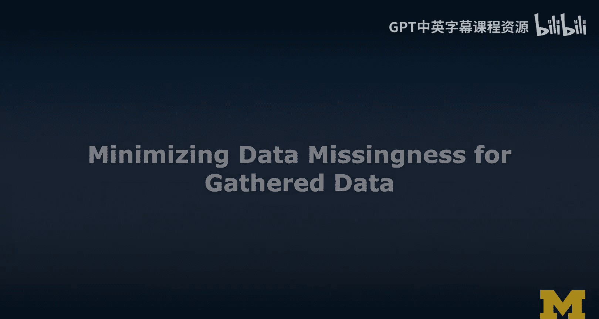
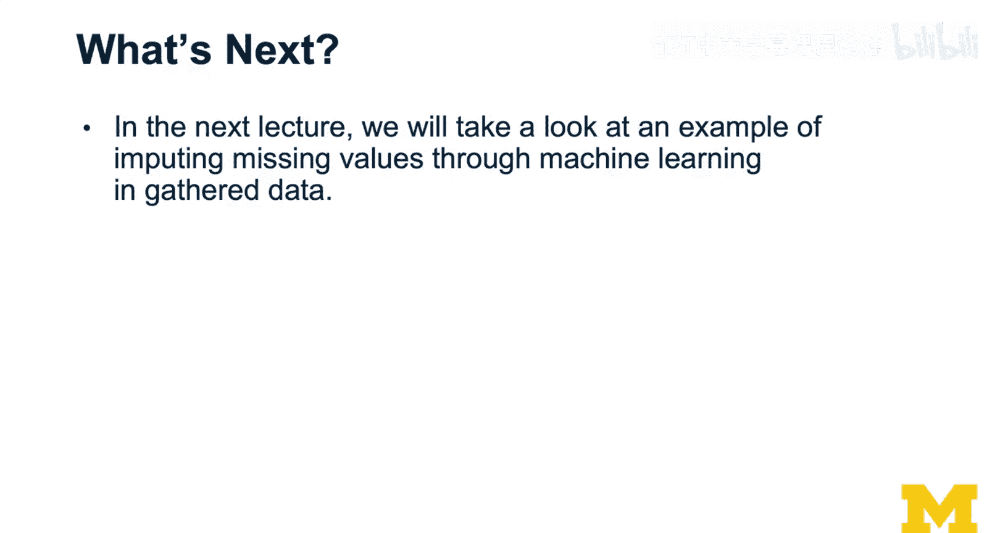

# 密歇根大学《总体数据质量（框架、度量、设计策略）total data quality》 p95 22_最小化采集型数据缺失率.zh_en -BV1Jn4y1X7uS_p95-

嗯。Hello everyone， in this lecture you will learn how to minimize data missingness for gather data。

Don't forget to check where we are in the big picture in previous lectures you'll learn how to minimize data missingness for design data Now we will take a look at gather data for gather data。

 we can also use missing data adjustments for design data。

List wise deletion is a method to exclude an entire record from analysis if any single value is missing。

Model imputation is a method to fill missing data cells with most frequent or common values in the data field。

Mean median imputation is a method to fill missing data cells with a mean or median value in the data field。

These methods are commonly used in both designed and gathered data。

Another technique to minimize data missingness is to use machine learning algorithms trained on label data to predict missing values。

Data scientists have used NB， Dec tree， and key nearest neighbors to list a few to predict missing values in medical records and social media data。

This approach has been proven to provide quite good imputation results。

But creating label data required to train and evaluate the performances of machine learning algorithms can be costly and inaccurate due to。

 for example， low intercodal reliability。In record linkedage attacks。

 if we aim to link records with high level certainty。

 we may end up producing many unlinked records in other words。

 if records are linked only when they match on highly strict criteria。

 this will increase false negatives inducing bias in linked data。

Machine learning can help us to estimate the probability that a linkage instance is correct。

A study by Dr。 Tvik and colleagues in 2005 demonstrated this。In the study。

 two records were compared for their similarity of over various features。

Then they were determined to be a match case if their similarity score is above a a certain threshold that is chosen during training。

By adjusting the threshold， records that fail to be linked can be minimized。

Although the method discussed in the previous slide can increase correctlyly linked cases。

 we still see false positive and false negative cases。

This means that we need to think about trade off in minimizing data missinginess in record linkage。

That is， one error may be tolerated more than another depending on the purpose of data analysis。

Analysis should acknowledge this uncertainty and preferably provide robustness tests such as sensitivity analysis on the different probability thresholds。

Next， we will do a step by step exercise to impute missing values using machine learning in gather data。

