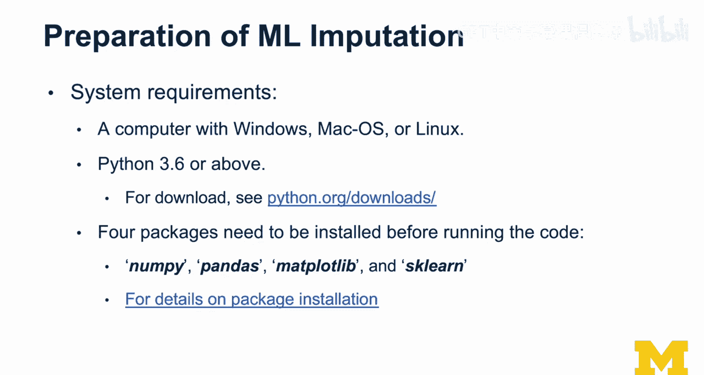
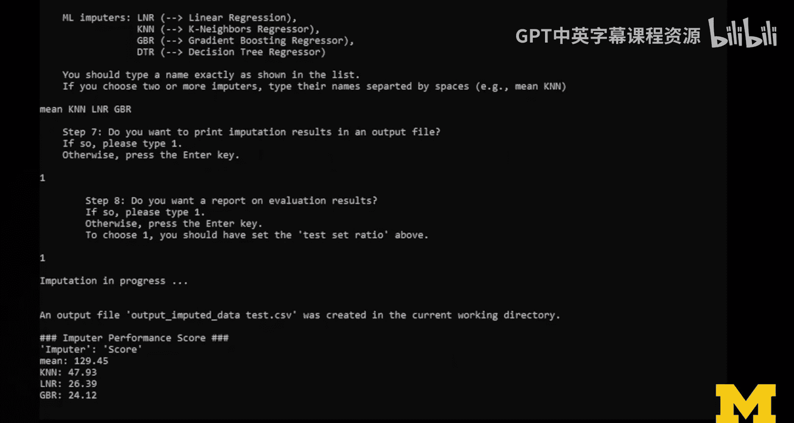
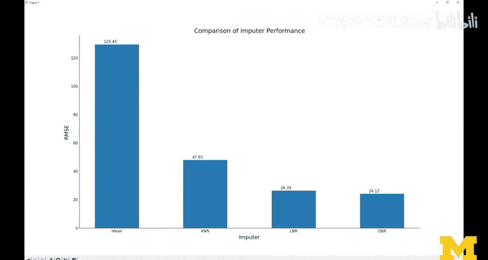
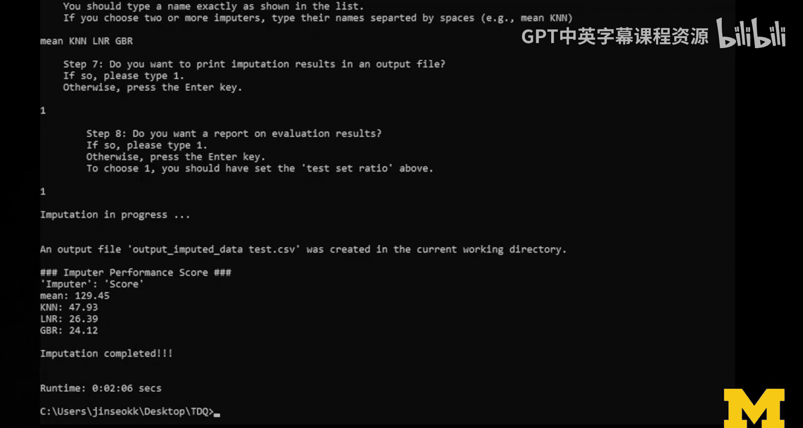
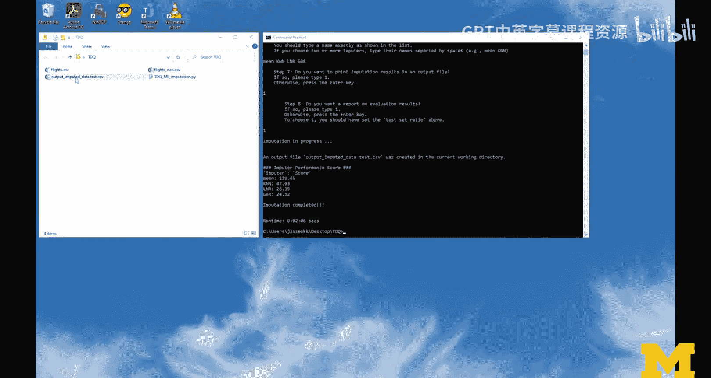
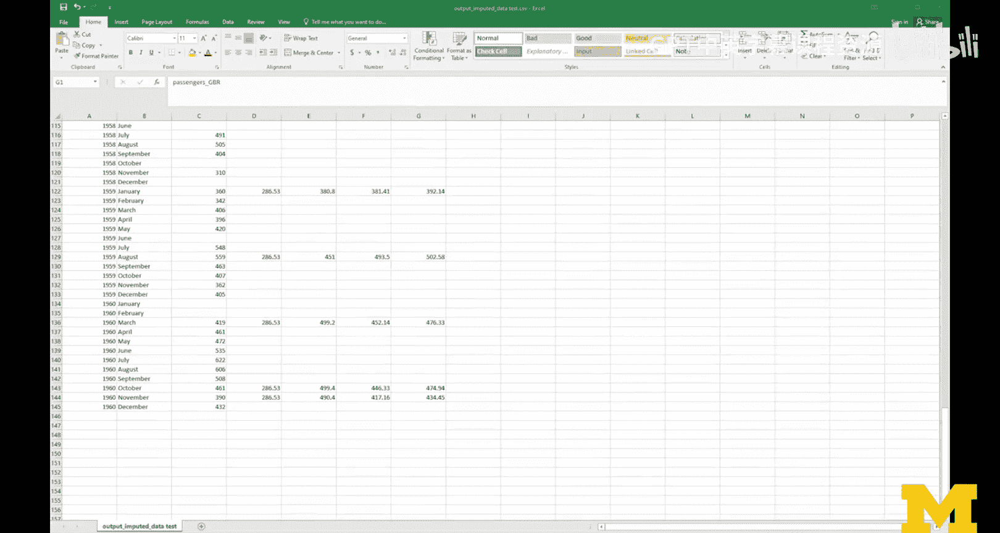

# 密歇根大学《总体数据质量（框架、度量、设计策略）total data quality》 p96 23_示例：降低采集型数据缺失率的解决方案.zh_en -BV1Jn4y1X7uS_p96-

Hello everyone In this example， we'll take a look at an imputation method to minimize data mixness for gather data。

Machine learning algorithms predict classes or values based on feature or predictor information。

 for example， scholars have used them to predict age groups of Twitter users based on their language usage and numbers of followers。

These machine learning algorithms can be used to predict missing values。 In other words。

 impute missing values and minimize impact of data missingness on data analysis。

To follow this example， you need to have a computer with Windows。

 Mac OS or Linuxux and Python installed。In addition， you need to install for python packages。

 numpy pandas， matpl lip and S K La。This example uses a machine learning impation tool created for this course。

The code is named TDQ on the bar， M， L on the bar invitationation dot pie。

Download the code from our course webage and save it in a folder on your computer with two data files。

 flights。t cs3 and flights on the bar， none dot csv。

Open a command prompt and change your current working directory to the location of the folder where the data file and the code file are saved。

Unlike previous examples， you don't need to open a Python console。Also。

 you don't need to import packages。Instead， just type Python TDQ under M L under impation thatt pi and press enter。

The command will import installed Python packages necessary to run machine learning algorithms。

After a few seconds， maybe a message will be displayed as Paul follows。

This asks you to provide the file name of data， to be loaded。

You were asked to save two data files above。A file named Flightstart CSv consists of year month and passenger numbers between 1949 and 1960。

This file comes from a python package named Seaborn。

You will use a modified version of the file named Fs on theba Nan Ds S3。

 This version was created for this example by making 20% of values in the passenger's column。

 randomly missing。Note that both data files need to be stored in the same folder as the code file。

A for this example， type flights on the bar N does C3。If you press enter。

 a summary of data information will appear。It reports that the passengers column has 115 non nu values。

 while two other columns have 144 values。This means that the passengers column have 29 missing values。

Under the summary， or the message is displayed， asking you to choose a column to impute。

The instruction ask you to look at the column names in the summary。Let's type passengers。

 and press enter。Next message asks you to choose which columns are going to be used for imputation by machine learning。

You need to choose at least one column。Also， you can choose multiple columns。

Type ear month and make sure they are separated by a space。

Machine learning algorithms will learn patterns of predicting missing values based on information in these two columns。

If you press enter， you will see the summary of the data again。Why is that。

In the core 3 week2 session， you learned how to maximize data processing quality by converting values into another format。

For machine learning， categorical values are often required to be coded into numerical ones for technical reasons。

So you need to find if any column has categorical values and thus needs to be converted。

In this example， the data type of the math column is object。

Meaning that its values are recorded in string or mixture of string and number。

For the simplicity of demonstration， this example uses only one heart encoding。

Type month and press enter。Next message asks you to choose the test set ratio for evaluation。

Data scientists evaluate how well machine learning based Iutation works by training and testing machine learning algorithms on valid values。

In the2 be imputed column。Please， read the instruction carefully。For this example， let's type 0。

2 and press enter。If you press enter without typing any value。

 the code will skip the evaluation procedure。In this case。

 it will use all rows with valid passenger values to train machine learning algorithm and predict any missing values in the remaining rows。

Now， it's time to choose machine learning algorithms。As you can see from the message。

 there are four algorithms available。In addition， you can choose any simple imps to compare how they perform against machine learning algorithms。

Please pay attention to names of imps。You need to type names exactly as shown in the message。

For this example， type mean K， N， N， N， and， R， Z， B，R， and press enter。After you choose impters。

 you need to decide whether you want to print out the imputation results and evaluation results respectively。

Let's type 1， and press enter。The code will produce an output file in the current working folder。

Next， you also need to decide whether you want to display any evaluation results。Type 1。

 and press enter。You will first see a message saying impation in progress。Once it's done。

 another message will tell you that an alpha file was created in the current working directory。

Then a report will be displayed to show the permanent score of each imp。Here。

 the pepperperman score is calculated by root mean square error abbreviated as RMSE。

 to measure the differences between values predicted by an impation method and the true values。Also。

 the code will create a bar plot to report the results in a separate window。

The above figure visualizes the scores of the imps you selected。You can zoom in。

 modify and save the plot in your preferred format using the control menu and save menu icons on the left bottom side of the figure。

Once you close the figure window， you will see a message saying impitation completed and the amount of run time on the command prompt。

 In this example， you chose to print out the output file。

If you set a test to set ratio as you did evolve， the code will produce an imputation alpha a file named output。

 Iuted data， test CSV in your folder。Go to the working directory and open the output file。

In the file， impation results by selected algorithms are shown beside true values。For example。

 the second row shows that the true value for the passenger's column is 112。Mean imp predicted 286。

53， while K and N predicted 135 Line regressor，53。61， and gradient boosting reggressor，122。38。

You can see that gradient boosting regressor made the closest prediction。

You can check manually how its imp performed by looking at other rows。

Without a test set ratio set evolve， the code will produce an imputation of a file named。

 output imputed data followed by each impder name。In the upper file。

 any missing cells in the original file are filled with imputed values。

 and a column is added to show an imputation flag。As demonstrated so far。

 the Iutation code implements machine learning algorithms， but only uses default settings。

You can fine tune any models by trying various hyperparameter and parametermeter options。

Available options and examples for modification can be found at links shown below each algorithm in the Iutation code。

I hope you enjoy the cold and find that the quality control is fun。😊。

