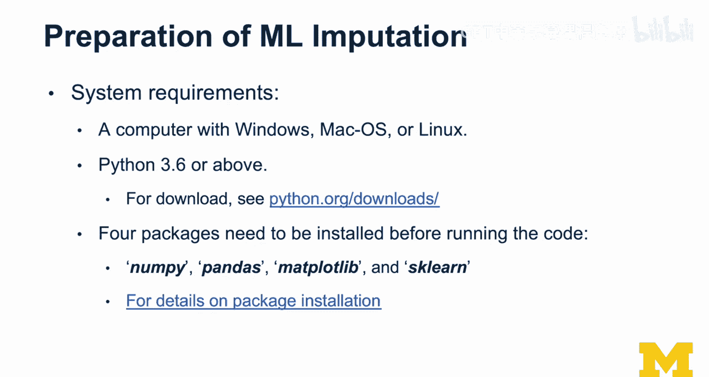
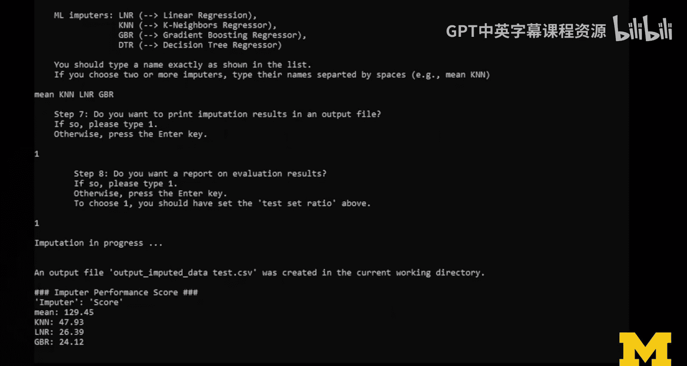
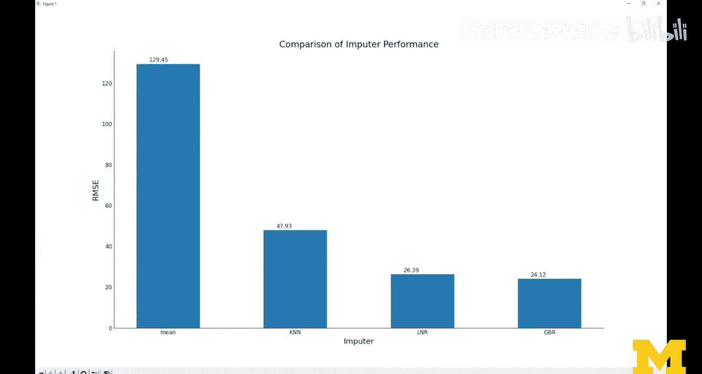
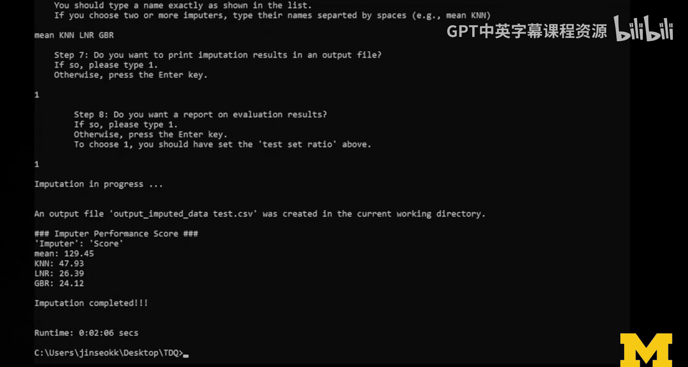
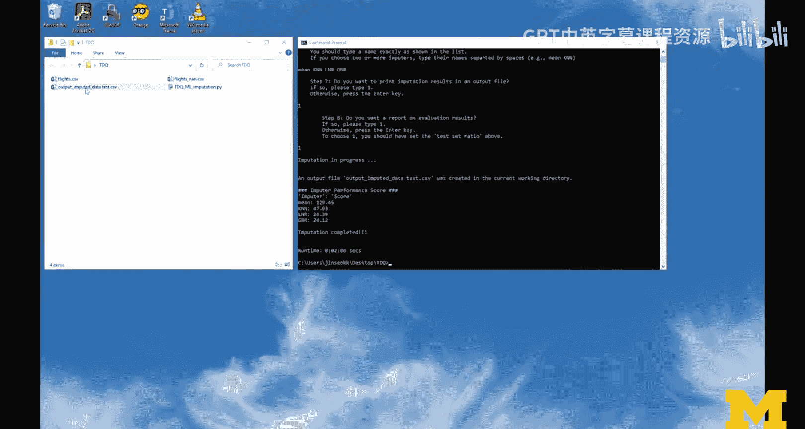
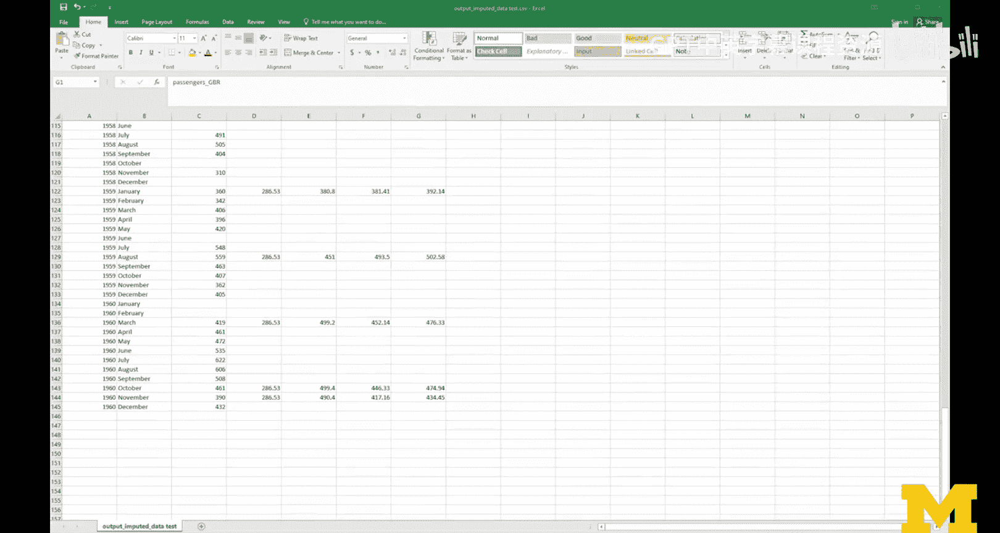

总体数据质量：23：示例：降低采集型数据缺失率的解决方案 🛠️


在本节课中，我们将学习一个使用机器学习算法进行数据填补的示例，以降低采集型数据的缺失率，从而最小化数据缺失对分析的影响。

---

### 概述

数据缺失是数据分析中常见的问题。机器学习算法能够基于已有的特征信息预测缺失值，这是一种有效的数据填补方法。本节将通过一个具体的航班乘客数据示例，演示如何使用一个专门的填补工具，基于年份和月份信息来预测缺失的乘客数量。

---



### 准备工作

在开始之前，需要确保你的计算机已安装必要的软件和工具。

以下是运行本示例所需的准备工作列表：
*   **操作系统**：Windows、Mac OS 或 Linux。
*   **编程语言**：已安装 Python。
*   **Python 包**：需要安装 `numpy`、`pandas`、`matplotlib` 和 `scikit-learn`。
*   **示例代码与数据**：从课程网页下载名为 `TDQ_ML_imputation.py` 的代码文件，以及两个数据文件 `flights.csv` 和 `flights_NaN.csv`，并将它们保存在计算机的同一个文件夹中。

---

### 运行填补程序

上一节我们准备好了环境和文件，本节中我们来看看如何运行这个机器学习填补程序。

打开命令行终端，将当前工作目录切换到保存代码和数据文件的文件夹位置。与之前的例子不同，你不需要打开 Python 交互式控制台，也无需手动导入包。

只需在命令行中输入以下命令并按下回车键：
```bash
python TDQ_ML_imputation.py
```
该命令会自动导入运行机器学习算法所需的 Python 包。

---

### 加载数据与选择参数

程序运行后，首先会提示你输入要加载的数据文件名。我们之前保存了两个文件：
*   `flights.csv`：包含1949年至1960年的年份、月份和乘客数量。
*   `flights_NaN.csv`：这是为本次示例修改的版本，乘客数量列中随机有20%的值被设置为缺失。

两个文件都需要与代码文件存放在同一文件夹。对于本示例，请输入 `flights_NaN.csv` 并按回车。

程序会显示数据摘要，报告各列的非空值数量。例如，乘客列有115个非空值，而其他两列有144个值，这意味着乘客列有29个缺失值。

随后，程序会要求你选择需要进行填补的列。根据数据摘要中的列名，输入 `passengers` 并按回车。

接下来，需要选择用于机器学习预测的**特征列**。以下是操作步骤：
1.  程序会提示你选择至少一个特征列。
2.  输入 `year month`（确保用空格分隔），表示将使用年份和月份信息来预测缺失的乘客数量。
3.  按下回车。

---

### 数据预处理与模型评估

选择特征列后，程序会再次显示数据摘要。这是因为机器学习算法通常要求将分类值转换为数值格式。

在数据摘要中，检查是否有列的数据类型为 `object`（表示其值为字符串或混合类型）。在本例中，`month` 列就是这种类型。为了简化演示，本示例使用独热编码进行处理。输入 `month` 并按回车。

接着，程序会询问用于模型评估的**测试集比例**。数据科学家通过在有效值上训练和测试算法来评估填补效果。请仔细阅读说明。对于本示例，输入 `0.2` 并按回车。如果不输入任何值直接回车，代码将跳过评估步骤，直接使用所有有效乘客值进行训练并预测缺失值。

---

### 选择算法与查看结果

现在，是时候选择具体的填补算法了。程序会列出可用的选项。

以下是可供选择的算法列表：
*   `mean`：使用均值填补。
*   `KNN`：K最近邻算法。
*   `LR`：线性回归。
*   `GBR`：梯度提升回归树。

你需要严格按照显示的名称输入。对于本例，输入 `mean KNN LR GBR` 并按回车。



选择算法后，程序会询问是否要分别打印出填补结果和评估结果。输入 `1` 并按回车，代码将在当前工作文件夹中生成输出文件。同样，对于是否显示评估结果，也输入 `1` 并按回车。



你将首先看到“填补进行中”的消息。完成后，会提示输出文件已创建，并显示每个填补器的性能得分报告。此处使用**均方根误差**（RMSE）作为评估指标，其公式为：
$$RMSE = \sqrt{\frac{1}{n}\sum_{i=1}^{n}(y_i - \hat{y}_i)^2}$$
其中，$y_i$ 是真实值，$\hat{y}_i$ 是预测值。

代码还会在一个单独的窗口中创建一个条形图来可视化结果。你可以使用图形窗口左下角的控件菜单和保存菜单图标来放大、修改并以你喜欢的格式保存该图表。



关闭图表窗口后，命令行会显示“填补完成”的消息以及运行时间。



---

### 分析输出结果

如果你像本例一样设置了测试集比例，代码会生成一个名为 `output_imputed_data_test.csv` 的输出文件。打开该文件，可以看到所选算法的填补结果与真实值并列显示。

例如，某一行显示乘客数量的真实值为112，而不同算法的预测结果为：均值填补预测为286.53，KNN预测为135，线性回归预测为53.61，梯度提升回归树预测为122.38。可以看出，梯度提升回归树的预测最接近真实值。你可以手动检查其他行来评估其填补效果。

如果没有设置测试集比例，代码会为每个填补器生成单独的输出文件（如 `output_imputed_data_KNN.csv`）。在这些文件中，原始数据里的缺失单元格已被填补值填充，并且会添加一列来显示填补标志。

---

### 总结




本节课中，我们一起学习了如何利用机器学习算法进行数据填补，以应对数据缺失问题。我们通过一个航班数据的实例，逐步操作了从环境准备、数据加载、特征选择、预处理到模型训练和结果评估的全过程。演示中使用的填补代码实现了多种机器学习算法，但仅使用了默认设置。你可以通过尝试不同的超参数和参数选项来微调任何模型，具体的修改选项和示例可以在填补代码中每个算法下方显示的链接中找到。希望你能享受这个过程，并发现质量控制的乐趣。😊