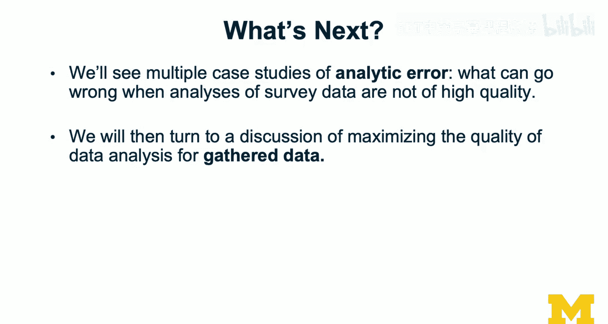

# 密歇根大学《总体数据质量（框架、度量、设计策略）total data quality》 p97 24_最大化设计型数据分析质量.zh_en -BV1Jn4y1X7uS_p97-

Okay， hello and welcome， everybody to week four of this third course on maximizing data quality。

And this week， we're going to talk about how to maximize the quality of our data analysis is kind of a final step in the overall total data quality framework。

 and specifically we're going to start talking about how to maximize the quality of an analysis of design data。

So let's revisit our total data quality framework here。

 We've talked about maximizing quality in terms of all the measurement dimensions， validity。

 data origin and data processing。 We've talked about how to maximize quality in terms of all the representation dimensions。

 including data access data source and missing data And now putting everything together。

 we can't forget about that last step where we've done all this prior processing。

 we've done all these prior adjustments， we've made sure from design perspectives that everything is really up to par in terms of overall quality。

 But now we actually want to analyze the edited and selected data。

 So we're at that final phase here where we're focusing on data analysis。

 And given that this course is talking about how to maximize quality。

 We want to make sure the data analysis phase that we're also performing a high quality analysis of the data so that we don't negate any of the earlier work that was done to maximize overall quality。

 So that's going to be our focus in this week and we're going to start with a discussion of design data。

 So how do we think about max。😊，Da analysis quality for design data So studies that are using design data features of the study design often need to be accounted for in data analysis。

 So if we're talking about experiments for example。

 we might need to account for experimental strata or the experimental factors where we want to compare different groups in terms of experimental treatments or something like that we need to account for those variables when we're conducting our analysis if we're talking about survey data collection we might be talking about the need to account for sampling weights or sampling strata based on the original sample design sampling clusters based on that original design multiple imputation of item missing data。

 these are all features of the study design that we would need to account for when we're ultimately performing the analysis and in general。

 these different design features should be accounted for in an analysis when they're informative about the primary measures of interest So if these different design features have relationships with the variables that we're ultimately interested in we want to make sure that we're accounting for these。

Design features when we do the overall analysis in surveys that are collected from probability samples in particular。

 where everybody in a population has a known probability of selection。

 there are generally three main design features to account for and the textbook by hearing and colleagues in 2017 talks at length about analysis they account for these design features。

 First of all， we need to make sure that we're thinking about weights that reflect probabilities of selection for different sampled units and we need to account for those weights in our analyses in order to compute unbiased estimates with respect to the original sample designs。

 We want to make sure that the estimates that we're computing are unbiased with respect to that sample design。

 a failure to account for weights could lead to biased estimates of population features。

 a second key design feature that we need to account for in probability samples typically are codes in the data that represent sampling straightta and these codes need to be accounted for in the analysis in order to reduce our。

errorsSo when we're computing estimates of population features。

 we want to attach measures of sampling variability to those estimates and stratification at the sample design stage will typically increase the precision of our estimates。

 And we want to make sure that's reflected when we compute our standard errors。

 So we need to account for those sampling straight in our analyses。

 if they're applicable for a given sample design。 The third main feature， again。

 if applicable for a given sample design are codes that represent sampling clusters。

 possibly geographic areas or other clusters of units that were randomly sampled as a part of the sample design。

 where units within the same cluster will tend to have similar values on a variable of interest。 Now。

 when we have cluster sampling， that tends to increase our standard errors or reduce the precision of our overall estimates。

 And if cluster sampling was part of the design， we want to make sure that that's reflected in terms of the standard errors that we're computing。

 So these are three key features of probability sample， these complex probability sample， that we do。

needed to account for in our analyses when we're working with data like this and a failure to account for them。

 that's reducing the quality of the analysis that we're performing。

 We want to make sure we're computing unbiased estimates with standard errors that reflect the design that was actually used So when working with design survey data that we collected from the so-called complex probability samples make sure to do the following to make sure that your data analysis is of maximum quality make sure to carefully review the data set documentation。

 especially any analytic guidelines that are provided to go along with that data set oftentimes you might want to download a national survey data from a national survey program and with that electronic data you'll also have documentation describing how to use the data make sure to review that documentation carefully before you get into the analysis especially if there are subsections that talk about analytic guidelines because that's going to help to make sure that you're performing a high quality analysis if you follow those guidelines so always always always very important to review。

That data set documentation。 Second key point， Consider those sample design features when you're making inferences about your population of interest。

 So there are many different software procedures that you can use in order to account for those design features that we talked about on the previous slide。

 the weights the sampling strata and the sampling clusters you can use， for example。

 the contributed survey package in the R software。 there are SVy commands in the status software。

 there are the survey commands in the SaS software。 for those of you who might be using SS。

 there's the complex samples module and Ss。 There's a variety of tools that allow you to account for complex sample design features。

 The key is that you're using these tools when you're analyzing data from these complex samples you can find more information at the Web link here on the slide。

 along with many examples of syntax to perform different kinds of analyses。

 This is the website for the hearing at all textbook that was referenced on the previous slide。

 So again， you can refer to that hearing at all textbook for general guidelines。

 but remember from course2。We have ways of measuring whether it's necessary to use weights when analyzing survey data。

 so we talked at length about measuring the need for using weights when performing different kinds of analyses。

 don't forget about those discussions from our course on measuring data quality Now all of that pertains to probability samples again where units in the population can be assigned a known probability of being included in the sample in many samples nowadays we're actually dealing with non-prob samples。

 these could be volunteers or convenient samples where we don't really know or have any control over the probability that an individual is going to be included in a given sample and in these types of non-pro samples there are approaches that have been developed in the recent literature that can be used to make probability inference about a particular parameter of interest。

 So Valaliant and Deer wrote a very nice book in 2018 that outlines these different approaches that can be used for non-prob samples and making inference and we want to talk about those in a second here。

The distinctionin is that with probability samples。

 we have a good statistical basis following these procedures that I've been describing to make inference about population features with non probability samples。

 we don't have that same statistical basis again， because we have no control over the probability of selection。

 So we want to follow these approaches that have been recently developed in the literature。

So with nonpro samples， when you're analyzing the data。

 there are three general approaches that one can use to make population inference。 And again。

 we're dealing with a sample that could be of convenience， a snowball sample。

 a volunteer sample something like that where again。

 we had no control over who selects to be in that sample。

 So first general approach known as quasi randomization in this kind of approach。

 we combine the data from that nonpro sample you think of a data set that you collected from that nonprob sample。

 you stack the data from that non-prob sample with a reference probability sample。

 we refer to that as a reference sample that measured several common variables。

 So the same variables， same kinds of values were measured in both a reference probability sample that you might get from a national survey or something like that with your non-pro sample and you line up those variables and now you have a stack data set that has the same variables in both of those dataset sets that you put together。

And we find those common variables and then put the dataset sets together once we have that stack dataset set then we predict the probability of being included in that nonpro sample using a weighted logistic regression model So you use the weights from the probability sample。

 that key design feature that we talked about earlier and then everybody in your non-pro sample that portion of the data gets a weight of one so you have your weights for the probability sample in a variable and in that same variable。

 everybody in the non-pro sample has a value of1 and you fit a logistic regression model。

 predicting the probability of being in that non-pro sample So everybody in the non- probability sample gets a1 on the dependent variable everybody in the probability sample gets a0 on that dependent variable and that's our dependent variable in a logistic regression model and we include those common variables in the probability sample and the non-pro sample as predictors in that logistic regression model Now what that model is going to yield is a predicted probability of being included。

In the non probability sample。 So we would then invert those predicted probabilities for that non probability sample for all the people in your non probability sample。

 we would flip we would invert them one divided by that predicted probability。

And that inverted value is what we would use as a weight in a design based analysis。

 So treating that as if it were a sampling weight in our original analyses for probability samples。

 we would use this kind of pseudo weight in analyzing data based on this quasiite randomization approach and proceed with our analysis。

 just like we would with probability samples。 So that's one possible approach。

 a second possible approach is more model based where we would try to predict the variable of interest for the nonsampled cases in the population。

 Now， this kind of approach would require having data on the nonsampled cases。

 So all the cases that did not selfselect into your nonprob samples。

 So that's a bit of a trickier endeavor because we need to find those data。

 at least we need to find aggregate data for the nonsampled cases。

 And based on a regression model fitted to data from the nonpro sample。

 we would use that model to predict the variable or variable of interest for nonsampled cases。

Population， so it's kind of like a missing data problem。

 We would fill in the values and the variables of interest for all the cases that weren't included in our non probability sample and then analyze that entire data set like it was from the population。

 That's called super population modeling。A third general approach is referred to as doubly robust or doubly robust approaches。

 In that case， we would combine the ideas of quasist randomization and superpopulation modeling。

 And if our regression model for making predictions for the nonsampled cases is correct or the model for predicting the probability of being included in the nonpro sample is correct。

 if either of those two models is correct。 Pulation inferences will still be accurate based on these doubly robust approaches。

 So that's the nice thing about about the doubly robust approaches。

 you can get the models to predict the probability of being in the nonprob sample or the model that's predicting values for cases that are not included in your sample。

 you can get one of those two models incorrect。 But your overall inferences will still be will still be accurate。

 Now， the issue here in practice is that there's not a lot of software out there that implements these three different approaches for nonprob samples。

 And what that means is that they usually have to be programmed。Again。

 that Valaliant Deaver book in 2018 is an excellent practical reference that walks people through how to conduct these kinds of analyses using the data software。

 particularly， but you can extend those ideas to other software packages that you might want to use。

 And when we calculate standard errors based on these nonproability approaches。

 variance estimation generally re on a techniques that's known as bootstrapping where other replication techniques and again。

 valiant De talk about how to carry that out in practice。 But in general。

 there's much more software for designbased analysis of probability samples like we talked about where you account for weights and straight and clusters。

 And again， you can visit that website that we talked about earlier to see examples of syntax in different software packages。

 so that's an overview。 the key theme here is that whether we're analyzing data from a probability sample or a nonpro sample。

 We want to make sure that we're using correct techniques that have been described and discussed and developed in the literature that maximizes the。

QuOf the analyses that we're performing。 Okay， that's the key theme here。 We've talked about these。

 these kind of state of the art techniques for how to conduct these analyses to make sure that we're accounting for design features in that overall analysis。

 So next up， we're going to see multiple case studies of analytic error。

 And the point there is to show you what can go wrong when you don't perform high quality analysis of survey data。

 and you fail to account for some of these design features。 Okay。

 so we're going to talk about what can go wrong。 And then we'll turn to a discussion of how to maximize the quality of data analysis specifically for gathered data。

 Okay， thank you。

