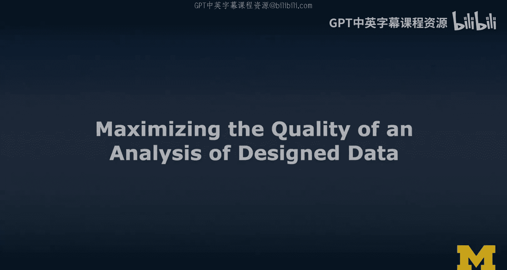
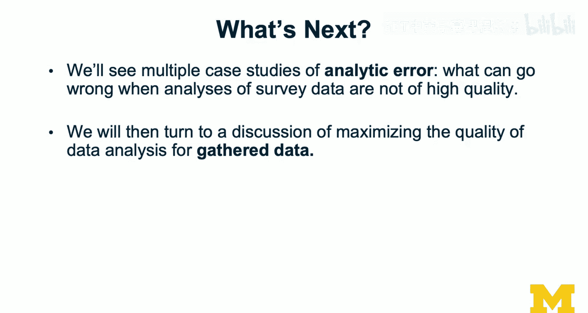

# 总体数据质量（框架、度量、设计策略）：第四周：最大化设计型数据分析质量 📊

在本节课中，我们将学习如何最大化数据分析的质量，这是总体数据质量框架中的最后一步。我们将重点讨论如何针对**设计型数据**（如实验或调查数据）进行高质量的分析，确保分析过程本身不会削弱前期为提升数据质量所做的所有努力。

## 课程概述

上一节我们回顾了总体数据质量框架，涵盖了测量维度和表示维度的质量最大化。本节中，我们来看看数据分析阶段，特别是如何处理**设计型数据**。设计型数据的分析必须考虑研究设计本身的特征，例如实验的分层、调查的抽样权重等，否则可能导致有偏或不精确的估计结果。

## 分析设计型数据的关键考量

对于利用研究设计特征的数据（即设计型数据），分析时通常需要考虑这些设计特征。例如，在实验中，我们需要考虑实验分层或实验因素；在调查数据收集中，则需要考虑抽样权重、抽样层或抽样群。

总的来说，当这些不同的设计特征与我们感兴趣的主要测量变量相关时，就应在分析中予以考虑。

## 概率样本的分析要点

对于从**概率样本**（即总体中每个个体都有已知被选中概率）收集的调查数据，通常有三个主要的设计特征需要在分析中加以考虑。Hearing等人2017年的教材对此有详细论述。

以下是分析概率样本数据时需要关注的三个核心设计特征：

1.  **权重**：权重反映了不同抽样单元的被选概率。在分析中必须使用这些权重，才能计算出相对于原始抽样设计的无偏估计。忽略权重可能导致对总体特征的有偏估计。
2.  **抽样层**：数据中代表抽样层的代码。在分析中考虑抽样层可以减少估计误差。抽样设计阶段的分层通常会提高估计的精确度，我们计算标准误时应体现这一点。
3.  **抽样群**：数据中代表抽样群（如地理区域或其他单元群）的代码。当同一群内的单元在感兴趣变量上取值相似时，整群抽样会增加标准误或降低估计的精确度。如果抽样设计包含整群抽样，我们计算的标准误应反映这一点。

在分析此类复杂概率样本数据时，若未能考虑这些特征，就会降低我们所进行分析的质量。我们的目标是计算无偏估计，并使标准误反映实际使用的设计。

## 处理概率样本数据的实践指南

当处理来自所谓复杂概率样本的设计型调查数据时，请遵循以下步骤以确保数据分析达到最高质量：

*   **仔细查阅数据集文档**：特别是任何随数据集提供的分析指南。在开始分析前，仔细阅读文档至关重要，这能帮助你进行高质量的分析。
*   **在对目标总体进行推断时考虑样本设计特征**：许多软件程序都提供了处理上述设计特征（权重、抽样层、抽样群）的功能。例如，R软件中的`survey`包、Stata软件中的`svy`命令、SAS软件中的`survey`程序，以及SPSS中的复杂样本模块。关键在于，在分析复杂样本数据时，要使用这些工具。更多信息和语法示例可参考幻灯片上提供的网页链接（即Hearing等人教材的网站）。
*   **回顾测量数据质量的课程内容**：不要忘记我们在“测量数据质量”课程中讨论过的内容，我们有方法可以衡量在分析调查数据时是否需要使用权重。

## 非概率样本的分析方法

以上内容均针对概率样本。然而，如今许多样本实际上是**非概率样本**，例如志愿者样本或方便样本，我们无法获知或控制个体被选入样本的概率。对于这类非概率样本，近期文献中已开发出一些可用于对特定参数进行概率推断的方法。Valiant和Deer在2018年合著的一本优秀著作概述了这些方法。

区别在于，对于概率样本，遵循上述程序我们有良好的统计基础来推断总体特征；而对于非概率样本，由于无法控制选择概率，我们缺乏同样的统计基础。因此，我们希望遵循文献中近期开发的这些方法。

在分析非概率样本数据时，有三种通用方法可用于进行总体推断：

*   **准随机化方法**：将非概率样本的数据与一个**参考概率样本**（测量了若干共同变量）的数据合并。然后，使用加权逻辑回归模型预测个体被纳入该非概率样本的概率。接着，**取该预测概率的倒数**，将其作为权重用于基于设计（design-based）的分析，就像处理概率样本中的抽样权重一样。
*   **超总体建模方法**：这是一种更基于模型的方法，试图为总体中**未被抽样**的个案预测感兴趣的变量。这需要拥有未抽样个案的数据（至少是汇总数据）。基于拟合非概率样本数据的回归模型，预测未抽样个案的变量值，然后分析整个数据集，就像它来自总体一样。
*   **双重稳健方法**：这种方法结合了准随机化和超总体建模的思想。其优点是，只要用于预测非概率样本入选概率的模型**或**用于预测未抽样个案值的模型中有一个是正确的，基于这些双重稳健方法的总体推断就仍然是准确的。

在实践中，目前没有太多软件直接实现这三种针对非概率样本的方法，通常需要自行编程。Valiant和Deer 2018年的著作是一个优秀的实用参考，指导人们如何使用R软件进行此类分析，其思想也可扩展到其他软件包。基于这些非概率方法计算标准误时，方差估计通常依赖于**自助法**或其他复制技术。

总的来说，针对概率样本的基于设计的分析（考虑权重、层和群）有更多的软件支持。你可以访问前面提到的网站查看不同软件包的语法示例。

## 核心主题与总结

本节课我们一起学习了如何最大化设计型数据分析的质量。无论是分析概率样本还是非概率样本，关键主题在于确保使用文献中描述、讨论和开发的正确技术，以最大化我们所进行分析的质量。

我们讨论了这些用于进行分析、确保在整体分析中考虑设计特征的前沿技术。接下来，我们将看到多个分析错误的案例研究，目的是展示当未能对调查数据进行高质量分析、未能考虑某些设计特征时，可能出现什么问题。之后，我们将转向讨论如何专门针对**收集型数据**最大化数据分析的质量。