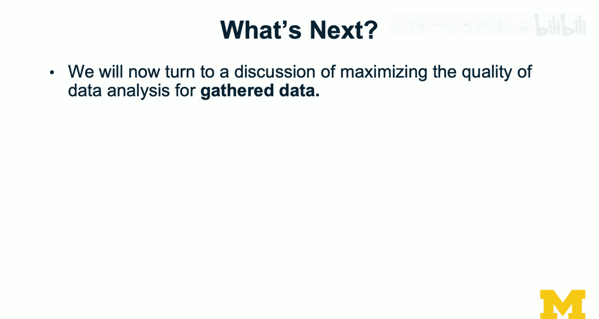

# 密歇根大学《总体数据质量（框架、度量、设计策略）total data quality》 p98 25_分析误差典型案例研究.zh_en -BV1Jn4y1X7uS_p98-

Okay， hello， everyone。 welcomecome back。 Now that we have an idea of what it takes to maximize the quality of our data analysis when working with design data。

 we're going to consider some case studies of what can go wrong。

 if we fail to account for design features when performing analyses of design data。

 and this is called analytic error when some of those different design features that we discuss previously are not correctly accounted for when we're actually sitting down to analyze design data。

 so we're going look at some case studies in analytic error。

 remember from our total data quality framework。 we're now focused on data analysis at that final phase of the overall framework and making sure that while we've tried to maximize quality at all the other dimensions of measurement representation。

 we want to continue to maximize quality when we're thinking about how we're analyzing the data at that final phase of the overall process。

 So again that's our focus here。 and these case studies are going to show you what can happen when we fail to perform a high。

Quality data analysis at that final phase Okay so first case study we're going to look at is the Se stat case study So we analyze survey data from the science and engineer statistical data system that's what Se stat stands for and this data system is sponsored by the national Center for science and engineering statistics or N we're going to look at three main Se stat surveys all of which collected data from complex probability samples like we talked about previously where the key design features that we need to account for are sampling weights that account for different probabilities of being selected in the sample and possibly non-response adjustment stratification So stratified sample designs and cluster sampling the selection of clusters of individuals at random as a part of the overall sample design All those design features need to be accounted for in a high quality analyses of these different data sets。

 So three different data sets， the national survey of college graduates or mCG the survey of doctorate。

pients or SDR in the national survey of recent college graduates or NSRCG。

 This survey is actually no longer active today。 Now the reference for this particular study was Weston colleagues in a 2016 article in the journal plus1 public library of science1。

 This is an interdisciplinary journal and we presented this general study of analytic error to be of general interest to researchers from a variety of different disciplines。

 So here's more about this case study。 we examined the implications of making analytic errors for analyses of the Setat data。

 So what we did is we downloaded the 2010 public use SR and NSCG data。

 So these data are freely available online。 we just downloaded these data sets and then we perform different types of analyses。

 We obtained the replicate weights for variance estimation from NsS。

 So this is one way that you can estimate standard errors of weighted estimates to account for those。

Complex sample design features， the straightta and the clusters is by using what are called replicate weights。

 That's the tool that should be used in order to estimate these types of variances。

 So we obtain that data from Nss which was discussed in the documentation for these data sets We then worked with NSES staff to identify key descriptive estimates that users of these data would be interested in computing to describe the target populations of these different surveys and we also identified regression models that were of substantive interest So models that allow the data users。

 NSEs data users to make population inferences about relationships between variables。

 So we wanted our example analyses to be grounded in reality。 That was really the key point here。

 So we wanted to work with the NSES staff to identify analyses that would be of interest to users of these data We then performed three types of analyses for both descriptive and analytic regression parameters by analytic I mean。

Pra we perform three different types of analyses for both of these different kinds of parameters。

 The first type of analysis fully accounted for the complex sampling features。

 So in the context of our course right now， that means we're maximizing the quality of our data analysis。

 We're fully accounting for those complex sampling features。

 The second approach was a type of analytic error。 We account for the sampling weights only and we ignore the other complex sample design features。

 the stratification and the cluster sampling， where again， in the case of these data sets。

 the stratification and cluster sampling were captured in those replicate weights that we can obtain from NSES other data sets will make codes available containing the stratification and cluster sampling features。

But in that second analysis， we only accounted for the sampling weights in our analysis。

 We failed to account for the stratification and cluster sampling。

 And then the third analysis was what we might call a naive analysis。

 We completely ignored those complex sampling features so that would be a low quality approach to doing the overall data analysis is just to be completely ignorant about those complex sampling features and their role or their effect on the overall analysis。

 So we compared and contrasted estimates that were produced based on these three different approaches when focusing on the same data and the same estimates of these different parameters。

 We also considered ratios of variance estimates to assess what are known as misspecation effects And that's what happens when you ignore key sampling features in the analysis。

 We looked at ratios of the essentially the standard errors squared to see if there were notable differences in those standard errors due to ignoring these key sampling features。

 So what did we find in this particular case。Study among eight different categorical variables that we analyzed in the 2010 survey of doctorate recipients。

 inferences related to estimated distributions in the population。

 basically population percentages on these different variables would have changed completely for five of the variables if these design features were ignored and these variables included current salary。

 race ethnicity attending professional meetings in the past year。

 major field of study and labor force status these were all different categorical variables available in the SDR but our inferences would have completely changed about the distributions of these variables Now the changes were generally small。

 but we would have arrived at different conclusions altogether for the proportions that fell into different categories defined by these different variables if we ignored these design features so five out of eight variables we would arrive at different substantive conclusions about what the population looks like in terms of those different variables。

When looking at data from the NSCG among 10 continuous and categorical variables in the 2010 NSCG。

 there would be substantial changes in inference for nine of those variables。

 So that means if you look at an estimate of am means say and a confidence interval or an estimate of a proportion and its confidence interval。

 we would arrive at completely different conclusions for 90% of those variables if we completely ignored those design features。

 it's pretty shocking。 but we would get a very different picture of the population ignoring those design features。

 So here's an extreme example of what we're talking about from the 2010 NSCG of this type of analytic error。

 So a key indicator coming from that national survey of college graduates is whether in the survey they say that their primary job is in the science and engineering fields。

 that's a key indicator that the US uses to understand its workforce when we fully account for the complex sampling features in the analysis again。

 the high quality analysis in the。Of our course right now。

 the weighted estimate of the percentage of individuals with a primary job in science and engineering is about 30%。

30。38%。 and you can see that that standard error is about 0。

3% taking those design features into account so that would be the estimate that we'd want to report in a paper or technical report or something like that。

 If we only account for the final weights as one might expect。

 we arrive at this exact same weighted estimate。 It's still 30。38%。

 so that's fine but the standard error notice rises somewhat。

 and that's because we're not accounting for the stratification that was inherent to the National C of College graduates and stratification again reduces our standard errors It makes our estimates more precise So we would fail to get that benefit of the reduced standard error by failing to account for the stratified sampling that was used to select the sample initially but look what happens if we're completely ignorant about the complex sampling features and we ignore the weights。

And we ignore those replicate weight， which are used for variance estimation and reflect the stratified cluster sampling。

 Our estimate now becomes 54。94% of people in the target population。

 having a job in science and engineering almost 25 percentage point difference compared to the correct weighted。

 unbiased estimate， because we ignore those weights in the overall analysis。 Furthermore。

 notice how that standard error drops， we are overstating the precision of our estimate by failing to account for those complex sampling features。

 So basically， everything is going really wrong here when we completely ignore those complex sampling features and we would have a very。

 very misleading picture of what that population looks like by failing to account for those design features in our overall analysis。

 Now， why is this happening， The NScG weights were highly correlated with several other measures of interest。

 race， ethnicity， highest。obtain salary， major degree。

 There was oversampling of individuals in these different categories。

 especially those who are in science and engineering。

 So there are oversampling of individuals more likely to be in those job categories。

 So that's why failure to use the weights to paint such a misleading picture here because of the oversampling in these different categories and the correlation of those weights with several other key measures So critically important to account for the weights in this case。

 people with higher probabilities of being included in the NSCG sample had unique values on these variables of interest。

 and so the weights are informative and we need to make sure those weights are being accounted for in the analysis。

 otherwise we're in this situation where we're painting a very misleading picture of what the population looks like。

 so this is what we mean about maximizing the quality of the analysis If we were to report 55% we're ignoring those other design features and we're reporting a low quality estimate that's subject to a lot of bias because of the failure to account for those design features now。

That was descriptive estimates， What about regression models in a regression model that we fitted to log transform current salary as a dependent variable in the 2010 National Sury of college graduates。

 the main effect of having a science and engineering degree on log transform salary would change completely。

 if we fully account for the complex sampling features， we get evidence of a positive relationship。

 that 0。16 is the regression coefficient for having a science and engineering degree。

 So if you have a science and engineering degree you're expected to have a higher current salary and the standard error for that estimated coefficient was 0。

03 had we completely ignored the complex sampling features in the analysis that estimated coefficient for having a science and engineering degree is divided by 8 so we actually lose evidence of that significant relationship by failing to account for those design features Furthermore。

 the standard error is lower than it actually should be。

 So we would have no evidence of a relationship again， another type of。

and a poor quality estimate by failing to account for those design features。

 Take a different model into consideration。 Suppose we had a logistic regression model for having a science and engineering job as a dependent variable in the 2010 NSCG and we' interested in making inference about the interaction between race。

 ethnicity and gender this too would have changed radically。

 if we fully account for the complex sampling features。

 this is just a P value for testing an null hypothesis that that interaction is significant。

 If we fully account for the complex sampling features， our Pvalue 。19。

 which means we would fail to reject an null hypothesis that those interactions don't matter。

 But if we ignored those complex sampling features altogether。

 we would find evidence of a strongly significant interaction between race ethnicity and gender。

 And again， we might go on to report that in a paper and you know say that that's an important research finding when。

 in fact， is just a low quality estimate coming from this data set because we failed to account for those complex sample design features。

When we account for those features， there's no evidence of this kind of interaction in the overall population。

Okay， so here's a second case study。 This is from the Burtis。

 and we'll talk about what Burtis means here in a second。

 Very little work to date has considered the analytic error problem in the establishment survey context。

 So the two prior surveys we were talking about were surveys of individuals Burtis was a survey of establishments。

 And so what we did in this case study is we considered the implications of failing to account for sample design features in a real establishment survey And given that establishment surveys can generally vary widely in terms of their size。

 the number of employees， their profits， etc Probabilities of selection are often a function of size and the weights can therefore vary widely because the weights are a function of the probabilities of being included in the sample。

 So weights become even more critical to think about when we're dealing with establishment survey data。

 So we performed the same types of alternative analyses of data， for example。

 with and without accounting for the weights in the estimation from the 2013 Burtis where Burtis stands for business research and development and innovation survey。

 that's what。Burtis acronym where the Burtis acronym comes from We also considered the effects of ignoring the stratification in the Burtis sample design。

 so different establishments were stratified in the overall national sample and we need to account for that stratification if we want our standard errors to be reduced and have more efficient estimates So just a disclaimer about the Burs this research uses data from the US Census Bureau's longitudinalEmployer household Dynamics program which was partially supported by grants from the National Science Foundation the National Institute on Aging grant and grants from the Alfred P Sloan Foundation just need to make that clear and that any opinions and conclusions expressed herein are those of me and do not necessarily represent the views of the US Census Bureau All results have been reviewed to ensure that no confidential information is disclosed and you could read more details about the Burs survey at this web link here at the bottom of the slide so here are results from the descriptive analyses so these are descriptive analyses of selected variables you can see approximate sample sizes。

Report the actual sample sizes here for variables， including total salary expenditures in millions。

 total worldwide employees and thousands， total US expenditures on RD in thousands and total worldwide expenditures and RD in thousands so we want to calculate means on each of these different variables using our different analytic approaches so you can see the Burs selected a pretty big sample of these different establishments to compute these different estimates So in the first approach again。

 completely naive we ignore the weights and we ignore the stratified sampling so there are codes available in the Burs data files representing the different strata and we ignore those codes entirely so you see these estimates based on the naive approach a low quality analysis of the Burs data so you can see the different estimates look at the shocking differences in the estimates of these means for approaches two and three where we're fully accounting for the weights and we're either adjusting for the strata to compute our standard errors that's approach3 or we're not accounting for the strata to compute。

Our standard errors that's approach to look at how different the estimates of these means become when we account for the weights in the birdest。

 there's just no comparison and we would be painting such a misleading picture of what the population tends to look like in terms of means on these different variables for these US establishments if we fail to account for those weights in our estimation。

 look at the differences in the estimates of these means we also see much lower standard errors of those estimated means when we're accounting for the weights。

 especially when we account for the strata in the estimation， you can see that in approach3。

 accounting for the strata and the variance estimation reduces the standard errors even further。

 but we would clearly arrive at substantially different conclusions about these population parameters when describing these estimations if we fail to account for those design features in the analysis here are results from the regression models that were fitted and we looked at in this case。

 total research and development expenditures。The US as a dependent variable and our predictors included total salary expenditures and total worldwide employees and then the interaction between those two variables。

 So we're in the same situation here。 look at what happens to these estimated coefficients when we fail to account for the weights in approach1 where we fail to use the weights you see the coefficients look at how much they change in approaches2 and3 when we're actually using the weights and again in this case in approach 3 where we're accounting for the sampling strata look at how the standard errors drop compared to approach 2 we're getting more precise estimates when we're fully accounting for all those design features So approach 3 in this case would be the high quality the maximize quality data analysis that we're looking for when analyzing these kinds of design survey data sets and that's what we would want to report in a publication so just to summarize the Burs case study failing to account for the survey weights in the 2013 Burs led to substantial changes in inference for both means and regression coefficient。

And again， this was because the weights were informative。 They were correlated with key measures。

 And that means they're going to play a role in estimation of these different parameters。

 important to account for them。 a failure to account for the stratified sample design of the 2013 Burts LED to overly conservative inferences。

 In other words， our standard errors were too large。

 The publication by myself and Joe Saxaw in 2018 presents additional details about this analysis if you're interested。

 The key kind of takeaway point here。 I that high quality analysis will add a minimum。

 begin by accounting for critical design features in the data analysis。

 as these features often have large impacts on the estimates that we're reporting or their standard errors。

 That's how we want to make sure that we're maximizing the quality of the analysis performed。 Okay。

 so what's next this week， we're going to turn to a discussion of maximizing the quality of data analysis when we're working with gather data sets。

 Okay， Thank you。

