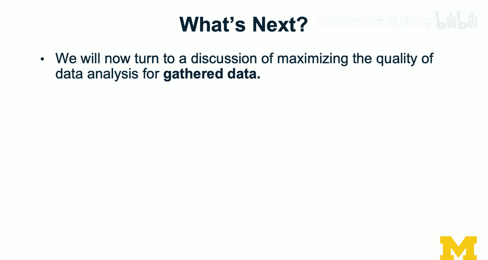

# 总体数据质量（框架、度量、设计策略）：25：分析误差典型案例研究 📊

在本节课中，我们将通过两个具体的案例研究，探讨在分析设计数据时，如果未能正确考虑抽样设计特征（如权重、分层、整群抽样）会如何导致严重的分析误差。我们将看到，忽略这些特征会如何扭曲描述性统计和回归模型的结果，从而得出完全误导性的结论。

上一节我们介绍了在数据分析阶段最大化质量的重要性，本节中我们来看看当分析过程未能正确考虑设计特征时，会发生什么。这被称为**分析误差**。我们将通过两个真实的数据集案例，展示忽略抽样权重、分层和整群设计等关键特征所带来的后果。

## 案例研究一：SESTAT 数据系统

首先，我们来看一个基于SESTAT（科学与工程统计数据系统）数据的案例研究。该系统由美国国家科学与工程统计中心赞助。我们分析了其中三项主要调查的数据，它们都采用了复杂的概率抽样设计。这些设计的关键特征包括：
*   **抽样权重**：用于调整样本中个体被选中的不同概率以及可能的无回答。
*   **分层抽样**：将总体划分为层，然后在各层内独立抽样。
*   **整群抽样**：随机选择个体群组（如学校、街区）作为样本单位。

在高质量分析中，必须考虑所有这些设计特征。

我们使用了2010年的“博士获得者调查”和“全国大学毕业生调查”的公开数据。与NCSES工作人员合作，我们确定了数据使用者感兴趣的关键描述性估计和回归模型，以确保分析贴近现实。

以下是我们在分析中采用的三种方法：
1.  **高质量分析**：完全考虑了所有复杂抽样特征（权重、分层、整群）。
2.  **部分校正分析**：仅考虑了抽样权重，但忽略了分层和整群设计。
3.  **朴素分析**：完全忽略了所有复杂抽样特征。

通过比较这三种方法得出的估计结果，我们评估了分析误差的影响。

### 主要发现

在分析2010年“博士获得者调查”中的8个分类变量时发现：
*   如果忽略设计特征，其中**5个变量**（包括当前薪资、种族/民族、过去一年是否参加专业会议、主修领域和劳动力状态）的总体分布推断会**完全改变**。尽管变化幅度可能不大，但会导致关于不同类别比例的实质性结论不同。

在分析2010年“全国大学毕业生调查”中的10个连续和分类变量时发现：
*   如果完全忽略设计特征，其中**9个变量**的推断会出现**实质性变化**。这意味着对于90%的变量，我们基于均值或比例及其置信区间会得出完全不同的结论。

### 一个极端示例

“全国大学毕业生调查”中的一个关键指标是调查对象是否表示其主要工作属于科学与工程领域。
*   **高质量分析**（考虑所有设计特征）：估计约有 **30.38%** 的人从事科学与工程领域工作，标准误约为0.3%。
*   **仅考虑最终权重**：点估计仍为30.38%，但标准误有所上升（因为未利用分层设计带来的精度增益）。
*   **朴素分析**（忽略所有权重和设计）：估计值变为 **54.94%**，产生了近25个百分点的巨大偏差，并且标准误被人为压低，严重高估了估计的精确度。

**为什么会这样？** 因为NSCG的权重与种族、民族、最高学位、薪资等多个关键指标高度相关。调查过度抽样了更可能从事科学与工程工作的人群。因此，忽略权重会导致描绘出极具误导性的人口画像。

### 回归模型中的误差

分析误差同样严重影响回归模型的结果。
*   在一个以对数转换当前薪资为因变量的回归模型中，如果完全忽略复杂抽样特征，“拥有科学与工程学位”这一变量的回归系数会**缩小为原来的1/8**，并且其标准误会低于应有水平，导致我们可能错误地认为该关系不显著。
*   在另一个以“是否拥有科学与工程工作”为因变量的逻辑回归模型中，如果忽略设计特征，我们会发现种族/民族与性别之间存在**显著的交互作用**。然而，当正确考虑所有设计特征后，**并无证据**表明总体中存在这种交互作用。

这个案例清楚地表明，未能正确考虑抽样设计特征会导致低质量、有偏的估计，并可能报告错误的研究发现。

## 案例研究二：BRDIS 企业调查

第二个案例关注的是企业调查背景下的分析误差。企业调查（如BRDIS——商业研发与创新调查）的对象是机构，其规模（雇员数、利润等）差异巨大，因此入选概率常与规模相关，导致权重值变化范围很广。在企业调查数据分析中，权重变得更为关键。

我们使用2013年BRDIS的数据，进行了类似的三类分析比较，并特别考察了忽略分层设计的影响。

### 主要发现

在针对“总薪资支出”、“全球雇员总数”、“美国研发支出”等变量的描述性分析中：
*   当**忽略权重**时（朴素分析），对总体均值的估计与考虑权重后的结果**截然不同**，会严重歪曲对美国企业这些指标的真实认知。
*   当**考虑权重但忽略分层**时，标准误仍然较大。
*   **高质量分析**（同时考虑权重和分层）不仅得到了合理的点估计，还通过利用分层设计**进一步降低了标准误**，获得了更精确的估计。

在回归分析中，我们以“美国研发总支出”为因变量，“总薪资支出”和“全球雇员总数”及其交互项为预测变量。
*   同样，**忽略权重**会导致回归系数发生巨大变化。
*   在**考虑权重的基础上进一步纳入分层信息**（高质量分析），能够有效**降低回归系数的标准误**，得到更精确的推断。

### 案例总结

BRDIS案例研究表明：
1.  在2013年BRDIS数据分析中，**忽略调查权重**会导致对均值和回归系数的推断发生**实质性变化**。
2.  **忽略分层抽样设计**会导致推断过于保守，即**标准误被高估**。
3.  根本原因在于权重是“信息性”的，它们与关键测量指标相关，因此在参数估计中扮演重要角色。

## 总结与核心要点 🎯

本节课中，我们一起学习了分析误差的两个典型案例。通过SESTAT个人调查和BRDIS企业调查的数据，我们清晰地看到：

*   **忽略抽样设计特征（尤其是权重）** 会严重扭曲描述性统计（如比例、均值）和回归模型的结果，导致点估计产生巨大偏差，并错误估计其精确度（标准误）。
*   **高质量的数据分析**，**至少**需要从在分析中**正确考虑关键的设计特征**开始。这些特征通常对我们报告的估计值或其标准误有巨大影响。
*   分析误差的根源在于设计特征（如权重）与研究所关注的变量之间存在相关性。当这种相关性存在时，忽略设计特征就等于忽略了数据生成机制的重要信息，必然导致有偏且不可靠的结论。

因此，为了最大化数据分析阶段的质量，确保研究结论的可靠性与有效性，研究者必须充分理解其数据背后的抽样设计，并在分析中采用适当的方法（如使用抽样权重、设计效应调整、基于复制权重的方差估计等）来校正这些设计特征的影响。