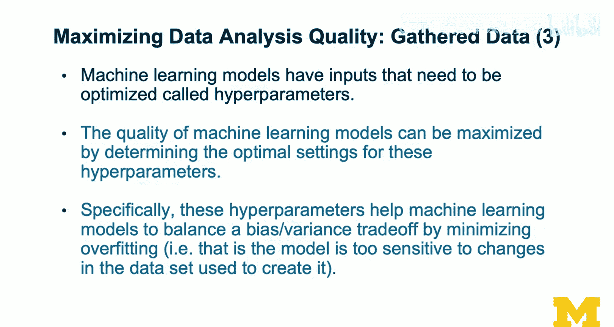
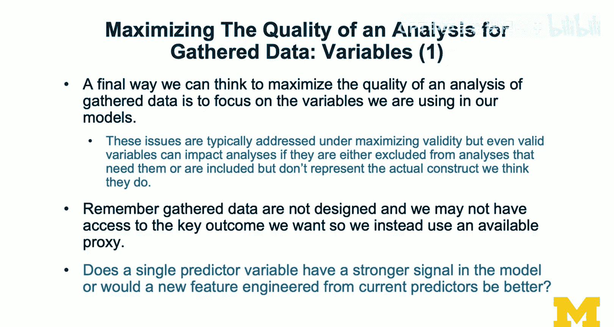
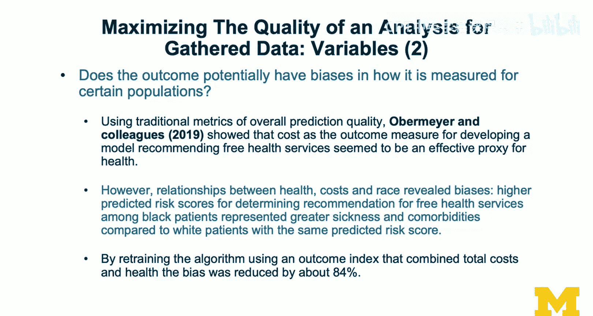
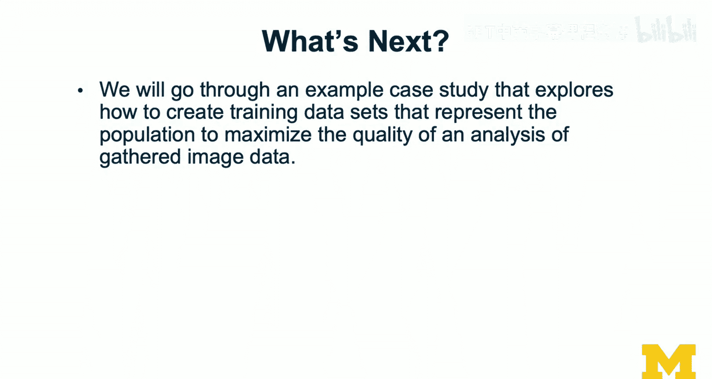

# 密歇根大学《总体数据质量（框架、度量、设计策略）total data quality》 p99 26_最大化采集型数据分析质量.zh_en -BV1Jn4y1X7uS_p99-

Hello， welcome to our lecture on maximizing the quality of an analysis of gathered data。

 I'm Trenm Buskirk。 We're really happy to have you。 Just like you do in all of our lectures。

 we're going to point out where we are in our framework。

 We're going to be looking at the ways to maximize data analysis， quality for gathered data。

 So this actually occurs at the very bottom of our framework at the nexus of where measurement and representation come together。

 Many types of gathered data fall into what we might call big data with many cases。

 many variables or accommodation of the two。 As we discussed in our second course。

 we often apply machine learning models or methods to analyze various types of gathered data。😊。

By applying these machine learning methods to the gathered data。

 we are in part maximizing the analysis of such data already。 Ma learning methods offer flexible。

 often non parametric approaches for adapting to the complexity and availability of data。

 but not all ML methods work equally well for a given prediction problem。

Mendez and colleagues in 2008 compared two machine learning methods。

 random forest and logistic regression for predicting graduation outcomes for stem that would be science technology engineering and math majors based on academic administrative data from the largest university in the US。

 Their work showcased how random forest models can be more accurate for such predictions compared to those made by logistic regression models。

 if interactions are present among the predictors that may not be known a priori to researchers when they needed to specify the logistic regression model at the time that they did the analysis。

 Ma learning models have inputs that need to be optimized called hyperparameters。

 The quality of machine learning models can be maximized by determining the optimal settings for these hyperparameters。

 What exactly are hyperparameters。 Imagine that you have a toaster oven。

 and you want to create perfectly。😊。

Toast when you put the toast in the oven。 there's a knob on the side of the machine that would tell the machine how dark you want that toast to be。

 You turn that knob to your favorite setting。 You clamp down the toaster you wait for the toast。

 Andvoila， it comes out But when you were first buying or using that toaster。

 You probably didn't know exactly how far to the right to move that knob。

 Think of that knob as a hyperparameter。 It is a setting on the machine that needs to be set by the user in order for the machine to properly do what you're asking it to do。

 Ma learning models are not a whole lot different than your toaster。

 And the hyperparameters are a whole not a whole lot different than that knob。

 So that's how I sort of think about the hyperparameters。 Hopefully that's a little bit more clear。

 These hyperparameters help machine learning models to balance a so called bias and variance trade off by。

izing overfitting Overfitting is when a model is too sensitive to the changes in the dataset set used to create it。

 It's paying too much attention to the data locally and not thinking about new data coming in。

 a model that's overfit would be very sensitive to the current dataset set and may not work very well when you apply it to new dataset sets coming in。

 So we want to be able to balance bias and variance。

If these hyperparameters are selected and evaluated using the same data set。

 the model's performance on new data will likely be worse， as described by Coon and Johnson。

 a common approach for determining the optimal values of these hyperparameters is using a grid search where different possible values are selected and tested over a range and a model is constructed using training data。

 and then it is evaluated on test data。 Sometimes we use one training data set and one test data set to create an estimate for which hyperparameter gives us the best performance of a model。

 That so called split sample approach is one way that you can evaluate the performance of a model at a given setting of a hyperparameter。

 But there are other ways that we could actually get better estimates of model performance less biased by looking at multiple versions of a。

Training data set and multiple versions of a test set。

Kfold cross validation is such an approach for creating independent sets of training and test data to create an unbiased assessment of how the model will perform at various levels of the hyperparameters。

 on new data。 A fold is simply a subset selected at random without replacement from the big data set。

 Each case in the data belongs to one and only one fold。

 One of the most commonly used values of K and Kfold cross validation is 10。 And in this case。

 a fold represents a 10% subs sampleample of the data set。😊。

The first fold is held away to be the test data and folds 2 through 10 are combined to become the training data。

 the process repeats so that each fold is used once as the test data。

Model performance is averaged across these 10 test folds。

 and the value of the hyperparameter with the highest accuracy from these averages is then selected as the final setting on the knob and is used in the model to create a final model with all the data combined Another way we can maximize the quality of an analysis of gathered data is to ensure that the training data sets that we use regardless of what kind of crossvalation we may employ or not represent the populations for which predictions are desired。

 We note that issues with the training data have technically already been addressed in this course in our data source quality lectures。

 but we note here that the impact of these data source errors in terms of how the training data represents the population for which predictions are desired could actually impact the quality of models derived from these。

Training data socal algorithmic biases can actually result if there are insufficient representation of the population in training dataset sets。

 Bulwani and Gub in 2018 discuss this in gender shades in the gender shades study E and others in 2019 discuss this in windmill plots and non windmill plots in image detection studies to overcome these issues。

 there is a growing set of work in focusing on sampling and other methods for curating training data sets to ensure adequate representation across the so-cal protective groups like gender race and age。

 for example， the idea behind these approaches stems from the ability to seek additional cases to be added to the training dataset sets where deficiencies lie in order to promote overall fairness and adequate population representation in the training dataset set itself。

 a final way we can think to maximize。The quality of an analysis of gathered data is to focus on the variables we are actually using in our models。

 It's really no surprise that if you put junk into a model。

 you might at best get junk out but in some cases we actually are trying to think more carefully about the variables that we are putting into these models in order to form the predictions or the estimates that we need。

 The thing that's a little bit tricky here is that our big data sets usually have lots of variables available。

 and in those data sets， we actually may not have constructed those variables from scratch。

 We may not know completely what those variables were intended to measure or exactly how they were measured because this is gathered data。

 and it is a secondary data source for us to use in our analyses。

The issues with respect to the validity of the variables have been already addressed in the maximizing validity lectures in this course。

 but even valid variables can impact analyses if they are either excluded from the analyses that need them to be included or they are included。

 but they don't actually represent the construct that we think they do。Remember。

 gathered data are not design data， and we may not have complete access to the key outcome that we want。

 So instead， we use an available proxy。 Does a single predictor variable have a strong signal in the model or would a new feature that's engineered from other variables be better。

Does the outcome potentially have biases in how it is measured for certain populations using traditional metrics of overall prediction quality overmeing colleagues in 2019 showed that cost as the outcome measure for developing a model that recommended free health services seemed to be an effective proxy for health。

 cost was an effective proxy for health。 However， upon further exploration。

 they discovered that relationships between health costs and race revealed biases， Alic biases。

 if you will。 High predicted risk scores for determining recommendation for these free health services among black patients represented greater sickness and greater comorbidities compared to white patients with the same predicted score by retraining the algorithm using an outcome index that combined total costs and health measures。

 The bias was reduced by 84。😊，PSo in this case， they thought cost was a reasonable proxy and used that variable as the outcome in their model。

 Later， they understood that cost was really representing several things that created some errors in the model for these inequitable risk scores by race。

So instead of using the cost variable， they combined it with additional variables to create a new index that was used to develop their models。

 and that new index actually improve the performance。 So again。

 the variables that we include in our models are important。

 And how those variables are measured or what they're measuring is also important。

 and we may not be able to tell at first glance or at first model if they will actually work。

 Com up next， we're going to go through an example case study that explores how to create training data sets that represents the population to maximize the quality of an analysis of gathered data。

 Thanks for being with us willll see you soon。😊。

