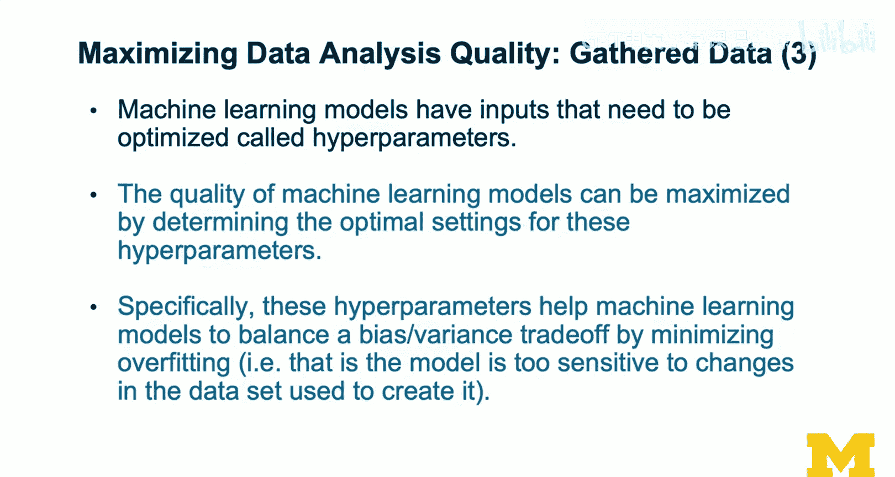
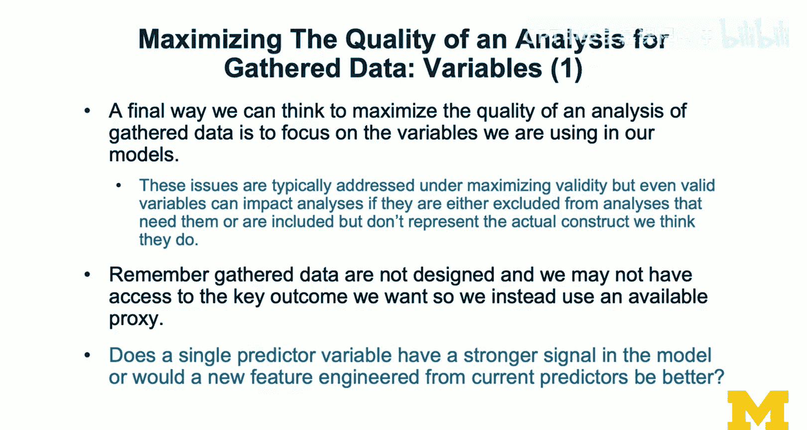
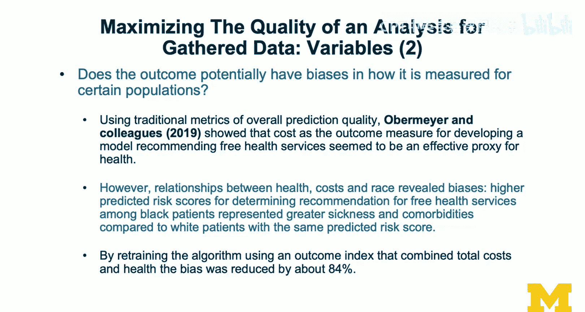
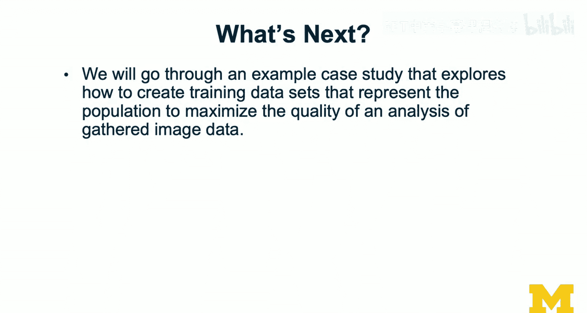

# 总体数据质量：26：最大化采集型数据分析质量 📊

在本节课中，我们将学习如何最大化采集型数据分析的质量。我们将探讨机器学习模型的应用、超参数优化、训练数据的代表性以及变量选择等关键策略，以确保分析结果的准确性和公平性。

---

## 框架中的位置 🗺️

上一节我们介绍了数据质量框架的其他部分，本节中我们来看看如何最大化采集型数据的分析质量。在我们的总体数据质量框架中，这部分内容位于最底部，是测量与表征的交汇点。

许多采集型数据属于我们通常所说的“大数据”，具有大量案例、众多变量或两者兼备的特点。正如我们在第二门课程中讨论的，我们经常应用机器学习模型或方法来分析各种类型的采集型数据。

---

## 应用机器学习方法 🤖

通过将机器学习方法应用于采集型数据，我们已经在某种程度上最大化了对这类数据的分析。机器学习方法提供了灵活、通常是非参数化的方法，以适应数据的复杂性和可用性。然而，并非所有机器学习方法对给定的预测问题都同样有效。

Mendez及其同事在2008年比较了两种机器学习方法：随机森林和逻辑回归。他们基于美国最大大学的学术管理数据，预测STEM（科学、技术、工程和数学）专业学生的毕业情况。他们的研究表明，如果预测变量之间存在交互作用，而研究人员在分析时指定逻辑回归模型之前可能并不知道这些交互作用，那么随机森林模型对此类预测的准确性可能高于逻辑回归模型。

---

## 优化超参数 ⚙️

机器学习模型有一些需要优化的输入参数，称为**超参数**。通过确定这些超参数的最佳设置，可以最大化机器学习模型的质量。

**超参数**是什么？想象你有一个烤面包机，你想烤出完美的面包片。当你把面包放进机器时，机器侧面有一个旋钮，用来告诉机器你希望面包烤到什么程度。你把这个旋钮转到你最喜欢的设置。你按下烤面包机，等待面包片。瞧，面包片就烤好了。但当你第一次购买或使用这个烤面包机时，你可能并不知道该把旋钮向右转多少。把这个旋钮想象成一个超参数。它是机器上的一个设置，需要由用户设定，以便机器正确执行你的要求。机器学习模型与你的烤面包机没有太大不同，而超参数与那个旋钮也没有太大不同。

这些超参数帮助机器学习模型平衡所谓的**偏差-方差权衡**，从而最小化**过拟合**。

**过拟合**是指模型对用于创建它的数据集的变化过于敏感。它过于关注数据的局部特征，而没有考虑新输入的数据。一个过拟合的模型对当前数据集非常敏感，但当你将其应用于新的数据集时，可能效果不佳。因此，我们希望能够在偏差和方差之间取得平衡。

---

## 评估超参数性能 📈

如果使用相同的数据集来选择和评估这些超参数，模型在新数据上的性能可能会更差，正如Coon和Johnson所描述的那样。

确定这些超参数最佳值的一个常用方法是使用**网格搜索**。在这种方法中，在一系列范围内选择并测试不同的可能值，使用训练数据构建模型，然后在测试数据上评估它。

有时，我们使用一个训练数据集和一个测试数据集来估计哪个超参数能给我们带来最佳的模型性能。这种所谓的**分割样本法**是评估模型在给定超参数设置下性能的一种方式。

但是，还有其他方法可以让我们获得更好的、偏差更小的模型性能估计，那就是通过查看训练数据集的多个版本和测试集的多个版本来实现。

**K折交叉验证**就是这样一种方法，它创建独立的训练和测试数据集，以对模型在不同超参数水平下对新数据的性能进行无偏评估。

一个**折**只是从大数据集中随机抽取的一个子集，且不放回。数据中的每个案例属于且仅属于一个折。K折交叉验证中最常用的K值是10。在这种情况下，一个折代表数据集的10%子样本。

第一个折被保留作为测试数据，第2到第10折合并成为训练数据。这个过程重复进行，使得每个折都被用作一次测试数据。模型性能在这10个测试折上取平均值，然后从这些平均值中选择准确率最高的超参数值作为旋钮的最终设置，并用于模型中，以结合所有数据创建一个最终模型。

---

## 确保训练数据的代表性 👥

我们可以最大化采集型数据分析质量的另一种方法是，确保我们使用的训练数据集，无论我们采用何种交叉验证方法，都能代表我们希望进行预测的总体。

我们注意到，训练数据的问题在技术上已在本课程的数据源质量讲座中讨论过，但在此我们指出，这些数据源错误在训练数据代表预测目标总体方面的影响，实际上可能会影响从这些训练数据中衍生出的模型的质量。

如果训练数据集中对总体的代表性不足，实际上可能导致所谓的**算法偏见**。Bulwani和Gub在2018年的“性别阴影”研究以及E等人在2019年关于图像检测研究中的“风车图”和“非风车图”的讨论中都提到了这一点。

为了克服这些问题，越来越多的研究集中在抽样和其他方法上，以策划训练数据集，确保在所谓的**受保护群体**（如性别、种族和年龄）中有足够的代表性。例如，这些方法背后的理念是，能够在训练数据集存在缺陷的地方寻找额外的案例添加到训练数据集中，以促进训练数据集本身的整体公平性和充分的总体代表性。

---

## 关注模型中的变量 🔍

我们可以考虑的最后一个最大化采集型数据分析质量的方法是，关注我们模型中实际使用的变量。

如果你把垃圾输入模型，最多也只能得到垃圾输出，这并不奇怪。但在某些情况下，我们实际上需要更仔细地思考我们放入这些模型的变量，以形成我们需要的预测或估计。

这里有点棘手的是，我们的大数据集通常有很多可用的变量，而在这些数据集中，我们可能并非从头开始构建这些变量。我们可能不完全知道这些变量旨在测量什么，或者它们是如何被精确测量的，因为这是采集型数据，是我们分析中使用的二手数据源。

关于变量效度的问题已在本课程的“最大化效度”讲座中讨论过，但即使是有效的变量，如果它们被排除在需要它们的分析之外，或者被包含在内但实际上并不代表我们认为它们所代表的结构，也可能影响分析。

请记住，采集型数据不是设计型数据，我们可能无法完全获得我们想要的关键结果。因此，我们使用一个可用的**代理变量**。

单个预测变量在模型中是否具有强信号？或者从其他变量中**工程化**出来的新特征是否会更好？结果变量的测量方式是否可能对某些群体存在偏见？

Overmeing及其同事在2019年表明，作为开发推荐免费医疗服务模型的**结果测量指标**，成本似乎是健康的一个有效代理。成本是健康的一个有效代理。然而，经过进一步探索，他们发现健康成本与种族之间的关系揭示了偏见，可以说是**算法偏见**。在确定推荐这些免费医疗服务时，黑人患者的高预测风险分数代表了比具有相同预测分数的白人患者更严重的疾病和更多的并发症。

通过使用一个结合总成本和健康测量指标的结果指数重新训练算法，偏见减少了84%。在这个案例中，他们最初认为成本是一个合理的代理，并在模型中使用该变量作为结果。后来，他们理解到成本实际上代表了导致这些按种族划分的不公平风险分数模型中产生一些误差的几个因素。因此，他们没有使用成本变量，而是将其与其他变量结合，创建了一个用于开发模型的新指数，而这个新指数实际上提高了性能。

所以，我们模型中包含的变量很重要。这些变量如何测量或它们测量什么也很重要。我们可能无法在第一眼或第一个模型中判断它们是否真的有效。

---

## 总结 📝

本节课中，我们一起学习了最大化采集型数据分析质量的几种关键策略：

1.  **应用合适的机器学习方法**：根据数据特性和预测问题选择模型，例如随机森林可能比逻辑回归更能捕捉未知的交互作用。
2.  **优化超参数**：通过网格搜索和K折交叉验证等方法，找到模型的最佳设置，以平衡偏差和方差，避免过拟合。
3.  **确保训练数据代表性**：关注训练数据是否充分代表了目标总体，特别是受保护群体，以避免算法偏见。
4.  **审慎选择与评估变量**：仔细考量模型中使用的变量，包括代理变量的有效性，并意识到变量测量方式可能引入的偏见，必要时通过特征工程创建更合适的指标。

接下来，我们将通过一个案例研究来探索如何创建能代表总体的训练数据集，以最大化采集型数据分析的质量。