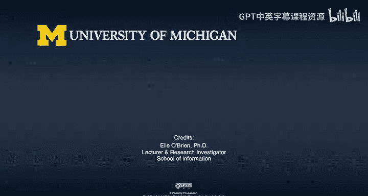
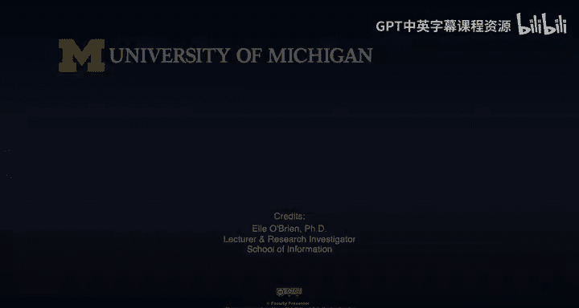

# 课程一：欢迎来到《理解数据：导航统计、科学与人工智能》👋

在本节课中，我们将对《理解数据》专项课程进行整体介绍。你将了解课程的目标、结构、讲师背景以及学习本课程的价值。

---

大家好，我是艾尔·奥布莱恩，密歇根大学的讲师和研究员。
欢迎来到《理解数据：导航统计、科学与人工智能》课程。

在这个专项课程中，我们将探索一些关于如何理解数据、从数据中学习以及利用数据进行预测的重要理念。非常高兴你能加入我们。

首先，让我简单介绍一下自己。我的背景是科学研究，具体而言，我专攻听觉神经科学。这意味着我研究大脑如何理解声音。我的训练涉及大量数学建模，即使用数学和计算机来解释和预测那些难以直接在人体中测量的现象。我将在课程中通过实例分享更多相关内容。

目前，我在密歇根大学信息学院任教，是教学团队的一员。我为来自不同背景的学生教授数据科学和统计学课程，这是我热爱这份工作的原因之一。同时，我也研究许多领域的科学家如何利用复杂的数据和软件开展工作。

教授数据知识的方式多种多样，因为正如我们即将看到的，数据无处不在，创建和使用数据的原因也很多。

请将这个专项课程视为一次简短的导览，它将带你领略现代思维中从数据中创造意义和价值的一些重要理念。请记住，这次导览远非详尽无遗，我选择强调哪些概念当然受到我个人科学背景的影响。这意味着你可能会注意到教学实例偏向于人类健康研究。

此外，本专项课程不包含代数或编程问题。我们的目标是培养对重要理念的直觉和熟悉度。也许随着学习的深入，你会对进一步学习产生兴趣，去上一些涉及方程或编码的课程，从而能够自己分析数据或构建预测模型。或者，如果你已经具备丰富的数据工作经验，本课程或许能帮助你跳出细节，在更广阔的背景下审视自己的工作。

---

## 课程结构概览 📚

上一节我们介绍了课程的整体目标，本节中我们来看看三门课程的具体内容安排。

以下是三门课程的简要介绍：

*   **第一门课程：数据与统计**
    我们将学习什么是数据，以及如何使用统计学来理解数据中的模式。我们还将花时间培养我们思考和谈论数字的直觉，重点是发现并避免涉及统计数据的误导性陈述。

*   **第二门课程：科学与数据**
    我们将探讨科学如何将数据与我们对于世界的理解联系起来，以帮助我们创造新知识。我努力将这门科学课程打造成我初次学习研究工作时希望听到的样子。我们还将探索科学如何传播给公众、哪些信息可能被遗漏，以及如何推理你在生活中可能遇到的听起来很科学的说法。

*   **第三门课程：人工智能与机器学习**
    我们将尝试澄清关于这些术语含义的一些重大困惑，深入探讨这些系统通常如何工作以及它们可能如何出错，并为你提供重要的策略，以便在他人在谈论人工智能时提出关键问题。

虽然你可以单独学习这些课程，但我认为如果按顺序学习，你将能从本专项课程中获得最大收益。如果你这样做，我猜你会发现一些反复出现的主题，请留意这些贯穿始终的主线。

---

## 课程寄语与总结 🌟

无论你来自何方，或希望去向何处，我都希望这个专项课程能为你提供有价值的东西。最重要的是，我希望它能帮助你认识到，当我们谈论数据时，我们谈论的从来不仅仅是数字。我们谈论的是对我们至关重要的事物，而仅仅作为你自己，你也有权决定什么才是重要的。

本节课中，我们一起了解了《理解数据》专项课程的讲师背景、核心目标以及三门课程（数据与统计、科学与数据、人工智能与机器学习）的主要内容。本课程旨在构建直觉，不涉及复杂数学或编程，适合所有背景的学习者。希望这门课程能成为你探索数据世界的有益起点。