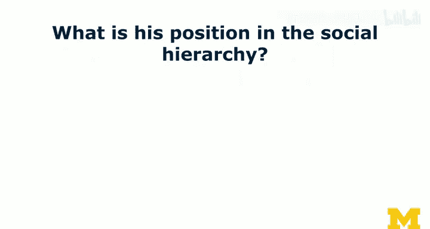
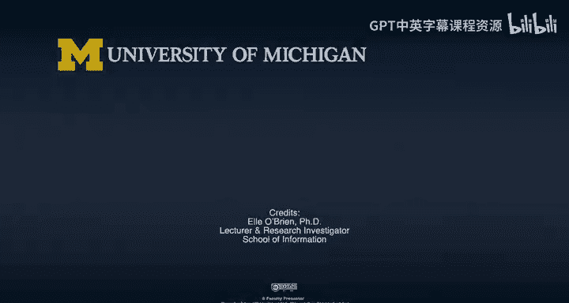

# 密歇根大学《理解数据：导航统计、科学和AI》课程 - P2：现象如何转化为统计数据 🐔➡️📊

在本节课中，我们将要学习现实世界中的现象是如何被转化为我们可以分析和学习的统计数据的。我们将探讨“数据”和“统计量”的基本定义，并通过一个具体的例子来理解数据收集过程中的关键选择和挑战。

***

## 什么是统计量？🧮

首先，我们需要明确什么是统计量。一个基本的定义是：**统计量是从数据中计算得出的一个数值**。

这个数值可以是任何数字，例如某个事物的数量，或者是你可能熟悉的平均值（我们稍后会详细讨论）。简而言之，统计量就是对数据进行计算的结果。

***

## 什么是数据？🌍

然而，“统计量是数据的计算”这个定义引出了另一个问题：什么是数据？

数据的一种定义是：**数据是我们用来表示世界中事物的方式**。我强调“一种定义”，是因为实际上并不存在一个普适且简单的数据定义。

但在这里，我们将采用的定义是：数据是我们**表征**世界的方式。以下是一些例子：
*   一本书、一本手写的日记，它们用文字表征了作者对世界的体验。
*   一个测量值，例如我们用尺子测量一个三明治的厚度。
*   一件艺术品，如图中的北欧民间艺术，它以新的方式表征了雪花。
*   一个充满数字的电子表格，其中的数字代表了现实世界中的某些事物（如利润或库存），而不仅仅是凭空编造的数字。

***

## 从现象到数据：以梅尔文鸡为例 🐓

在这个定义中，有一个非常有趣的点：**当我们选择研究某事物时，它才会变成数据**。这具体是什么意思呢？让我们通过一个例子来理解。

我想介绍我的鸡——梅尔文。梅尔文本身不是数据，它是一只鸡。但如果我们想研究它，情况就会改变。

假设我们想了解关于梅尔文的几个问题：
1.  它有多重？
2.  它有多少根羽毛？
3.  它大部分时间在做什么？
4.  它在鸡群社会等级中的地位如何？
5.  它对生活有多满意？

当我们开始研究这些问题时，我们就在创造数据，并以新的方式看待梅尔文。

以下是针对每个问题，我们可能如何收集数据：

**1. 梅尔文有多重？**
我们可以把它放在秤上，得到一个数字，例如 **1.76 公斤**。

**2. 梅尔文有多少根羽毛？**
理论上我们可以数出来。也许我亲自数，并请另一位科学家复核，最终我们可能达成一致：它有 **11,490** 根羽毛。

**3. 梅尔文大部分时间在做什么？**
我们可以通过观察来回答。我可能会在院子里待一整天（甚至一周），记录下梅尔文做的每一件事，最终得到一份活动日志。

**4. 梅尔文的社会地位如何？**
这更棘手，因为很难直接测量。但我们可以基于对鸡行为的理解来创造一种测量方法。例如，记录一周内梅尔文参与了多少次争斗，以及它赢了多少次。

**5. 梅尔文对生活有多满意？**
这非常困难。一种方法是创建一份“快乐鸡行为”清单，然后观察梅尔文表现出其中多少种行为。另一种方法是直接“询问”梅尔文（假设我们能找到鸡语翻译），然后分析它的回答——例如，计算回答中的积极关键词，或请心理学家评估其满意程度。

通过以上探索，我们突然有了多种表征梅尔文的方式：它的体重、羽毛数量、打赢的架数、活动日志以及对生活满意度的回答。**这就是数据收集的本质**。

***

## 数据的核心：数值与语境 📝

现在，我想强调一个细微之处：以上哪些是数据？是数字“11,490”吗？

实际上，数据不仅仅是数字。**数据是“数值”加上“语境”**。

例如：
*   **数值**：11,490
*   **语境**：这个数字指的是羽毛；是在梅尔文这只鸡身上数的；由两位密歇根大学的鸡科学家于2022年7月7日验证。

所以，完整的数据表述应该是：“**2022年7月7日，由两位密歇根大学的鸡科学家在梅尔文身上验证并数出的11,490根羽毛。**”

***

## 数据收集中的选择与挑战 🤔

总结来说，每当我们想要了解自然时，都必须进行一次主动的“翻译”——将世界中的事物转化为我们可以学习的新表征（即数据）。

但每次进行这种翻译（数据收集）时，都迫使我们做出选择。回顾我们为研究梅尔文所做的所有决定：如何确保羽毛数量准确？如何衡量社会地位？如何收集代表幸福感的数 据？这些都是选择。

即使回答看似简单客观的问题，如“哪棵树最大？”，我们也会面临选择。例如，我们可以测量树从地面到最高点的高度，也可以测量树干的宽度，或者树冠最宽处的宽度，甚至树根的大小（树根当然也是树的一部分）。我们选择定义“最大”的方式，可能会导致不同的答案。

***

## 总结 📚

本节课中，我们一起学习了现象如何转化为统计数据。
*   我们明确了**统计量**是从数据中计算得出的数值。
*   我们探讨了**数据**是“数值+语境”，是我们表征世界事物的方式。
*   我们通过梅尔文鸡的例子，详细了解了将具体现象（一只鸡）转化为各种数据（体重、羽毛数等）的过程。
*   我们认识到，**数据收集本质上是一个充满选择的过程**，不同的选择会导致不同的数据表征，进而可能影响结论。

在初步理解了数据的定义和生成过程后，我们自然会问：**接下来，我们如何开始从数据中学习呢？** 这将是后续课程要探讨的核心问题。