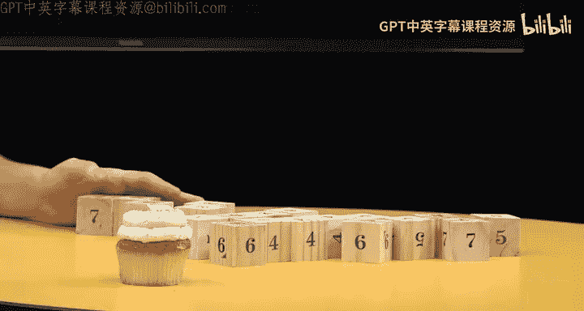
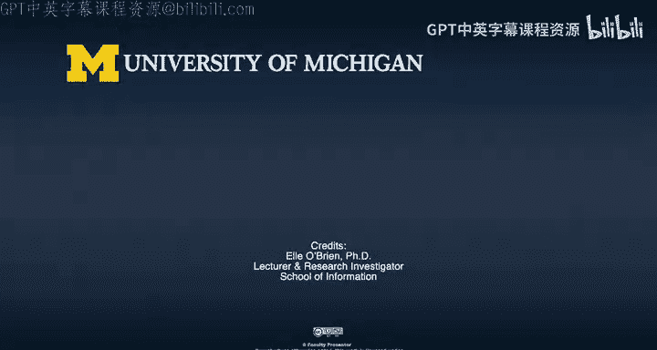

# 3：从数据中学习 📊

在本节课中，我们将学习如何将现实世界的体验转化为数据，并通过可视化方法（如直方图）来识别数据中的模式和分布特征。我们将通过一个关于纸杯蛋糕评分的例子，理解统计思维的基本过程。

---

统计思维涉及将我们的体验重新构建为新的表现形式，以帮助识别世界中有意义的模式。

让我们看一个例子。假设镇上开了一家新的纸杯蛋糕店，我正在考虑是否应该花辛苦赚来的钱买一个纸杯蛋糕。它们到底好不好吃？

假设我在面包店外设立了一个摊位，询问每位出来的顾客，请他们按1到10的评分标准给纸杯蛋糕打分。每次询问后，我将他们的分数记录在一个数字方块上。

在拦截了许多从纸杯蛋糕店出来的顾客并收集了他们的评分后，我得到了许多方块。到目前为止发生了什么？

纸杯蛋糕顾客将他们品尝纸杯蛋糕的真实体验转化为1到10的评分。然后，我将他们脑海中的这个评分转化为可以拿在手中、存储和堆叠的数字方块。

---

## 📈 构建直方图

我们为什么要做这些？目前我们只有一堆方块，这很难理解。因此，我们将制作一种称为直方图的东西。这是一种将数据组织成整洁可视化的方法，以便更好地发现模式。

以下是构建直方图的步骤：

1.  我将所有评分很低的方块堆叠在一起。首先寻找评分为1的方块，但没有找到。
2.  接着，将所有评分为2的方块堆叠在一起。
3.  然后，将所有评分为3的方块堆叠在一起。
4.  继续这个过程，依次堆叠评分为4、5、6、7和8的方块。

现在，我们不再面对一堆杂乱的方块，而是看到了另一种形式。我们称之为**分布**。我们可以看到评分从低到高是如何分布的。

我们能看到中间围绕5分有一个凸起，但也存在一些**变异性**。让我们花点时间理解“变异性”这个词。如果每个人都给纸杯蛋糕完全相同的5分，就不会有变异性，我们只会有一堆评分为5的方块。但相反，我们得到了这个形状。这是因为并非每个人都给出了完全相同的评分。

变异性使我们的数据稍微复杂一些，但也更有趣。尽管存在变异性，并非每个人都给出相同的分数，但存在一个模式：在5分附近有一个凸起。这是因为给纸杯蛋糕打5分的人比打其他分数的人多，而且大多数人给出的评分在4到6分之间。只有少数人给出了3分或更低，也只有少数人给出了7分或更高。

---

## 🧠 从分布中学习

如果我认为自己与在纸杯蛋糕店前调查的那些人相似，我可能可以从这个分布中学到一些东西。

我预计自己可能会给这个纸杯蛋糕打5分左右，也许是4分或6分。它既不是不可思议的美味，也不是糟糕透顶。这是统计中一个非常基本过程的本质：

1.  我们找到一种方法将世界中的某些事物表示为数据（在本例中是人们对新纸杯蛋糕店的体验）。
2.  我们将这些数据放入可以计数和可视化的形式（即方块）。
3.  我们组织数据（在本例中，我们将相同评分的方块堆叠起来，得到直方图）。

我们做这一切是为了理解数据如何分布，并开始看到模式。大多数时候，研究人员使用计算机而不是木块来表示、存储和操作数据。但我向你展示的是统计学家使用软件进行的过程的模拟版本。

---

## 💡 直方图的价值与总结

只有少数数据点（代表人们对纸杯蛋糕店评分的方块）时，即使不制作直方图，你也可能理解一些大的模式。也许我本可以只看袋子，注意到有很多5分。但你可以想象，如果我们有数百或数千个数据点，制作可视化图表（当然还要使用计算机）将变得更加重要。

**关键在于，我们可以使用直方图作为一种便捷的方式来查看数据的分布。** 从这个分布中，我们可以开始注意到一些特征，比如**峰值**。峰值非常重要，因为它告诉我们很多人给纸杯蛋糕的评分在10分制中大约是5分。所以这可能意味着我也很可能给出类似的评分，因为我认为自己与从纸杯蛋糕店出来的人很相似。

看，我正在从数据中学习。接下来，我们将正式介绍一些用来描述分布峰值的词汇：**均值**和**中位数**。我们将讨论这些统计量能告诉我们什么，以及它们可能误导我们的方式。同时，我会吃掉这个纸杯蛋糕，因为我知道它不太可能是我吃过的最好的，也不是最差的。这对我来说没问题。

---

本节课中，我们一起学习了如何将体验转化为数据，通过构建直方图来可视化数据的分布，并从分布中识别模式（如峰值和变异性）以进行推断。这是理解数据并进行统计思考的基础步骤。