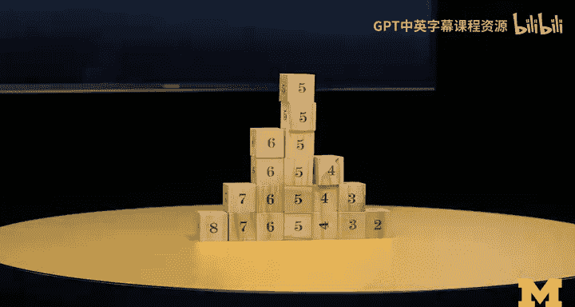

# 4：均值与中位数的测量意义 📊

在本节课中，我们将学习两个最核心的统计概念：均值和中位数。我们将通过一个给纸杯蛋糕评分的例子，理解它们如何描述数据的中心趋势，以及在不同数据分布下如何选择使用哪一个。

---

## 🧱 理解数据分布

首先，我们有一组数据，代表不同顾客对一家新纸杯蛋糕店的评分。每个方块代表一个评分，评分从1到10，1代表最差，10代表最好。

数据分布的形状像一座山或一个山丘，其峰值出现在评分5附近。这意味着给出5分的人数比给出其他任何分数的人数都多。

了解峰值及其周围范围的意义在于，它能告诉我们大多数人如何评价这个产品。这有助于我们形成对产品的预期。

---

## 📏 中位数的定义与计算

上一节我们介绍了数据分布的形状，本节中我们来看看如何用中位数来描述数据的中心。

中位数的计算方式如下：我们将所有数据块按大小顺序排列成一条线，然后找到恰好位于正中间的那个数据块。

以下是计算步骤：
1.  将数据从小到大排列。
2.  找到位于最中间位置的数据值。

在我们的例子中，将所有评分方块按顺序排列后，正中间的方块评分是5。这意味着有一半的评分小于或等于5，另一半的评分大于或等于5。这个中间值就是中位数。

将数据恢复成分布图后，我们可以看到中位数5正好对应着分布的峰值。

---

## ⚖️ 均值的定义与计算

除了中位数，另一个描述数据中心的常用指标是均值，它也被称为平均值。

均值是一个计算结果：我们将所有数据值相加，然后除以数据的总个数。

计算公式为：
**均值 = (所有数据值之和) / (数据总个数)**

在我们的例子中，将所有评分相加后除以总块数（19块），得到均值约为5.05。这个值也非常接近分布的峰值。

理解均值的另一种更直观的方式是将其想象为分布的“平衡点”。如果你试图用手指托起整个分布形状，那么能让它保持平衡的那个支点位置就是均值。如果支点太靠左或太靠右，分布都会向一侧倾倒。在我们的对称分布中，平衡点大约在5分的位置。

目前，在这个对称分布中，均值（5.05）和中位数（5）非常接近。

---

## 🤔 为何需要两个统计量？

既然均值和中位数在对称分布中如此接近，为什么我们还需要两个统计量呢？让我们通过另一个例子来看。

假设纸杯蛋糕的评分分布变成了这样：大多数人给出了很高的评分（8、9、10分），但有少数几个人给出了非常低的评分（1、2分）。这个分布不再对称，我们称之为有一个“长尾”——数据主体集中在高分区域，但左侧有一条低分的“尾巴”。

以下是重新计算的结果：
*   **中位数**：将数据排序后，位于正中间的评分是9。
*   **均值**：计算所有评分的平均值，结果约为7.7。

此时，均值（7.7）明显低于中位数（9）。这是因为均值被那几个极端的低分“拉低”了。而中位数则不受这些极端值的影响，它依然稳定地反映了大多数人的评分（高分区域）。

---

## 🎯 如何选择：均值还是中位数？

面对不同的数据分布，哪个统计量对决策更有帮助呢？思考一下：如果你想根据评分决定是否去这家蛋糕店，你应该更关注均值还是中位数？

在这个不对称分布的例子中，中位数（9分）更能代表“大多数人的感受”。而均值（7.7分）由于被少数极端差评拉低，可能低于大多数人的实际体验。

因此，选择使用均值还是中位数，取决于我们的研究问题和数据的分布形态。我们需要综合考虑，以确定哪个统计量能提供最有用的信息摘要来辅助决策。

---

## 📝 本节总结

本节课中我们一起学习了：
1.  **中位数**：将数据排序后位于正中间的值，它不受极端值影响，能稳定反映数据的中心位置。
2.  **均值**：所有数据的算术平均值，代表数据的“平衡点”，但它对极端值敏感。
3.  **如何选择**：在数据分布对称时，两者接近；当数据分布不对称、存在极端值时，中位数通常更能代表普通情况。应根据具体问题和数据特点选择合适的统计量进行解读。