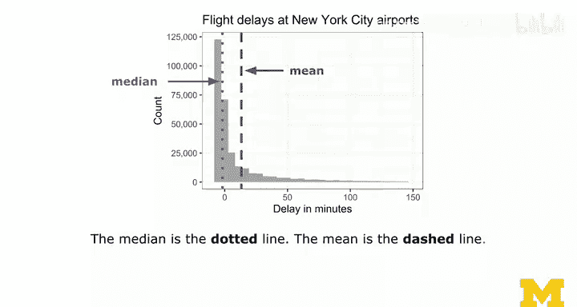

# 密歇根大学《理解数据：导航统计、科学和AI》课程 - P5：直方图解读方法 📊

在本节课中，我们将学习如何解读直方图，这是一种用于可视化数据分布的重要工具。我们将从直方图的基本构成开始，然后通过一个真实数据集的例子，来理解均值和中位数在偏态分布中的不同含义。

---

## 从方块到坐标轴 📐

上一节我们介绍了用方块堆叠来可视化数据的方法。本节中我们来看看如何将这种表示法转化为更标准的图形。

大多数数据分析师在工作中不会携带一堆方块，而是使用计算机制作图表。以下是我们将方块堆叠显示在一对坐标轴上的图片。

*   **X轴（横轴）**：位于底部，代表评分（或任何我们测量的变量）。
*   **Y轴（纵轴）**：代表给出每个评分的人数。
*   我们的方块被一个接一个地堆叠起来，只不过在图中它们被描绘成小矩形（柱状）而非立方体。

我们可以移除方块上的数字标签，只保留柱条。每个柱条的高度代表了堆叠的方块数量。这种表示法在视觉上更高效、更简洁，并且传达了相同的信息。这通常就是我们看到直方图的呈现方式。

---

## 解读真实数据示例：航班延误 🛫

现在让我们看一个真实的例子。这里有一张2013年纽约市机场航班延误时间的直方图。

每个柱条的高度代表延误时间在相应分钟数附近的航班数量。Y轴再次表示计数。

从图中我们可以看到：
*   最高的柱条集中在0分钟附近（甚至更少），这意味着许多航班准点或提前。
*   但也有少数航班延误时间极长。
*   航班延误超过两小时（约120分钟）的情况很罕见，但确实会发生。

以下是图中标注的两个重要统计量：
*   **中位数**：`median`，位置接近峰值，在0分钟附近。这意味着50%的航班延误时间小于或等于0分钟，另外50%的延误时间大于或等于0分钟。
*   **均值**：`mean`，位置远在右侧，大约40分钟处。

为什么均值和中位数相差如此之大？因为右侧这些接近两小时等待时间的数据点，对均值产生了巨大的“拉力”，将其拖向了分布的长尾方向。

---

## 均值与中位数：哪个更有用？🤔

如果我要乘坐从纽约市起飞的航班，在规划行程时，了解哪个统计量对我更有帮助？是均值还是中位数？

将两者放在一起对比，可以再次清楚地看到它们之间的差异：
*   **中位数**更能代表**典型**的航班延误情况。
*   **均值**所代表的延误时间，比大多数航班实际经历的延误都要长。

---

### 本节课总结

本节课中，我们一起学习了：
1.  直方图的标准表示方法，包括X轴、Y轴和柱条的含义。
2.  如何解读真实数据集（纽约机场航班延误）的直方图，观察数据分布的形状。
3.  理解了在数据分布不对称（存在极端值）时，**均值**和**中位数**会产生显著差异。
4.  认识到在类似场景下，**中位数**通常是衡量“典型”情况的更佳指标，因为它对极端值不敏感。

---
> 课程资源提示：本教程内容源自密歇根大学《理解数据》课程P5章节，对应视频资源编码为 BV1pU4NzuEvt。