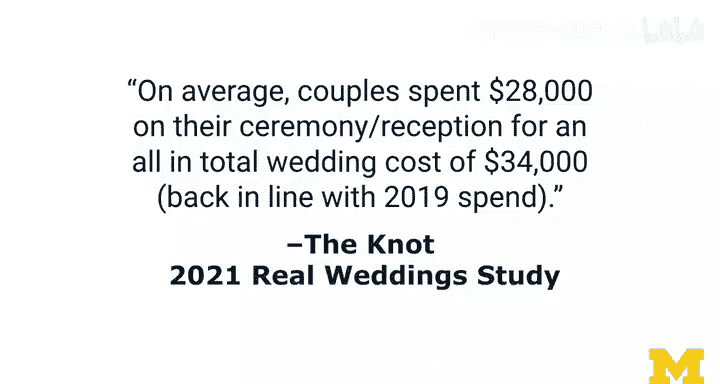

# 6：均值还是中位数：如何选择 📊

在本节课中，我们将要学习如何在实际场景中选择使用均值还是中位数来总结数据。我们将通过一个关于婚礼花费的例子，探讨这两个统计量在不同数据分布和不同问题背景下的适用性。

## 回顾与引入

上一节我们介绍了如何通过可视化数据分布来同时识别均值和中位数。但在很多情况下，我们无法看到完整的数据分布，而只能得到一个单一的统计量，例如均值或中位数，并被告知这是对数据的合理总结。本节中我们来看看为什么这可能会带来问题。

## 案例分析：婚礼花费数据

以下引用自一个在线婚礼博客，关于读者婚礼花费的研究：“平均而言，一对夫妇在仪式或招待会上花费28，000美元，婚礼总成本为34，000美元，与2019年的花费基本一致。” 这段引文来自2021年。

我们只得到了“平均”值，也就是均值。但这个统计量有用吗？让我们来思考一下。

为了便于理解，我们将使用一些积木来模拟可能的数据分布。我们不讨论具体的美元金额，而是将其转换为“月薪”的倍数，这样可能更容易思考。

## 场景一：对称分布

假设数据分布看起来对称且集中。以下是这种分布的可能情况：

*   大多数人的花费集中在中间范围，例如4-6个月的薪水。
*   花费很低（如2-3个月薪水）和很高（如9个月薪水）的人都很少。

在这种情况下，分布有一个清晰的峰值。均值和**中位数**都会大致对应于这个峰值。因此，无论使用均值还是中位数，都能公平地代表“典型”读者的花费水平。

## 场景二：偏态分布（长尾分布）

现在，假设数据分布看起来完全不同。以下是这种分布的特点：

*   大多数人花费不高，不超过2-4个月的薪水。
*   但仍然存在少数极其昂贵的婚礼，这些数据点会将分布向右“拉长”，形成一个长尾。

在这种情况下，**中位数**仍然会位于大多数数据聚集的区域（例如3个月薪水附近）。然而，**均值**或平均值会被那几个极高的数值拉高，从而变得比中位数大得多。

对于正在计划自己婚礼、想了解“典型”花费的读者来说，哪个统计量更有用？在这种情况下，均值并不接近大多数人的实际花费峰值。因此，读者可能会发现**中位数**更有参考价值。

我们无从得知真实的数据分布更像第一种（对称）还是第二种（偏态）。我个人认为它更可能像第二种，因为有些婚礼会办得极其奢华。但仅凭“平均婚礼成本”这一个数字，我们实际上无法判断这个统计量是否真的代表了典型新人的花费。

## 换个视角：不同的问题需要不同的统计量

让我们转换问题，从另一个角度考虑数据。如果我不再是计划婚礼的新人，而是一位考虑进入婚庆行业的创业者呢？例如，我可能想销售活动鲜花，并希望了解通过向新婚夫妇营销可能赚到多少钱。

在这种情况下，我关心的是哪个统计量？这里，**均值**可能实际上更有用。因为我不在乎我的收入是来自许多小型婚礼，还是来自一个极其昂贵的婚礼；我只想确保这个市场有赚钱的机会。虽然我不能保证一定能接到昂贵婚礼的订单，但我知道存在这种可能性。因为均值考虑到了那些非常奢侈的婚礼，它确实反映了我理论上的市场机会。

## 总结

本节课中我们一起学习了均值和中位数这两个必须掌握的基本统计量。在阅读新闻时你会经常听到它们，因为它们是总结复杂数据的快捷方式。

然而，根据你所提出的问题以及数据分布的方式，它们传达的信息可能并不相同。**均值**对极端值敏感，而**中位数**则对极端值稳健。选择哪个统计量更有帮助，完全取决于具体的**上下文**和分析**目的**。

