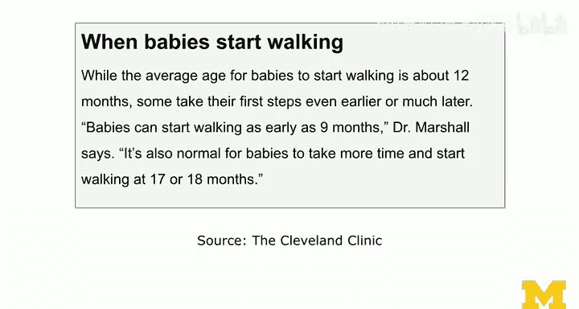

# 7：理解健康的数据变异性 📊

在本节课中，我们将学习数据变异性（Variability）的概念。我们将探讨为什么仅使用均值或中位数来总结数据有时会丢失重要信息，以及如何通过理解数据的分布范围来更全面地描述数据。

---

## 从中心到分布：为什么需要关注变异性？

上一节我们介绍了如何使用均值和中位数来概括数据的典型值。本节中我们来看看，仅依赖这些中心度量可能会忽略什么。

我们一直讨论使用均值和**中位数**等统计量来总结数据。通常，我们使用均值或中位数来传达数据中具有代表性或典型的结果，例如典型的纸杯蛋糕评分或婚礼花费。但像任何简化的总结一样，当我们只考虑均值或中位数时，有时会丢失重要信息。

让我们考虑一个例子。回到纸杯蛋糕评分的分布，我们看到在5分附近有一个明显的峰值，但存在一些变异性。有些人评了4分或6分，还有些人评分甚至在这个范围之外。

我们也可以想象一个完全不同的场景：分布的峰值仍然在5分，但变异性小得多。现在，可能每个人都评了4分或6分。因此，即使5分是中位数，这种情况与我们之前的情况也有所不同。

这里几乎没有证据表明有人会给纸杯蛋糕极高或极低的评分。而在之前的情况下，尽管这些是较为罕见的结果，但仍然有可能发生。因此，如果我拥有的是变异性小的数据，我应该更有把握地认为我的评分会在4到6分之间；而如果我拥有的是变异性大的数据，我仍然认为我可能给纸杯蛋糕评4到6分，但我必须承认存在一些事件、观察结果或尝试蛋糕的人，他们认为蛋糕比这个范围更差或更好。

我在这里操作的是将数据块从分布中心进一步向外扩散，或者将它们移除以使分布变得非常狭窄。你可以称之为分布的**范围**，即我的数据在1到10的尺度上占据了多少空间。另一个描述数据离散程度的技术术语叫做**标准差**。

虽然不深入探讨这个数学短语的具体细节，但你可以注意到“偏差”（deviation）指的是与常态不同的事物。我们可以将分布的中心视为一种常态，它捕捉了具有代表性或典型性的东西。尽管“偏差”一词在英语中暗示着某种负面含义，但在统计学中它更加中性。变异性是生活的一部分，不是一个需要消除的问题。事实上，它通常是我们最关心、最想理解的部分。

---

## 🧒 实例分析：婴儿学步时间的变异性

现在，让我们看一个儿童发展的例子。这里有一个问题：父母应该何时期待他们的宝宝开始走路？

回答这个问题的一种方法来自世界卫生组织的研究。他们收集了加纳、印度、挪威、阿曼和美国健康儿童的数据，希望为医生创建一个标准，以便医生能够理解，例如，如果一个孩子没有按时走路，何时可能存在风险，以及哪些社区可能面临风险并需要公共卫生干预。

让我们看看他们数据中儿童开始走路年龄的分布。这实际上是所谓的**模拟数据**。这意味着他们没有向公众提供所有数据，但我查看了他们最终报告中的统计数据，并构建了可能产生这些最终统计数据的数据样子。

这里，X轴是年龄（月），所以有些孩子大约在7个月开始走路，另一些大约在18个月开始走路，但大多数人处于中间。Y轴再次是计数，即有多少人。

这个分布的**均值**大约是12.17个月，这是一个非常精确的数字，也是峰值。你能想象如果我们告诉父母，他们应该期待宝宝在12.17个月走路吗？几乎没有宝宝会在那个精确的时间走路，大多数会稍早或稍晚一点。我们会有父母因为宝宝在12个月早走或在14个月晚走而打电话给医生。

执着于12.17个月这个平均值是没有意义的，因为事实上，很多宝宝在11个月或14个月开始走路。看看分布的主体部分实际上跨越了相当大的月份范围。孩子在12个月之前或之后开始走路是很常见的。

因此，我们可以做的是创建一个健康儿童常见的走路时间范围。我们可能会说，让我们的范围从底部附近开始，也许从第9个月左右开始，因为即使有几个孩子比那更早开始走路，也相当罕见；也许我们最晚到16或17个月左右，因为在那之后，我们希望鼓励父母与医生保持联系。

所以，与其告诉父母期待宝宝在12.17个月走路，我们可以告诉他们期待在9到16个月之间走路，因为我们知道孩子们开始独立走路的时间存在很大变异性，而且这种变异性大多是正常和健康的。在9个月开始走路的孩子可以健康快乐地成长，在12或16个月左右开始走路的孩子也是如此。落在这个范围之外的孩子确实存在，他们也可以健康快乐，但也许我们想安排一次检查，以确保他们拥有茁壮成长所需的一切。

---

## 📝 总结与核心要点

本节课中我们一起学习了数据变异性的重要性。

以下是本课的核心要点：
*   **变异性是数据的固有属性**：它描述了数据点之间的差异程度，而不仅仅是它们的中心趋势。
*   **仅关注中心可能产生误导**：均值或中位数无法反映数据的全貌，特别是当数据分布范围很广时。
*   **理解范围通常更有用**：在许多实际场景（如儿童发育）中，了解一个**可能的范围**（例如，9-16个月）比知道一个单一的平均值（12.17个月）更具信息量和实用性。
*   **标准差是衡量变异性的关键指标**：它量化了数据点相对于均值的平均偏离程度，公式为 `σ = √[ Σ(xi - μ)² / N ]`，其中 `σ` 是标准差，`xi` 是每个数据点，`μ` 是均值，`N` 是数据点总数。

总而言之，观察儿童的发展，我们看到很多自然的变异性。这意味着我们应该对个别婴儿的期望保持灵活。在这种情况下，了解一个可能的结果范围比了解一个均值或中位数更有用。