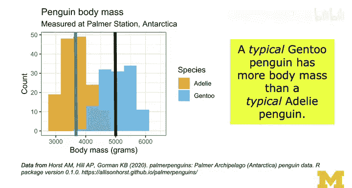

# 8：基于数据的比较分析 📊

在本节课中，我们将学习如何比较来自两个不同来源的数据。我们将通过分析两种企鹅的体重数据，理解如何利用数据分布和平均值来识别群体间的差异，并探讨这种比较方法的意义与局限性。

---

## 🐧 两种企鹅的数据分布

到目前为止，我们讨论的数据都来自单一来源，例如从纸杯蛋糕店走出的顾客、纽约的航班延误数据，或某流行在线杂志读者的婚礼支出。但有时我们需要比较两个数据源。我们可能想知道一家纸杯蛋糕店的评分是否与另一家不同，或者不同机场的航班延误情况是否有差异。让我们利用已建立的数据分布直觉，来看看如何进行这种比较。

我将向您介绍两种企鹅：阿德利企鹅和巴布亚企鹅。这是生活在南极洲的两种物种。我们可能对了解它们体型大小感兴趣。

以下是一个分布图。请记住，分布图表示我们可能测量了一大群企鹅的体重。这里展示的都是阿德利企鹅的体重数据，我们将它们绘制在此图中。我们可以从中看出几点信息。

首先，我们关注的是它们的体重，X轴代表体重，数值从小到大排列。Y轴是数量，表示特定体重的企鹅有多少只。通过观察体重跨度，我们可以看到一个合理的范围：这些企鹅的体重大约在2500克到5000克之间。

我们可以尝试猜测一个合理的平均值。观察这个分布，它相当对称，因此我们可以用平均值来估计峰值的位置。看起来大约在3700克左右，我们可以在这里画一条线。

---

## 🔄 比较两个物种

现在让我们看看另一个物种——巴布亚企鹅的数据。

再次观察，我们看到这个范围（体重跨度）的宽度：巴布亚企鹅的体重似乎从大约4000克延伸到6000克。峰值大约在5000克。

最后，我们可以将它们放在一起观察。如果我们将这两个分布绘制在同一张图上，可以看到一种颜色代表阿德利企鹅，蓝色代表巴布亚企鹅。颜色较深的区域是它们重叠的部分。

那么，让我们提出一个问题：哪种企鹅体型更大？

思考一下这个问题。因为每个企鹅物种的体重都有一个范围，也许我们应该问：一只典型的阿德利企鹅的体重是比典型的巴布亚企鹅大还是小？

在这种情况下，快速总结“典型”值的一种方法是计算每个物种的平均体重。我们知道平均值在这种情况下是一个非常有用的总结，因为这些分布很好且大致对称，没有很长的尾部。因此，我们的计划是：通过估计两个企鹅物种各自的平均体重，然后比较哪个平均值更大，来回答这个问题。

让我们回到直方图并开始标注。

首先，在这里标出阿德利企鹅的平均体重。

然后为巴布亚企鹅做同样的标注。

观察这两者，我们可以说，巴布亚企鹅的体重平均而言比阿德利企鹅大。

---

## 🤔 “平均更大”意味着什么？

但是，一个物种“平均更大”究竟意味着什么？我想在这里为比较平均值这件事增添一些细微的差别。

请思考这个判断题：这是否意味着**每一只**巴布亚企鹅都比**每一只**阿德利企鹅大？

观察图表片刻，看看是否能得到一些直觉或提示。现在，最大的阿德利企鹅接近5000克。从阿德利企鹅的分布中我们可以看到，有些数据点就在5000克左右。

再看看最小的巴布亚企鹅。观察它们的数据分布，最小的企鹅大约在这里，略低于4000克。

因此，当我们在同一张图上看到它们时，我们可以确定，确实存在一些阿德利企鹅比一些巴布亚企鹅大的情况，尽管巴布亚企鹅平均体型更大。

另一种理解方式是，分布之间存在重叠。在这个我加深显示的体重范围内，观察到了两个物种的企鹅。

那么，“平均更大”到底意味着什么？我们已经判定，上述说法实际上是**错误**的。并非每一只巴布亚企鹅都比每一只阿德利企鹅大。

---

## 💡 比较平均值的意义

那么，我们发现巴布亚企鹅平均体重更大这件事，真的重要吗？

我认为是的，以下是两个思考角度。

一种说法是：一只**典型**的巴布亚企鹅比一只**典型**的阿德利企鹅拥有更多的体重。我们是在描述“典型”情况，说明这两种企鹅体重聚集的位置略有不同。

另一种说法是：如果我随机挑选一只阿德利企鹅和一只巴布亚企鹅，**通常**，在大多数情况下，巴布亚企鹅的体重会更高。

比较两个数据分布的平均值，是识别某些更大模式的有效方法，例如巴布亚企鹅往往比阿德利企鹅体重更大。使用平均值有助于我们建立预期，或提供简化数据以便思考的通用方法。

有时这些结论会是错误的，比如当我们发现一只特别小的巴布亚企鹅或一只特别大的阿德利企鹅时。但我们仍然学到了一些在多数情况下成立的东西。

---

## ⚖️ 统计思维的核心张力

这里体现了统计思维的一个核心张力：我们可以学会识别在某些情况下（甚至很多情况下）成立的模式。但我们很少会谈论绝对性。正确的统计思维意味着**预期自己有时会出错**。

---

## 📝 本节课总结

在本节课中，我们一起学习了如何通过比较两个数据分布的平均值来进行数据分析。我们以阿德利企鹅和巴布亚企鹅的体重数据为例，理解了“平均更大”的实际含义并非指所有个体都更大，而是描述了群体的典型趋势。我们认识到，使用平均值进行比较是一种强大的简化工具，能帮助我们识别整体模式，但同时必须接受其结论并非绝对，存在例外情况。这正是统计思维的精髓所在：在不确定性中寻找有意义的规律。