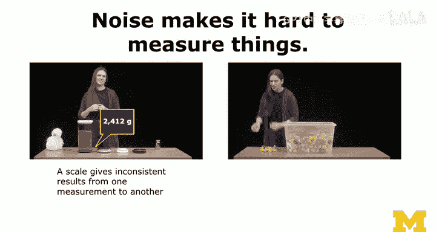
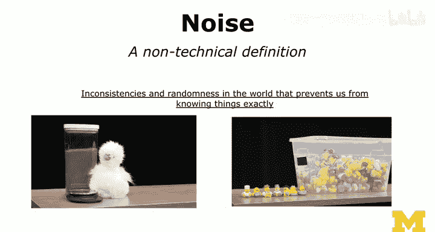
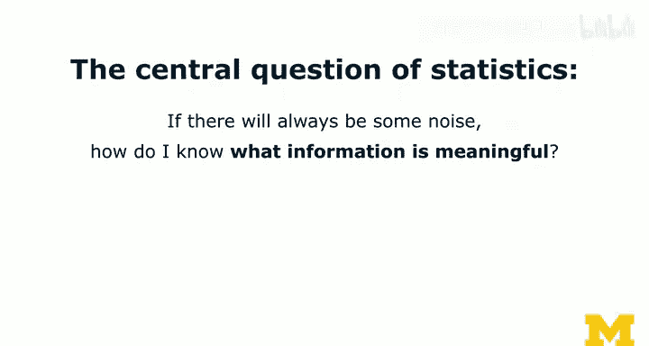

# 12：充满噪声的现实世界 🌊

在本节课中，我们将探讨现实世界中普遍存在的“噪声”现象。我们将了解噪声如何影响测量和观察，并学习如何在充满不确定性的环境中提取有意义的信息。

---

在我们的演示中，我们看到了噪声如何使测量变得困难的例子。

首先，我们曾尝试测量一些谷物的质量，但使用的天平有些噪声。它每次测量给出的结果都不一致，这使得我们难以确定真实的质量。

在我们的鸭子演示中，我们试图了解橡皮鸭的“海盗率”，但发现答案可能取决于我们选择测量哪些鸭子。由于我们每次调查都尝试随机选取不同的鸭子，因此被研究的鸭子总是存在一定的随机性和噪声。

这些就是噪声的例子。我已经多次使用这个词，现在我想给它一个定义。遗憾的是，从不同的科学领域来看，噪声的含义略有不同，并没有一个可以普遍使用的精确定义。但我想给出一个非技术性的、直观的定义，以便我们在讨论噪声时能够记住：**噪声是世界中的不一致性和随机性，它阻止我们精确地了解事物**。

这就像我们的天平，因为它有时不一致，我们很难确定哪个测量值最接近真实值。在我们的鸭子调查中，因为每次捞取的鸭子都不同，这使得我们很难知道真正的“真相”是什么。

---

但关于噪声，我想提出一个更深刻的观点：噪声不仅关乎我们的测量工具（如天平或调查），它也是世界本身的一部分，我们可能永远无法完全消除。

让我们再以梅尔文为例。假设我想研究梅尔文的数学技能，于是我召集了世界上最伟大的科学家，让他们设计出一份完美的数学测试，用以精确测量梅尔文的数学知识。这份测试设计得非常精妙，能完美反映梅尔文掌握的数学概念以及他能答对多少题。

假设我让梅尔文参加测试，他答对了84%的题目。那么，如果我们连续一周每天都测试他，会发生什么？我们假设不必担心梅尔文会记住前一天的答案，因为他是一只鸡，记忆力很短。所以每天晚上他睡觉后，就像获得了一块干净的石板，可以重新参加测试。

如果我们连续一周每天测试他，第一天他答对了大约84%。星期二他表现得更好一点，星期三差一点，星期四得分很高，星期五则不太理想。这里发生了什么？你认为梅尔文的数学技能在一周内变好又变差，然后又变好，接着大幅变差了吗？

很可能不是。梅尔文的数学技能在一周内并没有改变，但他参加测试的状态却每天不同。

*   第一天，假设梅尔文进来后表现尚可，但附近有一只虫子分散了他的注意力，这让他很难回答所有问题。
*   第二天，梅尔文得到了表扬，他感到非常自信，这给了他一点额外的动力。
*   第三天，下雨了，梅尔文不喜欢下雨，这影响了他参加测试的兴趣。
*   星期四，他胆子大了，猜了几个答案，其中一些幸运地猜对了。
*   星期五，梅尔文就是心情不好。他不知道原因，但他肯定没心情参加测试。

这是一个例子，说明即使我们的工具是完美的，梅尔文本人每天的状态也不尽相同。我们看到这些波动，它们或多或少是随机的。这些是不可预测的事件，比如房间里有苍蝇、去测试的路上得到表扬、某天下雨，或者只是无缘无故地心情不好。这些事情时常发生，我们无法控制它们。

由于世界上许多事物相互影响（比如苍蝇影响梅尔文的注意力），我们自身也可能带有一些“噪声”。但这并不意味着我们的数据毫无用处，我们仍然可以学到一些东西。

那么，你认为梅尔文在这项测试中的真实数学能力可能是30%吗？你认为他可能只会回答30%的题目吗？很可能不是，我们的数据远未接近30%，我们看到他的分数远高于此。

那100%呢？你认为可能吗？我认为也不太可能，梅尔文的分数也没有特别接近100%。所以，如果有人声称他在这项测试中的真实能力实际上是100%，我会认为这相当不可信。

相反，我可以做的是在所有数据点中间画一条线。这条线代表他这些天分数的平均值，大约是86%。因此，我们可以说，他在那项特定测试中答题的真实能力大约是86%，他大约能答对86%的题目。当然，如果我说恰好是86%可能过于自信，所以我可以在它周围设定一个范围。这个范围包含了这里的大部分数据。也许我可以说，梅尔文的真实能力很可能在答对84%到87%题目的范围内。

---

噪声不仅是我们环境的一部分（不仅仅是苍蝇或下雨天），它也是许多生物过程的一部分。所谓生物过程，我指的是我们的大脑以及帮助我们思考、感知和行动的身体部分。

以下是神经科学中的一个例子。你体内的神经元是帮助我们感知世界的细胞。这里有一张你耳朵里神经元的图片，这些红色和黄色的纤维看起来像细绳，它们实际上就是你耳朵里的神经元。神经元通过“发放”或“放电”来响应世界。听觉神经元编码世界上发生的声音并将其转化为大脑可以使用的东西的方式是：当声音出现时，它会发放或放电。我们听到一个声音，然后神经元以这种模式响应。圆点表示神经元可能安静的秒数，而这些感叹号表示它突然放电，而且通常不止放电一次，而是多次。

现在，如果我播放完全相同的声音（比如这个喇叭声），并且用同一个神经元，用完美的记录设备进行记录，当我一遍又一遍地向同一个神经元播放相同的声音时，我们会看到什么？我们会看到每次都会得到略有不同的兴奋模式。

这实际上是一个相当深刻的概念。同一个神经元，同一个声音，想象我们的记录仪器没有噪声，神经元的反应仍然会变化，即使它是对相同刺激的反应。然而，尽管对这个神经元来说，它从未以相同的方式“听”过两次喇叭声，但我们的大脑却能够理解我们听到的是同一个东西。即使我每次对你说话，对你的神经元来说，每次都是不同的，相同的兴奋模式在你的体内从未发生过两次，但你仍然知道那始终是我。

因此，我们的身体已经在进行一种深刻而有趣的计算：它试图在一个总是充满噪声的世界中，识别出哪些信息是有意义的，并从中构建出模式。这实际上正是统计学的核心问题。我们在这里的课程中要明确学习的就是这个：我们试图为你建立一些直觉，让你思考如何在一个总是充满噪声的世界中，选择我们认为有意义的信息。

---

在接下来的幻灯片中，我们将更明确地继续探讨这个问题。