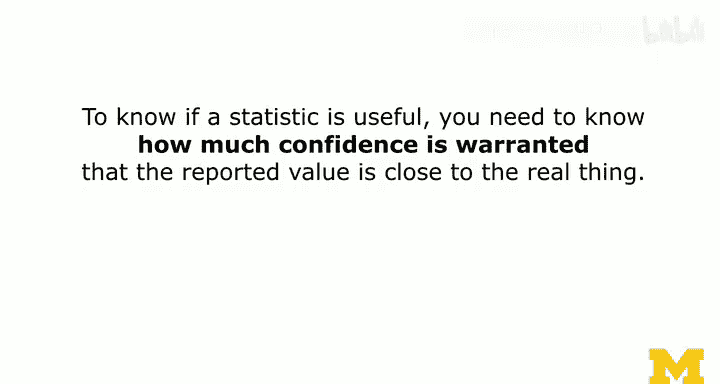

# 密歇根大学《理解数据》课程 - P13：如何与噪声共存 📊

在本节课中，我们将要学习一个核心概念：现实世界中的数据总是伴随着“噪声”。我们将探讨噪声是什么，以及如何通过“误差范围”这一工具来理解和应对它，从而在充满不确定性的世界中做出更合理的判断。

---

我们已经了解到，现实中总是存在噪声。我们永远不会遇到一个完全不需要处理噪声的世界。

但这并不意味着我们必须假设整个世界都是随机的，没有任何事物可以被认知。我们仍然可以形成一些预期，并且我们一直在这样做。例如，天气：我们无法精确知道闪电是否会发生以及会在哪里发生，但我们仍然可以获得天气预报，告诉我们闪电发生的可能性足够大，我们应该采取预防措施并进入室内。

另一个例子是语言。如果我说“我要去______游泳”，接下来我可能会说的内容有很多种可能性。其中一些可能性比另一些更大。例如，说“游泳池”、“海滩”或“湖泊”的可能性，比说“图书馆”、“杂货店”或“胡萝卜”的可能性要大得多。

---

还记得之前我们探讨过如何处理一系列可能的结果吗？我们研究了儿童何时学会走路，并发现虽然可以使用平均值（例如，预期孩子会在12个月大时走路），但这实际上会让很多父母感到困惑，因为很多孩子会在12个月之前走路，也有很多会在12个月之后走路。因此，我们给出的建议是：你应该预期你的孩子在8到18个月之间学会走路。我们给出了一个范围。

事实证明，这也是处理带有噪声的测量结果的一个好方法。

---

## 🔬 理解测量中的误差范围

仪器本身就有内置的误差范围。误差范围帮助我们确定那个范围——即我们应该预期的可能结果的范围。

这通常在购买秤时出现，制造说明或说明书会给出误差范围。它可能听起来像这样：“此秤的精度在1克以内。”

另一种说法是：**该秤的误差范围为 ±1 克**。

这意味着，如果我用这个秤称出300克，那么我知道我所测物体的真实质量**可能**在299克到301克之间。

如果误差范围是10克（这个范围更大一些），那么一个称出300克的物体，其真实质量**可能**在290克到310克之间。可能性的范围变得更大了一些。

如果秤的误差范围是100克呢？那么我只能说，那个称出300克的物体，其真实质量**可能**在200克到400克之间。这个范围就更大了。

一般来说，**误差范围越大，仪器的帮助就越小**。我们当然更愿意使用误差范围为1克的秤，而不是10克或100克的秤。

---

## 📊 民意调查中的误差范围

另一个例子来自民意调查。如果你最近经历过城镇、州或国家的选举，你可能已经被这些例子淹没了。

请记住，民意调查也是一种工具，它是一种用于理解世界上人们的情绪、信念或活动的工具。

你可能已经知道，有些民意调查比其他的更好。你可能本能地知道，进行民意调查的某些方法优于其他方法，它们并非都一样好。

让我们至少看一种判断民意调查是否有用的方法。

以下是两种民意调查，假设这是针对“橡皮鸭海盗行为”的调查。在调查A中，我们只抽样调查了4只鸭子。在调查B中，我们抽样调查了更多鸭子。你更愿意相信哪一个？

你很可能认为你更愿意相信调查B。但让我们想想为什么。在调查A中，你只得到了很少的回应，因此调查很可能错过整个人群的趋势。调查B有更多的回应，因此更有可能代表整个人群。

所以，调查A（我们在这里调查了很少的人或鸭子）的**误差范围相当大**。而调查B的**误差范围较小**，我们更有信心它更接近真相。

实际上，每项民意调查都有误差范围，但有时很难找到。例如，我最近读到一篇关于总统支持率民意调查的新闻文章，在故事的底部有一个脚注，那里报告了该民意调查的误差范围，包括参与人数以及如何联系他们等细节。你真的必须在文章中仔细寻找才能看到这些信息，我认为很可能很多人不会通读全文来看到这个。

---

## 📈 误差范围的可视化理解

但这到底意味着什么呢？让我们用一个视觉化的方式来看。假设我们在一次民意调查中测得支持率为45%，并且我们使用3%的误差范围（上一张幻灯片是3.1%，我们简化为3%）。这意味着什么？

我们可以用图形来描述。我们可以考虑在我们45%的估计值周围画一些线，给它一个“邻域”。这看起来就像是在说：根据我们的测量结果以及我们进行的民意调查及其内置的误差范围，总统的真实支持率**可能**低至42%，或高达48%。

换句话说，**我并不确定总统在全国的真实支持率是多少**，但如果我们认为这项民意调查具有合理的代表性和良好的执行，我可以合理地确信，真实的支持率在42%到48%之间。

那么，如果我们进行了另一项民意调查（我在图中用蓝色标记）会发生什么？

这次我们在那项调查中测得支持率为46%，同样有3%的误差范围。假设蓝色调查使用了与之前完全相同的方法，但在一周后进行，并且由于是随机抽样，参与研究的是不同的人。

那么，如果你看到这些数据——蓝色调查是一周后对不同人群进行的——你认为总统的支持率上升了吗？它从45%上升到46%了吗？

你应该对此持一些怀疑态度。事实上，我们从45%上升到46%所看到的这1个百分点的差异，实际上**在我们原始调查3%的误差范围之内**。

这意味着，如果我们继续在第一周测量完全相同的事情，只是抽取了稍微不同的人参与研究，那么即使没有任何变化，我们的支持率也可能在那个范围内上下波动3个百分点。我们的新调查结果正好落在仅因调查对象不同而可能预期的波动范围内。因此，这并没有特别强有力的证据表明总统的全国支持率上升了。

如果我们说“哦，那个百分点的增长非常有意义”，那就像有一个新闻主播看着梅尔文（一个虚构的例子）说：“哦，梅尔文的数学突然变好了，现在又变差了，哦，他又变好了，哦，他的数学又变差了。”我们知道这并没有发生。这些本质上只是随机抽取的情况，导致梅尔文的表现略有波动，但都在一个非常相似的范围内，因为我们知道梅尔文回答这些问题的真实能力在这一周内并没有真正改变。

---

## 💎 核心总结

综上所述，当我们谈论统计数据时，判断一个统计数字是否有用的另一个要素是，我们必须考虑**我们应该对报告的具体数字抱有多大的信心**。

如果我们有一项民意调查，不仅仅是知道“调查的测量结果是45%的支持率”，我们还需要知道**围绕这个数字的误差范围有多大**。这告诉我们，我们应该有多大信心认为报告的值确实接近真实情况。

**公式表示：**
`报告值 ± 误差范围 = 真实值的可能区间`

在本节课中，我们一起学习了：
1.  噪声是现实世界数据的固有部分。
2.  **误差范围**是量化这种不确定性的关键工具。
3.  无论是物理测量（如秤）还是社会测量（如民意调查），理解其误差范围对于正确解读数据至关重要。
4.  当比较两个测量结果时，如果差异在误差范围之内，则不能轻易得出“发生了真实变化”的结论。

通过理解和应用误差范围，我们可以更明智地看待数据，避免被随机波动所误导，从而在充满噪声的世界中做出更稳健的决策。