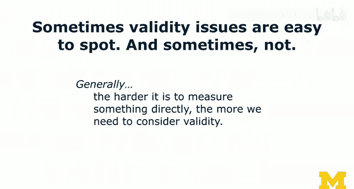
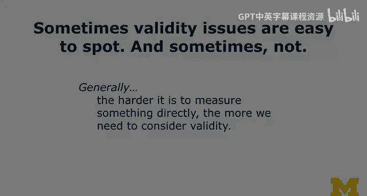

# 14：效度：我们究竟在测量什么 📊

在本节课中，我们将要学习**效度**这一核心概念。效度关注的是我们的测量结果与想要理解的事物之间的匹配程度。理解效度对于评估任何研究、调查或数据结论的可靠性至关重要。

## 🔍 什么是效度？

上一节我们介绍了数据收集中的不确定性，本节中我们来看看测量本身的准确性问题——效度。

效度是一个关于测量质量的概念。其非技术性的直观定义是：**效度反映了我们所测量的内容与我们真正想要理解的事物之间的吻合程度**。

## ✅ 高效度示例

以下是两个高效度的测量示例：

*   **测量鸡的重量**：如果我们想了解一只鸡有多重，那么**重量**就是“重”的一个效度很高的测量指标。而**秤**是测量重量的效度很高的工具。当然，我们必须测量正确的动物（鸡）。
*   **测量室外寒冷程度**：如果我们想了解室外有多冷，那么**温度**就是“冷”的一个效度很高的测量指标。而**温度计**是测量温度的效度很高的工具。同样，测量必须在室外进行。

## ❌ 低效度示例

相反，以下示例展示了低效度的情况：

*   用**卷尺**测量鸡的重量。即使卷尺非常精确，它测量的是长度，而非重量。
*   用**尺子**测量室外温度。尺子测量的是长度，而非温度。
*   通过测量**企鹅**的重量来了解鸡的重量。即使对企鹅的测量非常精确，它也与鸡的重量无关。

低效度的根本原因在于：**测量了错误的事物，或者使用了错误的工具去测量目标事物**。

## 📈 重新审视总统民调

现在，让我们再次考虑之前的总统民调例子。我们当时试图理解的问题是：**本国公民对现任总统的支持率**。

有哪些因素可能影响这项民调的效度呢？以下是几种可能性：

*   **问题表述模糊**：如果问题令人困惑，受访者可能不清楚自己被问的是什么，或者只能猜测。
*   **询问了相关但不同的问题**：例如，民调可能问“你计划在下届选举中再次投票给这位总统吗？”这与支持率相关，但并非完全相同。有些人可能不支持总统，但仍会投票给他，因为他们认为总统比竞争对手更好。
*   **样本代表性偏差**：如果民调主要通过电话访问参与者，那么不接听陌生电话的人（如内向者）、没有手机或固定电话的人可能会被低估。而经常接电话的人可能无法代表整体人口。

**关键点在于**：如果民调不是一个有效的测量工具，那么无论你询问多少人，得到的数据量有多大，只要数据本身是“错误”的，就无法正确回答我们的研究问题。我们可以得到一个误差范围极小的、非常“精确”的估计，但这个估计可能完全偏离真相。

## 🤔 效度问题如何产生？

效度问题产生的方式多种多样，但可以归纳为几种常见模式。以下是几个需要思考的方面：

*   **定义分类的挑战**：我们经常希望对事物进行分类以便测量，但从现实数据中创建类别可能异常困难。例如，统计一个国家的**死因**。不同地区在死亡记录方式上可能存在巨大差异，比如由谁记录（法医、培训不足的技术人员还是医生），以及是否存在将死因归于特定因素的压力。
*   **报告敏感信息的挑战**：在涉及敏感话题时，很难获得准确的自我报告。例如，询问“你多久锻炼一次？”、“你每天吃多少水果？”或“你多久说一次谎？”。在这些例子中，受访者可能迫于压力夸大或贬低自己的答案，以使自己看起来更符合社会期望。
*   **结果泛化的挑战**：一个活跃的研究问题是：**我们能否利用社交媒体来理解更广泛社会中的情感、信仰和价值观？** 这里存在一个重要问题：我们是否应该将这些结果泛化？研究社交媒体用户，能否让我们了解线下人群？还是说我们仅仅在研究社交媒体用户这一特定群体？社交媒体用户可能在许多重要方面与线下人群不同。

## ⚖️ 专家观点与效度判断

关于效度，专家之间可能存在合理的分歧。例如，在上述社交媒体研究的例子中，关于在哪些方面我们可以合理地将社交媒体用户的特征推广到更广泛人群，以及在哪些方面他们的行为仅限于自身，仍然存在合理的争议和积极的探索。

然而，有些情况下则不存在合理的分歧。以**情绪戒指**为例：事实证明，情绪戒指测量的是**体温**，因此它是测量体温的一个相当有效的工具。但当人们将其解读为测量**情绪**时，就失去了效度。关于这一点，专家们没有太多分歧。

有时效度问题很容易发现（如情绪戒指），但有时则不然。**通常，对某事物的直接测量越困难，我们就越需要仔细思考测量工具的效度**。

## 📝 本节课总结

本节课中我们一起学习了**效度**的概念。我们了解到，效度衡量的是我们的**测量**与真正想**理解**的事物之间的匹配程度。我们探讨了高效度与低效度的例子，分析了影响民调效度的因素，并讨论了效度问题产生的常见模式（如分类定义、敏感信息报告和结果泛化）。最后，我们认识到评估效度有时明确，有时则需要谨慎判断，尤其是在测量复杂或抽象概念时。确保测量的高效度是得出可靠数据结论的基石。