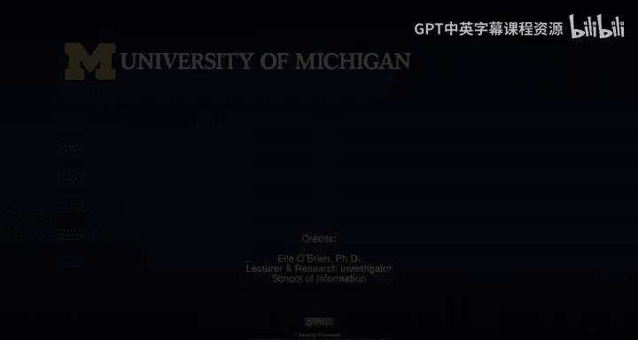
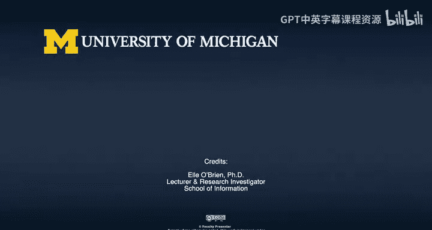

# 15：模块3导论：数字叙事中的统计学 📊

在本节课中，我们将要学习如何理解并批判性地看待数据叙事中的统计学。我们将探讨统计学在沟通中的作用，以及如何识别常见的数据叙事陷阱。

---

上周，我们建立了关于不确定性的直觉。

我们认识到随机性和噪音是不可避免的。

这对于想要知晓一切的人来说可能令人沮丧。

然而，尽管我们永远无法完全确定，但我们也不必绝望地认为一切将永远无法理解。

统计思维为我们提供了一条中间道路，但这种思维模式可能并不常见。

尽管我们的大脑非常擅长在噪音中发现模式，但对大多数人来说，谈论统计和数字需要大量练习，这并非与生俱来。

接下来，我们将看一些真实案例，了解统计沟通如何可能成功或失败。请记住，我们研究统计学并非仅仅因为我们喜欢与数字打交道。统计学帮助我们创造知识，或者至少用更简单的术语描述复杂的事物。

因此，当我们在生活中遇到统计数据时，需要记住它们通常服务于某种修辞目的。它们是由人类叙事者呈现在你面前的。

叙事者可能试图向你阐明他们认为有趣或重要的事情。他们可能希望说服你接受他们的立场，或者他们可能邀请你共同参与意义构建的过程。

我们将从统计叙事中最常见的几组矛盾开始。在你培养对统计数据的批判性眼光时，牢记这些考量会很有帮助。

以下是这些核心矛盾：

*   **精确性与可理解性**：如何在提供准确数据的同时，确保信息易于被受众理解。
*   **简化与完整性**：如何在简化复杂现象以传达核心信息时，不丢失重要的细节和背景。
*   **客观性与说服力**：统计本身追求客观，但其呈现和使用往往带有说服意图，如何平衡这两者。
*   **数据与故事**：如何将冰冷的数字融入有温度、能引起共鸣的叙事中。

---

本节课中，我们一起学习了统计思维在数据叙事中的核心地位。我们了解到，统计数据不仅是数字，更是人类沟通和构建意义的工具。通过认识统计叙事中常见的矛盾，我们可以更明智地解读遇到的数据，理解其背后的意图，并做出更审慎的判断。