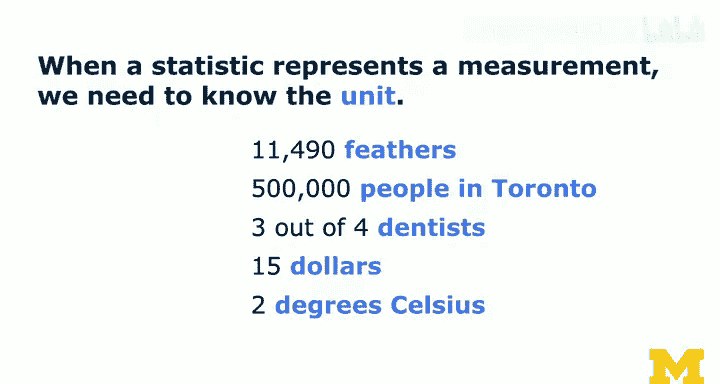
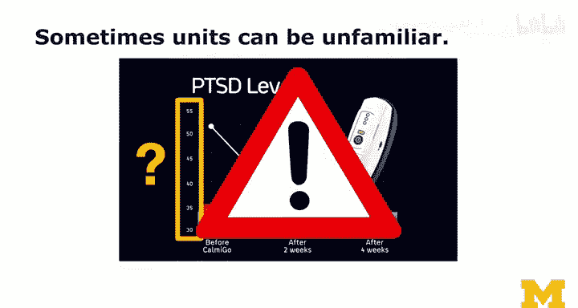
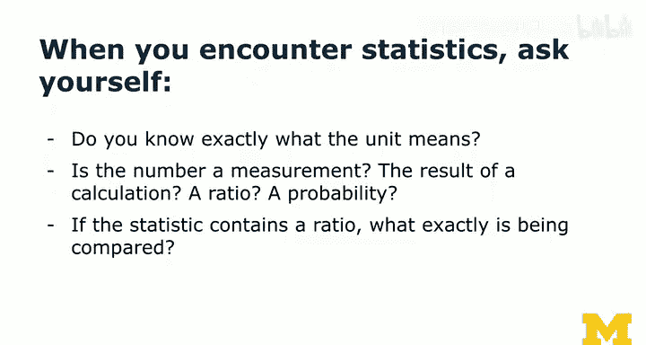

# 密歇根大学《理解数据》课程 - P16：单位、量纲与估算 📊


在本节课中，我们将要学习统计数据中**单位**和**量纲**的重要性，以及如何理解**估算值**与**直接测量值**的区别。我们还会探讨数字的不同“风味”，例如比率和百分比，并学习如何准确解读它们。

## 1. 统计数据的含义与单位

上一节我们介绍了统计数据的基本概念。本节中我们来看看统计数据的具体构成。



一个统计数据是关于数据的计算，而数据是**数值**加上**背景信息**。回想第一周我们数梅尔文的羽毛，我们数出他有11,490根，这是一个数值。但其他所有信息都是背景：我们数的是羽毛，对象是梅尔文，验证者是密歇根大学的科学家，以及计数的日期。所有这些背景信息赋予了数字意义。

背景信息的一个重要方面是**测量单位**。当一个统计数据代表一个测量值时，我们必须知道其单位。我们知道梅尔文有11,490根羽毛，这里的“根”就是单位。

以下是常见的单位示例：
*   **计数单位**：例如“多伦多有三人做了某件有趣的事”，这里的“人”是单位。
*   **比例单位**：例如“四分之三的牙医推荐某牙膏”，“牙医”是单位。
*   **货币单位**：例如美元、人民币等。
*   **温度单位**：例如摄氏度或华氏度，明确使用的标尺尤为重要。例如，**2°C**。




## 2. 未知单位的警示

有时，单位可能非常陌生，导致我们无法理解数据。

这里有一个我在网上看到的广告例子。它是一个针对创伤后应激障碍治疗设备的定向广告。在Y轴上，有一些数字，我猜代表PTSD水平。由于我不是PTSD专家，我不知道这些数字是如何测量的，因此完全无法理解它们的含义。例如，在这个量表上变化5个单位意味着什么？需要变化多少单位，患者才会感觉症状有所改善？我无从得知。

因此，对我而言，这是一个巨大的警示信号。我立即意识到自己无法解读这张图表，因为我不知道那些单位是什么。

## 3. 直接测量与衍生估算

需要记住的另一点是，有些统计数据并非直接测量，而是从其他统计数据**衍生**而来的估算值。

一个例子是智能体重秤。许多家用智能体重秤声称可以测量体脂率。但深入研究后会发现，直接测量体脂率极其困难，家用体重秤并不具备直接测量的能力。实际上，它测量的是你站上去时能获取的其他数据（例如生物电阻抗，即电流通过你身体的方式），然后将这些数值代入内置在秤内计算机的**公式**中，从而**估算**出它认为你的体脂率应该是多少。

```python
# 概念性伪代码，表示智能秤的估算过程
测量值 = 获取生物电阻抗()
估算体脂率 = 内置公式(测量值, 身高, 体重, 年龄, 性别)
```

像这样的衍生估算对于许多科学领域至关重要。例如，在神经影像学或脑成像中，我们无法直接测量一个行为中的人的大脑活动。我们没有简便的方法在人们活动时，将测量设备植入大脑内部来测量神经活动。因此，我们使用许多测量技术，例如通过血流或宏观层面的电活动，来**估算**在执行某些行为任务（如听东西或看电影）时大脑的哪些区域是活跃的。许多神经科学研究就是这样进行的，因为我们常常无法获得想要的直接测量数据，衍生估算是我们能得到的最佳结果。

所以，衍生估算是不完美的，这一点很重要。每当我们讨论它们时，我们讨论的不是直接测量，而是通过某些公式转换后对另一事物的**估算**。它们的质量可能参差不齐。事实上，就体重秤的例子而言，许多研究身体成分的专家认为，这些家用设备的估算结果并不特别有用，不足以让人从中获取有效信息。但在神经科学中，由于我们可以投入高质量的设备，并运用能恰当处理“我们并非直接测量大脑活动”这一不确定性的统计分析方法，我们有时能够设计出仍然能告诉我们一些信息的实验。


## 4. 数字的“风味”：比率与百分比

背景信息的另一个部分是数字可以有不同“风味”，就像冰淇淋一样。

有些数字是**比率**。例如：
*   四分之三的牙医
*   一半的澳大利亚人
*   访客数量是去年的四倍

所有这些本质上都是比率。比率是**比较**，它们告诉你两个数量之间的关系。它比较的是：我们询问的牙医中的四分之三，所有澳大利亚人中的一半，今年的访客数与去年的访客数。

数字也可以是**百分比**。有时你会在超市的商品包装上看到“果汁含量增加60%”。这本质上也是一个比率，60%等同于60比100。

百分比也可以表示**概率**。如果你听到有70%的降雨概率，这并非一个直接的测量值（我们无法精确测量），而是一个关于可能发生事件的陈述，表示我们估计降雨的概率约为70%。另一种理解方式是：如果我们能将今天模拟100次，其中大约70次会下雨。

## 5. 解读比率与百分比：以离婚率为例

百分比和比率可能比看起来更棘手。

例如，我经常听到一个说法：“50%的婚姻以离婚告终”。让我们试着解读这个百分比。根据我的调查，这个统计数据可能来源于一个粗略的计数：至少基于美国的一些数据，曾有一段时间，每年每发生100桩婚姻，就有50桩离婚。也就是说，发生的婚姻数量是离婚数量的两倍。

但“婚姻”到底指什么？这里有一个非常微妙的区别。
*   一种理解是：任何一桩婚姻以离婚告终。这里的**单位是“婚姻”**。
*   另一种理解是：一个人在其一生中经历离婚。这里的**单位是“人”**，而不是“婚姻”。这意味着，无论你结过多少次婚，你一生中要么经历过离婚，要么没有。

必然地，**经历过离婚的人的百分比**会低于**以离婚告终的婚姻的百分比**。花点时间想想为什么这一定是真的：因为一个人可以有多段婚姻。在这个例子中，我所找到的最接近“50%婚姻以离婚告终”这一说法的引用，更多是关于“婚姻”这个单位，而不是关于“我或任何其他人一生中经历离婚的几率”。那个统计数据谈论的是婚姻以离婚告终，而不是人们经历离婚。这是两种不同的单位。




## 6. 总结与关键问题

本节课中我们一起学习了单位、量纲和估算的核心概念。

总而言之，当你遇到统计数据时，请考虑问自己以下几个问题：
*   你是否确切知道**单位的含义**？
*   这个数字是**直接测量值**，还是由其他测量值**计算得出的结果**（衍生估算）？
*   它是一个**比率**（比较），还是一个**概率**？
*   如果统计数据包含一个比率，**到底在比较什么**？确保你确切知道被比较的是哪两个数字。


通过提出这些问题，你可以更清晰、更准确地理解和评估所遇到的任何统计数据。